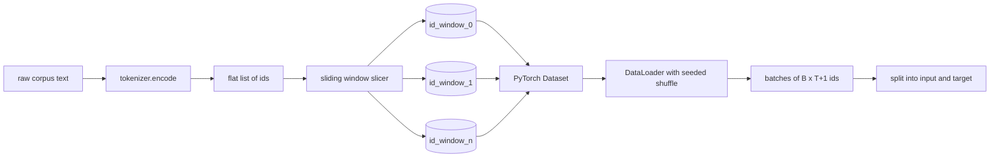
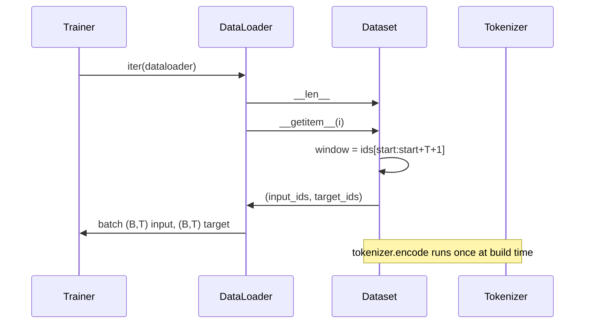

# Tokenized Dataset with Sliding Window

> Một lần chạy tiền huấn luyện là một hàm từ id token sang gradient. Bài này xây dựng băng chuyền đưa các id vào.

**Type:** Build
**Languages:** Python
**Prerequisites:** Phase 04 lessons, Phase 07 transformer lessons, Lesson 30 of this phase
**Time:** ~90 minutes

## Learning Objectives
- Chuyển một corpus thô thành một luồng id token bằng cách gọi tokenizer một lần.
- Cắt luồng id thành các cửa sổ độ dài cố định với bước trượt chồng lấn có thể cấu hình.
- Xây dựng một Dataset PyTorch trả về các tensor đầu vào và đích cho dự đoán token tiếp theo.
- Bọc tập dữ liệu trong một DataLoader với xáo trộn tất định được đặt seed theo epoch.
- Suy luận về đánh đổi giữa bước trượt, dư thừa, và kích thước tập dữ liệu hiệu dụng.

```figure
cap-sliding-window
```

## The frame

Một lần chạy tiền huấn luyện đọc một lô id token mỗi lần và cập nhật mô hình. Hình thức mỗi lô được cố định bởi hợp đồng huấn luyện. Với một mô hình ngôn ngữ nhân quả, lô giữ các id đầu vào `(B, T)` và các id đích `(B, T)` trong đó đích là đầu vào dịch trái một vị trí. Công việc của pipeline dữ liệu là tạo ra hợp đồng đó theo yêu cầu, theo cách tất định và có thể tái lập, từ một corpus có thể gồm vài gigabyte văn bản thô.

Bài này xây dựng pipeline. Tokenizer từ bài trước biến văn bản thành một danh sách id phẳng dài. Một cửa sổ trượt cắt danh sách đó thành các ví dụ huấn luyện. Một Dataset tùy chỉnh cung cấp các ví dụ dưới dạng tensor. Một DataLoader chia chúng thành lô và xáo trộn chúng với một seed đã biết.

## The shape contract

Một LM nhân quả tiêu thụ các id có hình dạng `(B, T)` với `B` là kích thước lô và `T` là độ dài ngữ cảnh. Đích tại vị trí `t` là đầu vào tại vị trí `t+1`. Điều đó nghĩa là mỗi ví dụ huấn luyện bao phủ `T+1` id thô. Bước trượt cửa sổ kiểm soát mức chồng lấn tồn tại giữa các ví dụ liên tiếp.



Bộ cắt không bao giờ chồng qua ranh giới corpus. Nếu cửa sổ cuối không có đủ id để lấp `T+1` vị trí, bộ cắt bỏ nó. Đệm đuôi bằng `<|pad|>` cũng là một lựa chọn hợp lệ nhưng làm phức tạp mặt nạ mất mát. Với bài này chúng ta bỏ.

## Why a sliding window

Một corpus tiền huấn luyện là một luồng id dài. Nếu mô hình chỉ thấy các cửa sổ không chồng lấn, mọi ví dụ huấn luyện sẽ dạy nó cùng các ranh giới `T`. Điều chỉnh bước trượt di chuyển những ranh giới đó để mô hình thấy các tác vụ dự đoán token tiếp theo đa dạng hơn.

Một bước trượt `T` tạo các cửa sổ không chồng lấn. Một bước trượt `T // 2` tạo chồng lấn năm mươi phần trăm và tăng gấp đôi tập dữ liệu hiệu dụng. Một bước trượt `1` tạo chồng lấn tối đa và tăng tập dữ liệu theo hệ số `T`. Chi phí là nhiều tính toán hơn mỗi epoch. Lợi ích là nhiều đa dạng ranh giới hơn. Hầu hết các lần chạy tiền huấn luyện sử dụng bước trượt bằng độ dài ngữ cảnh vì corpus đã lớn hơn nhiều so với lượng mô hình có thể hoàn tất trong một epoch, nên lập luận đa dạng ranh giới yếu hơn.

## The Dataset class

Một Dataset PyTorch có hai phương thức bắt buộc. `__len__` trả về số ví dụ. `__getitem__` trả về một ví dụ dưới dạng một cặp tensor. Dataset của chúng ta lưu luồng id đã mã hóa và bước trượt. Đánh chỉ mục vào nó tính điểm bắt đầu cửa sổ ngay khi chạy nên chi phí bộ nhớ là một bản sao luồng id bất kể bước trượt tạo ra bao nhiêu ví dụ.



Việc dịch một vị trí xảy ra bên trong `__getitem__`. Dataset trả về `(input, target)` trong đó `input = window[:-1]` và `target = window[1:]`. Cả hai là tensor long PyTorch. Vòng lặp huấn luyện coi chúng là đáp án chuẩn.

## Deterministic shuffle

Một DataLoader với `shuffle=True` đọc từ một bộ sinh ngẫu nhiên PyTorch. Bằng cách truyền một `torch.Generator` rõ ràng được đặt seed theo epoch, chúng ta nhận cùng phép xáo trộn mỗi khi lần chạy được khởi động lại. Thuộc tính đó quan trọng khi bạn muốn so sánh hai lần chạy chỉ khác một siêu tham số. Không có seed, hai lần chạy thấy dữ liệu theo các thứ tự khác nhau và các đường cong mất mát phân kỳ vì những lý do không liên quan đến thay đổi.

Hợp đồng seed trong bài này đơn giản. `epoch_seed = base_seed + epoch_index`. Seed cơ sở được truyền khi khởi tạo. Chỉ số epoch được bộ huấn luyện tăng ở đầu mỗi epoch. Một lần chạy lại với cùng seed cơ sở luôn thấy cùng thứ tự trong mọi epoch.

## Batch sampler

Bộ lấy mẫu mặc định trong PyTorch chọn các chỉ số ngẫu nhiên đều với lấy mẫu có hoàn lại bị tắt. Đó là điều chúng ta muốn cho tiền huấn luyện. Với tinh chỉnh trên một tập dữ liệu nhỏ hợp đồng cũng vậy. DataLoader lắp ráp một lô bằng cách gọi `__getitem__` `B` lần và xếp chồng các kết quả. Vì mọi ví dụ có cùng độ dài do cách xây dựng, không cần logic đệm.

Bài học giữ `num_workers=0` cho đơn giản. Trong một lần chạy sản xuất các worker song song hóa các lệnh gọi `__getitem__`. Với pipeline của chúng ta điều đó chủ yếu không làm gì vì công việc chỉ là một phần cắt của một tensor trong bộ nhớ, nhưng cùng API Dataset hỗ trợ worker một cách gọn gàng.

## Counting examples

Với một luồng id độ dài `N`, một độ dài ngữ cảnh `T`, và một bước trượt `S`, số ví dụ là `max(0, 1 + (N - (T + 1)) // S)`. Bài học cung cấp phép tính đó như một phương thức tĩnh trên Dataset để bộ huấn luyện có thể tính tổng số bước mỗi epoch mà không lặp.

## What this lesson does not do

Nó không truyền luồng từ đĩa. Corpus được mã hóa hoàn toàn trong bộ nhớ và giữ dưới dạng một tensor duy nhất. Với một corpus vài triệu id điều đó thấp hơn nhiều so với một trăm megabyte và là hình thức đúng cho bài học. Truyền luồng từ đĩa là một mối quan tâm riêng cắm vào bằng cách thay phần lưu trữ nhưng giữ hợp đồng Dataset.

Nó không xử lý nhiều tài liệu. Corpus được coi là một luồng id liên tục. Ranh giới tài liệu tiếp theo được mã hóa bằng cách chèn các id `<|endoftext|>` khi corpus được xây dựng từ nhiều tài liệu. Mô hình học dự đoán quanh ranh giới.

## How to read the code

`main.py` định nghĩa hai lớp và một hàm hỗ trợ. `SlidingWindowDataset` là Dataset PyTorch. `make_dataloader` trả về một DataLoader được cấu hình với một bộ sinh được đặt seed. `_encode_corpus_to_ids` là lệnh gọi tokenizer một lần. Demo ở cuối xây dựng một tokenizer nhỏ trong tiến trình, mã hóa một corpus tích hợp, tạo tập dữ liệu và dataloader, in một lô, và khẳng định hợp đồng hình dạng. Các kiểm thử trong `code/tests/test_dataset.py` ghim công thức đếm cửa sổ, thuộc tính dịch một vị trí, xáo trộn tất định, và đánh đổi bước trượt.

Chạy demo. Sau đó thay độ dài ngữ cảnh từ 16 thành 32 và xem số ví dụ mỗi epoch giảm thế nào. Con số đó là ngân sách số bước mỗi epoch của bạn.
