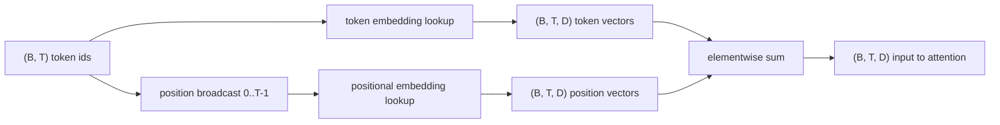
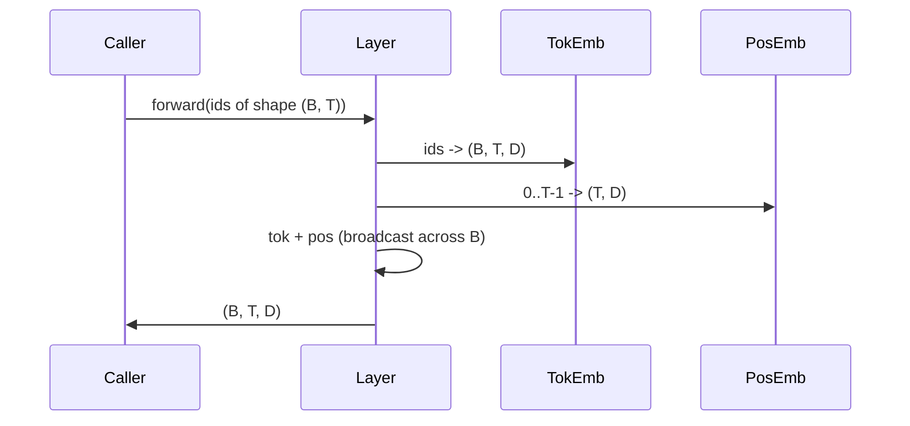

# Token and Positional Embeddings

> Id là số nguyên. Mô hình muốn vector. Hai bảng tra cứu nằm giữa chúng, và lựa chọn bảng vị trí định hình điều mô hình có thể học.

**Type:** Build
**Languages:** Python
**Prerequisites:** Phase 04 lessons, Phase 07 transformer lessons, Lessons 30 and 31 of this phase
**Time:** ~90 minutes

## Learning Objectives
- Xây dựng một bảng tra cứu embedding token ánh xạ các id từ vựng sang các vector dense.
- Xây dựng một bảng tra cứu embedding vị trí được học được đánh chỉ mục theo vị trí.
- Xây dựng một embedding vị trí hình sin cố định được đánh chỉ mục theo vị trí không có tham số.
- Kết hợp các embedding token và vị trí thành một đầu vào duy nhất cho một khối transformer.
- Đối chiếu các embedding được học và hình sin về khái quát hóa độ dài và số tham số.

```figure
cc-embedding-lookup
```

## The frame

Tiếp xúc đầu tiên của mô hình với một id token là một lần tra cứu hàng trong ma trận embedding token. Ma trận có một hàng cho mỗi id từ vựng và một cột cho mỗi chiều mô hình. Tra cứu trả về một vector mà phần còn lại của mô hình coi là ý nghĩa của id. Lan truyền ngược cập nhật các hàng đã được dùng trong lượt tiến. Qua huấn luyện hình học của những hàng đó học mã hóa độ tương tự trong các hướng.

Chỉ riêng các id token không có thứ tự. Mô hình cần một tín hiệu thứ hai nói cho nó vị trí một khác với vị trí mười bảy. Hai lựa chọn chiếm ưu thế cho tín hiệu đó là một embedding vị trí được học (một bảng tra cứu thứ hai, một hàng cho mỗi vị trí) và một embedding vị trí hình sin cố định (một công thức toán không có tham số). Lựa chọn có hệ quả. Một bảng được học là một tham số và bị giới hạn bởi độ dài ngữ cảnh tối đa mô hình đã được huấn luyện trên đó. Một bảng hình sin về lý thuyết không có tham số và công thức mở rộng đến bất kỳ vị trí nào, nhưng `SinusoidalPositionalEmbedding` của bài này tính trước một bảng cố định ở `max_context_length` và `forward` của nó phát sinh lỗi vượt giới hạn đó; vì vậy cả hai module đều thực thi một độ dài ngữ cảnh tối đa ở đây. Mô hình vẫn có thể khó khăn vượt độ dài huấn luyện ngay cả khi bảng đủ lớn để đánh chỉ mục.

Bài này xây dựng cả hai và kết hợp chúng với embedding token thành một đầu vào duy nhất cho khối attention của bài tiếp theo.

## The shape contract

Đầu vào giai đoạn embedding là một lô id token có hình dạng `(B, T)`. Đầu ra là một tensor có hình dạng `(B, T, D)` trong đó `D` là chiều mô hình. Mỗi phần tử lô có cùng độ dài ngữ cảnh `T`. Mỗi vị trí có cùng chiều vector `D`.



Phép kết hợp là một tổng, không phải một phép nối. Cộng giữ `D` không đổi xuyên suốt mạng và để mô hình quyết định theo từng đặc trưng liệu ý nghĩa token hay vị trí chiếm ưu thế ở mỗi lớp.

## The token embedding matrix

Embedding token là một tensor tham số có hình dạng `(V, D)` trong đó `V` là kích thước từ vựng. PyTorch cung cấp nó dưới dạng `nn.Embedding(V, D)`. Khi khởi tạo các phần tử được lấy từ một Gaussian nhỏ, theo truyền thống với trung bình không và độ lệch chuẩn quanh `0.02` cho các mô hình ở quy mô transformer. Cách khởi tạo chính xác ít quan trọng hơn việc nó nhất quán giữa các lần chạy.

Lượt tiến là một thao tác đánh chỉ mục duy nhất. PyTorch ánh xạ các id int64 `(B, T)` sang các số thực `(B, T, D)` bằng cách gom các hàng. Lượt ngược tích lũy gradient chỉ vào các hàng đã được chạm trong lượt tiến. Hai hàng chưa từng xuất hiện trong lô nhận gradient không ở bước đó.

Một chi tiết tinh tế. Embedding token và phép chiếu đầu ra ở cuối mô hình thường dùng chung trọng số (buộc trọng số). Khi điều đó xảy ra, mọi lượt ngược chạm mọi hàng của embedding qua phía đầu ra. Bài này cung cấp cả hai dưới dạng các module riêng nhưng cùng ma trận có thể đóng cả hai vai trò trong một mô hình đầy đủ.

## The learned positional embedding

Embedding vị trí được học là một `nn.Embedding` thứ hai có hình dạng `(max_context_length, D)`. Tra cứu được đặt khóa theo id vị trí `0, 1, 2, ..., T-1`. Lượt tiến broadcast vector vị trí đó dọc theo chiều lô.

Nhược điểm của bảng được học là không thể truy vấn nó ở vị trí `T` nếu mô hình chỉ được huấn luyện đến vị trí `T-1`. Hàng không tồn tại. Các mô hình chỉ decoder trong sản xuất sử dụng sơ đồ này đưa độ dài ngữ cảnh tối đa vào kiến trúc và từ chối xử lý các đầu vào dài hơn.

## The sinusoidal positional embedding

Embedding vị trí hình sin là một hàm từ vị trí sang vector. Vị trí `p` và đặc trưng `i` tạo ra

```python
angle = p / (10000 ** (2 * (i // 2) / D))
emb[p, 2k]     = sin(angle)
emb[p, 2k + 1] = cos(angle)
```

Hàm không có tham số. Mỗi vị trí có một vector duy nhất. Bước sóng biến thiên theo cấp số nhân trên các chiều đặc trưng, nên các chiều thấp hơn mã hóa vị trí thô và các chiều cao hơn mã hóa vị trí tinh.

Thuộc tính theo sau lựa chọn dùng `sin` và `cos` cùng nhau là vector tại vị trí `p + k` là một hàm tuyến tính của vector tại vị trí `p`. Điều đó cho lớp attention một đường dễ dàng để học các độ lệch vị trí tương đối. Mô hình không cần một tham số riêng để biểu đạt "nhìn lùi năm token."

Bài học tính toàn bộ bảng hình sin một lần khi khởi tạo và đánh chỉ mục vào nó tại thời điểm lượt tiến.

## The composition

Pipeline đầu vào làm ba việc theo thứ tự. Đọc các id token. Tra cứu các vector token. Cộng các vector vị trí. Trả về tổng.



Broadcast trong bước cộng sao chép tensor vị trí `(T, D)` dọc chiều lô. PyTorch xử lý điều đó tự động vì tensor vị trí có hình dạng `(1, T, D)` sau unsqueeze.

## Contrastive analysis

Bài học chạy cả hai biến thể trên cùng đầu vào và in hai chẩn đoán.

Thứ nhất là số tham số. Biến thể được học thêm `max_context_length * D` tham số trên embedding token. Biến thể hình sin thêm không.

Thứ hai là độ tương tự cosine giữa các embedding tại các vị trí lân cận. Biến thể hình sin có sự suy giảm mượt và có thể dự đoán vì hàm liên tục. Biến thể được học khi khởi tạo có độ tương tự gần ngẫu nhiên vì các hàng được lấy độc lập. Sau huấn luyện, biến thể được học thường phát triển một cấu trúc mượt tương tự, nhưng nó phải khám phá cấu trúc đó từ dữ liệu.

## What this lesson does not do

Nó không xây dựng mã hóa vị trí xoay (RoPE) hoặc AliBi. Đó là các lựa chọn hiện đại trong transformer sản xuất. Cả hai tuân theo cùng hợp đồng hình dạng như các embedding ở đây (áp dụng một phép biến đổi phụ thuộc vị trí lên các vector có hình dạng `(B, T, D)`) nhưng chúng áp dụng tại bước chiếu attention thay vì tại đầu vào. Bài tiếp theo xây dựng khối attention, và một trong các phần mở rộng tùy chọn là đưa phép xoay vào các phép chiếu query-key ở đó.

Nó không huấn luyện embedding. Huấn luyện đòi hỏi một hàm mất mát, điều đó đòi hỏi một đầu ra mô hình, điều đó đòi hỏi attention và một đầu LM. Đó là bài tiếp theo và bài sau nữa.

## How to read the code

`main.py` định nghĩa ba module. `TokenEmbedding` bọc `nn.Embedding(V, D)`. `LearnedPositionalEmbedding` bọc `nn.Embedding(L, D)`. `SinusoidalPositionalEmbedding` tính trước bảng và cung cấp nó dưới dạng một buffer. `EmbeddingComposer` gắn một embedding token và một embedding vị trí với nhau. Demo ở cuối in các hình dạng, số tham số, và chẩn đoán độ tương tự vị trí lân cận. Các kiểm thử trong `code/tests/test_embeddings.py` ghim hình dạng, hành vi broadcast, số tham số, và công thức hình sin.

Chạy demo. Sau đó thay chiều mô hình `D` từ 64 thành 32 và xem các dải bước sóng hình sin thay đổi thế nào.
