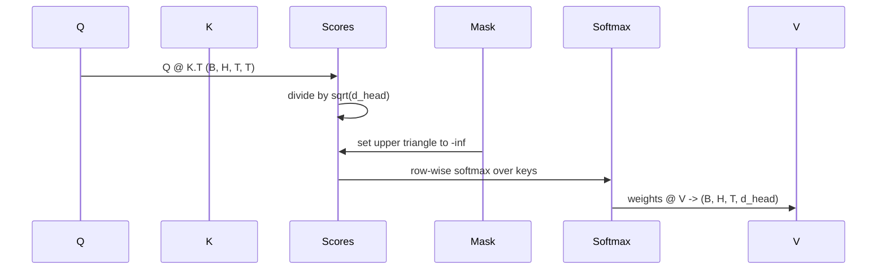

# Multi-Head Self-Attention

> Một phép chiếu tuyến tính, ba view, H đầu song song, một mặt nạ. Khối attention như mô hình thực sự sử dụng nó.

**Type:** Build
**Languages:** Python
**Prerequisites:** Phase 04 lessons, Phase 07 transformer lessons, Lessons 30 through 32 of this phase
**Time:** ~90 minutes

## Learning Objectives
- Triển khai một phép chiếu Query/Key/Value theo lô dưới dạng một lớp tuyến tính duy nhất được chia thành H đầu.
- Tính attention tích vô hướng có chia tỷ lệ với chuẩn hóa và xử lý dtype chính xác.
- Áp dụng một mặt nạ nhân quả ngăn một vị trí chú ý đến các vị trí tương lai.
- Kiểm tra các trọng số attention theo đầu cho một đầu vào cố định và suy luận về điều mỗi đầu nhìn vào.
- Huấn luyện một khối attention nhỏ trên một tác vụ đồ chơi và xem hàm mất mát giảm khi các đầu chuyên biệt hóa.

```figure
cap-multihead-attention
```

## The frame

Attention là hàm cho phép biểu diễn của một token kéo thông tin từ các token khác trong cùng chuỗi. Self-attention nghĩa là query, key, và value đều được suy ra từ cùng đầu vào. Đa đầu nghĩa là phép chiếu được chia thành H bài toán attention song song có các đầu ra được nối và chiếu trở lại.

Mẫu triển khai hiệu quả là một lớp tuyến tính chiếu từ `D` sang `3 * D` và được cắt thành ba view, rồi đổi hình dạng thành H đầu có kích thước `D // H` mỗi đầu. Matmul, softmax, và tổng có trọng số xảy ra dưới dạng các thao tác tensor theo lô để các đầu chạy song song trên bộ tăng tốc.

Bài này xây dựng khối đó. Nó cũng thêm mặt nạ nhân quả để cùng mã hoạt động như lớp attention trong một mô hình ngôn ngữ chỉ decoder. Bài tiếp theo xếp khối thành một transformer đầy đủ và bài sau nữa huấn luyện nó.

## The shape contract

Đầu vào là `(B, T, D)`. Đầu ra là `(B, T, D)`. Mặt nạ là `(T, T)` hoặc có thể broadcast tới nó. Bên trong khối các tensor trung gian có hình dạng `(B, H, T, d_head)` trong đó `d_head = D // H`. Ràng buộc là `D % H == 0`.

```mermaid
flowchart LR
    A["(B, T, D) input"] --> B[Linear D -> 3D]
    B --> C["split into Q, K, V"]
    C --> D["reshape to (B, H, T, d_head)"]
    D --> E["scores = Q @ K.T / sqrt(d_head)"]
    E --> F[apply causal mask]
    F --> G[softmax over keys]
    G --> H["context = weights @ V"]
    H --> I["reshape to (B, T, D)"]
    I --> J[output Linear D -> D]
    J --> K["(B, T, D) output"]
```



Hai lớp tuyến tính (phép chiếu QKV và phép chiếu đầu ra) là các tham số duy nhất trong khối. Mặt nạ, softmax, các matmul, và các phép đổi hình dạng đều không có tham số.

## The QKV split

Triển khai ngây thơ có ba lớp tuyến tính riêng, mỗi lớp cho Q, K, và V. Triển khai hiệu quả có một lớp duy nhất xuất ra `3 * D` đặc trưng và chia kết quả. Hai cách tương đương toán học vì ba phép nhân ma trận riêng với trọng số `(D, D)` chính xác là một phép nhân ma trận với một trọng số `(3D, D)` được xếp chồng từ chúng.

Phiên bản hiệu quả nhanh hơn vì bộ tăng tốc khởi chạy một matmul thay vì ba. Nó cũng dễ khởi tạo hơn vì ba ma trận con nằm trong cùng tensor tham số và có thể được khởi tạo cùng nhau.

## The head reshape

Sau khi chia, mỗi Q, K, V là `(B, T, D)`. Để biến nó thành H bài toán attention song song, chúng ta đổi hình dạng thành `(B, T, H, d_head)` và chuyển vị thành `(B, H, T, d_head)`. Chiều đầu giờ nằm cạnh chiều lô để PyTorch coi attention theo đầu là một thao tác theo lô trên `B * H` thực thể độc lập.

Chiều d_head ở cuối để matmul điểm `Q @ K.transpose(-2, -1)` co nó lại. Kết quả là các điểm attention theo đầu `(B, H, T, T)`.

## Scaling

Các điểm được chia cho `sqrt(d_head)` trước softmax. Không có sự chia tỷ lệ đó, các tích vô hướng tăng khi `d_head` tăng và đẩy softmax vào một chế độ mà một phần tử có gần như toàn bộ khối lượng và các phần tử còn lại nhỏ đến mức biến mất. Gradient trong chế độ đó rất nhỏ và việc học đình trệ. Chia cho `sqrt(d_head)` giữ phương sai của các điểm gần như không đổi trên các kích thước đầu.

## The causal mask

Một mô hình ngôn ngữ chỉ decoder chỉ có thể điều kiện hóa trên quá khứ khi dự đoán token tiếp theo. Mặt nạ thực thi điều đó. Cụ thể, trước softmax, mọi phần tử trên đường chéo của ma trận điểm `(T, T)` được thay bằng âm vô cực. Sau softmax những vị trí đó nhận trọng số không.



Chúng ta đăng ký mặt nạ như một buffer khi khởi tạo để nó nằm trên cùng thiết bị với mô hình và không là một phần của đồ thị gradient. Mặt nạ bao phủ độ dài ngữ cảnh tối đa mà khối sẽ từng thấy. Tại thời điểm lượt tiến chúng ta cắt góc trên trái `(T, T)`.

## The output projection

Sau các vector ngữ cảnh theo đầu `(B, H, T, d_head)`, chúng ta chuyển vị trở lại `(B, T, H, d_head)`, đổi hình dạng thành `(B, T, D)`, và áp dụng một phép chiếu tuyến tính `(D, D)` cuối. Phép chiếu đầu ra cho phép mô hình trộn các đầu. Không có nó, H đầu sẽ chỉ tái kết hợp qua các lớp sau và khối sẽ bị ràng buộc một cách nhân tạo.

## Attention weight inspection

Bài học cung cấp một cờ `return_weights=True` trên lượt tiến. Khi được đặt, khối trả về các trọng số attention theo đầu có hình dạng `(B, H, T, T)` bên cạnh đầu ra. Demo in một bản đồ nhiệt trọng số của một đầu trên một đầu vào ngắn để bạn có thể thấy cấu trúc tam giác nhân quả và sự tập trung theo vị trí.

Trong một mô hình đã huấn luyện, các đầu khác nhau học các mẫu khác nhau. Một số đầu chú ý đến token ngay trước đó. Một số đầu chú ý đến đầu chuỗi. Một số đầu trải attention gần như đều. Hook kiểm tra là điểm vào cho công việc diễn giải đó.

## The training demo

Demo ở cuối `main.py` nối khối attention với một đầu LM tí hon và huấn luyện toàn bộ trên một tác vụ lặp lại. Mỗi hàng đầu vào là một id ngẫu nhiên duy nhất được lặp dọc ngữ cảnh. Đích là đầu vào dịch một vị trí, nên mô hình phải học rằng token tiếp theo giống token trước. Hàm mất mát là entropy chéo. Với H=4, D=32, T=12, và một từ vựng 64, hàm mất mát giảm từ ngẫu nhiên (quanh `log(64) ~ 4.16`) xuống thấp hơn nhiều so với `1.0` trong ba epoch trên CPU.

Điểm chính của demo không phải huấn luyện một mô hình hữu ích. Điểm chính là xác nhận gradient chảy qua mọi phần của khối và các đầu học được điều gì đó trên một bài toán mà đáp án rõ ràng.

## What this lesson does not do

Nó không thêm một khối truyền thẳng. Lớp transformer trong một mô hình thực là attention theo sau bởi một MLP hai lớp với một kết nối phần dư và chuẩn hóa lớp quanh mỗi phần. Bài tiếp theo thêm những thứ đó.

Nó không triển khai mã hóa vị trí xoay hoặc AliBi. Cả hai áp dụng tại bước chiếu QKV trong cùng khối, nhưng chúng là một đơn vị giảng dạy riêng. Khối được xây dựng ở đây tương thích với cả hai bằng cách biến đổi Q và K trước matmul.

Nó không triển khai bộ nhớ đệm KV cho suy luận. Lưu đệm key và value qua các lượt tiến là tối ưu khiến giải mã tự hồi quy nhanh. Nó thay đổi hợp đồng hình dạng trên các tensor K và V nhưng không trên Q. Nó thuộc về bài suy luận.

## How to read the code

`main.py` định nghĩa `MultiHeadSelfAttention`. Lớp giữ hai lớp tuyến tính và một buffer mặt nạ được đăng ký. Lượt tiến chiếu, đổi hình dạng, chấm điểm, áp mặt nạ, softmax, đặt trọng số, đổi hình dạng, và chiếu lại. Demo ở cuối xây dựng một mô hình nhỏ bọc attention với các embedding token và vị trí cùng một đầu LM, huấn luyện nó trên một tác vụ sao chép trong ba epoch, và in đường cong mất mát cùng một bản đồ nhiệt attention theo đầu. Các kiểm thử trong `code/tests/test_attention.py` ghim hợp đồng hình dạng, thuộc tính nhân quả, thuộc tính softmax, thuộc tính chia đầu, và dòng gradient.

Chạy demo. Sau đó tăng `n_heads` từ 4 lên 8 (giữ `d_model=32`, nên `d_head=4`) và xem bản đồ nhiệt thay đổi.
