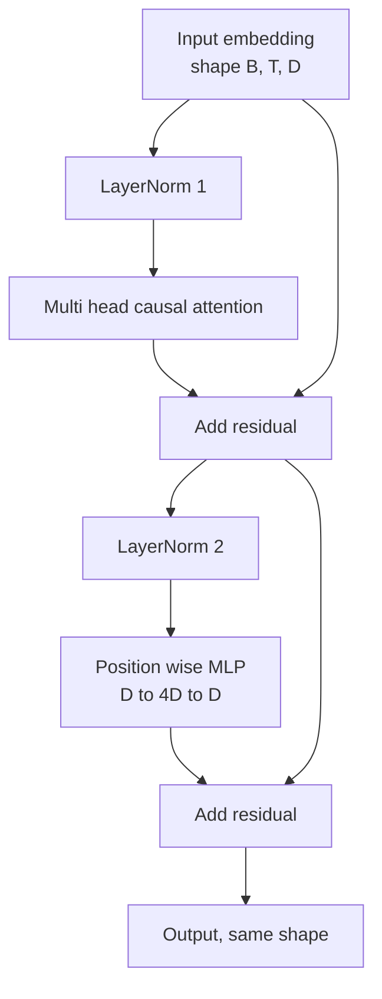
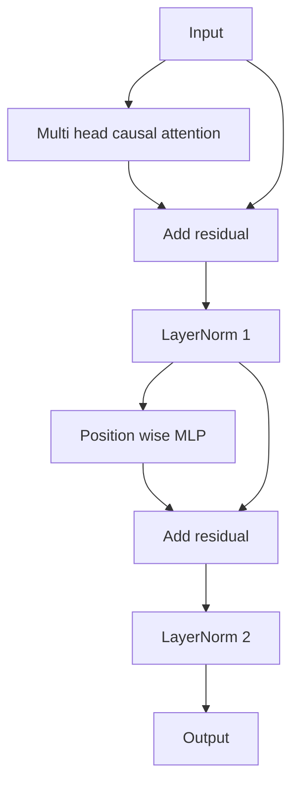

# Transformer Block from Scratch

> Một khối là đơn vị của mọi LLM decoder hiện đại. Chuẩn hóa lớp, attention đa đầu, phần dư, MLP, phần dư. Biến thể pre-LN huấn luyện ổn định mà không cần khởi động. Biến thể post-LN là thứ bài báo gốc cung cấp. Bài này xây dựng cả hai, song song, và cho thấy biến thể nào sống sót qua một ngăn xếp 12 lớp ở các tốc độ học phổ biến.

**Type:** Build
**Languages:** Python
**Prerequisites:** Phase 19 lessons 30 to 33 (tokenizer, embeddings, attention math, batched data loader)
**Time:** ~90 minutes

## Learning Objectives

- Xây dựng một khối transformer trong PyTorch từ bốn phần chuyển động: LayerNorm, attention nhân quả đa đầu, các kết nối phần dư, MLP theo vị trí.
- Đặt các LayerNorm ở hai cấu hình (pre-LN và post-LN) và giải thích tại sao một cấu hình huấn luyện ổn định mà không cần khởi động.
- Triển khai che nhân quả bên trong attention đa đầu để token `i` không thể thấy các token `j > i`.
- Theo dõi dòng gradient qua cả hai biến thể trên một ngăn xếp 12 lớp và đọc kết quả mà không giải thích qua loa.
- Tái sử dụng khối như một đơn vị thay thế trực tiếp khi bài tiếp theo lắp ráp một GPT 124 triệu tham số.

## The Problem

Một transformer là một khối được lặp lại. Làm sai khối một lần, lặp lại nó mười hai lần, và bạn cung cấp một mô hình phân kỳ ở epoch đầu hoặc cần các thủ thuật khởi động suốt phần còn lại. Hai chế độ lỗi bạn sẽ thấy trong bài này không kỳ lạ. Chúng xuất hiện lần đầu một người học xếp các khối một cách ngây thơ. Một là lớp attention chú ý đến tương lai. Cái còn lại là LayerNorm được đặt ở nơi nó không thể chế ngự tín hiệu phần dư ở độ sâu.

Cách sửa mang tính cơ học một khi bạn thấy nó. Khối có chính xác hai đường phần dư và chính xác hai vị trí chuẩn hóa. Chọn các vị trí chính xác và phần còn lại của ngăn xếp chỉ là ghi sổ.

## The Concept

Mọi khối transformer chỉ decoder là một hàm nhận một tensor có hình dạng `(batch, sequence, embedding)` và trả về một tensor cùng hình dạng. Bên trong, hai lớp con làm việc.



Đây là biến thể pre-LN. LayerNorm nằm bên trong nhánh phần dư, trước lớp con. Kết nối phần dư mang tín hiệu chưa chuẩn hóa đi tới.

Biến thể post-LN chuyển LayerNorm đến sau phép cộng phần dư.



Hình dạng giống hệt. Hành vi huấn luyện thì không. Với post-LN, gradient chảy ngược qua đường phần dư phải đi qua LayerNorm. Ở độ sâu mười hai và tốc độ học `3e-4`, gradient đó co lại đủ nhanh để cần một lịch khởi động. Pre-LN để đường phần dư chưa chuẩn hóa, nên gradient lan truyền gọn gàng đến lớp embedding. Pre-LN là cấu hình GPT-2 trở đi cung cấp vì lý do đó.

### Causal multi head attention

Lớp con attention chiếu đầu vào theo ba cách thành các tensor query, key, value. Mỗi tensor được đổi hình dạng từ `(B, T, D)` sang `(B, H, T, D/H)` trong đó `H` là số đầu. Attention tích vô hướng có chia tỷ lệ tính `softmax(Q K^T / sqrt(d_k))` theo đầu, che tam giác trên thành âm vô cực, áp dụng mặt nạ qua softmax, rồi nhân với `V`. Các đầu được nối trở lại thành một tensor `(B, T, D)` duy nhất và được chiếu thêm lần nữa. Mặt nạ là phần duy nhất khiến mô hình nhân quả. Quên mặt nạ và bạn huấn luyện một mô hình gian lận.

### The MLP

MLP theo vị trí áp dụng cùng mạng hai lớp cho mọi token độc lập. Độ rộng ẩn bằng bốn lần độ rộng embedding, kích hoạt là GELU, và một dropout theo sau lớp tuyến tính thứ hai. Không token nào nói chuyện với nhau bên trong MLP. Mọi trộn token xảy ra trong attention.

### Residual connections do two things

Chúng khiến đường gradient có tính cộng qua độ sâu, giữ chuẩn gradient trong thang đo xuyên suốt mười hai lớp. Chúng cũng để mỗi khối học một cập nhật cộng vào biểu diễn đang chạy thay vì một sự thay thế đầy đủ. Cả hai hiệu ứng là lý do khối mở rộng được.

```figure
cc-transformer-block
```

## Build It

`code/main.py` triển khai:

- `class LayerNorm` với tỷ lệ và dịch chuyển có thể học, eps có độ chệch, áp dụng theo vector token.
- `class MultiHeadAttention` với `num_heads`, `head_dim = d_model // num_heads`, phép chiếu QKV hợp nhất, mặt nạ nhân quả được đăng ký, dropout attention và phần dư.
- `class FeedForward` với hai lớp tuyến tính, kích hoạt GELU, dropout.
- `class TransformerBlock` với một cờ `pre_ln` chuyển giữa hai biến thể.
- Một demo xây dựng một ngăn xếp pre-LN 6 lớp và một ngăn xếp post-LN 6 lớp với các đầu vào giống hệt và in (a) hình dạng đầu ra, (b) chuẩn gradient tại embedding sau một lượt ngược.

Chạy nó:

```bash
python3 code/main.py
```

Đầu ra: kiểm tra hình dạng trên cả hai ngăn xếp, các chuẩn gradient cạnh nhau. Gradient embedding của ngăn xếp pre-LN lớn hơn một bậc độ lớn so với ngăn xếp post-LN ở cùng tốc độ học, là tín hiệu thực nghiệm rằng pre-LN huấn luyện không cần khởi động.

## Stack

- `torch` cho toán tensor, autograd, và hệ thống nối `nn.Module`.
- Không `transformers`, không trọng số tiền huấn luyện. Khối được triển khai từ các thành phần cơ sở.

## Production patterns in the wild

Ba mẫu biến khối sách giáo khoa thành thứ bạn có thể cung cấp.

**Phép chiếu QKV hợp nhất.** Ba lớp tuyến tính riêng tốn ba lần khởi chạy kernel và ba matmul. Một lớp tuyến tính có độ rộng `3 * d_model` làm cùng công việc trong một lần khởi chạy, rồi chia đầu ra dọc trục cuối. Đường hợp nhất nhanh hơn trên mọi bộ tăng tốc và khớp với điều các triển khai tham chiếu GPT-2, LLaMA, và Mistral đều cung cấp.

**Buffer mặt nạ nhân quả được đăng ký.** Mặt nạ chỉ phụ thuộc độ dài ngữ cảnh tối đa. Cấp phát nó một lần khi khởi tạo bằng `register_buffer`, cắt cửa sổ hoạt động theo lượt tiến, và bỏ qua cấp phát theo lệnh gọi. Quên điều này biến mặt nạ thành một điểm nóng cấp phát ở ngữ cảnh dài.

**Dropout ở hai nơi, không phải ba.** Dropout thuộc về sau softmax attention (dropout attention) và sau lớp tuyến tính thứ hai của MLP (dropout phần dư). Một dropout trên chính phần dư phá vỡ đồng nhất cộng cho phép gradient chảy ở độ sâu. Một số triển khai ban đầu làm sai điều này và trả giá bằng huấn luyện mong manh.

## Use It

- Khối trong bài này cắm thẳng vào phần lắp ráp GPT trong bài 35 mà không sửa đổi.
- Biến thể pre-LN là thứ mọi LLM trọng số mở hiện đại sử dụng. Biến thể post-LN là thứ bài báo attention gốc năm 2017 sử dụng. Biết cả hai đủ để đọc bất kỳ kiến trúc decoder nào bạn sẽ gặp.
- Đổi GELU thành SiLU và bạn có kích hoạt họ LLaMA. Đổi LayerNorm thành RMSNorm và bạn có chuẩn hóa họ LLaMA. Cùng bộ khung.

## Exercises

1. Thêm một cờ `bias=False` vào mọi lớp tuyến tính trong khối. Các LLM trọng số mở hiện đại cung cấp không có bias trên các lớp tuyến tính. Đo bạn tiết kiệm bao nhiêu tham số trong một mô hình 12 lớp 768 chiều.
2. Thay `nn.LayerNorm` bằng một RMSNorm viết thủ công và xác minh hình dạng đầu ra không đổi.
3. Thêm một cờ trả về các trọng số attention cho đầu đầu tiên dưới dạng một tensor `(B, T, T)`. Vẽ tam giác trên để xác nhận nó bằng không sau softmax.
4. Xây dựng một kiểm tra hợp lý đưa một tensor `(2, 16, 384)` với `H=6` qua cả hai biến thể và khẳng định các đầu ra lượt tiến khác nhau (ví dụ, `not torch.allclose`) khi trọng số được khởi tạo giống hệt và dropout được đặt về không.

## Key Terms

| Thuật ngữ | Cách mọi người nói | Ý nghĩa thực sự |
|------|-----------------|------------------------|
| Pre-LN | "Chuẩn hóa trước" | LayerNorm bên trong nhánh phần dư, trước mỗi lớp con; phần dư mang tín hiệu chưa chuẩn hóa |
| Post-LN | "Chuẩn hóa sau" | LayerNorm sau phép cộng phần dư; điều bài báo năm 2017 cung cấp và điều cần khởi động |
| Causal mask (Mặt nạ nhân quả) | "Mặt nạ tam giác" | Tam giác trên của các logit attention được đặt thành âm vô cực để token i không thể đọc token j khi j lớn hơn i |
| Fused QKV (QKV hợp nhất) | "Phép chiếu kết hợp" | Một lớp tuyến tính độ rộng 3D thay vì ba lớp tuyến tính độ rộng D; một kernel, một matmul |
| Residual stream (Luồng phần dư) | "Kết nối bỏ qua" | Tensor chưa chuẩn hóa chảy từ trên xuống dưới qua mọi khối; thứ mỗi khối cộng vào |

## Further Reading

- Phase 7 bài 02 (self attention từ đầu) cho phần toán attention bên dưới khối này.
- Phase 7 bài 05 (transformer đầy đủ) cho phiên bản encoder decoder của cùng bộ khung.
- Phase 10 bài 04 (tiền huấn luyện mini GPT) cho quy trình huấn luyện mà khối này cắm vào.
- Phase 19 bài 35 (track này) xếp mười hai khối này thành một mô hình GPT.
