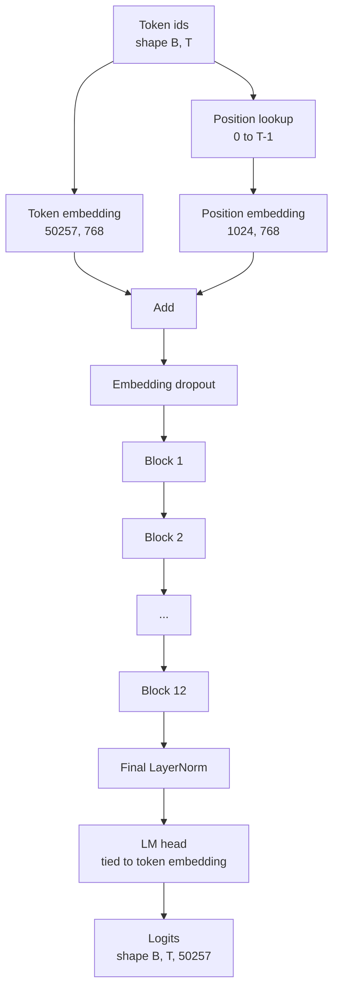
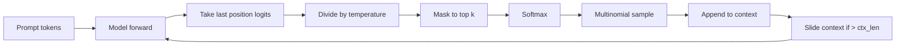

# GPT Model Assembly

> Mười hai khối được xếp chồng, một embedding token, một embedding vị trí được học, một LayerNorm cuối, và một đầu mô hình ngôn ngữ được buộc trọng số. Đó là toàn bộ mô hình GPT 124 triệu tham số. Bài này lắp ráp những phần đó thành một lớp hoạt động, đếm các tham số để xác nhận mô hình khớp hình thức 124M tham chiếu, và sinh văn bản với lấy mẫu đa thức, nhiệt độ, và top-k.

**Type:** Build
**Languages:** Python
**Prerequisites:** Phase 19 lessons 30 to 34
**Time:** ~90 minutes

## Learning Objectives

- Lắp ráp khối transformer từ bài 34 thành một mô hình GPT đầy đủ: embedding token, embedding vị trí, N khối, LayerNorm cuối, đầu mô hình ngôn ngữ.
- Tái tạo cấu hình 124 triệu tham số: từ vựng 50257, ngữ cảnh 1024, embedding 768, mười hai đầu, mười hai lớp.
- Buộc các trọng số đầu mô hình ngôn ngữ với embedding token và giải thích tại sao điều đó tiết kiệm ~38 triệu tham số ở quy mô này.
- Sinh văn bản từ một prompt với lấy mẫu đa thức, chia tỷ lệ nhiệt độ, và cắt ngắn top-k, giữ độ dài ngữ cảnh bằng một cửa sổ trượt.
- Đo số tham số và chi phí lượt tiến so với mục tiêu 124M.

## The Problem

Một khối transformer không làm gì tự nó. Bạn cần biến các id token thành vector, trộn thông tin vị trí, chạy chúng qua ngăn xếp, và chiếu trở lại các logit từ vựng. Quên bất kỳ bước nào trong bốn bước đó và mô hình hoặc không chạy lượt tiến được, trôi thông tin vị trí, hoặc không thể nói.

Hình thức mô hình cũng quan trọng. GPT-2 small tham chiếu là 124 triệu tham số ở chính xác cấu hình trên. Các con số không phải phép màu. Từ vựng 50257 nhân embedding 768 là bảng token. Vị trí 1024 nhân 768 là bảng vị trí. Mười hai khối với khoảng 7 triệu tham số mỗi khối là 84 triệu. Đầu cuối tái sử dụng bảng token bằng buộc trọng số. Cộng các phần và bạn đạt 124 triệu. Xây dựng một mô hình có số tham số không khớp tham chiếu là một dấu hiệu bạn đã nối sai thứ gì đó.

## The Concept



Các id token trở thành các vector token. Các id vị trí trở thành các vector vị trí. Hai thứ được cộng và gửi qua ngăn xếp. LayerNorm cuối là phần duy nhất ngoài các khối sống sót qua mọi biến thể hiện đại. Đầu LM tái sử dụng ma trận embedding token, đó là ý nghĩa của buộc trọng số.

### Weight tying

Embedding token có hình dạng `(vocab, d_model)`. Đầu mô hình ngôn ngữ cần chiếu từ `d_model` trở lại `vocab`. Chúng là chuyển vị của nhau. Buộc hai thứ nghĩa là đúng cùng một tensor tham số, được dùng hai lần. Ở từ vựng 50257 và d_model 768, ma trận là 38 triệu tham số. Không buộc, bạn trả giá cho nó hai lần. Có buộc, bạn trả giá cho nó một lần và bạn cũng nhận một tín hiệu gradient hơi sạch hơn vì embedding và đầu cập nhật cùng nhau.

### Position embedding is learned, not sinusoidal

GPT-2 cung cấp một embedding vị trí được học. Bảng vị trí là một tensor tham số có hình dạng `(1024, 768)`. Mô hình tra cứu vị trí 0 đến T-1 ở mọi lượt tiến và cộng kết quả tra cứu vào embedding token. Đây là sơ đồ vị trí đơn giản nhất (RoPE, ALiBi, bias tương đối T5 là các lựa chọn thay thế) và là thứ tham chiếu 124M sử dụng.

### Generation: temperature, top-k, multinomial

Sinh là tự hồi quy. Ở mọi bước, mô hình trả về các logit trên toàn bộ từ vựng tại mọi vị trí. Bạn chỉ lấy vị trí cuối, chia cho nhiệt độ, tùy chọn che tất cả trừ top k logit thành âm vô cực, softmax để nhận xác suất, và lấy mẫu một token từ phân phối kết quả.



Ba núm điều chỉnh, ba hành vi khác nhau. Nhiệt độ gần không sụp về tham lam. Nhiệt độ một khớp với phân phối tự nhiên của mô hình. Top-k một là tham lam. Top-k bốn mươi lọc đuôi dài. Các tổ hợp quan trọng; bài tiếp theo về huấn luyện sử dụng sinh như một tín hiệu đánh giá định tính.

```figure
cc-gpt-assembly
```

## Build It

`code/main.py` triển khai:

- Dataclass `class GPTConfig` với các mặc định 124M: `vocab_size=50257`, `context_length=1024`, `d_model=768`, `num_heads=12`, `num_layers=12`, `mlp_expansion=4`, `dropout=0.1`, `use_bias=True`, `weight_tying=True`.
- `class GPTModel` với embedding token, embedding vị trí, dropout embedding, mười hai `TransformerBlock`, LayerNorm cuối, và một `lm_head` buộc với embedding token khi cờ được đặt.
- Một hàm hỗ trợ `count_parameters` trả về số tham số duy nhất (nên buộc trọng số được tôn trọng trong số đếm).
- Một hàm `generate` làm nhiệt độ, top-k, đa thức, và ngữ cảnh cửa sổ trượt.
- Một demo xây dựng mô hình, in số tham số cạnh tham chiếu 124M, và sinh một chuỗi ngắn từ một prompt cố định để thể hiện pipeline từ đầu đến cuối.

Chạy nó:

```bash
python3 code/main.py
```

Đầu ra: số tham số bên cạnh tham chiếu 124M, các id token được sinh từ một prompt ngẫu nhiên, và một xác nhận rằng đầu LM và embedding token dùng chung lưu trữ khi bật buộc.

Để giữ demo nhanh, script cũng chạy một cấu hình tí hon (`d_model=64`, `num_layers=2`) từ đầu đến cuối và in chuỗi token được sinh nội tuyến. Cấu hình 124M được xây dựng nhưng chỉ số tham số của nó và một lượt tiến được thực thi.

## Stack

- `torch` cho toán tensor, autograd, và hệ thống nối module.
- `code/main.py` triển khai lại cùng mẫu khối từ bài 34 cục bộ.

## Production patterns in the wild

Ba mẫu tạo ra khác biệt giữa một mô hình chạy và một mô hình được cung cấp.

**Khởi tạo các phép chiếu phần dư nhỏ.** Phép chiếu đầu ra của attention và lớp tuyến tính thứ hai của MLP đều cấp trực tiếp vào một phép cộng phần dư. Khởi tạo chúng với cùng độ lệch chuẩn như mọi lớp tuyến tính khác tạo một luồng phần dư tăng theo độ sâu và đẩy LayerNorm cuối vào một chế độ nóng. Chia tỷ lệ std theo `1 / sqrt(2 * num_layers)` cho hai phép chiếu đó; luồng phần dư giữ trong một khoảng hợp lý xuyên suốt mười hai lớp.

**Lưu đệm tensor id vị trí, đừng tính lại.** `torch.arange(T)` cấp phát bộ nhớ mới ở mọi lượt tiến. Cấp phát một lần trong `__init__` cho ngữ cảnh tối đa, cắt T phần tử đầu theo lệnh gọi, và bỏ qua vòng khứ hồi bộ cấp phát.

**Buộc trọng số ở mức tham số, không chỉ bằng sao chép.** Đặt `lm_head.weight = token_embedding.weight` dùng chung tensor; sao chép thì không. Bộ tối ưu cần cập nhật một tham số và đồ thị autograd cần một lần tích lũy. Nếu bạn sao chép, đầu trôi khỏi embedding và buộc trọng số không mang lại gì.

## Use It

- Lớp mô hình trong bài này có cùng hình thức với lớp mà bài tiếp theo huấn luyện.
- Thay embedding vị trí được học bằng RoPE cho bạn họ LLaMA mà không chạm vào khối hoặc đầu.
- Thay GELU bằng SiLU và LayerNorm bằng RMSNorm cho bạn phần còn lại của các thay đổi họ LLaMA.
- Hàm sinh hoạt động với bất kỳ nguồn logit nào, không chỉ mô hình này. Bạn có thể lấy các logit từ một file GPT-2 tiền huấn luyện trong bài 37 và tái sử dụng cùng vòng lặp sinh.

## Exercises

1. Gỡ buộc đầu LM khỏi embedding token và đếm lại tham số. Xác minh chênh lệch là 50257 nhân 768 = 38 triệu.
2. Thay embedding vị trí được học bằng một bảng hình sin được tính khi khởi tạo. Xác nhận mô hình vẫn chạy lượt tiến và số tham số giảm 786,432.
3. Thêm một cờ `greedy=True` vào sinh bỏ qua lấy mẫu và chọn argmax. Xác nhận chuỗi tất định giữa các lần chạy.
4. Thêm một núm `repetition_penalty` chia logit của bất kỳ token nào trong prompt hoặc lịch sử được sinh cho một hằng số trước softmax. Cho thấy trên một prompt cố định rằng các giá trị trên một giảm số lần lặp trong đầu ra.
5. Thêm lấy mẫu `top_p` (hạt nhân) cạnh `top_k`. Kiểm tra hai dòng rằng tổng xác suất của các token được giữ vượt `top_p`.

## Key Terms

| Thuật ngữ | Cách mọi người nói | Ý nghĩa thực sự |
|------|-----------------|------------------------|
| Weight tying (Buộc trọng số) | "Embedding được buộc" | Đầu LM và embedding token dùng chung tensor tham số; tiết kiệm vocab nhân d_model tham số và khớp tham chiếu GPT-2 |
| Position embedding (Embedding vị trí) | "Các vị trí được học" | Một bảng riêng có hình dạng (độ dài ngữ cảnh, d_model) được cộng vào các vector token; được học từ đầu đến cuối |
| Sliding window context (Ngữ cảnh cửa sổ trượt) | "Trần ngữ cảnh" | Khi prompt cộng các token được sinh vượt độ dài ngữ cảnh, bỏ các token cũ nhất để cửa sổ hoạt động vừa |
| Top-k sampling (Lấy mẫu top-k) | "Cắt ngắn K" | Giữ K logit có giá trị cao nhất, che phần còn lại thành âm vô cực, softmax trên phần còn lại |
| Temperature (Nhiệt độ) | "Nhiệt độ lấy mẫu" | Chia logit cho T trước softmax; T nhỏ hơn 1 làm sắc, T bằng 1 giữ phân phối tự nhiên, T lớn hơn 1 làm phẳng |

## Further Reading

- Phase 19 bài 34 cho khối mà mô hình này xếp chồng.
- Phase 19 bài 36 cho vòng lặp huấn luyện điều khiển mô hình này với hàm mất mát entropy chéo.
- Phase 19 bài 37 cho nạp các trọng số GPT-2 tiền huấn luyện vào chính xác kiến trúc này.
- Phase 7 bài 07 (mô hình hóa ngôn ngữ nhân quả GPT) cho toán dự đoán token tiếp theo.
- Phase 10 bài 04 (tiền huấn luyện mini GPT) cho quy trình huấn luyện gốc trên cùng kiến trúc.
