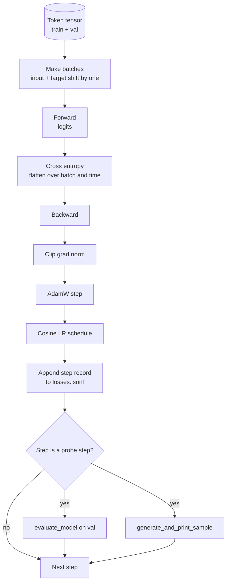

# Training Loop and Evaluation

> Một vòng lặp không đo lường là một vòng lặp nói dối. Bài này xây dựng vòng lặp huấn luyện điều khiển mô hình GPT: AdamW với tách suy giảm trọng số, một lịch tốc độ học khởi động cộng cosine, một hàm hỗ trợ `calc_loss_batch`, một lượt `evaluate_model` trên dữ liệu được giữ riêng, một phép thăm dò định tính `generate_and_print_sample` mỗi K bước, và một nhật ký JSONL các mất mát bạn có thể vẽ sau đó. Cùng bộ khung huấn luyện mọi LLM decoder bạn sẽ từng xây dựng.

**Type:** Build
**Languages:** Python
**Prerequisites:** Phase 19 lessons 30 to 35
**Time:** ~90 minutes

## Learning Objectives

- Xây dựng một vòng lặp huấn luyện tính mất mát entropy chéo với căn chỉnh đầu vào và đích chính xác cho dự đoán token tiếp theo.
- Cấu hình AdamW với suy giảm trọng số áp dụng cho các tensor trọng số và không cho các tensor LayerNorm hoặc bias.
- Triển khai một lịch tốc độ học với khởi động tuyến tính và suy giảm cosine, và đọc LR kết quả theo thời gian.
- Đánh giá trên một phần chia được giữ riêng với `evaluate_model` để mất mát đánh giá có thể so sánh giữa các lần chạy.
- Sinh một mẫu định tính mỗi K bước với `generate_and_print_sample` để phát hiện phân kỳ trước khi đường cong mất mát làm được.
- Lưu bền vững mất mát theo bước vào JSONL để bạn có thể nạp lại, vẽ, và cung cấp nhật ký huấn luyện như một sản phẩm bàn giao.

## The Problem

Một script huấn luyện in mất mát nhưng không làm gì khác thất bại theo ba cách. Nó không thể cho bạn biết liệu mất mát đang giảm vì lý do đúng không (mô hình có thể quá khớp tập huấn luyện và không bao giờ học). Nó không thể cho bạn biết liệu một phân kỳ đang bắt đầu không (mất mát có thể tăng vọt một bước và hồi phục, hoặc một bước rồi sụp). Nó không thể cho bạn biết mô hình đã học gì (mất mát là một đại lượng vô hướng; một mẫu được sinh là một đoạn văn). Cả ba thất bại đều ẩn trừ khi vòng lặp đo lường.

Vòng lặp trong bài này đo theo ba cách. Mất mát trên lô huấn luyện mỗi bước. Mất mát trên một lô được giữ riêng mỗi K bước. Một phần tiếp nối được sinh từ một prompt cố định mỗi K bước. Nhật ký huấn luyện đi vào JSONL nên hiện vật là lời chứng của vòng lặp.

## The Concept



Hai phần không hiển nhiên là căn chỉnh mất mát và tách suy giảm AdamW.

### Loss alignment

Mô hình dự đoán token tiếp theo tại mọi vị trí. Nếu lô đầu vào là các token `[t0, t1, t2, t3]`, lô đích phải là `[t1, t2, t3, t4]`. Entropy chéo được tính trên hình dạng phẳng `(batch * seq, vocab)` với đích phẳng `(batch * seq,)`. Quên phép dịch và bạn huấn luyện mô hình dự đoán chính nó, điều hội tụ về mất mát không trong khi không học gì hữu ích.

### AdamW decay split

Suy giảm trọng số chính quy hóa các tensor trọng số nhưng không các hệ số tỷ lệ chuẩn hóa hoặc bias. Đặt suy giảm lên hệ số tỷ lệ LayerNorm từ từ đẩy hệ số về không và phá chuẩn hóa. Đặt suy giảm lên một bias vô hại về toán học nhưng lãng phí chu kỳ. Phân chia tiêu chuẩn là: các tensor hình ma trận (trọng số tuyến tính, bảng embedding) nhận suy giảm, bất cứ thứ gì trông như một tỷ lệ hoặc dịch chuyển không nhận.

### Warmup plus cosine schedule

Khởi động tăng tốc độ học từ không lên đích trong vài trăm bước để trạng thái bộ tối ưu có thời gian được điền. Suy giảm cosine hạ tốc độ học trở lại gần không trong các bước còn lại để giai đoạn cuối tinh chỉnh các trọng số ở kích thước bước nhỏ. Tổ hợp là lịch phổ biến nhất trong huấn luyện LLM trọng số mở vì nó loại bỏ phần lớn các thời điểm mong manh trong nghìn bước đầu và nghìn bước cuối.

### Held out evaluation

`evaluate_model` chạy một số lô cố định từ phần chia xác thực, tích lũy mất mát, chia cho số lô, và trả về. Không gradient. Không dropout. Con số có thể tái lập giữa các lần chạy với cùng seed và cùng phần chia. Báo cáo mất mát được giữ riêng cạnh mất mát huấn luyện là cách bạn phát hiện quá khớp.

### Qualitative sampling as an early signal

Một mô hình có mất mát huấn luyện giảm đẹp nhưng các mẫu được sinh đều là cùng token thì bị hỏng. Một mô hình có đường cong mất mát trông phẳng nhưng các mẫu được sinh rõ dần thành các từ mạch lạc thì đang học. Phép thăm dò định tính chạy nhanh hơn đọc toàn bộ đường cong và bắt các chế độ mà đại lượng vô hướng bỏ lỡ.

```figure
cap-training-loop
```

## Build It

`code/main.py` triển khai:

- `make_batches(token_ids, batch_size, context_length)` cắt một tensor token dài thành các cặp đầu vào và đích.
- `calc_loss_batch(model, inputs, targets)` chạy lượt tiến, làm phẳng, và trả về entropy chéo vô hướng.
- `evaluate_model(model, val_loader, max_batches)` lặp một số lô xác thực cố định không có grad và trả về mất mát trung bình.
- `generate_and_print_sample(model, prompt, max_new_tokens)` chạy hàm sinh của bài 35 trên một prompt cố định và in kết quả.
- `build_param_groups(model, weight_decay)` tạo danh sách tham số AdamW hai nhóm.
- `cosine_with_warmup(step, warmup_steps, total_steps, max_lr, min_lr)` trả về LR tại một bước cho trước.
- `train(...)` chạy vòng lặp, lưu bền vững `outputs/losses.jsonl`, và in mất mát đánh giá cùng một mẫu mỗi `eval_every` bước.
- Một demo huấn luyện một mô hình tí hon trên dữ liệu tổng hợp trong một số ít bước, ghi một nhật ký JSONL, và in mất mát đánh giá cùng một mẫu tại các điểm thăm dò. Demo chạy trong chưa đến một phút trên CPU.

Chạy nó:

```bash
python3 code/main.py
```

Đầu ra: dòng mất mát theo bước, mất mát đánh giá mỗi bước thăm dò, một mẫu được sinh mỗi bước thăm dò, và một `outputs/losses.jsonl` cuối bạn có thể nạp với `json.loads` theo dòng.

## Stack

- `torch` cho autograd, bộ tối ưu, và các module.
- `main.py` triển khai lại `GPTModel` của bài 35 và các module hỗ trợ cục bộ.

## Production patterns in the wild

Ba mẫu biến vòng lặp sách giáo khoa thành thứ bạn có thể để chạy qua đêm.

**Cắt chuẩn gradient là không thể thương lượng.** Một lô xấu (dữ liệu bất thường, một đỉnh LR, một trường hợp biên số học) tạo một gradient khổng lồ xóa sạch hàng giờ huấn luyện. `torch.nn.utils.clip_grad_norm_(params, max_norm=1.0)` sau `backward` và trước `step` giữ bộ tối ưu trong một khoảng an toàn. Giá trị cắt là một tham số tự do; một là mặc định sống sót qua hầu hết thiết lập.

**Ghi nhật ký JSONL có thể tiếp tục, không phải trạng thái pickle.** Các bản ghi mất mát theo bước dưới dạng các dòng `{"step": int, "train_loss": float, "lr": float}` trong JSONL bền vững: bất kỳ sự cố nào cũng để lại một hiện vật có thể đọc, bạn có thể grep, bạn có thể vẽ bằng ba mươi dòng Python, và bạn có thể tiếp tục huấn luyện bằng cách đọc bước cuối. Trạng thái pickle buộc bạn vào bố cục module chính xác đã tạo ra file, vốn mong manh qua các lần tái cấu trúc.

**Các lô đánh giá được lấy từ một phần cố định.** Các token xác thực được cắt thành lô lúc script bắt đầu, không phải ngay khi chạy. Khả năng tái lập phụ thuộc vào các lô đánh giá giống hệt từ lần chạy này sang lần chạy khác; nếu không so sánh mất mát đánh giá giữa hai lần chạy đo sự xáo trộn lô nhiều như mô hình.

## Use It

- Vòng lặp trong bài này là cùng bộ khung huấn luyện một mô hình 124M trên dữ liệu thực. Đổi tensor token tổng hợp lấy một loader kiểu `datasets` và vòng lặp chạy không đổi.
- Nhật ký JSONL là sản phẩm bàn giao biến một lần chạy huấn luyện thành bằng chứng. Bài tiếp theo dùng một nhật ký để so sánh một checkpoint vừa huấn luyện với một checkpoint tiền huấn luyện.
- Phép thăm dò mẫu định tính là phương tiện bao quát mà mất mát vô hướng không thể thay thế.

## Exercises

1. Thêm các kiểm thử đơn vị `weight_decay_groups()` xác nhận các tham số tỷ lệ và bias đi vào nhóm không suy giảm và các trọng số tuyến tính và embedding đi vào nhóm suy giảm.
2. Thay các token ngẫu nhiên tổng hợp bằng các byte từ một file văn bản nhỏ để demo huấn luyện trên thứ có thể đọc được. Xác minh mẫu được sinh sử dụng các ký tự hiện diện trong file.
3. Thêm một sàn `min_lr` bằng 10 phần trăm `max_lr` vào lịch cosine và vẽ lại.
4. Lưu một checkpoint mỗi `eval_every` bước ngoài nhật ký JSONL. Thêm một cờ `resume_from` nạp lại trạng thái mô hình và trạng thái bộ tối ưu.
5. Ghi nhật ký thông lượng theo bước (token mỗi giây) cạnh mất mát và xác nhận nó nằm trong một dải ổn định.

## Key Terms

| Thuật ngữ | Cách mọi người nói | Ý nghĩa thực sự |
|------|-----------------|------------------------|
| Loss alignment (Căn chỉnh mất mát) | "Dịch một vị trí" | Các token đầu vào ở vị trí 0..T-1, token đích ở vị trí 1..T; entropy chéo được tính trên các hình dạng đã làm phẳng |
| Decay split (Tách suy giảm) | "Hai nhóm" | AdamW nhận các tensor hình ma trận với suy giảm trọng số và các tensor tỷ lệ hoặc bias không có suy giảm |
| Warmup (Khởi động) | "Tăng dần" | Tốc độ học tăng từ không đến đích trong một số bước cố định để trạng thái bộ tối ưu có thể được điền |
| Eval batches (Các lô đánh giá) | "Các lô được giữ riêng" | Một phần cố định của tensor token xác thực, được cắt một lần lúc script bắt đầu, được dùng giống hệt mỗi lần thăm dò |
| Qualitative probe (Phép thăm dò định tính) | "In mẫu" | Một lần sinh ngắn từ một prompt cố định được in mỗi K bước để bắt các chế độ lỗi mà chỉ riêng mất mát che giấu |

## Further Reading

- Phase 19 bài 35 cho mô hình mà vòng lặp điều khiển.
- Phase 19 bài 37 cho nạp các trọng số tiền huấn luyện vào cùng mô hình.
- Phase 10 bài 04 (tiền huấn luyện mini GPT) cho quy trình trên dữ liệu thực.
- Phase 10 bài 10 (đánh giá) cho bề mặt đánh giá rộng hơn ngoài mất mát entropy chéo.
