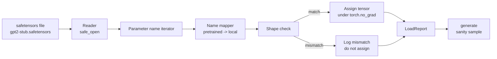

# Loading Pretrained Weights

> Huấn luyện một mô hình 124 triệu tham số từ đầu là một quyết định ngân sách; nạp một checkpoint được công bố là việc ngày thứ Ba. Bài này nạp các trọng số tiền huấn luyện kiểu GPT-2 từ một file safetensors vào chính xác kiến trúc từ bài 35, duyệt ánh xạ tên tham số từng phần, và sinh thử một phần tiếp nối để chứng minh việc nạp đã hoạt động. Không mạng, không loader bên thứ ba, không phép màu mờ đục.

**Type:** Build
**Languages:** Python
**Prerequisites:** Phase 19 lessons 30 to 36
**Time:** ~90 minutes

## Learning Objectives

- Đọc một file safetensors bằng thư viện Python `safetensors` và kiểm tra các tên và hình dạng tensor.
- Ánh xạ mỗi tên tham số tiền huấn luyện sang một tham số bên trong mô hình GPT bài 35.
- Xử lý hai quy ước tên khác nhau giữa các trọng số GPT-2 được công bố và mô hình trong track này: `wte/wpe/h.N.attn.c_attn/c_proj` và `mlp.c_fc/c_proj` so với các tên cục bộ `tok_embed/pos_embed/blocks.N.attn.qkv/out_proj` và `mlp.fc1/fc2`.
- Phát hiện và từ chối một sự không khớp hình dạng với một lỗi rõ ràng trước khi bất kỳ phép gán trọng số nào xảy ra.
- Sinh một phần tiếp nối ngắn với các trọng số đã nạp và xác nhận các token đến từ phân phối đã nạp, không phải phân phối được khởi tạo ngẫu nhiên.

## The Problem

Các trọng số được công bố không được đóng gói cho kiến trúc của bạn. Chúng mang các tên mà triển khai gốc sử dụng. File tiền huấn luyện có `transformer.h.0.attn.c_attn.weight` hình dạng `(2304, 768)`; mô hình của bạn kỳ vọng `blocks.0.attn.qkv.weight` hình dạng `(2304, 768)` (là cùng ma trận trong một quy ước bố cục khác) hoặc mô hình của bạn sử dụng `nn.Linear` lưu ma trận chuyển vị. Cùng tham số xuất hiện với ba danh tính khác nhau tinh vi (tên, hình dạng, bố cục byte) và loader phải dung hòa cả ba.

Một loader sao chép mù quáng đặt tensor đúng vào chỗ sai và bạn nhận một mô hình sinh vô nghĩa. Một loader từ chối sao chép khi hình dạng khác nhưng không ghi nhật ký gì khiến bạn đoán tensor nào không được đặt vào. Loader trong bài này rõ ràng: mọi phép gán được ghi nhật ký, mọi hình dạng được kiểm tra, và một `LoadReport` tóm tắt các lần trúng, thiếu, và không khớp hình dạng để bạn có thể đọc điều đã xảy ra.

## The Concept



Bộ ánh xạ tên chỉ là một hàm từ chuỗi sang chuỗi. Kiểm tra hình dạng là một if. Phép gán xảy ra bên trong `torch.no_grad()` để autograd không theo dõi việc nạp. Báo cáo giữ kết quả của mọi tên.

### The GPT-2 naming convention

Các trọng số GPT-2 được công bố nằm dưới các tên như:

| Tên tiền huấn luyện | Hình dạng | Ý nghĩa |
|-----------------|-------|---------|
| `wte.weight` | (50257, 768) | Embedding token |
| `wpe.weight` | (1024, 768) | Embedding vị trí |
| `h.N.ln_1.weight` | (768,) | Hệ số tỷ lệ LayerNorm 1 tại khối N |
| `h.N.ln_1.bias` | (768,) | Dịch chuyển LayerNorm 1 tại khối N |
| `h.N.attn.c_attn.weight` | (768, 2304) | Trọng số tuyến tính QKV hợp nhất |
| `h.N.attn.c_attn.bias` | (2304,) | Bias tuyến tính QKV hợp nhất |
| `h.N.attn.c_proj.weight` | (768, 768) | Phép chiếu đầu ra attention |
| `h.N.attn.c_proj.bias` | (768,) | Bias phép chiếu đầu ra attention |
| `h.N.ln_2.weight` | (768,) | Hệ số tỷ lệ LayerNorm 2 |
| `h.N.ln_2.bias` | (768,) | Dịch chuyển LayerNorm 2 |
| `h.N.mlp.c_fc.weight` | (768, 3072) | Trọng số MLP fc1 |
| `h.N.mlp.c_fc.bias` | (3072,) | Bias MLP fc1 |
| `h.N.mlp.c_proj.weight` | (3072, 768) | Trọng số MLP fc2 |
| `h.N.mlp.c_proj.bias` | (768,) | Bias MLP fc2 |
| `ln_f.weight` | (768,) | Hệ số tỷ lệ LayerNorm cuối |
| `ln_f.bias` | (768,) | Dịch chuyển LayerNorm cuối |

Hai bất ngờ cần dự liệu. Các lớp tuyến tính `c_attn`, `c_proj`, `c_fc` được lưu với ma trận chuyển vị so với điều `nn.Linear.weight` kỳ vọng. Loader chuyển vị trong lúc gán. Đầu LM hoàn toàn không nằm trong file; mô hình dựa vào buộc trọng số với `wte`, nên đầu được đặt bằng tạo bí danh khi `wte` được nạp vào.

### The local naming convention

Mô hình trong track này sử dụng các tên mô tả:

| Tên cục bộ | Ý nghĩa |
|------------|---------|
| `tok_embed.weight` | Embedding token |
| `pos_embed.weight` | Embedding vị trí |
| `blocks.N.ln1.scale` | Hệ số tỷ lệ LayerNorm 1 tại khối N |
| `blocks.N.ln1.shift` | Dịch chuyển LayerNorm 1 |
| `blocks.N.attn.qkv.weight` | QKV hợp nhất |
| `blocks.N.attn.qkv.bias` | Bias QKV hợp nhất |
| `blocks.N.attn.out_proj.weight` | Phép chiếu đầu ra attention |
| `blocks.N.attn.out_proj.bias` | Bias phép chiếu đầu ra |
| `blocks.N.ln2.scale` | Hệ số tỷ lệ LayerNorm 2 |
| `blocks.N.ln2.shift` | Dịch chuyển LayerNorm 2 |
| `blocks.N.mlp.fc1.weight` | MLP fc1 |
| `blocks.N.mlp.fc1.bias` | Bias MLP fc1 |
| `blocks.N.mlp.fc2.weight` | MLP fc2 |
| `blocks.N.mlp.fc2.bias` | Bias MLP fc2 |
| `final_ln.scale` | Hệ số tỷ lệ LayerNorm cuối |
| `final_ln.shift` | Dịch chuyển LayerNorm cuối |

Ánh xạ là một hàm cố định. Bài học cung cấp nó dưới dạng một dict mà loader lặp qua.

### The stub fixture

Các trọng số GPT-2 thực là 0.5 GB. Demo không tải chúng; nó tạo một fixture safetensors nhỏ ở lần chạy đầu, với chính xác quy ước tên GPT-2 và các hình dạng phù hợp với một mô hình 12 khối ở d_model 192 thay vì 768. Fixture có cấu trúc đúng để thực thi mọi đường mã trong loader. Đổi fixture lấy file thực và loader hoạt động không cần sửa đổi.

```figure
cc-weight-remap
```

## Build It

`code/main.py` triển khai:

- Một bản sao nhỏ của `GPTModel` bài 35 để bài này tự chứa.
- `make_pretrained_to_local(num_layers)` mở rộng các mục theo lớp.
- `load_safetensors(model, path)` lặp qua các tên, ánh xạ chúng, kiểm tra hình dạng, chuyển vị các trọng số kiểu conv1d, và gán dưới `torch.no_grad()`. Trả về một `LoadReport`.
- `make_stub_safetensors(path, cfg)` tạo một file fixture với chính xác quy ước tên tiền huấn luyện.
- Một demo tạo `outputs/gpt2-stub.safetensors` ở lần chạy đầu, xây dựng một mô hình mới, thu một phần tiếp nối được sinh từ khởi tạo ngẫu nhiên, nạp stub, thu một phần tiếp nối khác, in cả hai, và xác minh hai phần khác nhau (việc nạp thực sự thay đổi mô hình).

Chạy nó:

```bash
python3 code/main.py
```

Đầu ra: đường dẫn fixture, một nhật ký nạp theo tên, một tóm tắt `LoadReport`, một phần tiếp nối trước khi nạp, một phần tiếp nối sau khi nạp, và một sự không khớp hình dạng trên một tensor cố ý sai duy nhất được chèn vào fixture để đường thất bại được thực thi.

## Stack

- `safetensors` cho định dạng trên đĩa và một bộ đọc truyền luồng.
- `torch` cho mô hình và toán gán.
- Không `transformers`, không `huggingface_hub`, không lệnh gọi mạng.

## Production patterns in the wild

Ba mẫu khiến loader sống sót khi tiếp xúc với các trọng số bạn không tạo ra.

**Luôn xác thực file trước bất kỳ phép gán nào.** Mở file, liệt kê mọi tên tensor với dtype và hình dạng của nó, chạy toàn bộ ánh xạ với các kiểm tra hình dạng, và chỉ khi thành công mới bắt đầu gán. Các mô hình nạp nửa chừng là những cỗ máy thất bại âm thầm.

**Ghi nhật ký mọi phép gán với tên nguồn và tên đích.** Khi điều gì trông sai, nhật ký nói cho bạn tensor nào đã vào đâu; lựa chọn còn lại là đọc hexdump. Dataclass `LoadReport` trong bài này theo dõi các danh sách `loaded`, `missing`, `unexpected`, và `shape_mismatch` và in một tóm tắt ở cuối.

**Đầu LM là một bí danh buộc trọng số, không phải một bản sao riêng.** Đặt `model.lm_head.weight = model.tok_embed.weight` sau khi nạp `tok_embed` là mẫu chuẩn. Sao chép ma trận embedding vào một tham số `lm_head.weight` mới phá việc buộc và âm thầm tăng gấp đôi số tham số của bạn.

## Use It

- Loader hoạt động cho bất kỳ file safetensors nào sử dụng quy ước tên tiền huấn luyện. Các file GPT-2 thực (small / medium / large / xl) hoạt động không cần thay đổi mã; chỉ cấu hình mô hình khác.
- Cùng mẫu mở rộng sang các trọng số LLaMA, Mistral, Qwen khi bạn cập nhật ánh xạ tên. Các kiểm tra hình dạng và báo cáo giữ nguyên.
- Sinh kiểm tra hợp lý sau khi nạp là một cổng nhanh: nếu các mẫu sau nạp trông như các mẫu trước nạp, việc nạp đã không thay đổi mô hình, nghĩa là ánh xạ đã âm thầm bỏ lỡ mọi tensor.

## Exercises

1. Thêm một đối số `dtype` vào loader chuyển mỗi tensor sang một dtype đích (`bfloat16`, `float16`, `float32`) trong khi gán. Xác nhận một mô hình `float32` có thể được hạ kiểu xuống `bfloat16` và vẫn sinh.
2. Thêm một đối số `expected_layers` từ chối nạp một checkpoint có các chỉ số `h.N` không khớp với `num_layers` của mô hình.
3. Cắm loader vào hàm sinh bài 35 và tạo hai mẫu cạnh nhau: một từ khởi tạo ngẫu nhiên, một từ fixture được nạp.
4. Thêm một đường xuất: ghi trạng thái mô hình hiện tại vào một file safetensors mới sử dụng quy ước tên tiền huấn luyện. Khứ hồi loader và xác nhận báo cáo không có sự không khớp hình dạng nào.
5. Mở rộng `NAME_MAP` để xử lý quy ước tên LLaMA (không bias, RMSNorm, bố cục qkv hợp nhất) và chạy lại loader trên một fixture LLaMA stub mà bạn tạo.

## Key Terms

| Thuật ngữ | Cách mọi người nói | Ý nghĩa thực sự |
|------|-----------------|------------------------|
| Name map (Ánh xạ tên) | "Ánh xạ lại khóa" | Hàm từ tên tensor tiền huấn luyện sang tên tham số cục bộ; thường là một dict trực tiếp với một mục theo chỉ số lớp được mở rộng qua một vòng lặp |
| Shape mismatch (Không khớp hình dạng) | "Hình dạng sai" | Tensor tiền huấn luyện tồn tại dưới tên được ánh xạ nhưng các chiều của nó không khớp tham số cục bộ; loader từ chối gán và ghi nhật ký cặp đó |
| Transpose-on-load (Chuyển vị khi nạp) | "Bố cục Conv1d" | GPT-2 được công bố lưu các phép chiếu attention và MLP ở chuyển vị của điều nn.Linear kỳ vọng; loader chuyển vị trong khi gán |
| Weight tying alias (Bí danh buộc trọng số) | "Đầu LM dùng chung" | Đặt model.lm_head.weight = model.tok_embed.weight để đầu và embedding dùng chung lưu trữ; đầu không nằm trong file vì điều này |
| Load report (Báo cáo nạp) | "Tóm tắt độ bao phủ" | Một dataclass nhỏ theo dõi các danh sách loaded, missing, unexpected, và shape_mismatch; in nó là cách bạn biết việc nạp có thành công không |

## Further Reading

- Phase 19 bài 35 cho kiến trúc nhận các trọng số.
- Phase 19 bài 36 cho vòng lặp huấn luyện tạo ra một checkpoint cùng hình thức.
- Phase 10 bài 11 (lượng tử hóa) cho điều cần làm với các trọng số được nạp khi bộ nhớ hạn hẹp.
- Phase 10 bài 13 (xây dựng một pipeline LLM hoàn chỉnh) cho toàn bộ vòng đời quanh nạp và suy luận.
