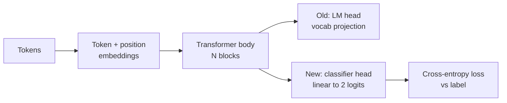
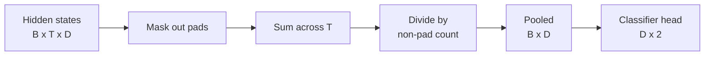
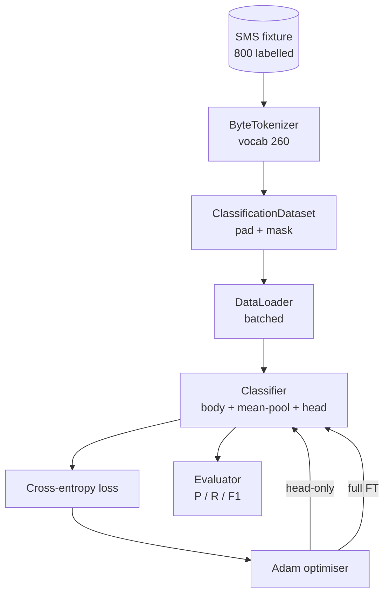

# Capstone Lesson 38: Classifier Fine-Tuning by Head Swap

> Bài tổng kết đầu tiên của Track B. Một mô hình ngôn ngữ tiền huấn luyện là một ngăn xếp các khối self-attention kết thúc bằng một đầu dự đoán token. Khi bạn muốn thư rác so với thư thường, đầu là sai nhưng thân phần lớn là đúng. Bài này tháo đầu ra, gắn một lớp tuyến tính hai lớp phân loại vào biểu diễn được gộp, và huấn luyện bộ phân loại theo hai cách khác nhau: chỉ lớp cuối, và tinh chỉnh đầy đủ. Đánh giá là precision, recall, và F1 trên một phần chia được giữ riêng. Bạn học mỗi chiến lược mang lại gì và nó tốn gì.

**Type:** Build
**Languages:** Python (torch, numpy)
**Prerequisites:** Phase 19 lessons 30-37 (NLP LLM track: tokenizer, embedding table, attention block, transformer body, pre-training loop, checkpointing, generation, perplexity)
**Time:** ~90 minutes

## Learning Objectives

- Thay một đầu mô hình ngôn ngữ bằng một đầu phân loại mà không khởi tạo lại thân.
- Triển khai hai chế độ huấn luyện: thân đóng băng (chỉ đầu) và tinh chỉnh đầy đủ, dùng chung một vòng lặp huấn luyện.
- Xây dựng một pipeline dữ liệu có nhận thức tokenizer thực hiện đệm, che phần đệm, và gộp đầu ra attention.
- Tính precision, recall, F1, và một ma trận nhầm lẫn từ các logit thô.
- Suy luận về đánh đổi giữa số tham số, thời gian huấn luyện, và phần dư khả năng cải thiện.

## The Problem

Bạn đã tiền huấn luyện một transformer nhỏ trên một corpus tổng quát. Đầu đầu ra chiếu trạng thái ẩn cuối sang một từ vựng 1000 token. Giờ bạn có 800 tin nhắn SMS được gắn nhãn thư rác hoặc thư thường và bạn muốn một bộ phân loại nhị phân. Có ba lựa chọn.

Lựa chọn sai là huấn luyện một bộ phân loại mới từ đầu trên 800 ví dụ. Thân của mô hình tiền huấn luyện đã mã hóa cấu trúc hữu ích: danh tính từ, vị trí, sự đồng xuất hiện đơn giản. Vứt bỏ nó lãng phí tính toán đã xây dựng nó.

Hai lựa chọn đúng là đổi đầu với thân đóng băng, và đổi đầu với thân có thể huấn luyện. Huấn luyện chỉ đầu nhanh, gần như miễn phí về bộ nhớ, và hiếm khi quá khớp với ít dữ liệu thế này. Tinh chỉnh đầy đủ chậm hơn, có thể quá khớp trên dữ liệu nhỏ, nhưng đạt độ chính xác cao hơn khi miền hạ nguồn trôi khỏi corpus tiền huấn luyện.

Bài này xây dựng cả hai, để bạn có thể so sánh chúng trên cùng fixture.

## The Concept



Mô hình là một hàm `f_theta(tokens) -> hidden_states`. Đầu là một hàm `g_phi(hidden) -> logits`. Đổi đầu nghĩa là giữ `theta` và thay `g_phi`. Các tham số của thân là phần đắt. Đầu là một lớp tuyến tính duy nhất.

Hai tập tham số có thể huấn luyện quan trọng:

- `theta` (thân): hàng chục nghìn trọng số theo khối attention.
- `phi` (đầu): `hidden_dim * num_classes` trọng số cùng một bias.

Trong huấn luyện chỉ đầu bạn tính gradient đối với `phi` và đặt chúng về không đối với `theta`. PyTorch cho phép bạn làm điều này bằng cách đặt `requires_grad=False` trên các tham số thân. Bộ tối ưu sau đó chỉ thấy đầu và thân giữ đóng băng.

Trong tinh chỉnh đầy đủ bạn để gradient chảy ngược qua toàn bộ ngăn xếp. Các trọng số thân trôi để khớp mục tiêu phân loại. Rủi ro là quên thảm khốc trên dữ liệu nhỏ: tiền huấn luyện của thân bị rửa trôi bởi quá khớp nhiễu.

## The Pooling Question

Một bộ phân loại cần một vector cho mỗi chuỗi, không phải một vector cho mỗi token. Ba lựa chọn phổ biến:

- **Gộp trung bình**: lấy trung bình các trạng thái ẩn dọc chuỗi, được đặt trọng số bởi mặt nạ attention.
- **Gộp CLS**: thêm một token đặc biệt vào đầu và chỉ dùng đầu ra của nó. Đây là điều BERT làm.
- **Gộp token cuối**: dùng token cuối không phải đệm. Đây là điều các bộ phân loại lớp GPT làm.

Bài này sử dụng gộp trung bình với đặt trọng số mặt nạ attention rõ ràng. Nó đơn giản nhất, cho một tín hiệu ổn định trên các độ dài chuỗi, và không đòi hỏi tiền huấn luyện một token CLS.



## The Data

Tám trăm tin nhắn SMS, cân bằng 400 thư rác và 400 thư thường, được tạo tất định trong `code/main.py`. Bộ sinh dùng một seed cố định, chọn các mẫu và thay các nội dung điền chỗ, và phát ra các tin nhắn dài từ 5 đến 25 token. Các tập dữ liệu thực có nhiễu mà fixture này không có. Điểm chính của fixture là khả năng tái lập.

Dữ liệu chia 80/20: 640 huấn luyện, 160 kiểm thử. Các phần chia được phân tầng để tập kiểm thử giữ cân bằng 50/50. Một tập được giữ riêng với cân bằng đã biết cho phép precision và recall được đọc như các con số trung thực.

## The Metrics

Phân loại nhị phân với lớp 1 là lớp dương tính (thư rác). Các số đếm là:

- `TP`: dự đoán thư rác, thực là thư rác.
- `FP`: dự đoán thư rác, thực là thư thường.
- `FN`: dự đoán thư thường, thực là thư rác.
- `TN`: dự đoán thư thường, thực là thư thường.

Ba chỉ số chính:

- `precision = TP / (TP + FP)`. Trong các tin nhắn bị gắn cờ thư rác, tỷ lệ nào thực sự là thư rác?
- `recall = TP / (TP + FN)`. Trong các thư rác thực, mô hình đã gắn cờ tỷ lệ nào?
- `F1 = 2 * P * R / (P + R)`. Trung bình điều hòa của hai chỉ số.

Một ma trận nhầm lẫn in bốn số đếm dưới dạng một lưới 2x2. Demo ghi điều này vào stdout cho cả hai chế độ huấn luyện.

```figure
cap-classifier-head-swap
```

## Architecture



Thân là một transformer cố ý tí hon: từ vựng 260, ẩn 64, 4 đầu, 2 khối, chuỗi tối đa 32. Nó đủ nhỏ để huấn luyện cả hai chế độ đến hội tụ trong chín mươi giây trên CPU. Nó không được tiền huấn luyện trong bài; thay vào đó, hàm hỗ trợ `pretrain_quick` thực hiện năm epoch huấn luyện LM trên văn bản của cùng fixture để cho thân một điểm xuất phát không tầm thường. Điều này giữ bài học tự chứa.

## What you will build

Triển khai là một `main.py` cùng một module kiểm thử (`code/tests/test_main.py`).

1. `ByteTokenizer`: ánh xạ byte sang id, dành một pad id.
2. `Block`: một khối transformer với attention đa đầu và một lớp truyền thẳng. Chuẩn hóa trước.
3. `LMBody`: embedding token + vị trí cùng một ngăn xếp khối. Trả về các trạng thái ẩn.
4. `MeanPool`: trung bình được đặt trọng số mặt nạ trên trục chuỗi.
5. `Classifier`: thân, gộp, đầu tuyến tính. Thân là cùng thực thể giữa các chế độ.
6. `freeze_body` và `unfreeze_body`: bật tắt `requires_grad` trên các tham số thân.
7. `train_classifier`: một vòng lặp dùng chung. Nhận mô hình và một bộ tối ưu được cấu hình cho bất kỳ nhóm tham số nào có thể huấn luyện.
8. `evaluate`: chạy tập kiểm thử và trả về `Metrics(precision, recall, f1, confusion)`.
9. `run_demo`: tiền huấn luyện thân ngắn, rồi huấn luyện và đánh giá chỉ đầu, rồi đầy đủ, in cả hai báo cáo, và thoát với mã không.

## Why the comparison matters

Chế độ chỉ đầu thường huấn luyện nhanh hơn và thiếu khớp một cách nhẹ nhàng hơn. Trên fixture này bạn thường thấy precision gần 0.9 và recall gần 0.85 sau hai mươi epoch huấn luyện chỉ đầu. Tinh chỉnh đầy đủ mất lâu hơn khoảng ba lần và nằm trong khoảng vài điểm theo cả hai hướng, tùy seed ngẫu nhiên.

Bài học không chọn một người thắng. Nó dạy bạn đọc các con số và chi phí. Trên 800 ví dụ và một thân tí hon, chỉ đầu là quyết định đúng. Trên 80,000 ví dụ và một thân lớn hơn, tinh chỉnh đầy đủ bắt đầu đáng giá. Hợp đồng bạn lấy từ bài này là API: cùng hàm `train_classifier` xử lý cả hai, và việc chuyển đổi là một lệnh gọi.

## Stretch goals

- Thêm một chế độ thứ ba chỉ mở đóng băng khối cuối. Điều này đôi khi được gọi là tinh chỉnh một phần. Nó tốn ít hơn FT đầy đủ và học nhiều hơn chỉ đầu.
- Thêm một bộ lập lịch tốc độ học. Một lịch cosine trên đầu cùng một tốc độ hằng nhỏ hơn trên thân là một thiết lập sản xuất phổ biến.
- Thay gộp trung bình bằng một bộ gộp attention được học: một lớp attention nhỏ với một query được học. Điều này thường vượt gộp trung bình trên các chuỗi dài hơn.

Triển khai cho bạn các hook. Các kiểm thử ghim hợp đồng. Các con số là để bạn đẩy xa.
