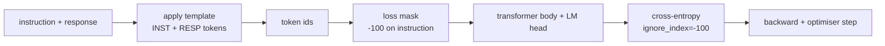
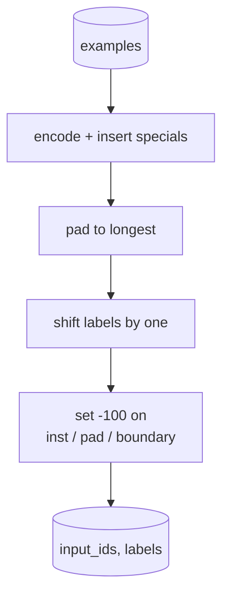
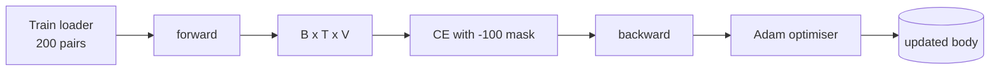

# Capstone Lesson 39: Instruction Tuning by Supervised Fine-Tuning

> Một mô hình cơ sở tiền huấn luyện có thể kéo dài một chuỗi nhưng không thể làm theo một chỉ dẫn. Tinh chỉnh có giám sát là thay đổi nhỏ nhất sửa điều này: đưa cho mô hình các ví dụ ghép cặp một chỉ dẫn và một phản hồi mong muốn, và huấn luyện thân dự đoán các token phản hồi. Mẹo là bạn chỉ muốn mất mát tính phản hồi, không tính chỉ dẫn. Bài này xây dựng một vòng lặp SFT kiểu Alpaca với một hàm collate tùy chỉnh che các token chỉ dẫn bằng `ignore_index=-100`, huấn luyện trên 200 cặp chỉ dẫn-phản hồi, và đánh giá trên một phần chia được giữ riêng bằng khớp chính xác.

**Type:** Build
**Languages:** Python (torch, numpy)
**Prerequisites:** Phase 19 lessons 30-37 (NLP LLM track: tokenizer, embedding table, attention block, transformer body, pre-training loop, checkpointing, generation, perplexity)
**Time:** ~90 minutes

## Learning Objectives

- Định dạng dữ liệu chỉ dẫn-phản hồi ghép cặp thành một chuỗi nhân quả duy nhất với các token ranh giới rõ ràng.
- Xây dựng một hàm collate che các token chỉ dẫn để entropy chéo chỉ tính các token phản hồi.
- Huấn luyện một thân transformer tí hon theo mục tiêu SFT và xem chỉ số đánh giá thay đổi.
- Triển khai sinh tham lam và lấy mẫu theo nhiệt độ tôn trọng ranh giới bắt đầu phản hồi.
- Tính khớp chính xác trên phần giữ riêng đối với các phần hoàn thành được sinh.

## The Problem

Một mô hình cơ sở được huấn luyện trên dự đoán token tiếp theo không biết chỉ dẫn là gì. Cho nó thấy chuỗi `"What is the capital of France?"` và nó sẽ tiếp tục câu hỏi hoặc tự tạo một câu mới. Mô hình có ngôn ngữ nhưng không có hợp đồng định dạng.

Hợp đồng SFT là một mẫu chuỗi. Mỗi ví dụ huấn luyện trở thành một chuỗi duy nhất với ba vùng:

```text
<INST> What is the capital of France? <RESP> The capital of France is Paris.
```

Các token ranh giới là các token đặc biệt được dành riêng lúc huấn luyện. Mô hình học rằng mọi thứ sau `<RESP>` là phản hồi và phản hồi là thứ được chấm điểm. Mục tiêu token tiếp theo của mô hình cơ sở vẫn áp dụng; nó chỉ được huấn luyện trên một corpus mà mọi ví dụ có hình thức này.

Nhưng có một điểm mắc. Nếu bạn đưa toàn bộ chuỗi vào một hàm mất mát entropy chéo thông thường, bạn đang huấn luyện mô hình cũng dự đoán các token chỉ dẫn. Chỉ dẫn đã được cung cấp. Bạn muốn gradient không trên những vị trí đó. Cách sửa là mặt nạ.

## The Concept



`ignore_index` là một tính năng của `torch.nn.functional.cross_entropy`. Bất kỳ vị trí đích nào bằng `ignore_index` đóng góp mất mát không và gradient không. Quy ước trong PyTorch là `-100`. Hàm collate xây dựng hai tensor mỗi ví dụ: `input_ids` (toàn bộ chuỗi) và `labels` (một bản sao của `input_ids` với các vị trí chỉ dẫn được ghi đè bằng `-100`).

Mô hình thấy toàn bộ chuỗi trong lượt tiến; attention có thể chú ý đến chỉ dẫn. Mất mát chỉ tính các token phản hồi. Đây chính xác là điều bạn muốn: điều kiện hóa trên chỉ dẫn, dự đoán phản hồi.

## The Data

Hai trăm cặp chỉ dẫn-phản hồi được tạo tất định trong `main.py`. Chúng bao phủ sáu loại tác vụ:

- sự kiện một lượt (thủ đô của X)
- số học
- trích xuất danh sách
- tóm tắt một câu
- mã (print, sort)
- định nghĩa

Mỗi tác vụ có một chỉ dẫn theo mẫu và một phản hồi tất định. Điều này cố ý đơn giản. Khớp chính xác mong manh, và bài học dùng một fixture nơi đáp án đúng là một chuỗi cụ thể. Các tập dữ liệu SFT thực cần các chỉ số mờ; nguyên tắc giống hệt.

Các phần chia là 160 huấn luyện, 40 kiểm thử. Tập kiểm thử bao phủ cả sáu loại tác vụ để có thể báo cáo khớp chính xác theo hạng mục.

## Tokenisation and Padding

Tokenizer ở mức byte với ba token đặc biệt được dành riêng:

- `INST_ID = 256`: đánh dấu đầu vùng chỉ dẫn.
- `RESP_ID = 257`: đánh dấu ranh giới giữa chỉ dẫn và phản hồi.
- `PAD_ID = 258`: đệm cho các lô có độ dài biến đổi.

Chuỗi là `[INST] inst_bytes [RESP] resp_bytes [PAD]*`. Hàm collate:

1. Phân tách token từng ví dụ.
2. Đệm mọi ví dụ trong lô đến chuỗi dài nhất trong lô.
3. Xây dựng `labels` = `input_ids` dịch một vị trí (đích LM nhân quả), với:
   - Vùng chỉ dẫn được thay bằng `-100`.
   - Vùng đệm được thay bằng `-100`.
   - Chính vị trí ranh giới `RESP_ID` được thay bằng `-100` (bạn không huấn luyện mô hình dự đoán token ranh giới; nó dự đoán thứ theo sau).



Phép dịch là thủ thuật nhân quả tiêu chuẩn: vị trí `i` của `input_ids` dự đoán vị trí `i+1`, nên `labels[i] = input_ids[i+1]` (với vị trí cuối được bỏ khỏi đầu vào và vị trí đầu được bỏ khỏi đích). Mặt nạ được áp dụng sau phép dịch để vào đúng vị trí.

## Training



Vòng lặp là vòng lặp SFT PyTorch tiêu chuẩn. Adam, tốc độ học quanh 3e-4 đến 1e-3, mười đến hai mươi epoch trên fixture này, không có bộ lập lịch. Mô hình đủ nhỏ (ẩn 96, 2 khối, độ dài tối đa 64) để huấn luyện đến hội tụ trên CPU trong hai phút.

Mỗi epoch thứ năm vòng lặp chạy một lượt đánh giá tí hon trên tập được giữ riêng và in khớp chính xác. Xem khớp chính xác đi từ 0.0 ở epoch một đến mức như 0.85 ở epoch mười lăm là thành quả của bài học: bạn có thể thấy mô hình học định dạng và các đáp án cùng lúc.

## Generation

Tại thời điểm đánh giá mô hình nhận tiền tố chỉ dẫn `[INST] inst_bytes [RESP]` và sinh token cho đến khi:

- chuỗi đạt `max_len`, hoặc
- mô hình phát ra một heuristic dừng đặc biệt: hai byte kết thúc câu liên tiếp (`.`, `!`, `?`).

Bài học cung cấp giải mã tham lam cùng một bộ lấy mẫu nhiệt độ tùy chọn. Khớp chính xác sử dụng tham lam vì nhiệt độ sẽ khiến chỉ số mang tính ngẫu nhiên. Các hệ thống thực thường lấy mẫu, rồi chấm mờ; pipeline đó là bài 41.

## Exact-Match Evaluation

Khớp chính xác là chỉ số văn bản nghiêm ngặt nhất. Chuỗi phản hồi dự đoán được chuẩn hóa (chữ thường, bỏ khoảng trắng, gộp khoảng trắng kép) và so sánh với phản hồi tham chiếu, được chuẩn hóa cùng cách. Chỉ số hoặc là 1 hoặc 0 mỗi ví dụ. Tổng hợp là trung bình.

Các pipeline SFT thực bổ sung khớp chính xác bằng F1 ở mức token (bài 41) và một mô hình chấm. Khớp chính xác vẫn hữu ích vì nó không mơ hồ; nếu nó nói 0.7, chính xác 70 phần trăm chỉ dẫn kiểm thử tạo ra phản hồi chuẩn đúng từng ký tự.

```figure
cc-sft-loss-mask
```

## What you will build

Triển khai là một `main.py` cùng các kiểm thử.

1. `InstructionTokenizer`: bộ mã hóa ở mức byte với các token đặc biệt được dành riêng. Mã hóa một tiền tố chỉ dẫn hoặc một cặp đầy đủ.
2. `make_dataset`: tạo 200 cặp trên sáu loại tác vụ với một seed cố định.
3. `SFTDataset`: trả về `(input_ids, labels)` mỗi ví dụ, đã chuẩn bị mặt nạ.
4. `sft_collate`: đệm động, xây dựng tensor lô, đặt `-100` trên các vị trí chỉ dẫn và đệm.
5. `TinyGPT`: thân transformer cùng đầu LM được buộc hoặc không buộc.
6. `train_sft`: vòng lặp SFT, với các hook đánh giá theo epoch.
7. `generate`: giải mã nhân quả từ một tiền tố, tham lam hoặc lấy mẫu, với heuristic dừng.
8. `exact_match`: so sánh chuỗi được chuẩn hóa, trả về float trong `[0, 1]`.
9. `run_demo`: xây dựng dữ liệu, huấn luyện trong hai mươi epoch, đánh giá, in phân tích theo hạng mục, thoát với mã không khi thành công.

## Why the mask matters

Không có mặt nạ, mất mát coi các token chỉ dẫn là đích. Mô hình học dự đoán chỉ dẫn. Đây là một mục tiêu khác và tạo một mô hình tệ hơn theo hai cách. Thứ nhất, năng lực mô hình bị lãng phí tái tạo các đầu vào người dùng luôn cung cấp. Thứ hai, mất mát phản hồi nhỏ hơn trong tổng gradient vì các token chỉ dẫn nhiều hơn các token phản hồi trong hầu hết các lô; tốc độ học hiệu dụng của bộ tối ưu trên phần bạn quan tâm thấp hơn bạn dự định. Mặt nạ không phải một sự trau chuốt; nó là mục tiêu.

## Stretch goals

- Thêm khởi động tốc độ học theo sau bởi suy giảm cosine. SFT nhạy với LR hơn tiền huấn luyện.
- Thêm ghi nhật ký mất mát theo token và vẽ đường cong mất mát qua huấn luyện. Chú ý các epoch đầu bị chi phối bởi các token mẫu (`<RESP>`, các tiền tố phổ biến) và các epoch sau bị chi phối bởi các token đáp án thực.
- Mở rộng đánh giá sang BLEU-1 hoặc chrF. Khớp chính xác đánh giá thấp các mô hình tạo ra một cách diễn đạt lại với cùng đáp án.
- Thêm một mẫu trò chuyện với định dạng nhiều lượt và huấn luyện trên một fixture bao gồm các trao đổi tiếp.

Triển khai cho bạn hợp đồng định dạng, mặt nạ, và vòng lặp. Thay đổi mục tiêu từ mô hình cơ sở sang mô hình làm theo chỉ dẫn là một hàm collate.
