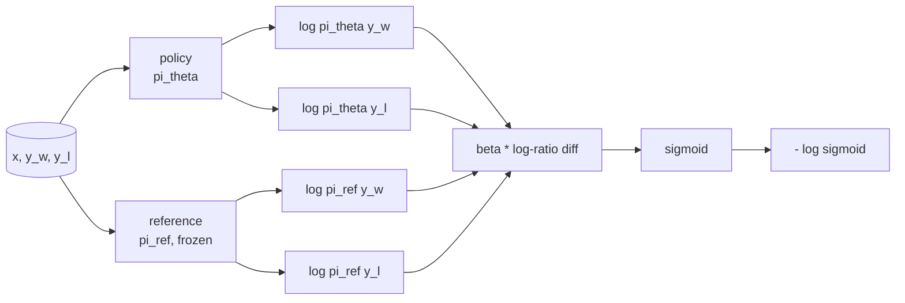
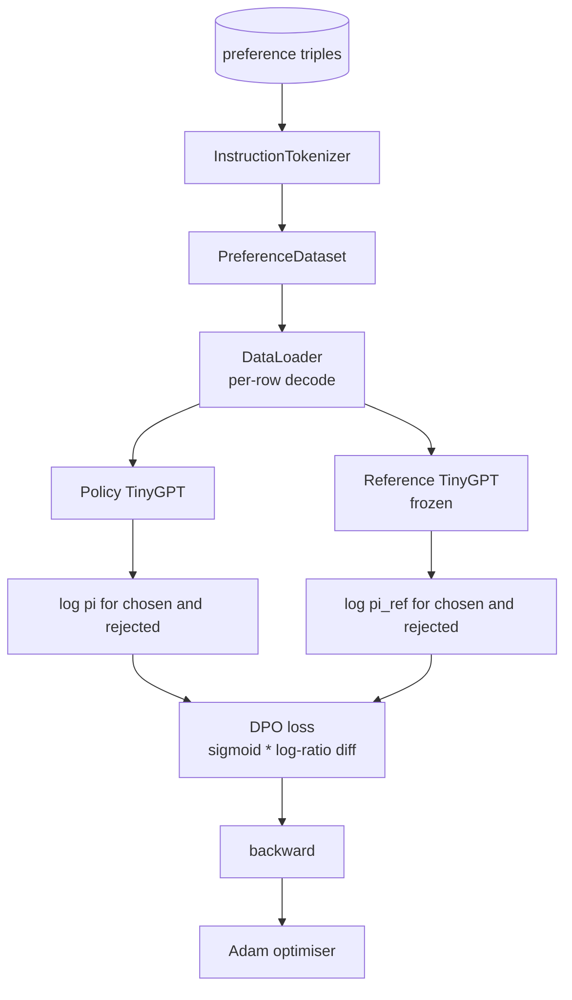

# Capstone Lesson 40: Direct Preference Optimization from Scratch

> Các mô hình phần thưởng và PPO là ngăn xếp RLHF cổ điển. DPO thu gọn ngăn xếp đó thành một hàm mất mát có giám sát duy nhất khớp một chính sách trực tiếp với các cặp ưu tiên. Bài này suy ra mất mát DPO từ đồng nhất chênh lệch phần thưởng, cung cấp một mô hình tham chiếu cùng mô hình chính sách hoạt động, tính các log-xác suất theo token, và huấn luyện một transformer tí hon trên một fixture ưu tiên gồm các phần hoàn thành được chọn và bị từ chối. Các kiểm thử ghim toán mất mát và hướng gradient để bạn biết triển khai khớp bài báo.

**Type:** Build
**Languages:** Python (torch, numpy)
**Prerequisites:** Phase 19 lessons 30-37 (NLP LLM track: tokenizer, embedding table, attention block, transformer body, pre-training loop, checkpointing, generation, perplexity)
**Time:** ~90 minutes

## Learning Objectives

- Suy ra mất mát DPO như một sigmoid trên một chênh lệch log-tỷ số có chia tỷ lệ và kết nối nó với phần thưởng ngầm.
- Xây dựng một cặp mô hình tham chiếu + mô hình chính sách với một tham chiếu đóng băng và một chính sách có thể huấn luyện.
- Tính các log-xác suất ở mức chuỗi dưới cả hai mô hình, che các token prompt.
- Huấn luyện chính sách trên các bộ ba `(prompt, chosen, rejected)` và xem log-xác suất được chọn tăng tương đối so với bị từ chối.
- Ghim hành vi bằng các kiểm thử trên toán mất mát, dấu gradient, và tính bất biến tham chiếu.

## The Problem

Bạn có một mô hình SFT. Nó làm theo chỉ dẫn, nhưng các đầu ra không đồng đều; một số phần hoàn thành rõ ràng, một số dài dòng hoặc sai. Bạn cũng có một tập dữ liệu nhỏ các cặp ưu tiên: với cùng prompt, một người đánh dấu một phần hoàn thành là được chọn và phần còn lại là bị từ chối.

Câu trả lời RLHF cổ điển là một pipeline hai giai đoạn. Huấn luyện một mô hình phần thưởng trên các ưu tiên. Tối ưu chính sách theo phần thưởng bằng PPO. Điều này hoạt động nhưng tốn kém: hai mô hình trong bộ nhớ trong PPO, kiểm soát KL để giữ chính sách gần tham chiếu, khai thác phần thưởng khi mô hình phần thưởng mong manh.

DPO thay cả hai giai đoạn bằng một mất mát có giám sát duy nhất. Mô hình phần thưởng không bao giờ tồn tại tường minh. Chính sách được huấn luyện trực tiếp trên các cặp ưu tiên, với một hình phạt KL rõ ràng hướng về tham chiếu SFT. Cùng nghiệm tối ưu dưới mô hình ưu tiên Bradley-Terry, ít mã hơn nhiều.

## The Concept

Bắt đầu từ mô hình Bradley-Terry. Với một prompt `x` và hai phần hoàn thành `y_w` (được chọn) và `y_l` (bị từ chối), xác suất con người thích `y_w` là

```text
P(y_w > y_l | x) = sigmoid( r(x, y_w) - r(x, y_l) )
```

trong đó `r` là một hàm phần thưởng tiềm ẩn nào đó. RLHF trước tiên khớp `r` từ các ưu tiên, rồi huấn luyện một chính sách `pi` để tối đa hóa `r` với một neo KL:

```text
max_pi   E_{x, y~pi} [ r(x, y) ] - beta * KL(pi || pi_ref)
```

Phép suy ra DPO nhận thấy rằng chính sách tối ưu `pi*` dưới mục tiêu này có một dạng đóng theo `r`:

```text
pi*(y | x) = (1/Z(x)) * pi_ref(y | x) * exp( r(x, y) / beta )
```

Sắp xếp lại theo `r`:

```text
r(x, y) = beta * ( log pi*(y | x) - log pi_ref(y | x) ) + beta * log Z(x)
```

Số hạng `log Z(x)` giống nhau cho cả `y_w` và `y_l` (nó phụ thuộc vào `x`, không phải `y`), nên nó triệt tiêu khi bạn tính chênh lệch ưu tiên:

```text
r(x, y_w) - r(x, y_l) = beta * ( log pi_theta(y_w|x) - log pi_ref(y_w|x)
                                - log pi_theta(y_l|x) + log pi_ref(y_l|x) )
```

Thế vào sigmoid Bradley-Terry và lấy âm log hợp lý trên các cặp ưu tiên:

```text
L_DPO(theta) = - E_{(x, y_w, y_l)} [
  log sigmoid( beta * ( log pi_theta(y_w|x) - log pi_ref(y_w|x)
                       - log pi_theta(y_l|x) + log pi_ref(y_l|x) ) )
]
```

Đây là mất mát. Nó là một sigmoid trên một đại lượng vô hướng duy nhất mỗi ví dụ, được tính từ bốn log-xác suất. Không mô hình phần thưởng riêng. Không PPO. Không số hạng KL trong mất mát; ràng buộc KL được đưa vào phép suy ra dạng đóng.



## The Sign of the Gradient

Một kiểm tra hợp lý hữu ích trước bất kỳ lần chạy huấn luyện nào. Lấy gradient theo `log pi_theta(y_w | x)`:

```text
d L_DPO / d log pi_theta(y_w | x) = - beta * (1 - sigmoid(z))
```

trong đó `z` là đối số của sigmoid. Điều này âm với mọi `z`, có nghĩa là: tăng log-xác suất của chính sách đối với phần hoàn thành được chọn làm giảm mất mát. Đối xứng, gradient theo `log pi_theta(y_l | x)` dương: tăng log-xác suất bị từ chối làm tăng mất mát. Huấn luyện đẩy phần được chọn lên và phần bị từ chối xuống. Tham chiếu đóng băng; nó không di chuyển.

## The Data

Mười hai bộ ba ưu tiên đi kèm bài học. Mỗi bộ là `(prompt, chosen, rejected)`. Phần hoàn thành được chọn ngắn và chính xác. Phần bị từ chối dài dòng, lạc đề, hoặc sai. Các cặp bao phủ cùng các họ tác vụ như bài 39 (thủ đô, số học, danh sách) để một chính sách bắt đầu từ một cơ sở SFT có một điểm xuất phát hợp lý.

Fixture cố ý nhỏ. DPO hoạt động trên hàng chục nghìn cặp trong sản xuất; ở đây, điểm chính là toán mất mát và vòng lặp chạy từ đầu đến cuối trên một tập dữ liệu tí hon và khoảng cách log-xác suất được chọn so với bị từ chối tăng lên rõ ràng.

## Reference Invariance

Một triển khai DPO phải xử lý mô hình tham chiếu cẩn thận. Tham chiếu là mô hình SFT được đóng băng tại chỗ. Ba thuộc tính phải đúng:

- Các tham số tham chiếu không bao giờ nhận gradient.
- Các log-xác suất tham chiếu không bao giờ thay đổi giữa các epoch.
- Chính sách bắt đầu từ cùng trọng số như tham chiếu. (`theta` tối ưu là tham chiếu cộng một cập nhật được học; khởi tạo chính sách như một bản sao tham chiếu là khởi đầu được định nghĩa rõ.)

Triển khai thực thi những điều này bằng cách:

- Bọc tham chiếu trong `torch.no_grad()` trong các lượt tiến.
- Đặt `requires_grad=False` trên mọi tham số tham chiếu.
- Tạo chính sách qua `policy.load_state_dict(reference.state_dict())` sau khi tham chiếu được xây dựng.

```figure
cap-dpo-preference
```

## Architecture



Mô hình là cùng TinyGPT được dùng trong bài 39 (chỉ decoder, nhân quả, tokenizer byte). Tham chiếu và chính sách dùng chung kiến trúc; các trọng số của chính sách trôi khỏi tham chiếu dưới huấn luyện trong khi tham chiếu giữ cố định.

## What you will build

Triển khai là một `main.py` cùng các kiểm thử.

1. `InstructionTokenizer`: tokenizer byte với các token đặc biệt `INST` và `RESP`. Cùng hình thức như bài 39.
2. `TinyGPT`: transformer chỉ decoder. Cùng hình thức như bài 39 để bài học tự chứa ngay cả nếu bạn bỏ qua 39.
3. `make_preferences`: trả về mười hai bộ ba `(prompt, chosen, rejected)`.
4. `sequence_log_prob`: với mô hình, một tiền tố prompt, và một phần hoàn thành được cung cấp, trả về tổng log-xác suất token tiếp theo trên phần hoàn thành (không có đóng góp vị trí prompt).
5. `dpo_loss`: nhận bốn log-xác suất và `beta`, trả về tensor mất mát theo ví dụ và chênh lệch phần thưởng ngầm để ghi nhật ký.
6. `train_dpo`: vòng lặp theo epoch tính log-xác suất được chọn và bị từ chối dưới chính sách và tham chiếu, áp dụng mất mát, và thực hiện bước Adam.
7. `evaluate_margins`: trả về biên log-xác suất được chọn-trừ-bị từ chối trung bình dưới chính sách tại bất kỳ thời điểm nào.
8. `run_demo`: xây dựng tham chiếu và chính sách từ một lần tiền huấn luyện khởi động nhỏ, sao chép trọng số, huấn luyện trong ba mươi bước, in mất mát và biên theo bước, và thoát với mã không khi thành công.

## Why DPO works

DPO tương đương toán học với RLHF dưới mô hình ưu tiên Bradley-Terry, sai khác ở cách tham số hóa phần thưởng. Phần thưởng ngầm `r(x, y) = beta * (log pi(y|x) - log pi_ref(y|x))` có thể được nhận dạng từ các ưu tiên đến một hàm của `x`, vốn triệt tiêu trong chênh lệch. Chính sách dạng đóng cho phép bạn bỏ qua mô hình phần thưởng tường minh. Ràng buộc KL được thực thi về cấu trúc: bất kỳ độ lệch nào của `pi` khỏi `pi_ref` làm log-tỷ số lớn hơn, và sigmoid bão hòa, làm giảm gradient khi chính sách di chuyển quá xa. Tham chiếu là lưới an toàn của bạn.

## Stretch goals

- Thêm một chuẩn hóa độ dài vào tổng log-xác suất: chia cho độ dài phần hoàn thành. Thiên lệch độ dài là một chế độ lỗi DPO đã biết nơi mô hình ưu tiên chọn các phần hoàn thành ngắn hơn vì log-xác suất của chúng lớn hơn về giá trị tuyệt đối.
- Thêm biến thể IPO của mất mát: thay sigmoid + log bằng `(z - 1)^2`. So sánh hội tụ trên fixture.
- Thêm một tham số làm mượt nhãn nội suy giữa nhãn được chọn-bị từ chối cứng và một giá trị đều 0.5.
- Thay tham chiếu bằng một mô hình nhỏ hơn rẻ hơn (phong cách chưng cất tri thức).

Triển khai cho bạn mất mát, tính bất biến tham chiếu, và vòng lặp huấn luyện. Toán là bài học. Mã khiến toán cụ thể.
