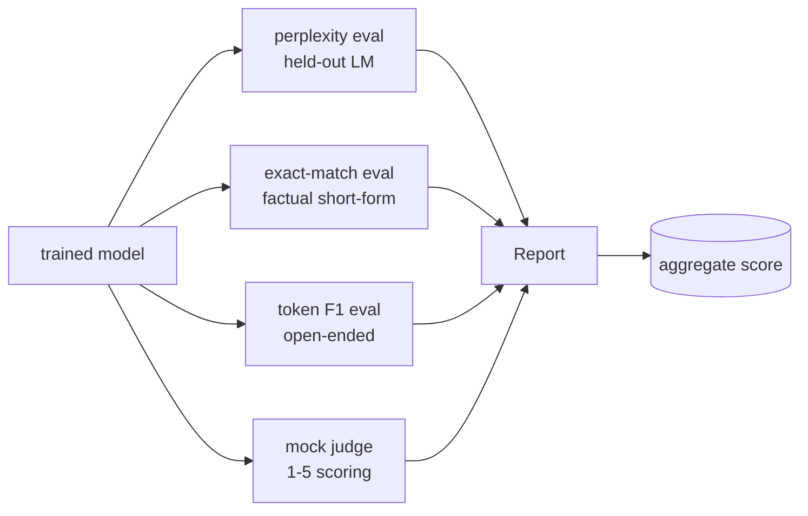
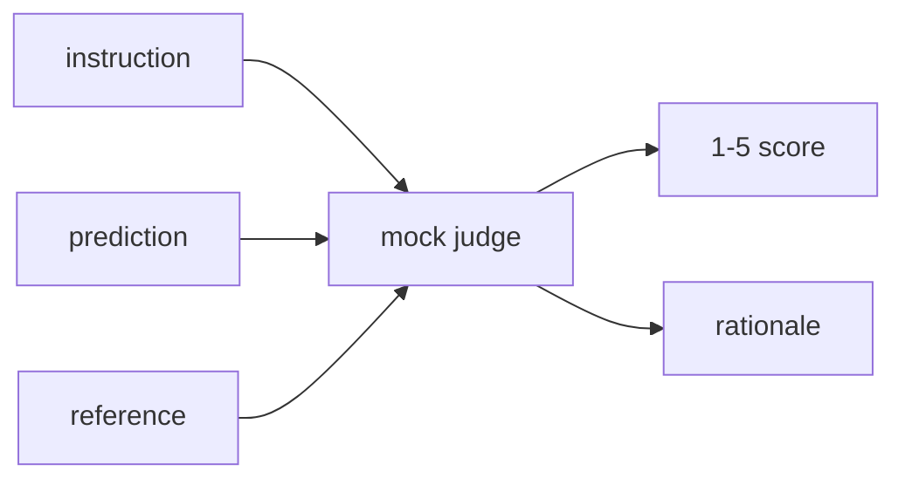
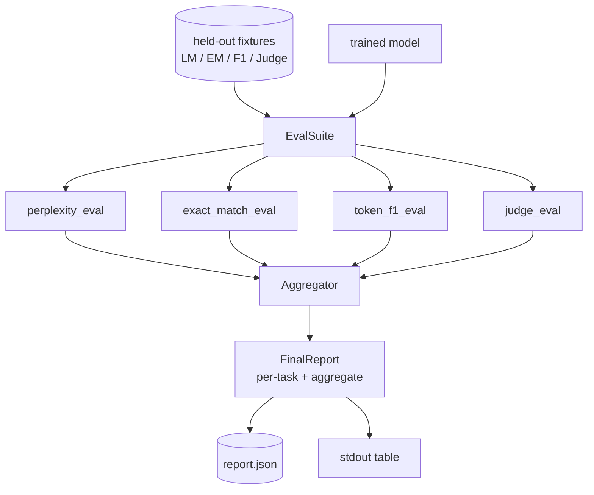

# Capstone Lesson 41: Full Evaluation Pipeline

> Huấn luyện là phần bạn có thể giám sát bằng các đường cong mất mát. Đánh giá là phần bạn phải thiết kế. Bài này xây dựng một pipeline đánh giá thống nhất nhận bất kỳ mô hình ngôn ngữ đã huấn luyện nào, chạy bốn đánh giá không đồng nhất trên nó, tổng hợp các kết quả thành một báo cáo theo tác vụ, và cung cấp một LLM-làm-bộ-chấm giả lập cục bộ để vòng lặp chạy không có mạng. Bốn đánh giá bao phủ các chiều mà mọi mô hình được cung cấp cần: mô hình hóa ngôn ngữ (perplexity), tính đúng đắn dạng ngắn (khớp chính xác), độ tương tự dạng mở (F1 token), và chấm điểm định tính (bộ chấm).

**Type:** Build
**Languages:** Python (torch, numpy)
**Prerequisites:** Phase 19 lessons 30-37 (NLP LLM track: tokenizer, embedding table, attention block, transformer body, pre-training loop, checkpointing, generation, perplexity)
**Time:** ~90 minutes

## Learning Objectives

- Tính perplexity trên phần giữ riêng với hạch toán token được che trên một transformer tí hon.
- Chạy một đánh giá khớp chính xác trên các prompt sự kiện dạng ngắn.
- Tính F1 ở mức token giữa các chuỗi dự đoán và tham chiếu với chuẩn hóa.
- Xây dựng một LLM-làm-bộ-chấm giả lập cục bộ chấm các đầu ra mô hình trên thang 1-5.
- Tổng hợp bốn đánh giá thành một báo cáo có trọng số duy nhất với phân tích theo tác vụ.

## The Problem

Một chỉ số duy nhất không bao giờ mô tả một mô hình ngôn ngữ. Perplexity nói mô hình khớp phân phối ngôn ngữ tốt thế nào nhưng không nói gì về việc nó có trả lời câu hỏi không. Khớp chính xác nói liệu mô hình tạo chuỗi chuẩn không nhưng phạt các cách diễn đạt lại đúng. F1 token tha thứ diễn đạt lại nhưng bị đánh lừa bởi chồng lấn từ vựng với nội dung sai. LLM-làm-bộ-chấm nắm bắt các chiều định tính nhưng tốn kém và ngẫu nhiên.

Pipeline bạn thực sự muốn có cả bốn. Mỗi đánh giá bao phủ một chiều các đánh giá khác bỏ lỡ. Mỗi đánh giá chạy trên một tập con dữ liệu được giữ riêng khác nhau có hình thức cho chỉ số đó. Báo cáo cuối hiển thị các số liệu theo tác vụ cạnh nhau và một tổng hợp, để một người rà soát có thể thấy thoáng qua những đánh đổi mô hình đang thực hiện.

Bài này xây dựng pipeline đó, từ đầu đến cuối, trong một file.

## The Concept



Mỗi đánh giá là một hàm từ `(model, dataset) -> EvalResult`. Kết quả mang giá trị chỉ số, các chi tiết theo ví dụ để kiểm tra, và một tên cho tổng hợp. Pipeline kết hợp chúng bằng một cấu hình nói chạy những đánh giá nào và đặt trọng số thế nào.

## Perplexity, properly counted

Perplexity là `exp(mean negative log-likelihood per token)`. Triển khai có hai bẫy:

- Trung bình phải trên các vị trí token thực, không phải trên batch * sequence. Các token đệm phải được loại khỏi mẫu số hoặc perplexity sẽ trông tốt hơn thực tế.
- Mô hình dự đoán token tiếp theo, nên các logit tại vị trí `i` dự đoán token tại vị trí `i+1`. Các lỗi lệch một ở đây âm thầm: mất mát vẫn huấn luyện, nhưng chỉ số trở nên vô nghĩa.

Đánh giá tính các tổng theo lô của `-log p(token)` trên các vị trí không đệm và một số đếm token theo lô, rồi chia ở cuối. Điều này an toàn số học hơn lấy trung bình các perplexity theo lô (vốn đặt trọng số thấp cho các chuỗi ngắn) và khớp định nghĩa sách giáo khoa.

## Exact-match, with normalisation

Harness chuẩn hóa cả dự đoán và tham chiếu trước khi so sánh:

- Chuyển chữ thường.
- Bỏ khoảng trắng xung quanh.
- Gộp các chuỗi khoảng trắng bên trong thành một khoảng trắng.
- Bỏ dấu câu kết thúc ở cuối (`.`, `!`, `?`) nếu hai phía chỉ khác dấu câu.

Chuẩn hóa khiến khớp chính xác hữu ích trong thực tế. Một mô hình nói `"Paris"` là đúng; một mô hình nói `"Paris."` cũng đúng; một mô hình nói `"  paris  "` cũng đúng. Chỉ số vẫn đòi hỏi đáp án là cùng chuỗi sau chuẩn hóa.

## Token F1, the right way

F1 token là trung bình điều hòa của precision và recall được tính trên túi token. Các bước:

1. Chuẩn hóa dự đoán và tham chiếu (cùng quy tắc như khớp chính xác).
2. Chia mỗi chuỗi thành một danh sách token (phân tách token theo khoảng trắng).
3. Đếm giao đa tập.
4. Precision = `intersection_count / len(pred_tokens)`. Recall = `intersection_count / len(ref_tokens)`. F1 = trung bình điều hòa.

Nếu cả dự đoán và tham chiếu rỗng, F1 là 1 (khớp rỗng). Nếu chỉ một rỗng, F1 là 0. Mẫu này khớp tham chiếu đánh giá SQuAD và tạo các con số ổn định trên các cách diễn đạt lại.

## Local Mock LLM-as-Judge

Một bộ chấm thực là một mô hình tiên phong sau một API. Với bài này bộ chấm phải chạy ngoại tuyến. Bộ chấm giả lập là một bộ chấm điểm tất định nhận một chỉ dẫn, dự đoán của mô hình, và tham chiếu, và trả về một điểm trong `{1, 2, 3, 4, 5}` cùng một lý do một dòng. Các quy tắc chấm điểm rõ ràng:

- 5 nếu dự đoán được chuẩn hóa bằng tham chiếu được chuẩn hóa.
- 4 nếu F1 token giữa dự đoán và tham chiếu ít nhất 0.8.
- 3 nếu F1 token trong `[0.5, 0.8)`.
- 2 nếu F1 token trong `[0.2, 0.5)`.
- 1 nếu không.

Đây không phải một bộ chấm thực, nhưng nó có giao diện đúng. Thay bằng một mô hình thực sau này bằng cách thay đổi một hàm. Pipeline không quan tâm.



## Aggregation

Tổng hợp là một trung bình có trọng số của các điểm đánh giá được chuẩn hóa. Mỗi đánh giá báo cáo số riêng của nó trong `[0, 1]`:

- Perplexity: chuẩn hóa thành `1 / (1 + log(perplexity))`. Một perplexity 1 ánh xạ đến 1, vô cực ánh xạ đến 0.
- Khớp chính xác: đã trong `[0, 1]`.
- F1 token: đã trong `[0, 1]`.
- Bộ chấm: chia cho 5.

Các trọng số có thể cấu hình. Hỗn hợp mặc định là 0.2 perplexity, 0.3 khớp chính xác, 0.3 F1 token, 0.2 bộ chấm. Lựa chọn trọng số là một quyết định sản phẩm; bài học cung cấp núm điều chỉnh để bạn có thể thử nghiệm.

```figure
cg-eval-quadrant
```

## Architecture



`EvalSuite` là một bộ điều phối mỏng. Mỗi đánh giá riêng lẻ là một hàm tự do nhận `(model, tokenizer, dataset, config)` và trả về một `EvalResult`. `Aggregator` thu thập kết quả và tạo báo cáo cuối. Demo in bảng và ghi một bản sao JSON mà CI hạ nguồn có thể tiếp nhận.

## What you will build

Triển khai là một `main.py` cùng các kiểm thử.

1. `TinyGPT`: cùng kiến trúc chỉ decoder được dùng trong các bài 38-40, được đưa vào để bài học độc lập.
2. `InstructionTokenizer`: tokenizer byte với các token đặc biệt INST / RESP / PAD.
3. Bốn fixture: một corpus LM, một tập EM, một tập F1, và một tập bộ chấm. Hai mươi ví dụ mỗi tập, tất định.
4. `perplexity_eval`: trả về `EvalResult` với giá trị perplexity và histogram mất mát theo token.
5. `exact_match_eval`: trả về EM trung bình và các bản ghi theo ví dụ.
6. `token_f1_eval`: trả về F1 token trung bình và các bản ghi theo ví dụ.
7. `mock_judge` và `judge_eval`: điểm và lý do theo ví dụ, điểm trung bình trên tập.
8. `Aggregator.normalise`: quy tắc chuẩn hóa theo đánh giá.
9. `Aggregator.aggregate`: trung bình có trọng số và báo cáo được lắp ráp.
10. `run_demo`: huấn luyện một mô hình tí hon ngắn, chạy cả bốn đánh giá, in bảng báo cáo và ghi JSON, thoát với mã không khi thành công.

## Reading the report

Báo cáo có ba lớp. Trên cùng là điểm tổng hợp. Bên dưới nó là bốn số theo đánh giá. Bên dưới chúng là các phân tích theo ví dụ để chẩn đoán. Một lần chạy CI thất bại thường muốn tổng hợp, nhưng một người rà soát truy đuổi một lỗi thoái lui muốn phân tích theo ví dụ để thấy những đầu vào nào mô hình làm sai.

Bản xuất JSON sử dụng các khóa ổn định để một bảng điều khiển CI có thể vẽ các đường xu hướng qua các phiên bản. Bảng được in đẹp dành cho con người nhìn terminal sau một lần chạy huấn luyện.

## Stretch goals

- Thêm một đánh giá hiệu chuẩn: các xác suất softmax của mô hình có khớp độ chính xác của nó không? Chia nhóm dự đoán theo độ tin cậy và báo cáo độ chính xác thực nghiệm theo nhóm.
- Thêm một đánh giá độ vững: gắn nhãn mỗi ví dụ bằng một nhiễu loạn (lỗi gõ, diễn đạt lại, yếu tố gây nhiễu) và báo cáo mức giảm chỉ số theo nhiễu loạn.
- Thay bộ chấm giả lập bằng một mô hình thực sau một lệnh gọi HTTP. Chữ ký hàm không đổi.
- Thêm học trọng số theo tác vụ: thay vì các trọng số cố định, khớp trọng số theo một thứ tự ưu tiên đích trên các mô hình.

Triển khai cho bạn bốn đánh giá, bộ tổng hợp, và báo cáo. Các pipeline đánh giá thực xếp thêm nhiều chiều trên đó; mẫu giữ nguyên: một hàm mỗi đánh giá, một bộ tổng hợp, một báo cáo.
