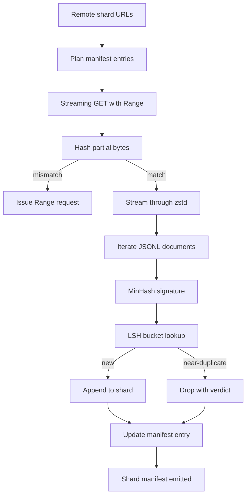

# Large Corpus Downloader

> Huấn luyện một mô hình ngôn ngữ bắt đầu từ lâu trước lượt tiến đầu tiên. Corpus phải nằm trên đĩa, được giải nén, loại trùng, và có thể định địa chỉ, với câu chuyện tiếp tục đã được giải quyết trước khi mạng ngắt ở 4 phần trăm. Bài này xây dựng một trình tải truyền luồng kéo các shard nén, giải nén ngay khi chạy bằng Zstandard, lấy dấu vân tay các bản gần trùng qua MinHash cộng băm nhạy cảm cục bộ, và ghi một bản kê khai shard mà phần còn lại của pipeline có thể tin tưởng.

**Type:** Build
**Languages:** Python
**Prerequisites:** Phase 19 lessons 30-37
**Time:** ~90 minutes

## Learning Objectives

- Truyền luồng các shard từ xa bằng `urllib` và giải nén bằng `zstandard` mà không đệm toàn bộ file trong bộ nhớ.
- Tiếp tục các bản tải một phần bằng cách phát các yêu cầu HTTP `Range` theo một độ lệch byte đã xác minh.
- Xây dựng một chữ ký MinHash theo tài liệu và chia nhóm nó bằng LSH để các bản gần trùng va chạm.
- Phát ra một bản kê khai shard với băm nội dung, kích thước byte, số tài liệu, và kết luận loại trùng.

## The Problem

Lần đầu bạn huấn luyện trên một corpus 200 GB mạng ngắt ở phần trăm 41 và script thoát với một ngoại lệ `urllib`. Lần thứ hai nó ngắt ở phần trăm 78. Đến phần trăm 99 bạn đã viết lại vòng lặp ba lần. Hai thất bại bạn phải thiết kế đối phó từ phút đầu là tiếp tục tải một phần và loại bỏ tài liệu trùng. Cả hai đều có lời giải nổi tiếng; cả hai thường bị bỏ qua vì pipeline bắt đầu như một lệnh gọi `requests.get` một dòng đã mọc răng.

Tiếp tục là một vấn đề HTTP. Máy chủ phải tuân thủ `Range`, máy khách phải theo dõi độ lệch đã xác minh theo một bản ghi trên đĩa, và độ lệch đã xác minh phải sống sót qua cái chết tiến trình. Nếu độ lệch và file lệch nhau dù chỉ một byte bản tải tiếp tục ghi rác và corpus bị hỏng theo cách chỉ xuất hiện trong phân tách token.

Loại trùng là một vấn đề chữ ký. Loại trùng băm chính xác bỏ lỡ các bản gần trùng: cùng bài Wikipedia xuất hiện với ba chân trang mẫu khác nhau, cùng file mã với một header giấy phép khác, cùng bài blog với một tham số theo dõi trên mọi liên kết. MinHash cộng LSH bắt những trường hợp này với chi phí dưới tuyến tính. Chi phí là một chữ ký mỗi tài liệu và một tra cứu nhóm mỗi chữ ký.

## The Concept



### Streaming with `urllib`

`urllib.request.urlopen` của thư viện tiêu chuẩn trả về một đối tượng giống file. Bọc nó trong một `zstandard.ZstdDecompressor().stream_reader` và các byte chảy từ mạng qua bộ giải nén vào bộ lặp tài liệu mà không bao giờ hiện thực hóa shard nén hoặc shard đã giải nén trong bộ nhớ. Chi phí bộ nhớ duy nhất là bộ đệm dòng, chữ ký MinHash cho tài liệu hiện tại, và chỉ mục LSH.

### Resume with `Range`

Trình tải ghi hai file mỗi shard: chính shard và một checkpoint `.partial.json`. Checkpoint ghi `verified_bytes`, `expected_size`, `sha256_prefix` (được tính trên `verified_bytes` byte đầu), và URL nguồn. Khi khởi động trình tải đọc checkpoint, tính lại `sha256_prefix` trên các byte trên đĩa, và chỉ tiếp tục nếu băm được tính lại khớp. Nếu băm sai phần tải một phần bị loại và bản tải bắt đầu lại từ byte không. Hỏng âm thầm là không thể vì các byte được xác minh được kiểm tra, không phải giả định.

### MinHash plus LSH

MinHash ước lượng độ tương tự Jaccard của hai tập trong không gian cố định. Với một tài liệu tập là các shingle (n-gram chồng lấn) của văn bản nó. Chữ ký là `k` giá trị băm nhỏ nhất, một cho mỗi hàm băm độc lập. Hai tài liệu có độ tương tự Jaccard `s` có xác suất `s` đồng ý ở bất kỳ thành phần chữ ký đơn lẻ nào.

LSH sau đó nhóm `k` thành phần thành `b` dải, mỗi dải `r` hàng, trong đó `k = b * r`. Hai tài liệu va chạm ở ít nhất một dải với xác suất `1 - (1 - s^r)^b`, là một ngưỡng sắc quanh giá trị `s` mà bạn điều chỉnh `(b, r)` tới. Ngưỡng cho loại trùng corpus điển hình là `s = 0.8`, mà tài liệu nghiên cứu LSH đạt với `k = 128`, `b = 32`, `r = 4`.

### Shard manifest as a contract

Đầu ra bền vững duy nhất của trình tải là bản kê khai. Bản kê khai giữ, theo shard, URL, số byte đã giải nén, số tài liệu, số tài liệu duy nhất sau loại trùng, và sha256 của file shard cuối. Phân tách token hạ nguồn đọc bản kê khai, không phải danh sách thư mục. Nếu một shard thiếu hoặc sha256 của nó sai, bản kê khai nói cho giai đoạn tiếp theo từ chối bắt đầu. Bản kê khai là cạnh quyết định giữa "dữ liệu đã được tải" và "dữ liệu đã được tải và có thể xác minh".

```figure
cap-corpus-downloader
```

## Build It

`code/main.py` triển khai:

- `ShardPlanner` - đọc một danh sách URL shard và tạo các mục bản kê khai được lên kế hoạch.
- `StreamingDownloader` - mở một luồng `urllib` với `Range` tùy chọn, ghi vào một file tạm, cập nhật checkpoint `.partial.json` trên mỗi đoạn, và xác minh tiền tố sha256 khi tiếp tục.
- `ZstdDocIterator` - bọc luồng giống file trong `zstandard.ZstdDecompressor` và sinh một tài liệu mỗi dòng.
- `MinHasher` - tạo một chữ ký `k` thành phần cho một chuỗi bằng một họ seed băm cố định.
- `LSHIndex` - chia nhóm các chữ ký theo dải và báo cáo các va chạm.
- `Dedup` - kết hợp bộ băm và chỉ mục để gắn nhãn mỗi tài liệu `keep` hoặc `near_duplicate` cùng id shard khớp.
- `ManifestWriter` - thu thập các thống kê theo shard và ghi `manifest.json`.

Một demo ở cuối file xây dựng một corpus tổng hợp nhỏ trên đĩa, nén nó bằng `zstandard`, tải nó qua một URL `file://`, loại trùng, và in bản kê khai.

Chạy nó:

```bash
python3 code/main.py
```

Script thoát với mã không và in một tóm tắt bản kê khai.

## Production Patterns

Bốn mẫu mở rộng bài này đến các corpus thực.

**Checkpoint trước khi ghi.** `.partial.json` phải được `fsync` trước khi các byte được thêm vào shard. Nếu không mất điện đảo thứ tự: các byte shard trên đĩa, checkpoint không có chúng, lần tiếp tục sau tin nó có ít byte đã xác minh hơn thực tế, các byte hậu tố trùng làm hỏng file. Checkpoint trước, rồi ghi. Đây là cùng kỷ luật như một nhật ký ghi trước.

**Chỉ mục LSH được chia shard.** Một chỉ mục LSH duy nhất trên toàn corpus không vừa RAM ở quy mô 200 GB. Phân vùng chỉ mục LSH theo băm dải đầu tiên, lưu các phân vùng trên đĩa, và chỉ tham khảo phân vùng mà một chữ ký mới sẽ rơi vào. Chi phí là một lần đọc đĩa bổ sung mỗi tài liệu; lợi ích là chỉ mục LSH không còn là một trần bộ nhớ cứng.

**Đánh dấu xóa, không xóa.** Các bản trùng bị bỏ được ghi trong bản kê khai với kết luận `near_duplicate` và id shard của tài liệu chúng va chạm. Xóa chúng làm mất liên kết giữa bản trùng và bản được giữ của nó. Đánh dấu xóa bảo toàn dấu vết kiểm toán và để một lượt hạ nguồn thay đổi ý định về ngưỡng.

**Sha256 theo shard trong bản kê khai, cộng một sha256 bản kê khai.** Chính bản kê khai nhận một băm nội dung. Các giai đoạn hạ nguồn xác minh băm bản kê khai trước khi tin các mục theo shard. Không có điều này bản kê khai là bề mặt tấn công âm thầm: một kẻ tấn công có thể chỉnh sửa một file duy nhất có thể làm hỏng toàn pipeline.

## Use It

Các mẫu sản xuất:

- **Tiếp tục trên mọi lần chạy CI.** Các runner CI tạm thời. Trình tải phải giả định một đĩa mới ở mọi lần chạy và phục hồi từ bộ nhớ đệm hoặc từ xa. `--cache-dir` là một cờ hạng nhất.
- **Loại trùng trước phân tách token.** Phân tách token tốn kém. Chạy nó hai lần trên cùng tài liệu là gấp đôi chi phí cho cùng đường cong mất mát. Loại trùng ở thượng nguồn phân tách token, không phải hạ nguồn.
- **Bản kê khai làm cổng hợp nhất.** Lần chạy huấn luyện đọc sha256 bản kê khai từ một commit được ghim. Một phiên bản tập dữ liệu mới đòi hỏi một commit bản kê khai mới. Liên kết giữa mã và dữ liệu là git, không phải truyền miệng.

## Ship It

`outputs/skill-corpus-downloader.md` sẽ, trên một dự án thực, mô tả những URL nào cấp cho trình tải, cách thư mục checkpoint được bố trí, độ rộng shingle và bộ ba `(k, b, r)` nào việc loại trùng sử dụng, và bản kê khai nằm ở đâu trong kiểm soát phiên bản. Bài này cung cấp bộ máy.

## Exercises

1. Thêm một cờ `--shingle-width` và đo kết luận loại trùng thay đổi thế nào ở các độ rộng 3, 5, 9. Bảo vệ lựa chọn mặc định.
2. Thêm hỗ trợ gzip cạnh zstd bằng cách nhận diện các byte đặc trưng. Trình tải không nên yêu cầu bên gọi chỉ định codec.
3. Thêm một chế độ `--resume-only` từ chối bắt đầu một bản tải mới nếu không tìm thấy checkpoint. Hữu ích trong CI để giữ một lần chạy khỏi vô tình kéo lại 200 GB.
4. Chuyển chỉ mục LSH sang một file shelf hoặc sqlite và đo thông lượng so với biến thể trong bộ nhớ.
5. Thêm một kiểm tra sha256 bản kê khai khi khởi động. Trình tải nên đóng khi thất bại nếu bản kê khai trên đĩa không khớp băm bản kê khai trong `manifest.lock`.

## Key Terms

| Thuật ngữ | Cách mọi người nói | Ý nghĩa thực sự |
|------|-----------------|------------------------|
| Shard (Mảnh dữ liệu) | "Một file" | Một phần corpus tự chứa với sha256 riêng, được dùng làm đơn vị tiếp tục và loại trùng |
| MinHash signature (Chữ ký MinHash) | "Dấu vân tay" | Một bản phác `k` thành phần của một tập, trong đó mỗi thành phần là giá trị nhỏ nhất của một hàm băm độc lập trên tập |
| LSH band (Dải LSH) | "Nhóm" | Một nhóm `r` thành phần chữ ký được dùng làm một khóa nhóm duy nhất để phát hiện va chạm |
| Verified bytes (Các byte đã xác minh) | "Độ lệch tiếp tục" | Các byte trên đĩa có tiền tố sha256 khớp checkpoint; độ lệch an toàn duy nhất để tiếp tục từ đó |
| Manifest (Bản kê khai) | "Chỉ mục" | Bản ghi bền vững duy nhất về những gì trình tải tạo ra, bao gồm các băm nội dung |

## Further Reading

- [RFC 7233](https://datatracker.ietf.org/doc/html/rfc7233) - các yêu cầu HTTP Range, giao thức tiếp tục
- [Zstandard format specification](https://datatracker.ietf.org/doc/html/rfc8478) - định dạng frame khiến giải nén truyền luồng an toàn
- [MinHash](https://en.wikipedia.org/wiki/MinHash) - họ chữ ký bài này sử dụng
- [Locality-sensitive hashing](https://en.wikipedia.org/wiki/Locality-sensitive_hashing) - sơ đồ chia dải đằng sau ngưỡng loại trùng
- Phase 19 · 43 - corpus được phân tách token HDF5 mà trình tải cấp dữ liệu
- Phase 19 · 44 - lịch cosine huấn luyện trên corpus
- Phase 19 · 45 - vòng lặp AMP tiêu thụ lịch
