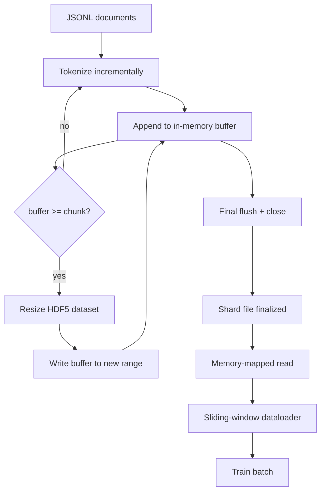

# HDF5 Tokenized Corpus

> Corpus đã tải phải nằm trong một bố cục mà bộ huấn luyện có thể truyền luồng từ đó ở tốc độ đường truyền. JSONL trên đĩa không sống sót qua 16 worker dataloader. HDF5 với một tập dữ liệu số nguyên chia đoạn, có thể đổi kích thước thì có. Bài này xây dựng phân tách token truyền luồng vào một tập dữ liệu HDF5 có thể đổi kích thước, ghi chia shard trên nhiều file, đọc ánh xạ bộ nhớ lúc huấn luyện, và một dataloader cửa sổ trượt tạo các chuỗi độ dài cố định với đóng gói đúng.

**Type:** Build
**Languages:** Python
**Prerequisites:** Phase 19 lessons 30-37
**Time:** ~90 minutes

## Learning Objectives

- Truyền luồng các tài liệu vào một tập dữ liệu số nguyên HDF5 có thể đổi kích thước với chia đoạn tất định.
- Chia shard việc ghi trên nhiều file HDF5 để thất bại có giới hạn và có thể song song.
- Đọc lại các token qua bố cục chia đoạn được bộ nhớ đệm trang hỗ trợ của HDF5 để dataloader chỉ sao chép vào bộ đệm lô tại thời điểm lô.
- Triển khai một dataloader cửa sổ trượt phát ra các chuỗi huấn luyện độ dài cố định với các quy tắc đóng gói rõ ràng.

## The Problem

Một lần chạy huấn luyện mô hình ngôn ngữ hiện đại đọc token ở hàng trăm nghìn mẫu mỗi giây trên hàng chục worker. JSONL trên đĩa chết ở lỗi trang bộ nhớ đệm nguội đầu tiên: bộ phân tích JSON chậm, các ranh giới tài liệu không thể định địa chỉ, và tìm đến "mẫu 4,217,884" đòi hỏi quét file. Ngay cả Parquet, vốn nén tốt, cũng không phù hợp vì bộ huấn luyện không muốn các cột; nó muốn một luồng token phẳng với truy cập ngẫu nhiên O(1).

HDF5 phù hợp vì nó cung cấp một tập dữ liệu chỉ số nguyên, chia đoạn, có thể đổi kích thước mà các đoạn thân thiện với bộ nhớ đệm trang lúc đọc. Bộ huấn luyện yêu cầu một phần của `tokens[3,200,000 : 3,200,8192]` và HDF5 sao chép hyperslab được yêu cầu từ bộ nhớ đệm trang vào một mảng NumPy vừa được cấp phát. Chi phí là một handle file mở và một dấu chân bộ nhớ đệm trang cỡ đoạn mỗi worker, không đáng kể so với chi phí giải mã JSONL.

Vấn đề xây dựng là làm phía ghi trung thực. Các tập dữ liệu có thể đổi kích thước dễ bị sử dụng sai: ghi từng tài liệu và file HDF5 phân mảnh đến mức không dùng được. Ghi mọi tài liệu trong một lần đổi kích thước và một cái chết tiến trình làm mất toàn shard. Kỷ luật đúng là đệm-rồi-mở rộng, với kích thước bộ đệm khớp kích thước đoạn, và ghi chia shard chia khối lượng công việc trên các file để một sự cố mất nhiều nhất một shard.

## The Concept



### Resizable HDF5 done right

Tập dữ liệu token được tạo với `maxshape=(None,)` và một `chunks=(chunk_size,)` cố định. Việc ghi tiến hành bằng cách đệm token trong một mảng NumPy độ dài `chunk_size`. Khi bộ đệm đầy, tập dữ liệu được đổi kích thước thêm chính xác `chunk_size` và bộ đệm được ghi vào khoảng mới. Ở cuối shard bộ đệm còn dư được ghi vào một khoảng một phần cuối. Mọi lần ghi liên tục và căn chỉnh theo đoạn trừ lần cuối, mà bộ đọc được bảo cắt tại `token_count` được ghi trong các thuộc tính HDF5 của shard.

### Sharded write

Một file HDF5 duy nhất là một điểm lỗi duy nhất. Pipeline ghi các shard song song: mỗi shard đầu vào từ Phase 19 bài 42 tạo một shard đầu ra HDF5. Một chỉ mục `shards.json` ghi, theo shard, đường dẫn file, số token, số tài liệu, và một sha256 trên các token. Bộ huấn luyện đọc `shards.json` để tính các độ lệch toàn cục và xác thực corpus.

### Memory-mapped read

Lúc huấn luyện mỗi worker mở phần các file HDF5 của mình trong chế độ `swmr=True` và yêu cầu `tokens[start:stop]`. Bố cục đoạn của HDF5 biến điều này thành một lần đọc được bộ nhớ đệm trang hỗ trợ khi đoạn nóng. Worker không bao giờ hiện thực hóa toàn file: phần cắt được sao chép vào bộ đệm lô của dataloader, mà dataloader sau đó sao chép vào một tensor huấn luyện bộ nhớ ghim tại thời điểm lô. Đường nóng có một syscall mỗi chuyển tiếp đoạn; mọi thứ khác là truy cập RAM.

### Sliding-window dataloader

Dataloader là giai đoạn duy nhất biết về độ dài chuỗi huấn luyện. Nó chọn một chỉ số bắt đầu ngẫu nhiên trong luồng token toàn cục, đọc `window_size + 1` token, và trả về `(input, target) = (tokens[:-1], tokens[1:])`. Các ranh giới tài liệu không được thực thi: một cửa sổ có thể vắt qua hai tài liệu, với một `boundary_token_id` rõ ràng giữa chúng để mô hình học sử dụng dấu phân cách. Đây là quy tắc đóng gói tiêu chuẩn; nó cũng là quy tắc một người mới quên, kết thúc với một corpus gồm 8 phần trăm token ranh giới huấn luyện và 92 phần trăm văn bản tự nhiên.

```figure
cc-hdf5-corpus
```

## Build It

`code/main.py` triển khai:

- `Tokenizer` - một tokenizer tất định ở mức byte đủ tốt cho demo. Giao diện là `encode(text) -> list[int]` và `vocab_size`.
- `HDF5ShardWriter` - mở một tập dữ liệu số nguyên có thể đổi kích thước, đệm token đến kích thước đoạn, đổi kích thước và ghi theo các bước kích thước cố định, ghi `token_count` và `sha256` làm các thuộc tính HDF5 khi đóng.
- `ShardedTokenizationPipeline` - lặp các tài liệu đầu vào, định tuyến chúng đến một bộ ghi, và phát ra một chỉ mục `shards.json`.
- `MmapTokenStore` - mở các file shard để đọc ánh xạ bộ nhớ, tính các độ lệch toàn cục, cung cấp một API `get_slice(start, stop)` duy nhất.
- `SlidingWindowDataloader` - chọn các cửa sổ ngẫu nhiên từ luồng toàn cục và sinh các mảng NumPy `(input_ids, target_ids)`.

Một demo ở cuối file xây dựng một corpus tí hon trong bộ nhớ, phân tách token thành hai shard, mở chúng qua ánh xạ bộ nhớ, chạy dataloader trong 10 lô, và in hình dạng theo lô cùng một checksum.

Chạy nó:

```bash
python3 code/main.py
```

Script thoát với mã không và in các checksum lô.

## Production Patterns

Bốn mẫu mở rộng bài này đến một lần chạy huấn luyện thực.

**Kích thước đoạn bằng lần đọc điển hình.** Bộ huấn luyện đọc `window_size + 1` token mỗi mẫu. Đặt đoạn HDF5 thành một bội số của `window_size` và các lần đọc được căn chỉnh bộ nhớ đệm trang. Các đoạn không khớp giảm thông lượng còn một nửa vì mọi mẫu chạm hai đoạn.

**Số token trong các thuộc tính, không phải trong tập dữ liệu.** Phần cắt cuối của tập dữ liệu có thể chỉ đầy một phần vì kích thước đoạn không chia hết ranh giới tài liệu. Lưu `token_count` thực như một thuộc tính HDF5 trên tập dữ liệu và để bộ đọc cắt tại giá trị đó. Không có điều này bộ đọc đi quá cuối vào các token đệm không và mô hình học dự đoán không.

**Sha256 chia shard với xác minh song song.** Mỗi shard có sha256 riêng trên các byte token. Bộ huấn luyện có thể xác minh mọi shard song song trước khi huấn luyện bắt đầu. Một sha256 sai làm thất bại lần chạy sớm, không phải ở epoch ba sau mười sáu giờ.

**`swmr=True` ở cả hai phía, với `libver="latest"` trên bộ ghi.** Chế độ Một-bộ-ghi-Nhiều-bộ-đọc yêu cầu bộ ghi mở với `libver="latest"`, tạo mọi tập dữ liệu từ trước, rồi đặt `file.swmr_mode = True`. Sau đó bộ ghi phải gọi `dataset.flush()` sau mỗi lần đổi kích thước để các worker đọc (được mở với `swmr=True`) thấy dữ liệu nhất quán. Bỏ qua `libver="latest"` hoặc bật SWMR sau các thay đổi cấu trúc là một nguồn phổ biến của lỗi "file bị khóa".

## Use It

Các mẫu sản xuất:

- **Một HDF5 mỗi shard nguồn.** Trình tải (bài 42) phát ra một shard mỗi URL; phân tách token (bài này) phát ra một HDF5 mỗi shard nguồn. Ánh xạ 1:1 làm tiếp tục và phục hồi lỗi một phần trở nên tầm thường.
- **Id token ranh giới.** Token ranh giới là một phần của từ vựng tokenizer và là token duy nhất dataloader chèn. Mất mát huấn luyện che token ranh giới nếu mô hình được kỳ vọng bỏ qua nó; nếu không nó học dùng nó như một dấu phân cách chuỗi.
- **`shards.json` làm nguồn sự thật.** Thêm một shard mới nghĩa là ghi HDF5, tính sha256 của nó, và thêm một mục. Bộ huấn luyện đọc file một lần khi khởi động và không bao giờ chạm danh sách thư mục.

## Ship It

`outputs/skill-hdf5-tokenized-corpus.md` sẽ, trên một dự án thực, mô tả tokenizer nào cấp cho pipeline, kích thước đoạn nào khớp cửa sổ của bộ huấn luyện, `shards.json` nằm ở đâu trong kiểm soát phiên bản, và cách các worker dataloader được chia shard trên các file. Bài này cung cấp bộ máy.

## Exercises

1. Thêm một cờ `--compression gzip` vào bộ ghi HDF5 và đo chi phí thông lượng trên corpus demo. Bảo vệ lựa chọn mặc định.
2. Thêm một seed tất định vào dataloader cửa sổ trượt và xác minh hai lần chạy với cùng seed tạo các lô giống hệt.
3. Thêm một chế độ `--validate` đọc mọi shard, tính lại sha256 trên các token của nó, và so sánh với `shards.json`. CI nên chạy điều này trước khi huấn luyện bắt đầu.
4. So sánh thông lượng dataloader ở các kích thước đoạn bằng, bằng một nửa, và gấp đôi kích thước cửa sổ. Báo cáo hiệu ứng bộ nhớ đệm trang.
5. Thêm một cờ `--max-document-tokens` cắt ngắn các tài liệu rất dài lúc ghi. Bảo vệ đánh đổi so với quyết định lúc đọc.

## Key Terms

| Thuật ngữ | Cách mọi người nói | Ý nghĩa thực sự |
|------|-----------------|------------------------|
| Resizable dataset (Tập dữ liệu có thể đổi kích thước) | "Chỉ thêm" | Một tập dữ liệu HDF5 với `maxshape=(None,)` tăng qua các lệnh gọi `resize` theo các bước cỡ đoạn |
| Chunked layout (Bố cục chia đoạn) | "Cách HDF5 lưu nó" | Các trang trên đĩa kích thước cố định mà kernel có thể ánh xạ bộ nhớ và dataloader có thể đọc liên tục |
| `swmr` mode (Chế độ swmr) | "Đọc trong khi ghi" | Chế độ Một-bộ-ghi-Nhiều-bộ-đọc cho phép các worker dataloader dùng chung file an toàn |
| Shard index (Chỉ mục shard) | "shards.json" | Chỉ mục bền vững của mọi shard token với các độ lệch và băm nội dung |
| Sliding window (Cửa sổ trượt) | "Mẫu huấn luyện" | Một phần cắt độ dài cố định của luồng token toàn cục mà bộ huấn luyện ghép với đích dịch một vị trí của nó |

## Further Reading

- [HDF5 chunking documentation](https://support.hdfgroup.org/documentation/hdf5/latest/hdf5_chunking.html) - bố cục tập dữ liệu chia đoạn, có thể đổi kích thước mà bài này sử dụng
- [h5py user guide](https://docs.h5py.org/en/stable/) - các binding Python cho HDF5
- [NumPy memory mapping](https://numpy.org/doc/stable/reference/generated/numpy.memmap.html) - thành phần cơ sở phía đọc mà HDF5 cung cấp qua h5py
- Phase 19 · 42 - trình tải mà đầu ra của nó bài này phân tách token
- Phase 19 · 44 - lịch cosine tiêu thụ dataloader này
- Phase 19 · 45 - vòng lặp AMP bọc bước huấn luyện
