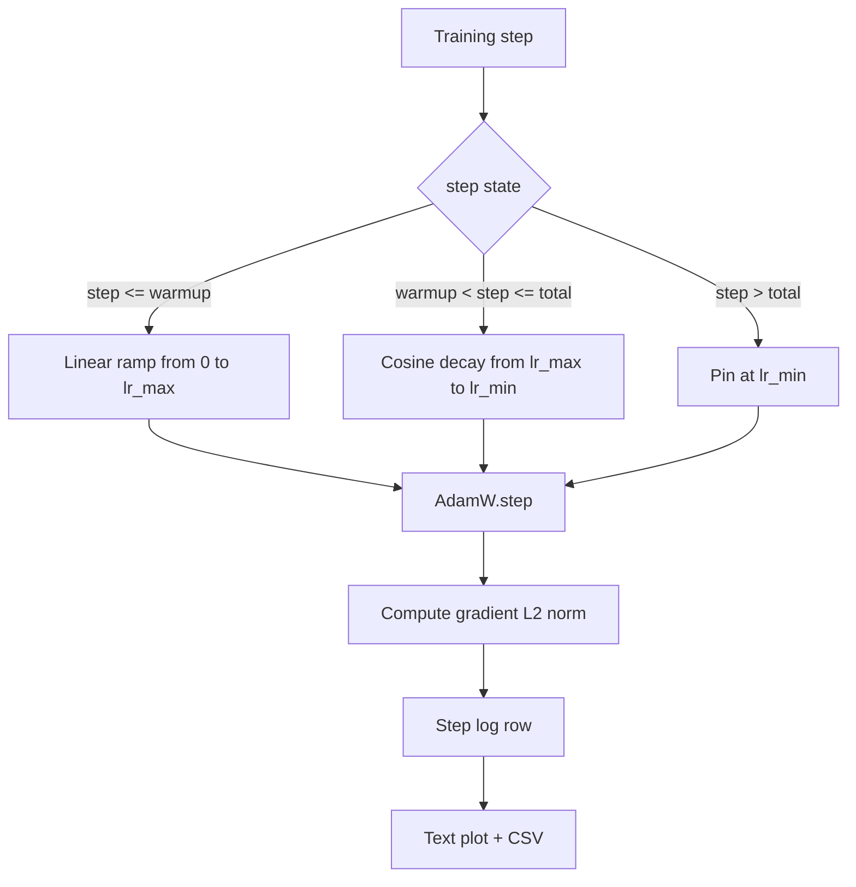

# Cosine LR with Linear Warmup

> Lịch tốc độ học là quyết định quan trọng thứ hai sau hàm mất mát. AdamW với một suy giảm cosine và một khởi động tuyến tính là mặc định hiện đại cho huấn luyện mô hình ngôn ngữ vì nó để mô hình thấy một kích thước bước hiệu dụng nhỏ trong nghìn cập nhật đầu mong manh, tăng đến một đỉnh được cấu hình, và suy giảm mượt trở lại gần không. Bài này xây dựng lịch đó, vẽ đường cong theo các bước huấn luyện, ghi nhật ký các chuẩn gradient cạnh lịch, và chứng minh lịch tôn trọng các ranh giới khởi động, đỉnh, và suy giảm.

**Type:** Build
**Languages:** Python
**Prerequisites:** Phase 19 lessons 30-37
**Time:** ~90 minutes

## Learning Objectives

- Triển khai một bộ tối ưu AdamW được nối với một lịch tốc độ học cosine với khởi động tuyến tính.
- Tính giá trị chính xác của lịch tại bất kỳ bước nào mà không có độ trôi dấu phẩy động giữa các lần chạy.
- Ghi nhật ký chuẩn L2 gradient cạnh tốc độ học để sức khỏe huấn luyện có thể quan sát.
- Hiển thị lịch thành một biểu đồ văn bản mắt có thể đọc và một CSV bất kỳ công cụ nào có thể tiêu thụ.

## The Problem

Nghìn cập nhật huấn luyện đầu là ồn ào nhất. Các trọng số mô hình vẫn gần khởi tạo. Ước lượng mômen bậc hai đang chạy của bộ tối ưu chưa ổn định. Chuẩn gradient lớn và nhiễu. Nếu tốc độ học ở đỉnh trong những cập nhật này mô hình hoặc phân kỳ hoàn toàn hoặc ổn định vào một bình nguyên mất mát mà nó không bao giờ thoát. Hai cách sửa nổi tiếng là cắt gradient, chủ đề của Phase 19 bài 45, và một lịch tốc độ học bắt đầu nhỏ rồi tăng dần.

Lịch cosine với khởi động có ba vùng. Từ bước không đến bước `warmup_steps` tốc độ học tăng tuyến tính từ không đến đỉnh được cấu hình `lr_max`. Từ bước `warmup_steps` đến bước `total_steps` tốc độ học đi theo nửa trên của một đường cong cosine, suy giảm từ `lr_max` xuống `lr_min`. Sau `total_steps` tốc độ học được ghim tại `lr_min` để một bộ huấn luyện cấu hình sai vượt quá không âm thầm thoát khỏi lịch.

Vấn đề xây dựng là các lịch dễ sai lệch một. Lỗi lệch một xuất hiện sáu giờ vào một lần chạy huấn luyện dưới dạng một tốc độ học cao hơn hoặc thấp hơn 1 phần trăm tại thời điểm mô hình bắt đầu quá khớp, điều không thể thấy trừ khi lịch được kiểm thử toàn diện tại các ranh giới.

## The Concept



### Warmup formula

Với `step` trong `[0, warmup_steps]` và `warmup_steps > 0`, tốc độ học là `lr_max * step / warmup_steps`. Trường hợp suy biến `warmup_steps = 0` được coi là "không khởi động": lịch bắt đầu trực tiếp tại `lr_max` ở bước không và ngay lập tức đi vào suy giảm cosine. Một số harness kiểm thử truyền `warmup_steps = 0` để kiểm tra lịch vẫn tạo một đường cong dùng được.

### Cosine formula

Với `step` trong `(warmup_steps, total_steps]` tốc độ học là `lr_min + 0.5 * (lr_max - lr_min) * (1 + cos(pi * progress))` trong đó `progress = (step - warmup_steps) / max(1, total_steps - warmup_steps)`. Tại `step = warmup_steps` cosine tính ra `cos(0) = 1`, cho `lr_max`, khớp chính xác điểm cuối khởi động. Tại `step = total_steps` cosine tính ra `cos(pi) = -1`, cho `lr_min`, khớp chính xác điểm cuối suy giảm.

Tính liên tục tại cả hai điểm cuối không phải tình cờ. Nó là lý do lịch được triển khai như một hàm duy nhất trên `step`, không phải ba hàm khác nhau được dán lại. Một lịch dán mất một ranh giới lần đầu `lr_max` được thay đổi.

### Floor after total steps

Với `step > total_steps` tốc độ học giữ tại `lr_min`. Hợp đồng rõ ràng: lịch không phát sinh lỗi và không ngoại suy; nó ghim tại sàn và để bộ huấn luyện ghi một cảnh báo. Các bộ huấn luyện cần kéo dài huấn luyện thay đổi `total_steps` của lịch, không phải vòng lặp.

### Gradient norm logging alongside the rate

Lịch là một nửa sức khỏe huấn luyện. Chuẩn gradient là nửa còn lại. Vòng lặp huấn luyện ghi nhật ký cả hai theo bước. Một lần chạy huấn luyện phân kỳ cho thấy chuẩn gradient tăng vọt trước mất mát; một khởi động được điều chỉnh tốt giữ chuẩn tăng tuyến tính với tốc độ; một đỉnh quá mạnh xuất hiện như một chuẩn giữ cao sau khởi động. Tập dữ liệu trên đĩa là `step, lr, grad_l2_norm, loss`. CSV là bản ghi bền vững duy nhất.

```figure
cap-cosine-warmup
```

## Build It

`code/main.py` triển khai:

- `CosineWithWarmup` - một hàm phi trạng thái `lr(step) -> float` trên lịch được cấu hình.
- `TrainState` - bọc một mô hình, một bộ tối ưu `AdamW`, và lịch thành một hàm bước duy nhất.
- `TrainState.step` - chạy một lượt tiến, một lượt ngược, ghi nhật ký chuẩn L2 gradient, và áp dụng `lr(step)` cho bộ tối ưu.
- `plot_schedule_ascii` - hiển thị lịch như một biểu đồ văn bản mắt có thể đọc.
- `write_schedule_csv` - phát ra một hàng mỗi bước với tốc độ học.

Một demo ở cuối file xây dựng một mô hình `nn.Linear` tí hon, huấn luyện trong 20 bước trên một lô đầu vào cố định, và in tốc độ học, chuẩn gradient, và mất mát theo bước. Lịch cũng được hiển thị như một biểu đồ văn bản cho kiểm tra hợp lý bằng mắt.

Chạy nó:

```bash
python3 code/main.py
```

Script thoát với mã không và in một nhật ký huấn luyện theo bước cùng biểu đồ lịch.

## Production Patterns

Bốn mẫu nâng lịch thành một hiện vật sản xuất.

**Lịch nằm trong một cấu hình, không phải trong mã.** Bộ huấn luyện đọc `warmup_steps`, `total_steps`, `lr_max`, `lr_min` từ một cấu hình YAML hoặc JSON được commit vào git. Lịch có thể tái lập vì cấu hình được định địa chỉ theo nội dung; lịch có thể kiểm toán vì cấu hình là một phần của diff PR.

**Bộ đếm bước đơn điệu và tách khỏi epoch.** Một số framework nhầm bước và epoch khi tập dữ liệu được chia shard hoặc dataloader khởi động lại. Lịch đọc `global_step` từ checkpoint của bộ huấn luyện, không phải từ một bộ đếm cục bộ. Một lần chạy tiếp tục đi tiếp tại vị trí lịch đúng vì bộ đếm bước là trục bền vững.

**Biểu đồ lịch trong thư mục lần chạy.** Mọi lần chạy huấn luyện ghi `outputs/lr_schedule.png` (hoặc trong bài này một biểu đồ văn bản) vào thư mục lần chạy của nó. Một người rà soát lướt thư mục có thể kiểm tra hợp lý lịch mà không chạy lại gì. Điều này bắt lớp lỗi cấu hình lịch sai tại thời điểm PR.

**Lược đồ hàng nhật ký cố định.** `step, lr, grad_l2_norm, loss` theo thứ tự đó. Một notebook hoặc bảng điều khiển hạ nguồn đọc lược đồ; đổi tên một cột mà không tăng phiên bản làm mất hiệu lực mọi bảng điều khiển hiện có.

## Use It

Các mẫu sản xuất:

- **Quét đỉnh trước khi quét bất cứ thứ gì khác.** `lr_max` là núm nhạy nhất. Quét nó trên một mô hình nhỏ trước; `lr_max` tối ưu biến thiên yếu theo kích thước mô hình, nên quét mô hình nhỏ là một tiên nghiệm mạnh.
- **Khởi động là một tỷ lệ của tổng số bước, không phải một số đếm tuyệt đối.** Một lần chạy 200 triệu bước với 2,000 bước khởi động bắt đầu ở đỉnh gần như ngay lập tức; một lần chạy 20,000 bước với cùng số khởi động trong 10 phần trăm. Cấu hình khởi động như một tỷ lệ (điển hình: 1-3 phần trăm) để lịch biến thiên theo thời lượng huấn luyện.
- **`lr_min` khác không là có chủ ý.** Một sàn bằng 10 phần trăm `lr_max` giữ bộ tối ưu học trong đuôi dài. Một lịch `lr_min = 0` tạo một đường cong huấn luyện trông tuyệt trên biểu đồ và một mô hình chưa thực sự huấn luyện xong.

## Ship It

`outputs/skill-cosine-warmup.md` sẽ, trên một dự án thực, mô tả cấu hình nào mang lịch, bộ đếm toàn cục được đọc từ bước bộ huấn luyện nào, và lần quét `lr_max` nào tạo ra giá trị được triển khai. Bài này cung cấp bộ máy.

## Exercises

1. Thêm một biến thể căn bậc hai nghịch đảo của lịch và so sánh nó trên một lần chạy huấn luyện đồ chơi 200 bước. Đường cong nào tạo mất mát cuối thấp hơn?
2. Thêm một cờ `--restart` thêm một khởi động thứ hai tại `total_steps / 2`. Bảo vệ việc các khởi động lại ấm cải thiện hay gây hại trên lần chạy đồ chơi.
3. Thêm một kiểm thử đơn vị rằng lịch liên tục: với mọi bước trong `[0, total_steps]` chênh lệch `|lr(step+1) - lr(step)|` được chặn bởi `lr_max / warmup_steps`.
4. Nối lịch vào một `torch.optim.lr_scheduler.LambdaLR` để nó kết hợp với mã framework. Bài học dùng một hàm bước thông thường; lớp bọc thay đổi gì?
5. Thêm một cờ `--plot-png` ghi một biểu đồ thực qua `matplotlib`. Bảo vệ việc biểu đồ văn bản của bài học hay PNG là mặc định tốt hơn cho các lần chạy CI.

## Key Terms

| Thuật ngữ | Cách mọi người nói | Ý nghĩa thực sự |
|------|-----------------|------------------------|
| Warmup (Khởi động) | "Bắt đầu chậm" | Tăng tuyến tính từ không đến `lr_max` trong `warmup_steps` cập nhật đầu |
| Cosine decay (Suy giảm cosine) | "Giảm mượt" | Đường cong cosine nửa trên từ `lr_max` đến `lr_min` trong các bước còn lại |
| Floor (Sàn) | "Sau huấn luyện" | Giá trị `lr_min` cố định mà lịch ghim tại đó sau `total_steps` |
| Gradient norm (Chuẩn gradient) | "L2 của gradient" | Chuẩn Euclid của vector gradient được nối, được ghi nhật ký mỗi bước |
| Global step (Bước toàn cục) | "Trục lịch" | Một bộ đếm bước đơn điệu sống sót qua khởi động lại và điều khiển lịch |

## Further Reading

- [Loshchilov and Hutter, SGDR: Stochastic Gradient Descent with Warm Restarts (arXiv 1608.03983)](https://arxiv.org/abs/1608.03983) - bài báo tham chiếu của lịch cosine
- [Loshchilov and Hutter, Decoupled Weight Decay Regularization (arXiv 1711.05101)](https://arxiv.org/abs/1711.05101) - bài báo tham chiếu của AdamW
- [PyTorch torch.optim.lr_scheduler](https://docs.pytorch.org/docs/stable/optim.html#how-to-adjust-learning-rate) - cách các hàm bước kết hợp với các bộ lập lịch framework
- Phase 19 · 42 - trình tải mà corpus của nó lịch này tiêu thụ
- Phase 19 · 43 - dataloader mà lịch cùng phát triển
- Phase 19 · 45 - cắt gradient và AMP, lớp tiếp theo trong vòng lặp
