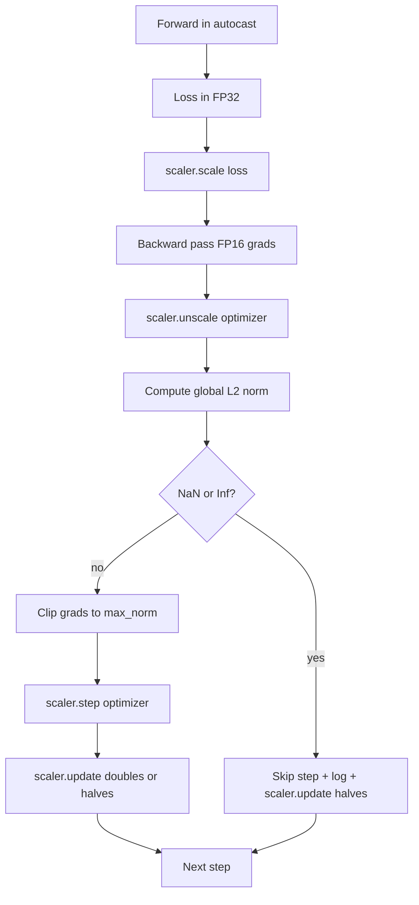

# Gradient Clipping and Mixed Precision

> Bộ tối ưu và lịch từ bài trước giả định các gradient hợp lý. Chúng thường không như vậy. Một lô xấu duy nhất có thể làm chuẩn gradient tăng vọt ba bậc độ lớn. Huấn luyện độ chính xác hỗn hợp khuếch đại điều này bằng cách đưa tràn FP16 vào phía mất mát. Bài này xây dựng hai dây an toàn mà huấn luyện sản xuất không thể cung cấp nếu thiếu: cắt gradient về một chuẩn L2 toàn cục được cấu hình, và một vòng lặp độ chính xác hỗn hợp với autocast và GradScaler phát hiện NaN và Inf, bỏ qua bước gọn gàng, và ghi nhật ký hệ số tỷ lệ để điều tra.

**Type:** Build
**Languages:** Python
**Prerequisites:** Phase 19 lessons 30-37
**Time:** ~90 minutes

## Learning Objectives

- Tính chuẩn L2 toàn cục trên mọi gradient tham số và cắt tại chỗ khi nó vượt một ngưỡng được cấu hình.
- Bọc một bước huấn luyện trong autocast cùng một GradScaler để các lượt tiến và ngược FP16 sống sót qua tràn.
- Phát hiện NaN và Inf trong mất mát hoặc gradient, bỏ qua bước bộ tối ưu, và ghi nhật ký lần bỏ qua.
- Báo cáo hệ số tỷ lệ của GradScaler mỗi bước để một chuỗi dài các lần bỏ qua có thể thấy ngay.

## The Problem

Một lần chạy huấn luyện đã chạy sạch hôm qua tạo ra một đường cong mất mát dựng đứng ở bước 8,217. Thủ phạm là một lô duy nhất có chuẩn gradient 4,200, gấp hai mươi lần đỉnh trước. Không có cắt bộ tối ưu áp dụng một bước đặt lại mọi điều mô hình đã học trong giờ trước. Với một phép cắt L2 toàn cục tại chuẩn 1.0, cùng lô đóng góp một cập nhật chuẩn đơn vị; mất mát giữ trên đường xu hướng; lần chạy sống sót.

Huấn luyện độ chính xác hỗn hợp đẩy thông lượng lên 2-3x bằng cách tính lượt tiến và phần lớn lượt ngược trong FP16. Chi phí là FP16 có một khoảng số mũ hẹp. Một gradient điển hình tràn trong FP16 tính ra Inf, lan truyền qua các lớp tiếp theo thành NaN, đặt mọi trọng số thành NaN ở bước bộ tối ưu tiếp theo. GradScaler của PyTorch giải quyết điều này bằng cách nhân mất mát với một hệ số tỷ lệ lớn trước lượt ngược và chia các gradient cho cùng hệ số trước bước bộ tối ưu. Nếu bất kỳ gradient nào là Inf hoặc NaN lúc bỏ tỷ lệ, scaler bỏ qua bước và giảm một nửa hệ số tỷ lệ; nếu N bước trước sạch, scaler tăng gấp đôi hệ số. Qua quá trình huấn luyện hệ số tìm giá trị cao nhất khoảng FP16 cho phép.

Vấn đề xây dựng là nối hai thứ chính xác. Cắt trước bỏ tỷ lệ và ngưỡng nằm trên các gradient có tỷ lệ; cắt sau bỏ tỷ lệ và thứ tự thao tác trên GradScaler quan trọng. Thứ tự đúng là: `scaler.scale(loss).backward()`, rồi `scaler.unscale_(optimizer)`, rồi `clip_grad_norm_`, rồi `scaler.step(optimizer)`, rồi `scaler.update()`. Bất kỳ thứ tự khác nào tạo một vòng lặp hỏng âm thầm.

## The Concept



### Global L2 norm

Chuẩn L2 toàn cục là chuẩn Euclid của vector gradient được nối, không phải chuẩn theo tham số. PyTorch triển khai điều này như `torch.nn.utils.clip_grad_norm_(parameters, max_norm)`. Hàm trả về chuẩn trước cắt để bài học có thể ghi nhật ký cả giá trị tự nhiên và đã cắt, cần thiết cho chẩn đoán "chúng ta đang cắt ở mọi bước".

### autocast and GradScaler

`torch.amp.autocast(device_type)` là trình quản lý ngữ cảnh chạy có chọn lọc các thao tác đủ điều kiện (hầu hết các thao tác lớp matmul) trong FP16. `torch.amp.GradScaler(device_type)` là hàm hỗ trợ chia tỷ lệ mất mát trước lượt ngược và chia tỷ lệ nghịch các gradient trước bước bộ tối ưu. Hai thứ được thiết kế cùng nhau; dùng một mà không có cái kia là một lỗi cấu hình mà kiểm thử nên bắt.

Bài học sử dụng autocast CPU vì đó là thứ chạy trong CI; cùng mẫu chuyển nguyên văn sang CUDA bằng cách đổi `device_type="cpu"` thành `device_type="cuda"`. GradScaler trên CPU là một stub (autocast CPU đã hoạt động trong BF16 mặc định và không cần chia tỷ lệ mất mát), nhưng bài học bao gồm các vị trí gọi để hệ thống nối giống hệt vòng lặp GPU.

### NaN and Inf detection

Phát hiện xảy ra ở hai nơi. Đầu tiên, chính mất mát được kiểm tra bằng `torch.isfinite` trước lượt ngược; một mất mát Inf hoặc NaN không tạo gradient hữu ích và được bỏ qua mà không vào bộ tối ưu. Thứ hai, sau `scaler.unscale_(optimizer)` bài học quét các gradient đã bỏ tỷ lệ bằng `has_non_finite_grad(...)` và coi bất kỳ Inf hoặc NaN nào là một lần bỏ qua. Hai kiểm tra cùng nhau bao phủ cả chế độ lỗi lượt tiến và lượt ngược.

### Scaling factor diagnostics

Hệ số tỷ lệ là trạng thái nội bộ của GradScaler. Mỗi bước bài học đọc `scaler.get_scale()` và ghi nhật ký nó cạnh tốc độ học và chuẩn gradient. Một lần chạy khỏe cho thấy hệ số tỷ lệ tăng theo các lũy thừa hai cho đến khi bão hòa gần `2^17` hoặc `2^18`. Một lần chạy hành xử sai cho thấy hệ số dao động giữa các giá trị cao và thấp, là tín hiệu rằng các gradient của mô hình đôi khi trong khoảng và đôi khi không. Chẩn đoán không thể thấy nếu không ghi nhật ký.

```figure
grad-clip-monitor
```

## Build It

`code/main.py` triển khai:

- `clip_global_l2_norm` - một lớp bọc quanh `torch.nn.utils.clip_grad_norm_` trả về cả chuẩn trước cắt và sau cắt.
- `has_non_finite_grad` - một hàm hỗ trợ quét các gradient tìm NaN và Inf.
- `AmpTrainState` - bọc một mô hình, một bộ tối ưu `AdamW`, một GradScaler, và một thiết bị autocast. Cung cấp một `step(inputs, targets)` chạy toàn bộ pipeline cắt, chia tỷ lệ, và bỏ qua khi NaN.
- `StepLog` và `SkipLog` - các bản ghi theo bước có cấu trúc.
- Một demo huấn luyện một mô hình `nn.Linear` nhỏ trong 20 bước, chèn một Inf vào gradient ở bước 5 để thực thi đường bỏ qua, và in nhật ký kết quả.

Chạy nó:

```bash
python3 code/main.py
```

Script thoát với mã không và in một nhật ký theo bước với mỗi hàng được gắn nhãn `STEP` hoặc `SKIP`; ít nhất một hàng là một `SKIP`.

## Production Patterns

Bốn mẫu nâng vòng lặp thành một bước huấn luyện sản xuất.

**Bộ đếm bỏ qua như một cảnh báo, không phải một dòng nhật ký.** Một ít bước bị bỏ qua mỗi lần chạy huấn luyện là khỏe. Hàng trăm lần bỏ qua mỗi epoch là một cảnh báo cứng: mô hình ở một chế độ FP16 không thể chứa và vòng lặp đang thất bại âm thầm. Bài học theo dõi một tỷ lệ bỏ qua trượt 1,000 bước và sẽ, trong sản xuất, gọi trực khi tỷ lệ trên 5 phần trăm.

**Ngưỡng cắt nằm trong cấu hình.** `max_norm = 1.0` là mặc định hiện đại cho huấn luyện mô hình ngôn ngữ. Quét nó trên một mô hình nhỏ trước; các ngưỡng lớn hơn để mô hình phục hồi từ các lô thực sự khó; các ngưỡng nhỏ hơn giới hạn trường hợp xấu nhất với chi phí một đường cong mất mát nhiễu hơn. Ngưỡng thuộc về cùng cấu hình YAML hoặc JSON như lịch từ bài 44.

**Nhật ký chuẩn đi vào một CSV cùng lịch.** Các cột CSV là `step, lr, grad_l2_pre_clip, grad_l2_post_clip, loss, skipped, skip_reason, scaler_scale`. Một người rà soát mở file thấy lịch, câu chuyện gradient, hệ số tỷ lệ, và kết quả bỏ qua (với lý do của nó) trong một hàng. Chia các cột trên các file là một công thức cho các phân tích lệch nhau.

**`scaler.update()` chạy mỗi bước, ngay cả khi bỏ qua.** Trên một bước sạch scaler đọc bộ đếm không-inf của nó, tăng nó, và có thể tăng gấp đôi hệ số. Trên một bước bị bỏ qua scaler giảm một nửa hệ số và đặt lại bộ đếm. Quên `update()` trên đường bỏ qua là lỗi tạo ra "hệ số tỷ lệ chưa bao giờ thay đổi."

## Use It

Các mẫu sản xuất:

- **Thiết bị autocast khớp thiết bị bộ tối ưu.** `torch.amp.autocast(device_type="cuda")` cho huấn luyện GPU; `torch.amp.autocast(device_type="cpu")` cho CPU. Trộn thiết bị tạo một lỗi kiểu âm thầm xuất hiện như một đường cong mất mát trông ổn nhưng một mô hình không học.
- **Kiểm tra mất mát trước lượt ngược.** `torch.isfinite(loss).all()` là một phép rút gọn tensor; chi phí không đáng kể và tiết kiệm trên một mất mát NaN là cả một bước huấn luyện. Luôn chạy nó.
- **`set_to_none=True` trong `zero_grad`.** Đặt các gradient thành `None` thay vì không, cho phép bộ tối ưu bỏ qua tính toán cho các nhóm tham số không bị ảnh hưởng. Thiết lập là một cải thiện thông lượng miễn phí và một giảm nhẹ bề mặt lỗi.

## Ship It

`outputs/skill-clip-amp.md` sẽ, trên một dự án thực, mô tả ngưỡng cắt và thiết bị autocast nào bước huấn luyện sử dụng, CSV theo bước nằm ở đâu trong kiểm soát phiên bản, và ngưỡng cảnh báo tỷ lệ bỏ qua sản xuất là gì. Bài này cung cấp bộ máy.

## Exercises

1. Thay việc chèn Inf tổng hợp bằng một đỉnh mất mát thực (nhân đích của một lô với 1e8) và xác minh đường bỏ qua kích hoạt.
2. Thêm một chế độ `--bf16` chuyển autocast sang BF16 thay vì FP16. BF16 có khoảng số mũ rộng hơn FP16 và hiếm khi cần chia tỷ lệ mất mát; xác minh tỷ lệ bỏ qua giảm về không trên cùng demo.
3. Thêm một kiểm thử đơn vị rằng lớp bọc cắt gradient trả về chuẩn trước cắt và sau cắt chính xác khi không có cắt.
4. Thêm một phép tính tỷ lệ bỏ qua cửa sổ trượt và một cờ CLI làm thất bại lần chạy nếu tỷ lệ vượt một ngưỡng được cấu hình trong 100 bước liên tiếp.
5. Nối vòng lặp để ghi CSV chuẩn (`step, lr, grad_l2_pre_clip, grad_l2_post_clip, loss, skipped, skip_reason, scaler_scale`) và xác nhận file sống sót qua một Ctrl-C bằng cách flush sau mỗi hàng.

## Key Terms

| Thuật ngữ | Cách mọi người nói | Ý nghĩa thực sự |
|------|-----------------|------------------------|
| Global L2 norm (Chuẩn L2 toàn cục) | "Đích cắt" | Chuẩn Euclid của vector gradient được nối trên mọi tham số có thể huấn luyện |
| autocast | "Độ chính xác hỗn hợp" | Thực thi FP16 (hoặc BF16) có chọn lọc các thao tác đủ điều kiện bên trong một khối `with` |
| GradScaler | "Bộ chia tỷ lệ mất mát" | Hàm hỗ trợ nhân mất mát trước lượt ngược và chia tỷ lệ nghịch gradient trước bước bộ tối ưu |
| Skip (Bỏ qua) | "Bước xấu" | Một bước bộ tối ưu bị từ chối vì gradient hoặc mất mát không hữu hạn; scaler giảm một nửa hệ số |
| Scaling factor (Hệ số tỷ lệ) | "Trạng thái scaler" | Hệ số nhân hiện tại của GradScaler; tăng gấp đôi sau các đoạn sạch và giảm một nửa ở mọi lần bỏ qua |

## Further Reading

- [Micikevicius et al., Mixed Precision Training (arXiv 1710.03740)](https://arxiv.org/abs/1710.03740) - đề xuất chia tỷ lệ mất mát gốc
- [Pascanu, Mikolov, Bengio, On the difficulty of training recurrent neural networks (arXiv 1211.5063)](https://arxiv.org/abs/1211.5063) - bài báo tham chiếu cắt gradient
- [PyTorch torch.amp.GradScaler](https://docs.pytorch.org/docs/stable/amp.html) - API scaler mà bài này bọc
- [PyTorch torch.nn.utils.clip_grad_norm_](https://docs.pytorch.org/docs/stable/generated/torch.nn.utils.clip_grad_norm_.html) - thành phần cơ sở cắt mà bài này sử dụng
- Phase 19 · 42 - trình tải mà corpus của nó cấp cho vòng lặp
- Phase 19 · 43 - dataloader mà vòng lặp tiêu thụ
- Phase 19 · 44 - lịch mà vòng lặp này kết hợp
