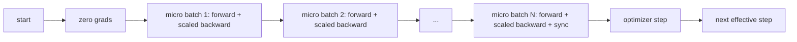
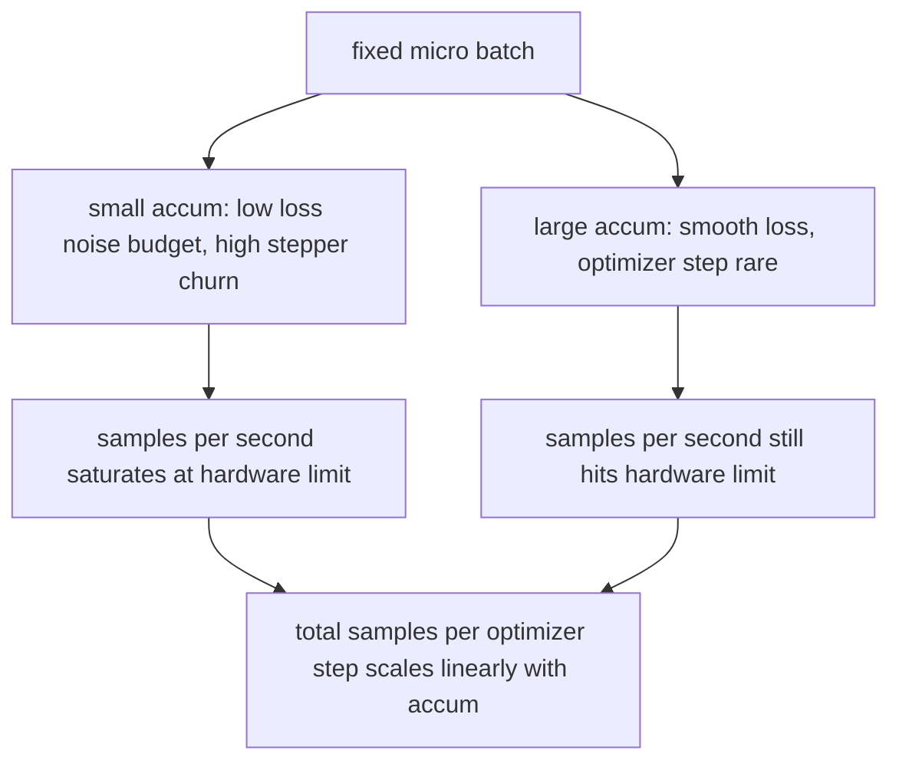

# Gradient Accumulation

> Huấn luyện ở một lô hiệu dụng bạn không đủ khả năng đáp ứng, từng lô vi mô một. Chia tỷ lệ mất mát, giữ bước bộ tối ưu, và để các gradient chất đống.

**Type:** Build
**Languages:** Python
**Prerequisites:** Phase 19 lessons 42 to 45
**Time:** ~90 minutes

## Learning Objectives

- Suy ra đẳng thức batch hiệu dụng: `effective_batch = micro_batch * accum_steps * world_size`, tức là `micro_batch * accum_steps` trên thiết bị đơn mà bài học này sử dụng.
- Triển khai chia tỷ lệ mất mát theo lô vi mô để gradient tích lũy khớp một lượt ngược lô đầy đủ duy nhất.
- Bỏ qua đồng bộ bộ tối ưu cho đến lô vi mô cuối (đồng bộ ở bước cuối).
- Đọc một đường cong thông lượng so với lô hiệu dụng và giải thích lợi ích giảm dần.

## The Problem

Bạn muốn huấn luyện ở một lô hiệu dụng 512 vì đường cong mất mát mượt hơn và bước bộ tối ưu hợp lý hơn ở quy mô đó. Bộ tăng tốc trên bàn chứa 32 ví dụ trước khi hết bộ nhớ. Tăng gấp đôi lô không phải một lựa chọn. Giảm một nửa mô hình không phải một lựa chọn. Mẹo mà lĩnh vực tìm đến năm 2017 và chưa bao giờ ngừng sử dụng là chạy 16 lượt ngược, để các gradient tích lũy bên trong các bộ đệm tham số, và chỉ thực hiện bước bộ tối ưu khi số đếm đạt mục tiêu.

Rủi ro là mất mát không còn là cùng con số nó từng là ở lô lớn hơn. Entropy chéo của 16 lô nhỏ được cộng ngây thơ bằng 16 lần mất mát của một lô đầy đủ. Không chia tỷ lệ, hướng gradient đúng nhưng độ lớn sai, và bước bộ tối ưu lớn gấp 16 lần. Cách sửa là một phép chia. Cách sửa cũng dễ quên.

## The Concept



Hợp đồng ngắn:

- Mất mát cho mỗi lô vi mô được chia cho `accum_steps` trước `backward()`. PyTorch mặc định cộng các gradient vào `param.grad`; phép chia đẩy tổng đang chạy trở lại đúng thang đo.
- Bước bộ tối ưu kích hoạt một lần mỗi lô hiệu dụng, sau lượt ngược của lô vi mô cuối. Thực hiện bước giữa quá trình tích lũy làm lệch mọi tham số mà phần còn lại của lần chạy phụ thuộc vào.
- Trạng thái bộ tối ưu (các bộ đệm động lượng, các mômen Adam) tiến một lần mỗi bước hiệu dụng, không phải một lần mỗi lô vi mô. Các trung bình trượt hàm mũ nếu không sẽ thấy sai tần suất và đốt qua lịch.
- Trên một thiết bị duy nhất đây là ghi sổ. Trên một cụm đa rank cùng mẫu bọc các lô vi mô không cuối trong một ngữ cảnh `no_sync` bỏ qua all-reduce gradient; lô vi mô cuối rút gọn toàn bộ gradient tích lũy trong một lượt thay vì trả chi phí mạng N lần.

### The equivalence proof in code

```python
loss = criterion(model(x_full), y_full)
loss.backward()
opt.step()
```

tương đương với

```python
for x, y in chunks(x_full, y_full, n):
    scaled = criterion(model(x), y) / n
    scaled.backward()
opt.step()
```

sai khác ở thứ tự cộng dấu phẩy động. Bộ đệm gradient tích lũy ở cuối vòng lặp là cùng tensor mà một lượt ngược lô đầy đủ duy nhất sẽ tạo ra. Mã bài học khẳng định điều này với chênh lệch trị tuyệt đối tối đa dưới 1e-4 trong `equivalence_check`.

### Where the cost goes

Mỗi lô vi mô tốn một lượt tiến và một lượt ngược. Với tích lũy bạn đánh đổi bộ nhớ lấy thời gian. Đường cong thông lượng trong `outputs/accum-curve.json` cho thấy điều xảy ra khi lô hiệu dụng tăng ở lô vi mô cố định:



Không có bữa trưa miễn phí. Tăng gấp đôi `accum_steps` tăng gấp đôi thời gian thực mỗi bước bộ tối ưu. Điều thay đổi là phương sai của ước lượng gradient: ở cùng ngân sách thời gian thực bạn đã thực hiện ít bước bộ tối ưu hơn nhưng mỗi bước được lấy trung bình trên nhiều mẫu hơn. Tài liệu coi lô lớn và lô nhỏ là các bài toán tối ưu khác nhau; bài học ở đây mang tính cơ học, không phải thống kê.

```figure
cc-grad-accumulation
```

## Build It

`code/main.py` là hiện vật có thể chạy. Nó làm ba việc.

### Step 1: equivalence check

`equivalence_check()` xây dựng hai bản sao của cùng mạng với cùng seed. Một bản thấy một lô 16 mẫu trong một lượt tiến. Bản kia thấy bốn đoạn 4 mẫu với mất mát chia cho bốn. Hàm so sánh các bộ đệm gradient trước bước bộ tối ưu và các tham số sau đó. Khẳng định là `max_abs_diff < 1e-4`.

### Step 2: sync-on-last-step pattern

`train_one_optimizer_step` duyệt các lô vi mô. Với mọi lô vi mô trừ lô cuối nó vào `no_sync_context(model)`. Trên một tiến trình duy nhất ngữ cảnh không làm gì; trên DDP đây là nơi all-reduce gradient được bỏ qua. Việc ghi sổ vẫn như nhau bất kể trường hợp nào. Một `sync_counter` ghi số lần chúng ta rời phạm vi no_sync; với N lô vi mô số đếm là một mỗi bước hiệu dụng, không phải N.

### Step 3: the throughput curve

`sweep_effective_batches` chạy cùng mô hình với một lô vi mô cố định và một danh sách bước tích lũy. Với mỗi thiết lập nó ghi nhật ký:

- `samples_per_sec`: tổng số mẫu đã thấy chia cho thời gian thực
- `median_step_ms`: phân vị thứ 50 theo bước hiệu dụng
- `sync_calls`: các điểm tập thể được thực thi
- `avg_loss`: trung bình trên các bước bộ tối ưu của lần quét

Đầu ra nằm trong `outputs/accum-curve.json` và có thể tái sử dụng từ một notebook.

Chạy nó:

```bash
python3 code/main.py
```

Script in diff tương đương, rồi bảng quét, rồi đường dẫn JSON. Mã thoát không.

## Use It

Trong huấn luyện sản xuất, tích lũy gradient nằm sau một núm điều chỉnh. Mẫu của PyTorch là `accumulation_steps = effective_batch // (micro_batch * world_size)`. Các framework mà bạn không được phép sử dụng ở đây bọc cùng vòng lặp, nhưng các bước giống nhau: chia tỷ lệ mất mát, bỏ đồng bộ trên các lô vi mô không cuối, tích lũy, thực hiện bước một lần.

Ba mẫu trong thực tế:

- Kích thước lô vi mô được chọn để lấp đầy bộ nhớ thiết bị. Bất cứ thứ gì nhỏ hơn lãng phí chu kỳ bộ tăng tốc. Bất cứ thứ gì lớn hơn gây sập.
- Lô hiệu dụng được chọn từ một lịch tốc độ học. Các lô hiệu dụng lớn cần tốc độ học được chia tỷ lệ và khởi động; đây là quy tắc chia tỷ lệ tuyến tính được nói đến từ năm 2017.
- Số lần tích lũy là cầu nối giữa hai thứ và là núm duy nhất bạn tự do điều chỉnh lúc chạy mà không viết lại bộ nạp dữ liệu.

## Ship It

`outputs/skill-gradient-accumulation.md` nắm bắt công thức để một đồng nghiệp có thể thả nó vào một repo mới: chia tỷ lệ mất mát theo `accum_steps`, bỏ đồng bộ bộ tối ưu trên các lô vi mô không cuối, thực hiện bước bộ tối ưu một lần mỗi lô hiệu dụng, ghi nhật ký thông lượng so với lô hiệu dụng dưới dạng JSON để đánh đổi có thể thấy.

## Exercises

1. Chạy lại lần quét với `--num-steps 100` và vẽ số mẫu mỗi giây so với lô hiệu dụng. Đường cong phẳng ở đâu?
2. Thêm một biến thể chia tỷ lệ sai (không chia) và cho thấy diff tham số ở bước 1 so với tham chiếu.
3. Đổi SGD thành AdamW và xác nhận trạng thái bộ tối ưu tiến một lần mỗi bước hiệu dụng, không phải một lần mỗi lô vi mô.
4. Đưa vào một lớp bọc `DistributedDataParallel` thực và định tuyến `no_sync_context` tới phương thức của nó. Xác nhận sync_calls giảm N-1 mỗi lô hiệu dụng.
5. Sửa kiểm tra tương đương để so sánh hai cách chia vi mô khác nhau (2 nhân 8 so với 4 nhân 4) và giải thích bất kỳ dung sai nào bạn cần nới lỏng.

## Key Terms

| Thuật ngữ | Cách mọi người nói | Ý nghĩa thực sự |
|------|-----------------|------------------------|
| Micro batch (Lô vi mô) | Lô bạn chạy lượt tiến | Phần vừa trong bộ nhớ trong một lượt tiến duy nhất |
| Accum steps (Các bước tích lũy) | Các lượt ngược mỗi bước | Số lượt ngược được cộng trước một bước bộ tối ưu |
| Effective batch (Lô hiệu dụng) | Lô | Lô vi mô nhân số bước tích lũy nhân kích thước thế giới song song dữ liệu |
| Loss scaling (Chia tỷ lệ mất mát) | Chia cho N | Phép chia theo lô vi mô để các gradient được cộng khớp lô đầy đủ |
| Sync on last (Đồng bộ ở cuối) | Bỏ phần còn lại | Chỉ chạy phép tập thể gradient trên lượt ngược cuối trong cửa sổ |

## Further Reading

- Tài liệu PyTorch về `DistributedDataParallel.no_sync` cho phiên bản sản xuất của mẹo đồng bộ ở bước cuối.
- Goyal và cộng sự, 2017, về chia tỷ lệ tuyến tính cho huấn luyện lô lớn, lý do chuẩn để quan tâm đến lô hiệu dụng.
- Trình theo dõi issue PyTorch về các tương tác tích lũy gradient với bỏ tỷ lệ độ chính xác hỗn hợp.
- Các bài Phase 19 từ 42 đến 45 bao phủ mô hình, bộ nạp dữ liệu, bộ tối ưu, và bộ khung huấn luyện mà bài này giả định.
- Phase 19 bài 47 bao phủ checkpoint và tiếp tục để một lần chạy tích lũy dài sống sót qua một trần thời gian thực.
