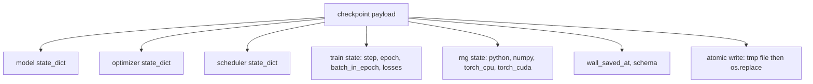
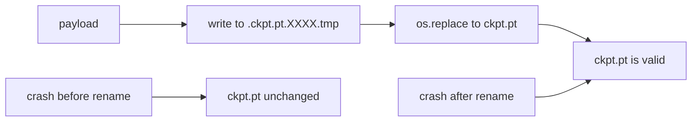
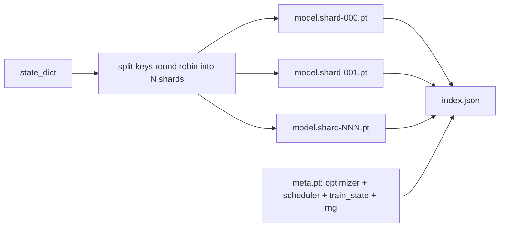

# Checkpoint Save and Resume

> Các lần ngắt huấn luyện giết các lần chạy; checkpoint cho chúng tiếp tục. Lưu mô hình, bộ tối ưu, bộ lập lịch, lịch sử mất mát, bộ đếm bước, và trạng thái RNG, một cách nguyên tử, để một lần diệt ở bất kỳ thời điểm nào đều để lại một file hợp lệ trên đĩa.

**Type:** Build
**Languages:** Python
**Prerequisites:** Phase 19 lessons 42 to 45
**Time:** ~90 minutes

## Learning Objectives

- Thu thập toàn bộ trạng thái huấn luyện vào một payload duy nhất có thể được nạp lại vào một tiến trình mới.
- Triển khai lưu nguyên tử bằng ghi vào file tạm rồi đổi tên để một sự cố không bao giờ để lại một file ghi nửa chừng.
- Khôi phục trạng thái RNG cho Python, NumPy, và PyTorch để mất mát sau tiếp tục khớp đường cơ sở không bị ngắt.
- Xây dựng một bố cục checkpoint chia shard cho các mô hình không còn vừa một file duy nhất, với các shard được xác minh băm và một chỉ mục JSON.

## The Problem

Bạn đặt một công việc huấn luyện trong 18 giờ. Trần thời gian thực là 4 giờ. Cụm khởi động lại ở giờ 11 vì ai đó ở cấp lương cao hơn bạn phê duyệt một nâng cấp kernel. Không có checkpoint bạn bắt đầu lại. Không có tiếp tục bạn cũng mất trạng thái bộ tối ưu đã mất 11 giờ đầu để học, nên ngay cả nếu các trọng số mô hình sống sót, các mômen AdamW đã mất và bước tiếp theo giật theo một hướng mà quỹ đạo huấn luyện đã đi qua.

Hiện vật đúng là một file duy nhất giữ mọi thứ cần để tiếp tục: các tham số mô hình, trạng thái bộ tối ưu, trạng thái bộ lập lịch, lịch sử mất mát cho các biểu đồ, các bộ đếm bước và epoch và lô-trong-epoch hiện tại, và trạng thái RNG cho mọi nguồn ngẫu nhiên. Không có trạng thái RNG đường cong mất mát được tiếp tục là một đường cong khác. Cùng mô hình, cùng dữ liệu, xáo trộn khác, mặt nạ dropout khác, con số khác trên bảng điều khiển.

Lưu nguyên tử là nửa còn lại của hợp đồng. Ghi vào tên file cuối nghĩa là một sự cố giữa lần ghi để lại một file hỏng; việc tiếp tục đọc rác. Ghi vào một file tạm trong cùng thư mục rồi đổi tên nghĩa là một sự cố giữa lần ghi để nguyên file tốt trước đó. Đổi tên là nguyên tử trên các hệ thống file POSIX.

## The Concept



### The five state buckets

| Nhóm | Tại sao nó quan trọng |
|--------|----------------|
| Mô hình | Trọng số và buffer; mô hình là gì. |
| Bộ tối ưu | Động lượng và các mômen thích ứng; không có chúng bước tiếp theo là một bài toán tối ưu khác. |
| Bộ lập lịch | Tốc độ học đang ở đâu trên đường cong của nó; các lịch cosine đặc biệt quan tâm. |
| Các bộ đếm huấn luyện | Bước, epoch, lô-trong-epoch, cùng lịch sử mất mát vẽ bảng điều khiển. |
| Trạng thái RNG | Tính tất định cho dropout, xáo trộn dữ liệu, và bất kỳ lấy mẫu nào bên trong mô hình. |

### Atomic save



Hai quy tắc. Thứ nhất, file tạm nằm trong cùng thư mục như đích để đổi tên nằm trong cùng hệ thống file; đổi tên chéo thiết bị không nguyên tử. Thứ hai, tên tạm là duy nhất theo lần thử để hai bộ ghi không giẫm lên nhau.

### Sharded checkpoints

Khi mô hình lớn payload một file trở nên quá lớn để nạp nhanh, quá lớn để kiểm tra, và quá đau đớn khi một ổ chia sẻ mạng trục trặc giữa lần đọc. Cách sửa là chia trạng thái tham số thành các shard và ghi một chỉ mục nhỏ gắn chúng lại.



Chỉ mục ghi số shard, sha256 của mỗi shard, và sha256 của file meta. Loader thất bại rõ ràng khi bất kỳ băm nào không khớp. Các shard có thể nằm trên các đĩa vật lý khác nhau; meta nhỏ và được đọc trước.

### Resume continues mid epoch

Một lần tiếp tục nhảy đến đầu epoch tiếp theo lãng phí từ vài phút đến một ngày. Cách sửa là `(epoch, batch_in_epoch)` cùng trạng thái RNG. Sau khi nạp, vòng lặp huấn luyện tua nhanh bộ sinh số ngẫu nhiên qua các lô đã được tiêu thụ trong epoch hiện tại và tiếp tục từ `batch_in_epoch`. Mã bài học làm chính xác điều này; khẳng định là quỹ đạo mất mát sau tiếp tục khớp đường cơ sở không bị ngắt trong 1e-4.

```figure
cc-atomic-checkpoint
```

## Build It

`code/main.py` cung cấp bốn thành phần cơ sở và một trình điều khiển demo.

### Step 1: capture and restore RNG state

`capture_rng_state` trả về một dict với `random.getstate` của Python, `np.random.get_state` của NumPy, và các byte RNG CPU và CUDA của PyTorch. Mọi phần được lưu như các số, tuple, và danh sách Python thông thường (mảng khóa của NumPy đi qua `tolist()`), để loader trong Bước 3 có thể đọc lại nó mà không giải pickle các đối tượng tùy ý. `restore_rng_state` đảo ngược nó. Tensor CPU là một bộ đệm byte uint8 mà RNG của PyTorch biết cách tiêu thụ.

### Step 2: atomic save

`atomic_save` ghi payload vào một file tạm trong thư mục đích, rồi `os.replace` hoán đổi nó vào tên cuối. `atomic_write_json` làm tương tự cho chỉ mục chia shard.

### Step 3: full checkpoint round trip

`save_checkpoint` đóng gói mô hình, bộ tối ưu, bộ lập lịch, trạng thái huấn luyện, và RNG vào một dict. `load_checkpoint` đảo ngược nó và trả về một `TrainState`. Trường schema là hook nâng cấp: các thay đổi định dạng tương lai tăng chuỗi phiên bản và loader điều phối.

`load_checkpoint` gọi `torch.load(..., weights_only=True)`. Một file `.pt` là một pickle, và giải pickle một file không đáng tin cậy bằng `weights_only=False` chạy bất kỳ mã nào file đặt tên. Loader chỉ trọng số chấp nhận các tensor và container cơ sở và từ chối mọi thứ khác, đó là lý do Bước 1 giữ trạng thái RNG trong các danh sách thông thường. Các kiểm tra toàn vẹn phát sinh `ValueError` thay vì dùng `assert`, vì `python -O` loại bỏ các assert. Dùng torch 2.6 hoặc mới hơn: trước bản phát hành đó `weights_only=True` có một cách vượt qua đã biết (CVE-2025-32434), nên bảo đảm mà bài này dựa vào chỉ đúng từ 2.6 trở đi.

### Step 4: sharded variant

`save_sharded_checkpoint` phân luân phiên các khóa tham số trên N shard, ghi mỗi shard với lần lưu nguyên tử riêng, ghi một file meta với bộ tối ưu và bộ lập lịch và trạng thái huấn luyện, và ghi chỉ mục JSON với các sha256 shard. `load_sharded_checkpoint` xác minh mọi shard trước khi hợp nhất và từ chối bất kỳ đường dẫn shard nào phân giải ra ngoài thư mục checkpoint.

### Step 5: resume demo

`run_resume_demo` huấn luyện một mô hình nhỏ trong `total_steps`, lưu một checkpoint tại `interrupt_at`, rồi tiếp tục. Một tiến trình thứ hai khôi phục checkpoint và chạy các bước còn lại. Hàm trả về chênh lệch tuyệt đối tối đa giữa hai quỹ đạo mất mát sau điểm ngắt. Với RNG được khôi phục, chênh lệch bằng không hoặc nhiễu dấu phẩy động.

Chạy nó:

```bash
python3 code/main.py
```

Các demo một file và chia shard đều khẳng định max-diff dưới 1e-4. Tóm tắt nằm trong `outputs/resume-demo.json`.

## Use It

Các ngăn xếp huấn luyện sản xuất cung cấp checkpoint như một phần của bộ huấn luyện. Hình thức giống nhau: mô hình + bộ tối ưu + bộ lập lịch + các bộ đếm + RNG, được ghi nguyên tử, được đặt tên theo bước để bản mới nhất dễ tìm. Các bố cục chia shard hỗ trợ nạp mô hình lớn bằng các lần đọc song song; index.json là thứ khiến điều đó hoạt động.

Bốn mẫu cần thực thi:

- **Nạp bằng `weights_only=True`.** Một checkpoint kéo từ một ổ chia sẻ hoặc một bản tải là đầu vào không đáng tin cậy. Loader chỉ trọng số ngăn một file độc hại chạy mã trên máy tiếp tục.
- **Schema là một chuỗi trong payload.** Các lần di chuyển phân nhánh theo nó. Không có nó bạn không thể phát triển định dạng mà không phá các lần chạy cũ.
- **Sha256 mọi shard.** Một bản tải âm thầm bị cắt ngắn là loại lỗi tệ nhất; loader thất bại nhanh hoặc nó thất bại muộn.
- **Giữ nhịp checkpoint trung thực.** Lưu mỗi N bước và mỗi phút thời gian thực, cái nào ngắn hơn. Nếu không bước dài bị sập lãng phí cả một cửa sổ công việc.

## Ship It

`outputs/skill-checkpoint-save-resume.md` là công thức cho bất kỳ script huấn luyện mới nào: hình thức payload, ghi nguyên tử, thu thập RNG, chỉ mục chia shard. Đặt skill vào một repo, nối `save_checkpoint` tại vị trí lưu định kỳ, nối `load_checkpoint` lúc khởi động, và lần chạy sống sót qua các lần diệt.

## Exercises

1. Thay chia shard luân phiên bằng chia shard theo nhóm tham số (các lớp kết thúc bằng `.weight` so với `.bias`). Khi nào mỗi bố cục thích hợp hơn?
2. Mở rộng vòng lặp lưu để giữ K checkpoint cuối và loại bỏ các bản cũ hơn. K đúng là gì khi đĩa nhỏ?
3. Thêm một cờ `--ckpt-every-seconds` kích hoạt một lần lưu theo một khoảng thời gian thực, không chỉ số bước.
4. Thêm một đường xác minh checksum chạy lúc khởi động, quét mọi checkpoint trong thư mục, và báo cáo những bản nào hỏng.
5. Triển khai một hàm `migrate_v1_to_v2` thêm một trường mới vào payload và tăng chuỗi schema. Làm việc nạp chấp nhận cả hai phiên bản.

## Key Terms

| Thuật ngữ | Cách mọi người nói | Ý nghĩa thực sự |
|------|-----------------|------------------------|
| Atomic save (Lưu nguyên tử) | "Ghi và cầu nguyện" | Ghi vào một file tạm trong cùng thư mục, rồi os.replace vào tên đích |
| State dict (Từ điển trạng thái) | "Các trọng số" | Các tham số mô hình và buffer, được đặt khóa theo tên tham số |
| Sharded checkpoint (Checkpoint chia shard) | "File mô hình lớn" | Nhiều file, một mỗi shard, cùng một file meta và một chỉ mục JSON với các sha256 |
| RNG state (Trạng thái RNG) | "Seed ngẫu nhiên" | Trạng thái được thu thập cho python random, numpy, torch CPU, torch CUDA; không chỉ seed |
| Mid-epoch resume (Tiếp tục giữa epoch) | "Khởi động lại" | Tua nhanh RNG và tiếp tục từ lô tiếp theo trong cùng epoch |

## Further Reading

- Ngữ nghĩa `rename` POSIX cho khẳng định tính nguyên tử mà `os.replace` dựa vào.
- Tài liệu PyTorch về `torch.save` và `torch.load`, bao gồm `map_location` cho khôi phục chéo thiết bị và `weights_only` cho nạp các file không đáng tin cậy.
- Phase 19 bài 46 bao phủ tích lũy gradient mà payload checkpoint của bài này sống sót qua.
- Phase 19 bài 48 bao phủ các lớp bọc phân tán có định dạng state dict mà sơ đồ này hỗ trợ.
- Tài liệu `fsync` kernel Linux cho bảo đảm bền vững đằng sau đổi tên nguyên tử.
