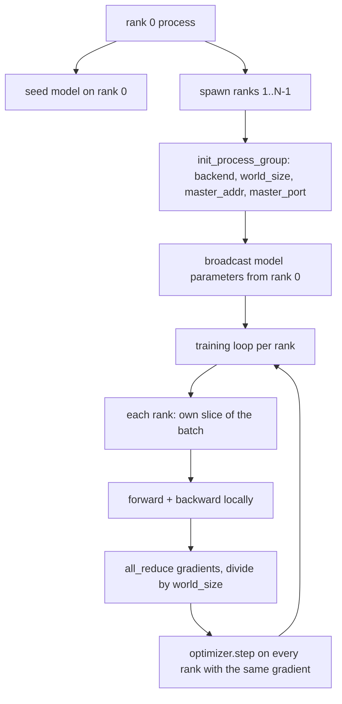
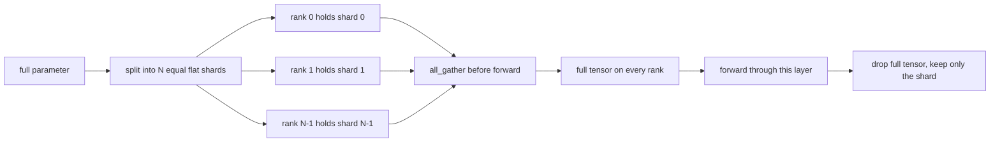

# Distributed Data Parallel and FSDP from Scratch

> Huấn luyện đa rank là hai phép tập thể và một quy tắc. Phát quảng bá các tham số lúc khởi động, lấy trung bình các gradient sau lượt ngược, không bao giờ để các rank bất đồng về bước chúng đang ở.

**Type:** Build
**Languages:** Python
**Prerequisites:** Phase 19 lessons 42 to 45
**Time:** ~90 minutes

## Learning Objectives

- Khởi động một nhóm tiến trình trên N rank với backend `gloo`, không phần cứng đặc biệt.
- Triển khai một lớp bọc DDP tối thiểu phát quảng bá các tham số khi khởi tạo và all-reduce các gradient sau lượt ngược.
- Chứng minh all-reduce của các gradient theo rank khớp một gradient một tiến trình trên đầu vào được nối.
- Phác thảo chia shard tham số FSDP: mỗi rank giữ một phần, tensor đầy đủ được gom cho lượt tiến và bỏ sau đó.

## The Problem

Mô hình vừa trên một thiết bị. Tập dữ liệu thì không. Ngân sách tối ưu nói bạn muốn thấy N lần số ví dụ mỗi giây thời gian thực. Đòn bẩy thứ nhất là song song dữ liệu: mỗi rank chạy cùng mô hình trên một phần khác của lô, rồi lấy trung bình các gradient trước bước bộ tối ưu. Đòn bẩy thứ hai là FSDP: mô hình cũng không vừa trên một thiết bị, nên mỗi rank giữ một phần của mọi tham số và tái tạo các tensor đầy đủ từng lớp trong lượt tiến.

Nỗi đau là ghi sổ. Nếu các tham số trôi giữa các rank lần chạy bị hỏng âm thầm. Nếu bạn lấy trung bình gradient nhưng không mất mát bảng điều khiển nói dối. Nếu backend tập thể không thể đồng ý về một cấu trúc liên kết lần chạy treo mãi. Cách sửa là viết các phép tập thể thủ công một lần và không bao giờ tin một lớp bọc bạn không thể tái tạo.

Bài này chạy trên CPU. Không giả định CUDA. Backend `gloo` đi kèm mọi bản dựng PyTorch và nhận các worker `torch.multiprocessing`; cùng mã chuyển sang `nccl` trên một nút đa GPU mà không thay đổi cấu trúc.

## The Concept



### The two collectives that matter

| Phép tập thể | Nó làm gì | Khi nào |
|------------|--------------|------|
| `broadcast` | Sao chép một tensor từ một rank đến tất cả rank khác | Khởi tạo tham số, trạng thái bộ lập lịch, bất kỳ đồng bộ một-đến-tất-cả nào |
| `all_reduce` | Cộng (hoặc trung bình, hoặc tối đa) một tensor trên mọi rank, mỗi rank nhận kết quả | Lấy trung bình gradient sau lượt ngược |
| `all_gather` | Mỗi rank đóng góp một tensor, mỗi rank nhận phần nối | Thu thập logit, bỏ chia shard tham số FSDP |

Hợp đồng DDP là `broadcast` khi khởi tạo và `all_reduce` sau lượt ngược. Bản phác thảo FSDP thêm `all_gather` trước lượt tiến của mỗi lớp.

### Gradient averaging matches single-process gradient

Một mô hình được huấn luyện trên một lô B ví dụ trên N rank phải tạo cùng gradient như một tiến trình duy nhất huấn luyện trên một lô N*B. Mẹo là cộng các gradient theo rank và chia cho N cho gradient mất mát trung bình, là điều entropy chéo với rút gọn trung bình sẽ tạo trên lô đầy đủ. Mã bài học khẳng định điều này với `max-abs-diff < 1e-3` giữa gradient all-reduce thủ công và gradient một tiến trình tham chiếu.

### FSDP sketch



Lợi ích bộ nhớ chính xác: bộ nhớ theo rank cho các tham số giảm xuống 1/N. Chi phí là gom, được trả mỗi lượt tiến. FSDP sản xuất chồng lấn gom với tính toán lớp trước để chi phí thời gian thực nhỏ hơn nhiều so với dự đoán ghi sổ ngây thơ. Bài học thực hiện khứ hồi trên mọi tham số và khẳng định tái tạo bằng bản gốc từng bit.

### CPU and the gloo backend

CUDA là đích sản xuất, nhưng cùng các đường mã tồn tại trên CPU. `gloo` là backend tập thể CPU. Nó chậm hơn `nccl` trên GPU nhiều bậc độ lớn, nhưng bề mặt API giống hệt. Nhóm tiến trình của bài học được khởi tạo với `backend="gloo"` và các rank được tạo bằng `torch.multiprocessing` thay vì `torchrun`; cả hai kết thúc ở cùng các lệnh gọi `torch.distributed`. Trên một nút đa GPU, các thay đổi duy nhất là `backend="nccl"`, các tensor thiết bị, và `torchrun` để khởi chạy.

```figure
cg-allreduce-ring
```

## Build It

`code/main.py` là hiện vật có thể chạy.

### Step 1: bring up the process group

```python
os.environ["MASTER_ADDR"] = "127.0.0.1"
os.environ["MASTER_PORT"] = str(port)
dist.init_process_group(backend="gloo", rank=rank, world_size=world_size)
```

`MASTER_ADDR` và `MASTER_PORT` là điểm hẹn: mọi rank kết nối cùng cổng trên cùng máy chủ. Bài học chọn một cổng trống qua một mẹo bind-rồi-đóng để tránh va chạm khi nhiều lần chạy dùng chung một máy.

### Step 2: broadcast at construction

`MinimalDDP.__init__` duyệt mọi tham số và buffer và gọi `dist.broadcast(tensor, src=0)`. Các giá trị của rank 0 trở thành khởi tạo chuẩn. Không có điều này, mỗi rank khởi tạo với seed riêng và các rank phân kỳ từ bước một.

### Step 3: all-reduce gradients after backward

```python
def all_reduce_grads_(module, world_size):
    for p in module.parameters():
        if p.grad is None:
            p.grad = torch.zeros_like(p.data)
        dist.all_reduce(p.grad.data, op=dist.ReduceOp.SUM)
        p.grad.data.div_(world_size)
```

Mỗi rank kết thúc với cùng gradient được lấy trung bình. Bước bộ tối ưu giờ là một hàm của cùng đầu vào trên mọi rank, là lý do các tham số giữ đồng bộ xuyên suốt lần chạy.

### Step 4: prove the equivalence

`manual_all_reduce_matches_single_process` xây dựng cùng mô hình trên rank 0 và so sánh gradient sau all-reduce với gradient một tiến trình duy nhất sẽ tính trên đầu vào được nối. Max-abs-diff quanh 1e-8.

### Step 5: FSDP round trip

`fsdp_round_trip_sketch` làm phẳng mỗi tham số, đệm đến một bội số của `world_size`, cắt, all-gather, và bỏ đệm. Tái tạo của mỗi rank bằng bản gốc. Đây là bước bỏ chia shard; phép nghịch đảo (chia shard lại sau lượt tiến) là một phần cắt từ tensor được gom.

Chạy nó:

```bash
python3 code/main.py
```

Kích thước thế giới mặc định là 2. Hai tiến trình CPU được tạo, nói chuyện với nhau qua `gloo`, và thoát với mã không. Đầu ra `outputs/ddp-demo.json` thu thập các tổng tham số theo rank, chuẩn gradient sau all-reduce, kết quả khứ hồi FSDP, và diff gradient thủ công-so-với-tham-chiếu.

## Use It

Các ngăn xếp huấn luyện sản xuất gọi cùng các thành phần cơ sở. `DistributedDataParallel` của PyTorch thêm: các hook gradient sau lượt ngược chồng lấn all-reduce với lượt ngược, all-reduce chia nhóm kết hợp vài gradient nhỏ thành một phép tập thể, và ngữ cảnh `no_sync` mà bài 46 sử dụng.

FSDP của PyTorch thêm: một view tham số phẳng theo lớp để mỗi rank giữ một buffer liên tục, chồng lấn bỏ chia shard của lớp tiếp theo với tính toán lớp hiện tại, và chuyển tải sang CPU tùy chọn cho các shard.

Hình thức giữ nguyên: phát quảng bá lúc khởi động, rút gọn sau lượt ngược, chia shard tham số khi chúng không còn vừa.

## Ship It

`outputs/skill-distributed-fsdp-ddp.md` mang công thức cho một script huấn luyện mới: khởi động nhóm tiến trình với `gloo` cho CPU và `nccl` cho GPU, bọc mô hình trong một vỏ DDP phát quảng bá khi khởi tạo và rút gọn sau lượt ngược, tùy chọn chia shard tham số bằng mẫu all_gather từ bản phác thảo FSDP.

## Exercises

1. Chạy với `--world-size 4` và xác nhận độ trải tham số giữ dưới 1e-3 xuyên suốt lần chạy.
2. Thay lấy trung bình thủ công bằng `dist.all_reduce(op=dist.ReduceOp.AVG)` và đo thời gian khác biệt.
3. Thêm một hook sau lượt ngược vào lớp bọc DDP để all-reduce chồng lấn với phần còn lại của lượt ngược; đo cải thiện thời gian thực.
4. Triển khai bước chia shard lại FSDP: sau lượt tiến, thay tensor đầy đủ bằng shard cục bộ lần nữa. Xác nhận bộ nhớ theo rank giảm.
5. Chuyển backend sang `nccl` trên một máy CUDA. Ghi nhận những biến môi trường nào thay đổi và những biến nào giữ nguyên.

## Key Terms

| Thuật ngữ | Cách mọi người nói | Ý nghĩa thực sự |
|------|-----------------|------------------------|
| Backend | "gloo hoặc nccl" | Thư viện triển khai các phép tập thể; gloo là CPU, nccl là GPU |
| World size (Kích thước thế giới) | "Tổng số rank" | Số tiến trình trong nhóm; nhóm là đơn vị mà các phép tập thể hoạt động trên |
| Rank | "Id worker" | Định danh tiến trình trong nhóm, đánh chỉ mục từ không |
| All-reduce | "Cộng các gradient" | Cộng một tensor trên mọi rank, mỗi rank kết thúc với cùng kết quả |
| Unshard (Bỏ chia shard) | "Gom các tham số" | Tái tạo tensor đầy đủ từ các phần theo rank qua all_gather |

## Further Reading

- Tài liệu `torch.distributed` của PyTorch cho ngữ nghĩa tập thể mà bài này dựa vào.
- Danh sách phép tập thể của thư viện `gloo`, giống hệt về hình thức với các thành phần cơ sở `nccl` được CUDA hỗ trợ.
- Phase 19 bài 46 cho mẫu tích lũy gradient bọc all-reduce DDP trong `no_sync`.
- Phase 19 bài 47 cho bố cục checkpoint sống sót qua các lần chạy DDP và FSDP.
- Tài liệu FSDP của PyTorch cho triển khai sản xuất của chia shard tham số được phác thảo ở đây.
