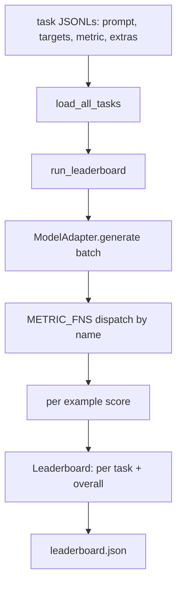
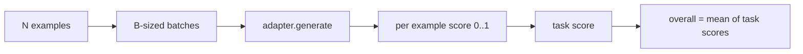

# Language Model Evaluation Harness

> Một mô hình làm tốt một tác vụ bạn không thể định nghĩa là một mô hình làm tốt một cách tình cờ. Harness là định nghĩa tác vụ, chỉ số, trình chạy, và bảng xếp hạng, trong một hình thức ngắn, có thể thay thế.

**Type:** Build
**Languages:** Python
**Prerequisites:** Phase 19 lessons 42 to 45
**Time:** ~90 minutes

## Learning Objectives

- Định nghĩa một tác vụ như một file JSONL với `prompt`, `targets`, `metric`, và `extras` tùy chọn theo ví dụ.
- Triển khai năm chỉ số: khớp chính xác, F1 rouge-l, kiểm tra thực thi, trắc nghiệm, và chứa chuỗi con.
- Xây dựng một trình chạy chia các ví dụ thành lô theo tác vụ và điều phối đến một adapter mô hình có thể thay thế.
- Phát ra một JSON bảng xếp hạng với các điểm theo tác vụ, độ trễ, và một trung bình tổng thể có thể tái lập.

## The Problem

Một mô hình ngôn ngữ mới xuất hiện mỗi tuần. Tuyên bố tiếp thị là nó làm tốt. Câu hỏi trung thực là: tốt ở cái gì? Câu trả lời trung thực là bảng xếp hạng bạn tự viết, vì bảng xếp hạng của nhà cung cấp là thứ họ đã điều chỉnh theo.

Không có một harness trong repo bạn so sánh hai mô hình bằng cảm giác. Với một harness bạn so sánh chúng bằng điểm trên một tập tác vụ cố định với một chỉ số cố định, trên một đầu ra JSON bạn có thể diff. Harness là hợp đồng giữa lần chạy hôm qua và lần chạy hôm nay. Không có nó, các lỗi thoái lui được phát hành.

Cái bẫy là quá khớp harness với một mô hình duy nhất. Cách sửa là cùng cái bẫy đảo ngược: harness đủ nhỏ để đọc trong mười lăm phút, các tác vụ đủ nhỏ để cung cấp trong repo, các chỉ số được viết từ đầu để một đồng nghiệp có thể kiểm toán chúng, và adapter là nơi duy nhất mã đặc thù mô hình tồn tại. Đổi adapter, bảng xếp hạng thay đổi; đổi các tác vụ, bảng xếp hạng thay đổi. Không gì khác nên thay đổi.

## The Concept



### Task spec

Mỗi ví dụ là một dòng JSONL:

```json
{"id": "arith-00", "prompt": "compute: 2 + 2", "targets": ["4"], "metric": "exact_match"}
```

Với các chỉ số cần hàm hỗ trợ chấm điểm, `extras` mang payload phụ:

```json
{
  "id": "code-00",
  "prompt": "python: write a function f that doubles its input",
  "targets": ["ok"],
  "metric": "code_exec",
  "extras": {"io_pairs": [[1, 2], [3, 6]]}
}
```

Một tác vụ là một file `.jsonl` dưới `outputs/tasks/`. Tên file là tên tác vụ. Mọi ví dụ trong một file dùng chung một chỉ số.

### The five fixture tasks

| Tác vụ | Chỉ số | Nó kiểm thử gì |
|------|--------|---------------|
| arithmetic | exact_match | Tính đúng đắn ở mức token trên một đáp án tất định |
| summary | rouge_l | F1 dãy con chung dài nhất so với một tóm tắt tham chiếu một dòng |
| code-exec | code_exec | Kiểm thử thực thi: hàm dự đoán phải thỏa mãn một danh sách cặp đầu vào-đầu ra |
| multiple-choice | multiple_choice | Chữ cái đầu của dự đoán phải khớp một chữ cái được phép |
| generation | substring_contains | Văn bản dạng tự do phải chứa ít nhất một chuỗi con đích |

### The metric contract

Mỗi chỉ số là một hàm từ `(prediction, targets, extras) -> float in [0.0, 1.0]`. Harness lấy trung bình các điểm theo ví dụ để nhận một điểm tác vụ, rồi lấy trung bình các điểm tác vụ để nhận tổng thể. Các hàm chỉ số tí hon:

- `exact_match`: chữ thường, gộp khoảng trắng, so bằng.
- `substring_contains`: cùng chuẩn hóa, kiểm tra chuỗi con.
- `multiple_choice`: ký tự đầu được viết hoa.
- `rouge_l`: độ dài LCS chia cho các độ dài dự đoán và tham chiếu, F1 của precision và recall.
- `code_exec`: thực thi dự đoán trong một không gian tên bị hạn chế, gọi `f(x)` trên mọi cặp đầu vào-đầu ra, đếm các kết quả khớp.

Chỉ số code_exec chạy dự đoán trong một không gian tên builtins đã bị lược bỏ. Kiểm thử của bài học khẳng định `import os` thất bại vì `os` không nằm trong không gian tên; bạn không thể tiếp cận hệ thống file từ một dự đoán mã.

### The model adapter

```python
class ModelAdapter(Protocol):
    def generate(self, prompts: Sequence[str]) -> List[str]: ...
    @property
    def name(self) -> str: ...
```

Adapter là chỗ nối. Bài học cung cấp `ToyAdapter`, một bộ so khớp mẫu tất định trả về đáp án đúng cho mọi prompt trong năm tác vụ fixture. Một adapter thực gọi mô hình và trả về đầu ra của nó. Harness không quan tâm loại nào.

### The runner

`run_task` chia `batch_size` prompt mỗi lần và điều phối đến hàm chỉ số. `run_leaderboard` duyệt mọi tác vụ và lấy trung bình. `write_leaderboard` phát ra JSON với một chuỗi schema để các thay đổi định dạng tương lai không âm thầm phá các bảng điều khiển.



```figure
eval-harness-matrix
```

## Build It

`code/main.py` là hiện vật có thể chạy.

### Step 1: seed fixture tasks

`seed_fixture_tasks(target_dir)` ghi năm file `.jsonl`. Lần chạy đầu của `main.py` tạo chúng khi thư mục rỗng.

### Step 2: load tasks

`load_all_tasks(task_dir)` đọc mọi `.jsonl` và trả về một dict từ tên tác vụ đến một danh sách bản ghi `Example`. Các dòng bình luận bắt đầu bằng `#` và các dòng trống được bỏ qua để người đóng góp có thể chú giải các file.

### Step 3: implement metrics

Mỗi chỉ số là một hàm nhỏ với một kiểm thử đơn vị. Bộ kiểm thử của bài học bao gồm 13 trường hợp bao phủ chuẩn hóa, chồng lấn một phần, thực thi mã, và từ chối mã không an toàn.

### Step 4: write the runner

`run_task` lặp các lô và tạo một `TaskResult` với điểm, số đúng, tổng số, và độ trễ. `run_leaderboard` duyệt mọi tác vụ và tạo một `Leaderboard` với trung bình tổng thể.

### Step 5: emit JSON

`write_leaderboard` tuần tự hóa bảng. Cờ `--include-per-example` xuất các bản ghi theo ví dụ để bạn có thể diff các dự đoán với lần chạy trước khi điểm thay đổi.

Chạy nó:

```bash
python3 code/main.py
```

Script tạo các fixture ở lần chạy đầu, chấm chúng bằng adapter đồ chơi (làm đúng mọi fixture), và ghi `outputs/leaderboard.json`. Điểm tổng thể là 1.0 với adapter đồ chơi; kiểm thử adapter stub trong `test_main.py` cho thấy cùng harness tạo 0.0 khi adapter không thể trả lời.

## Use It

Để cắm một mô hình thực vào, viết một adapter. Hình thức:

```python
class HttpAdapter:
    name = "vendor.v1"

    def __init__(self, endpoint, api_key):
        self.endpoint = endpoint
        self.api_key = api_key

    def generate(self, prompts):
        out = []
        for prompt in prompts:
            response = http_post(self.endpoint, prompt, self.api_key)
            out.append(response["text"])
        return out
```

Đổi `ToyAdapter` thành `HttpAdapter` ở đầu `main()`. Harness, các tác vụ, các chỉ số, và bảng xếp hạng giữ nguyên.

Ba mẫu cần thực thi khi cung cấp harness trong một dự án thực:

- **Ghim các file tác vụ.** leaderboard.json mang nội dung tác vụ được ghim băm hoặc mang các JSONL bên cạnh; nếu không điểm thay đổi khi file tác vụ thay đổi, và bạn không thể biết cái nào.
- **Diff các dự đoán, không chỉ các điểm.** Cờ `--include-per-example` cho phép bạn thấy mô hình đã nói gì vào ngày điểm giảm.
- **Giới hạn kích thước lô.** Các adapter thực có giới hạn tốc độ. Một kích thước lô nhỏ giữ harness tương thích giữa các nhà cung cấp.

## Ship It

`outputs/skill-lm-eval-harness.md` mang công thức: đặc tả tác vụ JSONL, năm chỉ số, adapter có thể thay thế, trình chạy theo lô, JSON bảng xếp hạng với chuỗi schema. Các file tác vụ trong `outputs/tasks/` là các fixture; sao chép chúng vào một dự án thực làm khởi đầu.

## Exercises

1. Thêm một tác vụ thứ sáu với một chỉ số tùy chỉnh bạn viết từ đầu (chồng lấn kiểu BLEU, chấm tham chiếu kiểu BLEURT, bất cứ thứ gì với một hợp đồng rõ ràng).
2. Mở rộng `code_exec` để thu stdout và nhận một danh sách stdout dự kiến làm các đích.
3. Thêm một lệnh diff bảng xếp hạng: với hai file `leaderboard.json` được cung cấp, in những tác vụ nào đã thay đổi và bao nhiêu.
4. Giới hạn độ trễ theo ví dụ. Bọc lệnh gọi adapter trong một timeout; đưa ra một cột `timeouts` riêng trong bảng xếp hạng.
5. Ghim nội dung tác vụ bằng một sha256 trong bảng xếp hạng để một người đọc tương lai có thể xác minh họ đã chấm cùng tác vụ.

## Key Terms

| Thuật ngữ | Cách mọi người nói | Ý nghĩa thực sự |
|------|-----------------|------------------------|
| Task spec (Đặc tả tác vụ) | "Định dạng đánh giá" | File JSONL với prompt, targets, metric, extras tùy chọn theo ví dụ |
| Metric (Chỉ số) | "Cách bạn chấm điểm" | Hàm từ (prediction, targets, extras) sang một float trong [0, 1] |
| Adapter | "Máy khách mô hình" | Đối tượng có phương thức generate(prompts) -> list[str]; mã đặc thù mô hình duy nhất |
| Leaderboard (Bảng xếp hạng) | "Bảng điểm" | JSON với các điểm theo tác vụ, tổng số đếm, độ trễ, và một trung bình tổng thể |
| Code exec metric (Chỉ số thực thi mã) | "Chạy và kiểm tra" | Thực thi dự đoán trong một không gian tên bị hạn chế, so sánh với các cặp đầu vào-đầu ra |

## Further Reading

- lm-evaluation-harness gốc cho tham chiếu sản xuất, lớn hơn nhiều nhưng cùng hình thức.
- lighteval của HuggingFace cho một triển khai thay thế của cùng hợp đồng.
- Phase 19 bài 46 bao phủ các mẫu tích lũy gradient được dùng trong ngăn xếp huấn luyện mà harness chấm.
- Phase 19 bài 47 bao phủ định dạng checkpoint bạn chấm; ghim băm checkpoint trong bảng xếp hạng.
- Phase 19 bài 48 bao phủ ngăn xếp huấn luyện phân tán đã tạo mô hình được kiểm thử.
