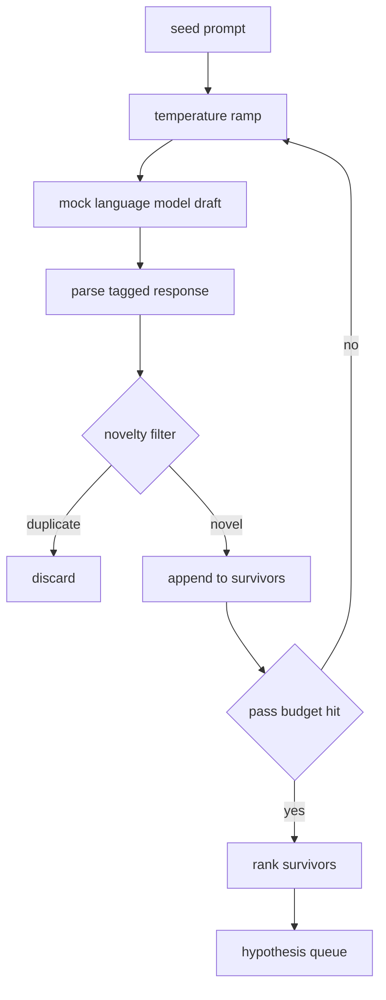

# Hypothesis Generator

> Một agent nghiên cứu hỏi cùng câu hỏi hai lần đang lãng phí token. Mẹo là buộc mỗi bản nháp đến một nơi mới.

**Type:** Build
**Languages:** Python
**Prerequisites:** Phase 19 Track A lessons 20-29
**Time:** ~90 minutes

## Learning Objectives
- Điều khiển một bộ lấy mẫu từ một prompt seed và biến các đầu ra của nó thành các bản ghi giả thuyết có kiểu.
- Tăng dần nhiệt độ bộ lấy mẫu trên mỗi lượt để bản nháp tiếp theo trôi xa bản trước hơn.
- Lọc các bản gần trùng bằng một mô hình embedding nhỏ và một ngưỡng khoảng cách cosine.
- Xếp hạng các bản sống sót bằng một hàm chấm điểm pha trộn tính mới, tính cụ thể, và khả năng kiểm thử.
- Giữ mọi bước tất định để cùng seed luôn tạo cùng hàng đợi.

## Why generate, then filter

Một bộ lập kế hoạch hỏi một mô hình một lần nhận một giả thuyết. Điều đó ổn cho một ví dụ được giải. Với một vòng lặp nghiên cứu nó là hình thức sai. Vòng lặp muốn một hàng đợi được xếp hạng có chiều sâu, để khi giả thuyết đầu thất bại trình chạy có giả thuyết tiếp theo sẵn mà không trả giá cho một lượt lấy mẫu đầy đủ khác.

Hai ý tưởng kết hợp để tạo hàng đợi đó. Thứ nhất là tăng dần nhiệt độ: mỗi lượt qua bộ lấy mẫu tăng nhiệt độ một nấc, nên các bản nháp sau được khuyến khích lang thang. Thứ hai là lọc tính mới: sau mỗi bản nháp, bộ sinh đo khoảng cách embedding với mọi bản sống sót trước và từ chối bất cứ thứ gì trong cụm.

Bài học cung cấp một mô hình ngôn ngữ giả lập trả về các chuỗi token theo kịch bản cho các prompt cố định. Giả lập đủ để thực thi toàn đường: prompt seed vào, áp dụng tăng nhiệt độ, phân tích các ứng viên, chạy bộ lọc tính mới, hàng đợi được xếp hạng ra.

## The Hypothesis shape

```text
Hypothesis
  id             : int           (monotonic within a run)
  text           : str           (the claim)
  variables      : list[str]     (what changes between conditions)
  metric         : str           (what the runner will measure)
  baseline_ref   : str | None    (which paper or run the comparison cites)
  draft_pass     : int           (which sampler pass produced this)
  temperature    : float         (the sampler setting at draft time)
  novelty_score  : float         (distance from prior survivors, 0..1)
  rank_score     : float         (weighted sum used for ordering)
```

`variables` và `metric` không phải văn bản tự do. Bộ phân tích kéo chúng từ một phản hồi có thẻ. Trình chạy trong bài năm mươi hai đọc trực tiếp các trường này khi nó xây dựng cấu hình thí nghiệm.

`baseline_ref` tùy chọn nhưng được khuyến nghị. Bộ đánh giá trong bài năm mươi ba cần một đường cơ sở để so sánh. Nếu giả thuyết bỏ nó, bộ đánh giá quay về lần chạy trước trên cùng chỉ số.

```figure
cg-novelty-ramp
```

## Architecture



Vòng lặp thẳng thắn. Phần thú vị là mỗi hộp có một hợp đồng cứng.

## Temperature ramp

Bắt đầu tại `t_min`, kết thúc tại `t_max`, bước `(t_max - t_min) / (n_passes - 1)`. Mỗi lượt gọi bộ lấy mẫu ở nhiệt độ hiện tại, tạo `n_passes` giá trị cách đều từ `GeneratorConfig.schedule()`. Mô hình giả lập tuân thủ nhiệt độ bằng cách chuyển giữa một tập nhỏ phản hồi theo kịch bản được đặt khóa theo `(prompt, temp_bucket)`. Các nhóm là khoảng mở để một thay đổi nhỏ về nhiệt độ chọn một nhóm khác và tạo một bản nháp khác. Trong sản xuất bộ lấy mẫu sẽ là một mô hình thực với `temperature=t` được truyền qua.

Lịch mặc định là sáu lượt từ `0.2` đến `1.2`. Sáu là đủ để lấp hàng đợi mà không trả giá cho các mẫu mà bộ lọc tính mới sẽ từ chối dù sao. Dưới `0.2` mô hình nhại lại seed. Trên `1.2` các phản hồi có xu hướng trôi lạc đề và không qua bộ phân tích.

## Novelty filter

Sau khi mỗi bản nháp được phân tích, bộ sinh nhúng văn bản và so sánh với mọi giả thuyết được chấp nhận. Embedding là một túi token từ được băm nhỏ, được chuẩn hóa về độ dài đơn vị. Khoảng cách cosine giữa hai vector đơn vị là `1 - dot(a, b)`. Một bản nháp đạt nếu khoảng cách nhỏ nhất của nó tới bất kỳ bản sống sót trước nào lớn hơn `novelty_threshold`. Mặc định là `0.25`.

Embedding băm không cầu kỳ. Nó tất định, không có phụ thuộc, và đủ để bắt trường hợp rõ ràng: hai bản nháp chia sẻ phần lớn các danh từ. Một triển khai sản xuất sẽ thay bằng một mô hình câu nhỏ. Giao diện giữ nguyên.

## Rank score

```text
rank_score = w_novelty * novelty_score
           + w_specificity * specificity_score
           + w_testability * testability_score
```

Ba điểm con. `novelty_score` là khoảng cách embedding nhỏ nhất từ các bản sống sót trước. `specificity_score` là số biến cụ thể trong giả thuyết chia cho một số đích. `testability_score` là một nếu giả thuyết chỉ định cả một chỉ số và một đường cơ sở, một nửa nếu nó chỉ có một chỉ số, không nếu không.

Các trọng số mặc định là `0.4`, `0.3`, `0.3`. Các trọng số nằm trong cấu hình bộ sinh để một bài hạ nguồn có thể dịch chúng mà không fork mã.

## Mock language model

```python
class MockLLM:
    def sample(self, prompt: str, temperature: float, seed: int) -> str:
        ...
```

Bộ lấy mẫu tất định với một bộ ba `(prompt, temperature, seed)`. Giả lập giữ một bảng phản hồi theo kịch bản được đặt khóa theo `(prompt_signature, temperature_bucket)`. Nếu bảng không có mục cho một khóa, bộ lấy mẫu trả về một phương án dự phòng không qua bộ phân tích. Đường dự phòng được thực thi bởi một trong các kiểm thử.

Seed được trộn vào phản hồi để cùng cặp `(prompt, temperature)` với các seed khác nhau tạo các bản nháp khác nhau. Trong kiểm thử chúng ta ghim seed để giữ các kết quả có thể tái lập. Trong một triển khai thực seed sẽ đến từ một đồng hồ hệ thống hoặc một bộ đếm.

## Output queue

Đầu ra là một danh sách các bản ghi `Hypothesis` được sắp theo `rank_score` giảm dần. Trình chạy trong bài năm mươi hai lấy đầu hàng đợi, chạy thí nghiệm, và bộ đánh giá trong bài năm mươi ba ghi lại một kết luận. Nếu kết luận nói giả thuyết sai, trình chạy lấy bản tiếp theo.

Hàng đợi hữu hạn. Khi nó rỗng bộ điều phối có thể mở rộng prompt seed và chạy bộ sinh lại hoặc dừng và báo cáo ngân sách cạn.

## How to read the code

`code/main.py` định nghĩa `Hypothesis`, `MockLLM`, `HypothesisGenerator`, và một demo tất định. Bộ sinh cung cấp một phương thức `run(seed_prompt)` duy nhất trả về một hàng đợi được sắp; số lượt được đọc từ `GeneratorConfig.n_passes` thay vì truyền như một đối số. Embedding là một túi token được băm. Bộ lọc tính mới là một hàm duy nhất. Điểm xếp hạng là một hàm duy nhất. Không gì phụ thuộc vào `numpy`; toán embedding là stdlib thuần để bài học giữ tính di động.

`code/tests/test_generator.py` bao phủ đường tuyến tính, đường từ chối bản trùng, đường lỗi bộ phân tích, các ranh giới tăng nhiệt độ, và thứ tự xếp hạng.

## Where this slots in

Bài năm mươi tạo ra hàng đợi. Bài năm mươi mốt lấy đầu hàng đợi và chạy một tìm kiếm tài liệu để xác nhận hoặc bác bỏ nó. Bài năm mươi hai lấy cùng phần đầu và chạy một thí nghiệm thực. Bài năm mươi ba đọc cả hai đầu ra và viết một kết luận. Bốn bài kết hợp thành một vòng lặp nghiên cứu không có con người trong đó; một người có thể can thiệp tại bất kỳ ranh giới nào.
