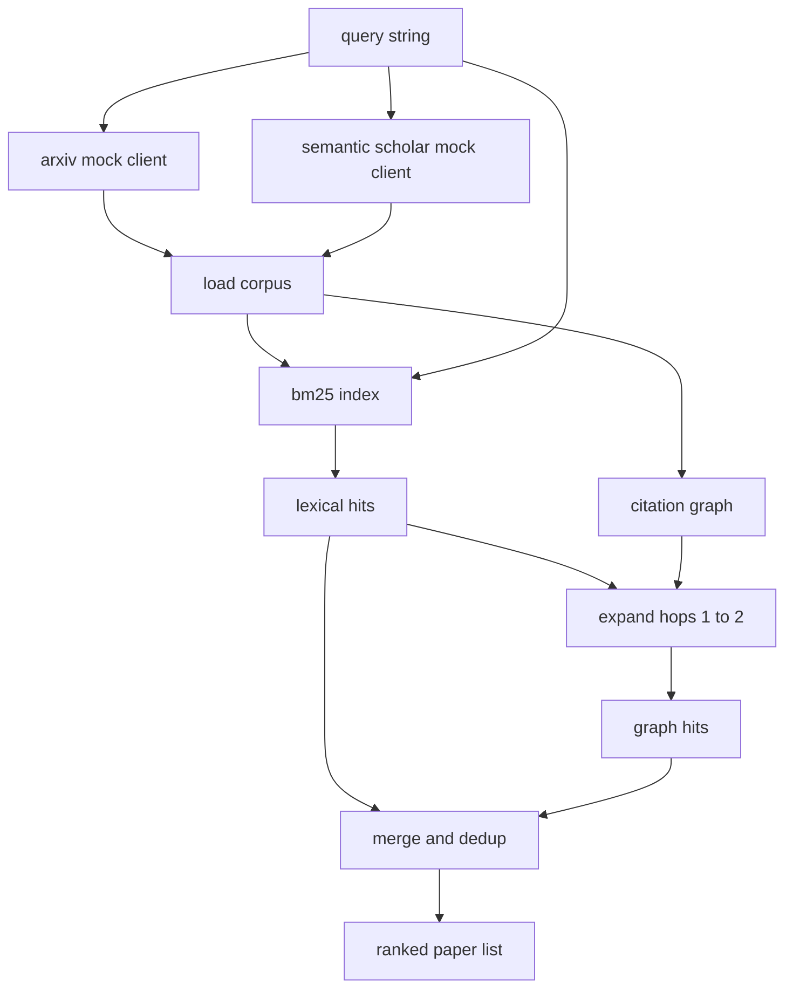

# Literature Retrieval

> Một giả thuyết rẻ. Biết liệu ai đó đã chứng minh nó chưa là phần đắt. Xây dựng lớp truy xuất trả lời câu hỏi đó trước khi trình chạy khởi động một sandbox.

**Type:** Build
**Languages:** Python
**Prerequisites:** Phase 19 Track A lessons 20-29
**Time:** ~90 minutes

## Learning Objectives
- Mô hình hóa một bản ghi bài báo nhỏ với các trường vòng lặp sẽ đọc ở hạ nguồn.
- Xây dựng một chỉ mục BM25 trên các tóm tắt chỉ bằng các cấu trúc dữ liệu stdlib.
- Duyệt một đồ thị trích dẫn để đưa ra các bài báo mà tìm kiếm từ vựng bỏ lỡ.
- Loại trùng các kết quả giữa các lượt từ vựng và đồ thị theo id bài báo ổn định.
- Bọc hai API bên ngoài giả lập sau một máy khách duy nhất để vị trí gọi thượng nguồn giữ nguyên khi các endpoint thực xuất hiện.

## Why two retrieval passes

Một tìm kiếm từ khóa trên các tóm tắt trả về các bài báo chia sẻ từ vựng với truy vấn. Điều đó bao phủ phần lớn bề mặt. Nó bỏ lỡ hai trường hợp. Thứ nhất là khi bài báo nền tảng sử dụng từ vựng khác; ví dụ một truy vấn "attention thưa" bỏ lỡ một bài có tiêu đề "lựa chọn khối trong định tuyến transformer." Thứ hai là khi bài báo liên quan là một bài tiếp nối trích dẫn một neo đã biết; tìm neo và duyệt tới hiệu quả hơn vét cạn tập tóm tắt.

Bài học xây dựng cả hai lượt. BM25 trên các tóm tắt bắt các kết quả từ vựng. Một phép duyệt đồ thị trích dẫn mở rộng một tập seed tiến và lùi một hoặc hai bước nhảy. Hợp được loại trùng theo id bài báo và được xếp hạng bằng một điểm kết hợp nhỏ.

## The Paper shape

```text
Paper
  id          : str           (stable identifier, "p001" for the mock corpus)
  title       : str
  abstract    : str
  year        : int
  authors     : list[str]
  references  : list[str]     (paper ids this paper cites)
  citations   : list[str]     (paper ids that cite this paper)
  source      : str           (which mock api supplied it, "arxiv" or "s2")
```

Các trường references và citations tạo thành đồ thị trích dẫn có hướng. Hai API giả lập trả về các trường chồng lấn nhưng không giống hệt, nên bộ nạp corpus hợp chúng theo `id`.

```figure
cg-citation-hops
```

## Architecture



Máy khách truy xuất sở hữu cả hai lượt và phép hợp nhất. Bên gọi đưa cho nó một truy vấn và nhận lại một danh sách được xếp hạng mà mỗi mục mang các trường điểm theo bài báo (`bm25_score`, `graph_distance`, `recency_score`, `final_score`) giải thích thứ hạng.

## BM25 from scratch

Triển khai là Okapi BM25 tiêu chuẩn với các tham số mặc định `k1=1.5`, `b=0.75`. Chỉ mục là hai từ điển: `term -> doc_frequency` và `term -> list of (doc_id, term_count)`. Độ dài tài liệu là số token của tóm tắt. Độ dài tài liệu trung bình được tính một lần lúc dựng chỉ mục. Chấm điểm một truy vấn là một tổng trên các từ truy vấn của `idf * tf_norm` trong đó `tf_norm` là tần suất từ được chuẩn hóa độ dài BM25 tiêu chuẩn.

Tokenizer là `lower` rồi chia theo ký tự không phải chữ-số. Nó không được rút gốc từ. Một hệ thống sản xuất sẽ thay bằng một bộ rút gốc nhỏ. Giao diện giữ nguyên.

```math
\begin{aligned}
\text{idf}(t) &= \log\!\left(\frac{N - \text{df} + 0.5}{\text{df} + 0.5} + 1.0\right) \\
\text{tf\_norm}(t) &= \frac{f \cdot (k_1 + 1)}{f + k_1 \cdot \left(1 - b + b \cdot \text{dl} / \text{avgdl}\right)} \\
\text{score}(d, q) &= \sum_{t \in q} \text{idf}(t) \cdot \text{tf\_norm}(t)
\end{aligned}
```

## Citation graph traversal

Đồ thị được xây dựng một lần từ corpus. Các cạnh tiến đi từ một bài báo đến các tài liệu tham khảo của nó. Các cạnh lùi đi từ một bài báo đến các bài trích dẫn nó. Phép duyệt là một tìm kiếm theo chiều rộng được khởi tạo bằng các kết quả BM25 đứng đầu, giới hạn ở hai bước nhảy.

Hai bước nhảy là một trần có chủ ý. Một bước nhảy quá nông; agent thường muốn tổ tiên hoặc hậu duệ trực tiếp. Ba bước nhảy làm nổ kích thước kết quả trên một đồ thị liên thông và có xu hướng trôi lạc đề. Bài học cung cấp giới hạn bước nhảy như một núm cấu hình để một vòng lặp hạ nguồn có thể siết nó.

## Dedup and ranking

Hai lượt trả về các tập chồng lấn. Phép hợp nhất đặt khóa theo id bài báo. Với mỗi bài báo điểm cuối là một hỗn hợp có trọng số.

```text
final_score = w_bm25 * bm25_score_norm
            + w_graph * graph_score
            + w_recency * recency_score
```

`bm25_score_norm` là điểm BM25 chia cho điểm BM25 tối đa trong tập được hợp nhất (nên trường nằm trong không đến một). `graph_score` là một cho các kết quả từ vựng trực tiếp, rồi `0.6` cho một bước nhảy, `0.3` cho hai bước nhảy, không nếu không. `recency_score` là một dốc tuyến tính từ không tại năm nhỏ nhất của corpus đến một tại năm lớn nhất.

Các trọng số mặc định là `0.5`, `0.3`, `0.2`. Các trọng số là cấu hình; một chủ đề cũ có thể giảm độ gần đây trong khi một chủ đề chuyển động nhanh tăng nó.

## Mock corpus

Corpus là một trăm bài báo, được tạo bởi `build_corpus()`. Mỗi bài có một tiêu đề và tóm tắt viết tay về một trong năm chủ đề: độ thưa attention, tăng cường truy xuất, các adapter hạng thấp, chưng cất tập dữ liệu, và các harness đánh giá. Các tài liệu tham khảo và bài trích dẫn được nối để mỗi chủ đề tạo một đồ thị con liên thông với một vài cạnh chéo chủ đề.

Hai máy khách API giả lập (`ArxivMockClient`, `SemanticScholarMockClient`) đọc từ cùng corpus nhưng cung cấp các trường khác nhau. Arxiv trả về title, abstract, year, authors. Semantic Scholar thêm references và citations. Máy khách truy xuất hợp theo id; xử lý bất đồng trường giữa các máy khách được hoãn sang một bài tiếp nối.

## What lessons 52 and 53 read

Trình chạy trong bài năm mươi hai đọc `paper.id`, `paper.title`, và ba câu đầu của tóm tắt làm ngữ cảnh cho thí nghiệm. Bộ đánh giá trong bài năm mươi ba đọc `paper.year` và `paper.references` để quy một đường cơ sở về một bài báo cụ thể.

Máy khách truy xuất trả về một `RetrievalResult` với cả danh sách được xếp hạng và các chỉ số theo truy vấn: số kết quả, điểm trung bình, điểm cao nhất, tổng thời gian thực. Trình chạy ghi nhật ký chúng để một lượt quan sát hạ nguồn có thể vẽ chất lượng theo thời gian.

## How to read the code

`code/main.py` định nghĩa `Paper`, `ArxivMockClient`, `SemanticScholarMockClient`, `BM25Index`, `CitationGraph`, `RetrievalClient`, và một demo tất định. Các máy khách giả lập và corpus nằm trong cùng file để bài học giữ tính di động. Triển khai BM25 là một lớp, sáu mươi dòng. Phép duyệt đồ thị là một phương thức.

`code/tests/test_retrieval.py` bao phủ đường từ vựng, đường đồ thị, hợp nhất, loại trùng, và truy vấn rỗng.

## Where this slots in

Bài năm mươi tạo một giả thuyết. Bài năm mươi mốt tìm tài liệu để xem liệu giả thuyết đó đã được giải quyết chưa. Bài năm mươi hai chạy thí nghiệm nếu chưa. Bài năm mươi ba đọc cả kết quả truy xuất và các chỉ số thí nghiệm để viết kết luận. Máy khách truy xuất là rẻ nhất trong bốn giai đoạn và chạy trước trong bộ điều phối.
