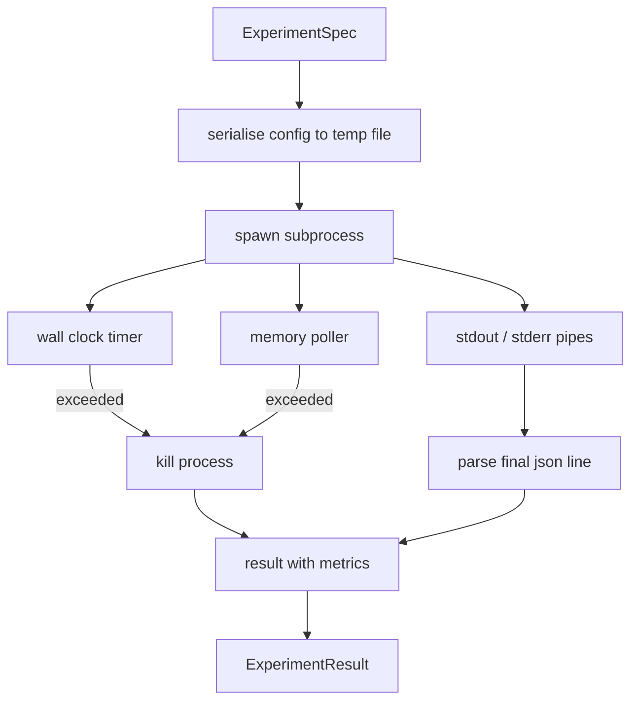

# Experiment Runner

> Vòng lặp chỉ trung thực như các phép đo của nó. Xây dựng trình chạy nhận một đặc tả, thực thi nó trong một tiến trình con được sandbox, và phát ra một khối chỉ số json mà bộ đánh giá có thể tin.

**Type:** Build
**Languages:** Python
**Prerequisites:** Phase 19 Track A lessons 20-29
**Time:** ~90 minutes

## Learning Objectives
- Mã hóa một thí nghiệm như một đặc tả có kiểu mà trình chạy có thể tuần tự hóa đến một tiến trình con.
- Khởi chạy một tiến trình con với một timeout thời gian thực cứng và một trần bộ nhớ mềm, và đưa cả hai ra như các điều kiện kết thúc.
- Thu thập stdout, stderr, và khối chỉ số có cấu trúc vào một bản ghi kết quả duy nhất.
- Xây dựng một bảng loại bỏ quét từng núm cấu hình một trên một đặc tả cơ sở cố định.
- Giữ mọi kết quả tất định với một seed để bộ đánh giá thấy cùng các số giữa các lần chạy.

## Why a subprocess

Một vòng lặp nghiên cứu chạy mã không đáng tin cậy. Giả thuyết đến từ một bộ lấy mẫu, script thí nghiệm đến từ cùng đường; coi bất kỳ thứ nào là an toàn trong tiến trình là mời một sự cố kéo bộ điều phối xuống. Các tiến trình con là sự cô lập đơn giản nhất ngôn ngữ cung cấp: một tiến trình riêng, một không gian địa chỉ độc lập, một handle tín hiệu ở phía cha.

Trình chạy ở đây không triển khai sandbox đầy đủ. Không có cgroup, không bộ lọc seccomp, không ánh xạ lại namespace. Điều nó có là một timeout thời gian thực, một vòng lặp thăm dò tăng trưởng bộ nhớ, và một đường diệt kết thúc tiến trình khi chạm một trong hai giới hạn. Đó là hợp đồng runtime mà mọi sandbox phức tạp hơn mở rộng. Bài học giữ hợp đồng đủ nhỏ để đọc trong một lần ngồi.

## The ExperimentSpec shape

```text
ExperimentSpec
  spec_id        : str            (stable id, "exp_001")
  hypothesis_id  : int            (link back to the queue from lesson 50)
  script_path    : str            (path to the python script to run)
  config         : dict           (passed to the script as one json arg)
  seed           : int            (deterministic seed for the experiment)
  wall_timeout_s : float          (hard timeout, killed on exceed)
  memory_cap_mb  : int            (soft cap, polled; killed on exceed)
  metric_keys    : list[str]      (which fields the evaluator will read)
```

Script nằm trên đĩa; trình chạy ghi cấu hình vào một đường dẫn file tạm mà script đọc. Script được kỳ vọng in một dòng json duy nhất trên stdout có các khóa là một siêu tập của `metric_keys`. Bất cứ thứ gì khác trên stdout được thu thập nhưng bị bộ phân tích chỉ số bỏ qua.

```figure
cg-runner-limits
```

## Architecture



Trình chạy là một lớp với một phương thức chính. Bộ thăm dò là một luồng nhỏ thức dậy một lần mỗi khoảng thăm dò và đọc tương đương `psutil` của tiến trình con từ hệ thống file proc khi có, quay về không làm gì khi nền tảng không cung cấp nó.

## Why a soft memory cap

Các trần bộ nhớ cứng cần `resource.setrlimit` và chỉ hoạt động trên POSIX. Bài học cung cấp một cách tiếp cận di động: thăm dò kích thước tập thường trú từ nền tảng và diệt tiến trình con nếu nó vượt trần. Trần mềm vì bộ thăm dò có một khoảng khác không; một tiến trình có thể tăng vọt trên trần giữa các lần thăm dò rồi giảm trở lại. Trình chạy ghi RSS quan sát tối đa để bộ đánh giá có thể thấy lần chạy đến gần giới hạn thế nào.

Trên các hệ thống không hỗ trợ kiểm tra tiến trình, bộ thăm dò ghi một cảnh báo một lần và tự tắt. Timeout thời gian thực vẫn áp dụng. Các kiểm thử bài học bao phủ cả hai đường.

## Capturing stdout and stderr

Trình chạy đọc cả hai pipe được xả khi hoàn tất. Stdout được quét từng dòng; dòng cuối phân tích được như json với mọi `metric_keys` bắt buộc được lấy làm khối chỉ số. Các dòng json trước được giữ trong kết quả như `intermediate_metrics`; bộ đánh giá có thể dùng chúng cho các đường cong học.

Stderr được thu thập nguyên văn vào kết quả. Trình chạy không bao giờ phát sinh lỗi khi mã thoát khác không; thay vào đó nó ghi mã vào kết quả. Bất kỳ lần thoát khác không nào được gắn nhãn `"crash"` ngay cả khi script đã in các chỉ số, để bộ đánh giá mặc định coi các lần chạy một phần là thất bại.

## Ablation table

```python
def ablate(base: ExperimentSpec, knob: str, values: list[Any]) -> list[ExperimentSpec]:
    ...
```

Với một đặc tả cơ sở và một tên núm được cung cấp, hàm hỗ trợ trả về một đặc tả mỗi giá trị với `config[knob]` được ghi đè. Mỗi đặc tả nhận một `spec_id` được suy ra (`f"{base.spec_id}_{knob}_{value}"`). Trình chạy cung cấp một `AblationRunner` chạy chúng theo thứ tự và trả về một `AblationTable` được đặt khóa theo giá trị núm.

Tại sao từng núm một. Các lần quét toàn bộ tổ hợp bùng nổ theo hàm mũ và tạo các kết quả bộ đánh giá không thể diễn giải. Từng núm một tạo một trục rõ ràng bộ đánh giá có thể vẽ. Bài học chỉ hỗ trợ các lần quét nhiều núm như các thí nghiệm loại bỏ một núm lặp lại, được bên gọi kết hợp.

## Determinism

Mỗi đặc tả mang một seed. Trình chạy chuyển tiếp seed đến script qua dict cấu hình (`config["__seed"] = spec.seed`). Các script thí nghiệm giả lập trong `code/experiments/` tuân thủ seed và tạo các chỉ số giống hệt giữa các lần chạy. Bộ đánh giá trong bài năm mươi ba phụ thuộc vào điều này; không có tính tất định một "thoái lui" có thể là một khởi tạo ngẫu nhiên khác.

## The mock experiment script

Bài học cung cấp một script thí nghiệm: `code/experiments/sparsity_experiment.py`. Nó là một script thực đọc file cấu hình của nó, mô phỏng một lần chạy huấn luyện nhỏ với một lượt ngẫu nhiên numpy, và in một khối chỉ số json. Script tuân thủ một núm `sleep_s` để kiểm thử timeout và một núm `allocate_mb` để kiểm thử bộ thăm dò bộ nhớ.

Mô phỏng không huấn luyện thứ gì thực. Nó là một phép tính số mô phỏng hình thức một vòng lặp huấn luyện: một đường cong mất mát, một perplexity cuối, một thời gian thực. Điểm chính của bài học là trình chạy, không phải mô phỏng. Một script thí nghiệm thực sẽ import một mô hình.

## Result shape

```text
ExperimentResult
  spec_id              : str
  hypothesis_id        : int
  exit_code            : int
  terminal             : "ok" | "timeout" | "oom" | "crash"
  wall_time_s          : float
  peak_rss_mb          : float | None
  metrics              : dict
  intermediate_metrics : list[dict]
  stdout_tail          : str
  stderr_tail          : str
```

Bộ đánh giá đọc `metrics` và `terminal` trước. Nếu terminal là bất cứ thứ gì ngoài `"ok"` thí nghiệm được tính như một lần chạy thất bại và kết luận của bộ đánh giá là tự động. Nếu không các chỉ số được đưa qua kiểm định ý nghĩa.

## How to read the code

`code/main.py` định nghĩa `ExperimentSpec`, `ExperimentResult`, `ExperimentRunner`, `AblationRunner`, và một demo tất định. Quản lý tiến trình con là một lớp. Bộ thăm dò bộ nhớ là một luồng nhỏ. Hàm hỗ trợ loại bỏ là một hàm duy nhất.

`code/experiments/sparsity_experiment.py` là thí nghiệm giả lập được dùng trong kiểm thử. Nó đọc đường dẫn file cấu hình từ argv và ghi một dòng chỉ số json duy nhất khi hoàn tất.

`code/tests/test_runner.py` bao phủ đường thành công, đường timeout, đường sập, bảng loại bỏ, và kiểm tra tính tất định giữa hai lần chạy.

## Where this slots in

Bài năm mươi sinh giả thuyết. Bài năm mươi mốt lọc bất cứ thứ gì tài liệu đã giải quyết. Bài năm mươi hai chạy thí nghiệm cho những gì còn lại. Bài năm mươi ba đọc kết quả, chạy kiểm định ý nghĩa, và viết kết luận mà bộ điều phối lưu theo id giả thuyết.
