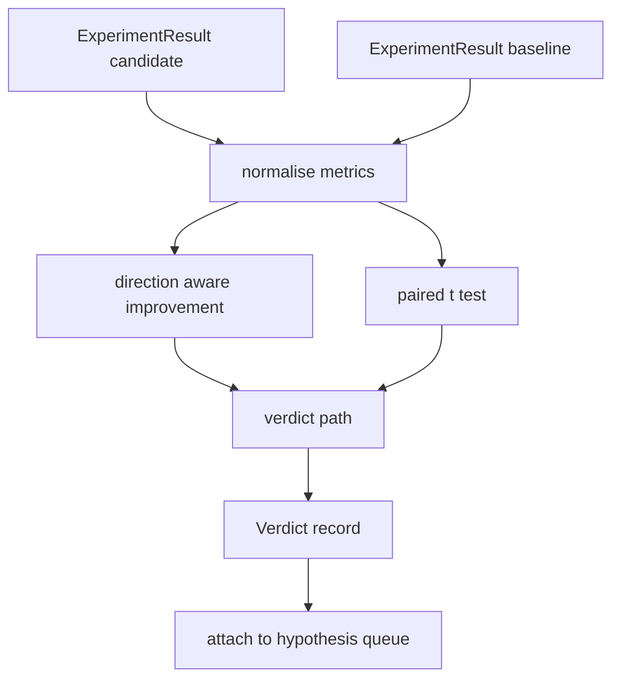

# Result Evaluator

> Trình chạy đã tạo các con số. Bộ đánh giá quyết định liệu những con số đó là một cải thiện, một thoái lui, hay nhiễu. Xây dựng đường kết luận biến các chỉ số thành một kết luận một dòng.

**Type:** Build
**Languages:** Python
**Prerequisites:** Phase 19 Track A lessons 20-29
**Time:** ~90 minutes

## Learning Objectives
- So sánh một lần chạy ứng viên với một đường cơ sở bằng cải thiện có nhận thức hướng và một ngưỡng cố định.
- Chạy một kiểm định t ghép cặp từ đầu trên các chỉ số theo seed và đọc giá trị p kết quả.
- Chuẩn hóa các chỉ số thang log để một báo cáo hạ nguồn có thể pha trộn chúng với các chỉ số tuyến tính.
- Phát ra một kết luận theo giả thuyết mà bộ điều phối có thể gắn vào hàng đợi từ bài năm mươi.
- Giữ mọi bước thuần túy để cùng đầu vào luôn tạo cùng kết luận.

## Why a paired test

Một con số duy nhất từ trình chạy không nói liệu thay đổi có thực không. Cùng cấu hình với một seed khác cho một perplexity khác. Thay đổi có thể là nhiễu. So sánh đúng là ghép cặp: cùng seed với cùng dữ liệu, chạy một lần với ứng viên và một lần với đường cơ sở. Mỗi seed đóng góp một chênh lệch. Trung bình của những chênh lệch đó là hiệu ứng. Sai số chuẩn của những chênh lệch đó là sàn nhiễu.

Bài học triển khai kiểm định từ đầu. Không có `scipy.stats`. Toán đủ nhỏ để đọc trên một màn hình.

```text
diffs    = [a_i - b_i for i in seeds]
mean     = sum(diffs) / n
variance = sum((d - mean) ** 2 for d in diffs) / (n - 1)
t_stat   = mean / sqrt(variance / n)
df       = n - 1
p_value  = two_sided_p(t_stat, df)
```

Giá trị p hai phía sử dụng một hàm beta không đầy đủ được chính quy hóa. Bài học cung cấp một triển khai nhỏ dùng phân số liên tục Lentz. Toàn bộ là sáu mươi dòng toán stdlib.

## Direction aware improvement

Một số chỉ số cải thiện khi tăng (độ chính xác, thông lượng). Các chỉ số khác cải thiện khi giảm (mất mát, perplexity, thời gian thực). Bộ đánh giá mang một trường `direction` trên mỗi chỉ số.

```text
if direction == "higher_is_better":
    improvement = (candidate - baseline) / abs(baseline)
elif direction == "lower_is_better":
    improvement = (baseline - candidate) / abs(baseline)
```

Cải thiện có dấu. Một cải thiện âm trên một chỉ số càng cao càng tốt nghĩa là ứng viên tệ hơn. Đường kết luận đọc dấu và độ lớn cùng nhau.

Một ngưỡng phẳng (`improvement_threshold=0.02`, hai phần trăm) quyết định liệu thay đổi đủ lớn để kết luận không. Dưới đó kết luận là "nhiễu" bất kể giá trị p; vòng lặp không quan tâm các thay đổi người dùng không thể đo.

```figure
cg-paired-verdict
```

## Architecture



Bộ đánh giá chạy ba phép tính độc lập và nối chúng trong đường kết luận. Mỗi phép tính là một hàm thuần túy không có trạng thái dùng chung.

## Log normalisation

Perplexity là hàm mũ theo mất mát. Một mức giảm 0.1 trong mất mát là một mức giảm lớn hơn nhiều trong perplexity. So sánh perplexity trực tiếp giữa hai cấu hình là ổn, nhưng pha trộn nó với các chỉ số tuyến tính trong một báo cáo duy nhất đòi hỏi chuẩn hóa.

Bài học chuẩn hóa bất kỳ chỉ số nào có trường `scale` là `"log"` bằng cách lấy log tự nhiên trước khi tính cải thiện. Ngưỡng sau đó được áp dụng trong không gian log. Một mức giảm perplexity từ 32 xuống 28 là `log(28) - log(32) = -0.133` trên một chỉ số càng thấp càng tốt, cao hơn nhiều so với ngưỡng hai phần trăm.

```text
if scale == "log":
    a = log(candidate)
    b = log(baseline)
else:
    a = candidate
    b = baseline
```

Các chỉ số với `scale="linear"` (mặc định) bỏ qua phép biến đổi. Cùng đường mã xử lý cả hai.

## Per seed paired test

Trình chạy từ bài năm mươi hai phát ra một khối chỉ số cuối mỗi lần chạy. Cho kiểm định ghép cặp bộ đánh giá cần một khối mỗi seed cho ứng viên và một mỗi seed cho đường cơ sở. Bộ điều phối chạy cùng thí nghiệm dưới cả hai cấu hình trên một danh sách seed và đưa cho bộ đánh giá hai danh sách bản ghi `ExperimentResult`.

Bộ đánh giá ghép chúng theo seed (seed nằm trong `result.metrics["seed"]`) và duyệt chỉ số được yêu cầu. Nếu các seed không khớp giữa hai danh sách, bộ đánh giá phát sinh một `PairingError`. Bộ điều phối nên chạy lại.

## The Verdict shape

```text
Verdict
  hypothesis_id          : int
  metric                 : str
  direction              : "higher_is_better" | "lower_is_better"
  scale                  : "linear" | "log"
  candidate_mean         : float
  baseline_mean          : float
  improvement            : float       (signed, fraction; see direction rules)
  p_value                : float | None  (None if n < 2)
  significance_threshold : float
  improvement_threshold  : float
  verdict                : "improved" | "regressed" | "noise" | "failed"
  rationale              : str
```

Đường kết luận là một bảng quyết định nhỏ:

```text
1. If any candidate result has terminal != "ok": verdict = "failed"
2. else if |improvement| < improvement_threshold:  verdict = "noise"
3. else if p_value is None or p_value > significance: verdict = "noise"
4. else if improvement > 0:                          verdict = "improved"
5. else:                                             verdict = "regressed"
```

Lý do là một câu một dòng con người có thể đọc mà bộ điều phối có thể ghi nhật ký theo id giả thuyết.

## How to read the code

`code/main.py` định nghĩa `MetricSpec`, `Verdict`, `Evaluator`, các hàm hỗ trợ thống kê t và beta không đầy đủ, và một demo tất định. Kiểm định t được triển khai bằng toán stdlib thuần; numpy chỉ được dùng để đọc danh sách chỉ số và tính trung bình và phương sai.

`code/tests/test_evaluator.py` bao phủ đường cải thiện, đường thoái lui, đường nhiễu (cải thiện nhỏ), đường nhiễu (n thấp), đường terminal thất bại, đường chuẩn hóa log, kiểm định t với một giá trị tham chiếu đã biết, và lỗi ghép cặp.

## Where this slots in

Bài năm mươi tạo hàng đợi giả thuyết. Bài năm mươi mốt lọc bất cứ thứ gì tài liệu đã giải quyết. Bài năm mươi hai chạy thí nghiệm dưới các cấu hình ứng viên và đường cơ sở trên các seed. Bài năm mươi ba đọc những lần chạy đó và viết kết luận. Bộ điều phối khâu bốn phần lại:

```text
for hypothesis in queue:
    literature = retrieval.search(hypothesis.text)
    if literature_settles(hypothesis, literature):
        attach(hypothesis, verdict="settled")
        continue
    candidates = runner.run_all(specs_for(hypothesis))
    baselines  = runner.run_all(baseline_specs_for(hypothesis))
    metric_spec = MetricSpec("perplexity", direction=LOWER, scale=LOG)
    verdict = evaluator.evaluate(hypothesis.id, metric_spec, candidates, baselines)
    attach(hypothesis, verdict)
```

Bộ điều phối đó không nằm trong bài này; bốn bài kết hợp thành nó mà không có chất kết dính nào ngoài các dataclass mỗi bài định nghĩa.
