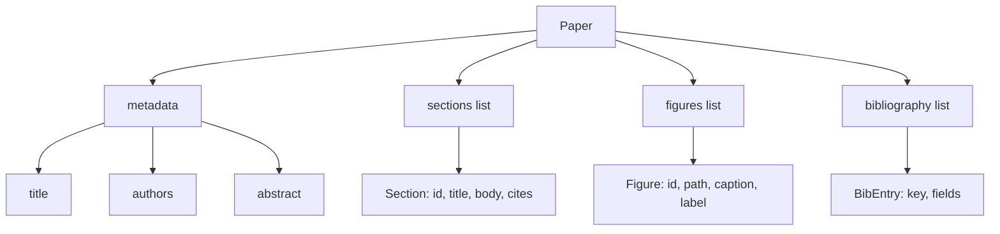
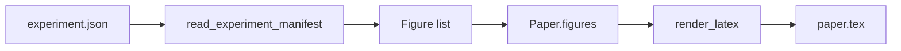
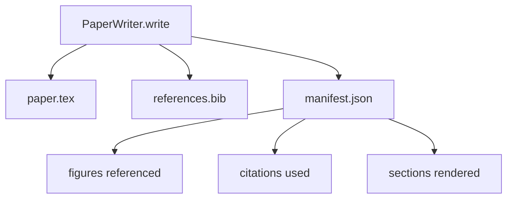

# Paper Writer

> Một bộ khung LaTeX là một hợp đồng giữa nhà nghiên cứu và người sắp chữ. Nếu hợp đồng bị phá tài liệu không biên dịch, và thất bại rõ ràng. Xây dựng bộ khung trước, rồi điền nó.

**Type:** Build
**Languages:** Python
**Prerequisites:** Phase 19 lessons 50-53
**Time:** ~90 minutes

## Learning Objectives

- Coi một bài báo nghiên cứu như một hiện vật có cấu trúc với một đồ thị mục đã biết, không phải một tài liệu dạng tự do.
- Tạo một bộ khung LaTeX khai báo tóm tắt, các mục, các vị trí hình, và các khóa thư mục tài liệu trước khi bất kỳ văn xuôi nào được viết.
- Chèn các hình từ đầu ra thí nghiệm (đường dẫn và chú thích) vào bộ khung qua một cơ chế vị trí tất định.
- Nối một bộ sinh văn xuôi giả lập điền từng mục từ một dàn ý có cấu trúc để harness có thể kiểm thử mà không có mô hình.
- Phát ra một `paper.tex` duy nhất cùng một `references.bib` cùng một bản kê khai liệt kê mọi hình được tham chiếu và mọi trích dẫn được dùng.

```figure
ch-paper-skeleton
```

## Why a skeleton first

Một bản nháp bắt đầu bằng văn xuôi tích lũy nợ cấu trúc. Phần giới thiệu mọc thêm ba đoạn lẽ ra nên nằm trong nghiên cứu liên quan. Một hình được tham chiếu trước khi nó được định nghĩa. Thư mục tài liệu kết thúc với ba khóa cho cùng một bài báo. Đến khi tác giả nhận ra, chi phí viết lại cao hơn chi phí viết.

Một bộ khung đảo ngược điều đó. Cấu trúc được khai báo từ trước như dữ liệu. Các mục là các vị trí với tên và thứ tự. Các hình là các vị trí với id và chú thích. Các khóa thư mục tài liệu được khai báo ở đầu với các mục chúng trỏ tới. Văn xuôi được sinh vào những vị trí đó từng vị trí một. Harness có thể xác thực, trước khi bất kỳ văn xuôi nào được viết, rằng mọi hình có một vị trí, mọi trích dẫn có một mục, và mọi mục xuất hiện trong mục lục.

Đây là cùng kỷ luật mà các bài trước áp dụng cho các kế hoạch, lệnh gọi công cụ, và trace. Cấu trúc là hợp đồng.

## The Paper shape



Mọi trường là dữ liệu Python thông thường. Bộ kết xuất là một hàm thuần túy từ `Paper` sang một chuỗi LaTeX. Harness có thể nội quan bài báo trước khi kết xuất: đếm các mục, liệt kê các file hình thiếu, kiểm tra rằng mọi `\cite{key}` có một `BibEntry` tương ứng.

## The render contract

Bộ kết xuất bảo đảm ba thuộc tính. Thứ nhất, mọi vị trí hình trong bộ khung phát ra một khối `\begin{figure}` với một nhãn ổn định dạng `fig:<id>`. Thứ hai, mọi mục phát ra một `\section{}` với một nhãn ổn định dạng `sec:<id>` để các tham chiếu chéo hoạt động. Thứ ba, thư mục tài liệu phát ra một khối `\bibliography` mà `references.bib` của nó chứa chính xác các mục được khai báo trên bài báo, không nhiều hơn và không ít hơn.

Vi phạm bất kỳ điều nào trong số này là một lỗi kết xuất, không phải một cảnh báo. Bộ khung là hợp đồng; một lần kết xuất âm thầm bỏ một hình là một sự phá vỡ hợp đồng.

## Figure injection from experiments

Các bài trước trong track này tạo các đầu ra thí nghiệm dưới dạng các bản kê khai JSON. Mỗi bản kê khai mang một danh sách hiện vật với các đường dẫn và chú thích ngắn. Bộ viết bài báo đọc bản kê khai đó và tạo các bản ghi `Figure`.



Việc chèn là tất định. Các id hình được suy ra từ tên thí nghiệm cộng một bộ đếm đơn điệu. Các chú thích đến từ bản kê khai. Các đường dẫn được chuẩn hóa tương đối với thư mục đầu ra của bài báo để LaTeX biên dịch ngay cả khi các đầu ra thí nghiệm nằm nơi khác trên đĩa.

## The mocked prose generator

Bài học không gọi một mô hình. Một `MockProseGenerator` đọc một hình thức dàn ý và phát ra văn xuôi tất định. Hình thức dàn ý là một chuỗi ngắn mỗi mục. Bộ sinh mở rộng chuỗi đó thành hai đoạn ngắn với tiêu đề mục được đan vào. Văn xuôi được sinh nhắc tên các hình và trích dẫn chính xác khi dàn ý khai báo chúng.

Điều này đủ để kiểm thử mọi hành vi của bộ viết. Một triển khai thực sẽ đổi bộ sinh thành một lệnh gọi mô hình. Harness quanh nó không đổi. Đó là giá trị của khai báo bộ sinh văn xuôi như một đối tượng có thể gọi: kiểm thử thay bằng một đối tượng tất định, sản xuất thay bằng một đối tượng mô hình, phần còn lại của pipeline giống hệt.

## The manifest output

Bộ viết phát ra ba file vào thư mục đầu ra.



Bản kê khai là thứ một bộ đánh giá hạ nguồn hoặc vòng lặp phê bình đọc. Nó không phân tích LaTeX; nó đọc bản kê khai. Bài tiếp theo, vòng lặp phê bình, nhận bản kê khai này làm đầu vào và tạo một danh sách phản hồi. Đó là lý do bản kê khai là một phần của hợp đồng và LaTeX thì không.

## Validation gates

Bộ viết chạy bốn cổng trước khi ghi bất kỳ file nào.

1. Mọi id hình là duy nhất trong bài báo.
2. Trường `cites` của mọi mục tham chiếu một khóa thư mục tài liệu được khai báo trên bài báo.
3. Tóm tắt không rỗng.
4. Tiêu đề không rỗng.

Một cổng thất bại phát sinh `PaperValidationError` với một lý do chính xác. Harness đưa ra lý do như chế độ lỗi. Không có ghi một phần: hoặc cả ba file được phát ra, hoặc không file nào.

## How to read the code

`code/main.py` định nghĩa `Paper`, `Section`, `Figure`, `BibEntry`, `PaperValidationError`, `MockProseGenerator`, `PaperWriter`, và một hàm `render_latex`. Phương thức `write` nhận một thư mục đầu ra và phát ra `paper.tex`, `references.bib`, và `manifest.json`. Hàm hỗ trợ `read_experiment_manifest` chuyển một danh sách bản kê khai thí nghiệm thành các bản ghi `Figure`.

`code/tests/test_paper_writer.py` bao phủ: kết xuất bộ khung không có mục, kết xuất đầy đủ với hai mục và hai hình, cổng thiếu trích dẫn, cổng id hình trùng, nội dung bản kê khai, và hợp đồng chuỗi LaTeX (mọi mục phát ra một `\section{}`, mọi hình phát ra một `\begin{figure}`).

## Going further

Hai phần mở rộng mà một triển khai thực sẽ muốn. Thứ nhất, kết xuất nhiều định dạng: cùng hình thức `Paper` biên dịch thành Markdown cho các bài blog và HTML cho bản xem trước. Bộ kết xuất trở thành một chiến lược trên `Paper`. Thứ hai, làm giàu trích dẫn: bộ viết lấy các mục BibTeX từ một khóa trích dẫn, với một bộ nhớ đệm DOI cục bộ được cung cấp. Cả hai thêm giá trị, cả hai có thể được thêm mà không chạm hợp đồng bộ khung.

Bộ khung là sự đặt cược. Các mục, hình, và trích dẫn được khai báo như dữ liệu, văn xuôi được sinh vào các vị trí, bản kê khai được phát ra cạnh LaTeX. Mọi cải thiện khác kết hợp lên trên.
