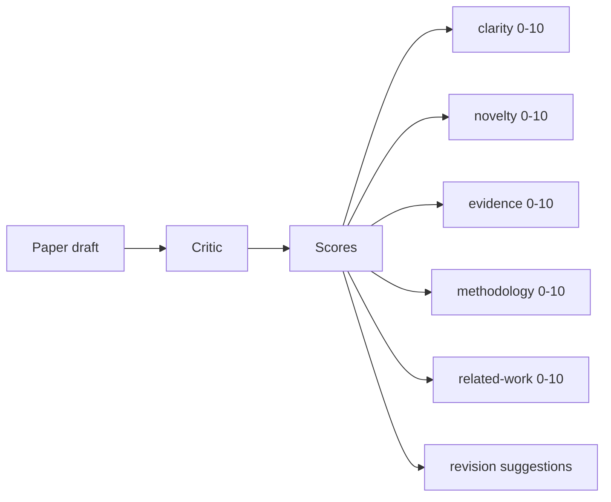
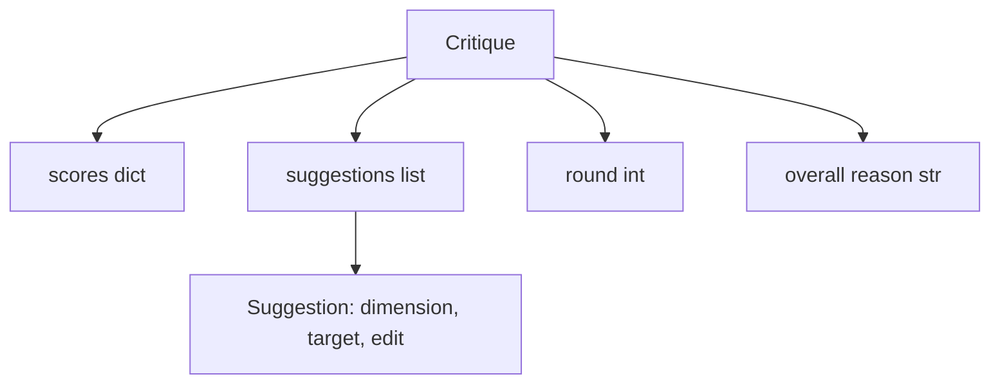
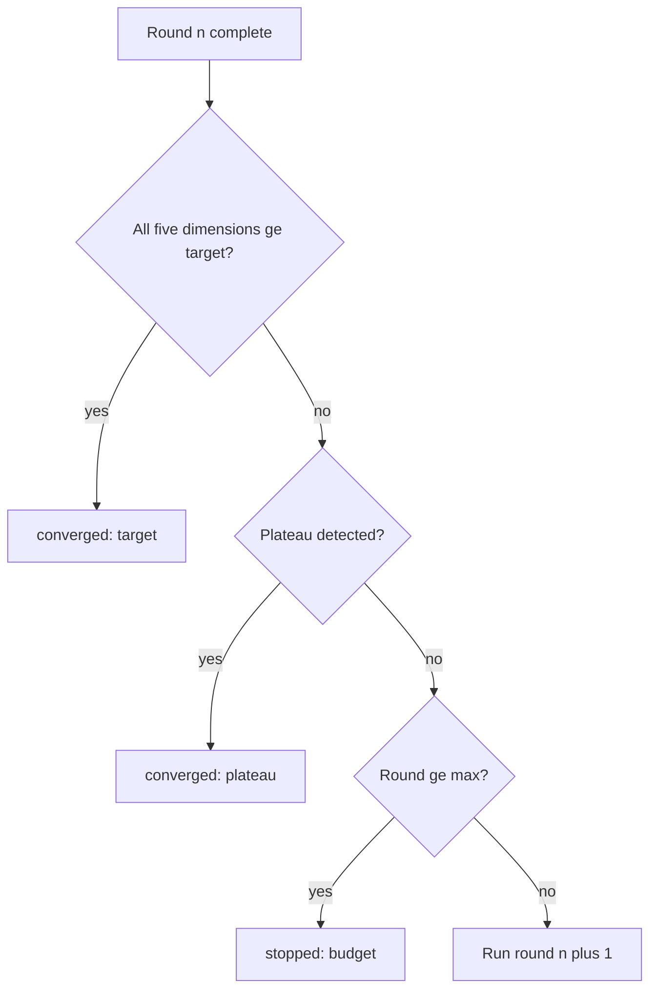
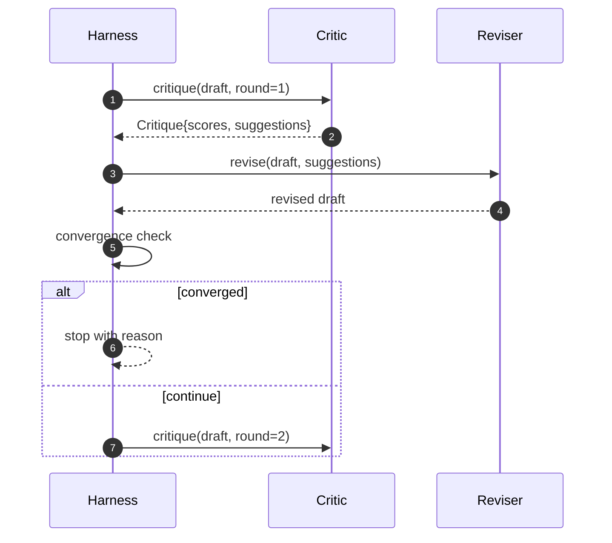

# Critic Loop

> Một bộ phê bình trả về "trông ổn" lần đầu thì bị hỏng. Một bộ phê bình luôn trả về "cần làm thêm" thì bị hỏng. Bộ phê bình thú vị là bộ hội tụ, và bạn phải thiết kế sự hội tụ.

**Type:** Build
**Languages:** Python
**Prerequisites:** Phase 19 lessons 50-53
**Time:** ~90 minutes

## Learning Objectives

- Chấm một bản nháp bài báo trên năm chiều cố định: tính rõ ràng, tính mới, bằng chứng, phương pháp luận, nghiên cứu liên quan.
- Áp dụng phê bình mỗi vòng như một diff sửa đổi có cấu trúc thay vì một lần viết lại dạng tự do.
- Phát hiện hội tụ bằng cách so sánh các điểm qua các vòng; dừng khi bình nguyên, đạt mục tiêu, hoặc cạn ngân sách.
- Giới hạn số vòng bằng một ngân sách số lần lặp tối đa để một bộ phê bình không hội tụ không chạy mãi.
- Phát ra một trace theo vòng để bảng điều khiển hoặc giai đoạn tiếp theo có thể hiển thị quỹ đạo điểm.

```figure
ch-critic-converge
```

## Why five fixed dimensions

Một bộ phê bình dạng tự do là một mô hình trả về một đoạn gợi ý. Sửa đổi của vòng tiếp theo coi đoạn đó như ngữ cảnh xung quanh. Liệu lần viết lại có giải quyết lời phê bình không là không thể xác minh vì lời phê bình chưa từng có cấu trúc.

Năm chiều cho harness một hợp đồng.



Điểm là một vector. Harness theo dõi từng chiều qua các vòng. Một sửa đổi nâng tính rõ ràng nhưng làm sụt bằng chứng là một thoái lui về bằng chứng, và kiểm tra hội tụ thấy nó. Một bộ phê bình chỉ dùng mô hình không thể cung cấp bảo đảm đó.

## The Critique shape



Mọi gợi ý mang chiều nó cải thiện, mục nó nhắm tới, và một chỉ dẫn `edit` mà bộ sửa đổi có thể áp dụng. Bộ sửa đổi cũng là một đối tượng có thể gọi. Bài học cung cấp một bộ sửa đổi tất định diễn giải chỉ dẫn edit như một thao tác thêm vào mục. Một bộ sửa đổi do mô hình điều khiển sẽ diễn giải cùng trường như một prompt. Hợp đồng không đổi.

## Convergence rules, in order

Vòng lặp phê bình kết thúc khi bất kỳ một trong ba điều kiện kích hoạt.



Mục tiêu là trường hợp nghiêm ngặt nhất: mọi chiều trong năm chiều (clarity, novelty, evidence, methodology, related_work) phải chạm `>= target_score` (mặc định `8.0`) trước khi vòng lặp trả về thành công. Một trung bình cao với một chiều yếu là không đủ. Phát hiện bình nguyên so sánh trung bình vòng hiện tại với trung bình vòng trước. Nếu cải thiện dưới `plateau_epsilon` (mặc định `0.1`) trong hai vòng liên tiếp, vòng lặp thoát với `plateau`. Ngân sách là một trần cứng số vòng (mặc định `5`) và thoát với `budget`.

Thứ tự quan trọng. Mục tiêu thắng bình nguyên thắng ngân sách. Nếu vòng ba chạm mục tiêu trên cùng lần lặp cũng sẽ kích hoạt một bình nguyên, kết quả là `target`, không phải `plateau`.

## Why plateau detection runs over two rounds

Một bình nguyên một vòng là nhiễu. Một bộ phê bình thực trả về một điểm hơi khác mỗi lần lặp ngay cả trên một bản nháp cố định, vì chấm điểm tất định vẫn phụ thuộc vào những gợi ý nào đã được áp dụng và theo thứ tự nào. Yêu cầu hai vòng bình nguyên liên tiếp lọc nhiễu đó ra. Nếu harness báo cáo một bình nguyên, bản nháp đã thực sự ngừng cải thiện.

## The deterministic critic in this lesson

Bài học không gọi một mô hình. Bộ phê bình được cung cấp là một đối tượng có thể gọi chấm một bản nháp dựa trên ba tín hiệu: độ dài thân mục trung bình (tính rõ ràng), số hình và số trích dẫn (bằng chứng), và một trường `originality_tag` trên siêu dữ liệu bài báo (tính mới). Bộ sửa đổi biết cách đẩy mỗi điểm lên.

```text
clarity      grows when the average section body length increases
novelty      grows when originality_tag is set to "high"
evidence     grows when a section's figure_refs is non-empty
methodology  grows when a section titled "Method" exists with body
related-work grows when a section titled "Related Work" exists with body
```

Bộ sửa đổi diễn giải mỗi gợi ý như một lần thêm có mục tiêu. Sau vòng một, harness có thể quan sát điểm tăng lên. Các kiểm thử dùng thuộc tính này để khẳng định vòng lặp giảm khoảng cách.

## The full loop contract



Harness sở hữu bộ đếm vòng, trace, và kiểm tra hội tụ. Bộ phê bình sở hữu điểm. Bộ sửa đổi sở hữu diff. Không thành phần nào trong ba thành phần chạm trạng thái của các thành phần khác.

## The Trace output

Mỗi vòng phát ra một sự kiện trace với số vòng, vector điểm, số gợi ý, và kết luận hội tụ. Trace đầy đủ được trả về cạnh bản nháp cuối. Một bảng điều khiển hạ nguồn có thể hiển thị biểu đồ điểm theo vòng. Bài tiếp theo, bộ lập lịch lặp, đọc trace để quyết định liệu nhánh có đáng giữ không.

## Budgets that protect against bad critics

Một bộ phê bình tạo các gợi ý không bao giờ cải thiện điểm sẽ khóa vòng lặp vào trần số lần lặp tối đa. Trace làm điều đó hiển lộ: năm vòng, điểm phẳng, kết luận `budget`. Người dùng đọc điều đó như một lỗi bộ phê bình, không phải lỗi bản nháp. Lựa chọn khác, chỉ đưa ra bản nháp cuối, che giấu chẩn đoán. Thiết kế ưu tiên trace đưa nó ra.

## How to read the code

`code/main.py` định nghĩa `Critique`, `Suggestion`, giao thức `Critic`, giao thức `Reviser`, `CriticLoop`, và một factory `make_deterministic_critic_pair` trả về bộ phê bình tất định và một bộ sửa đổi tương ứng. Một hình thức `Paper` tối thiểu được đưa vào để bài học độc lập.

`code/tests/test_critic_loop.py` bao phủ: cải thiện đơn điệu sau vòng một, hội tụ mục tiêu trên một bản nháp được điều chỉnh, phát hiện bình nguyên sau hai vòng phẳng, cạn ngân sách khi không gợi ý nào cải thiện, áp dụng gợi ý bởi bộ sửa đổi, và hình thức trace.

## Going further

Hai phần mở rộng mà một triển khai thực sẽ muốn. Thứ nhất, trọng số chiều: một bài báo cho workshop đặt trọng số tính mới cao hơn phương pháp luận; một tạp chí đặt ngược lại. Kiểm tra hội tụ trở thành một trung bình có trọng số. Thứ hai, các bộ phê bình ghép cặp: một bộ phê bình chấm, một bộ thứ hai phân xử các gợi ý trước khi bộ sửa đổi thấy chúng. Cả hai thêm giá trị, cả hai kết hợp trên cùng hình thức `Critique`.

Sự đặt cược là vector điểm. Một khi phê bình có cấu trúc, mọi cải thiện khác, quy tắc hội tụ, bảng điều khiển, bộ phê bình ghép cặp, đều cắm vào mà không thay đổi vòng lặp.
