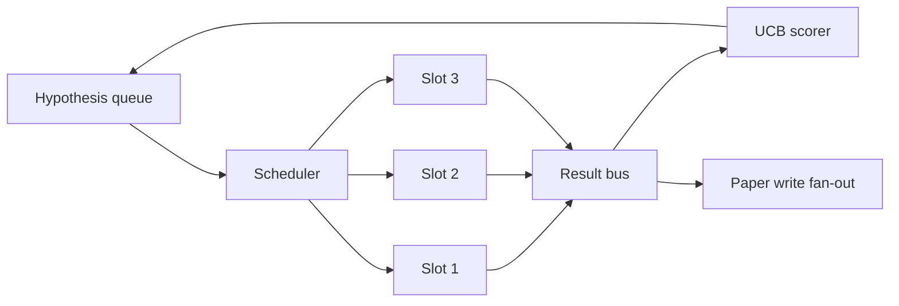
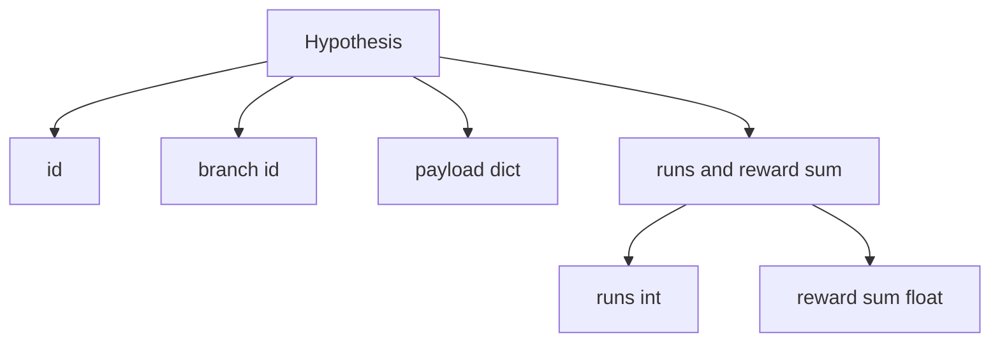
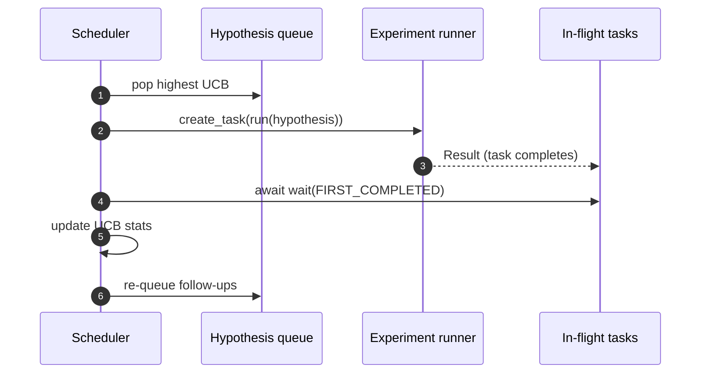

# Iteration Scheduler

> Một vòng lặp nghiên cứu không có bộ lập lịch là một hàng đợi với những ảo tưởng. Bộ lập lịch là nơi vòng lặp quyết định ngừng khám phá điều gì, và quyết định đó là toàn bộ cuộc chơi.

**Type:** Build
**Languages:** Python
**Prerequisites:** Phase 19 lessons 50-53
**Time:** ~90 minutes

## Learning Objectives

- Mô hình hóa một quy trình nghiên cứu như một hàng đợi giả thuyết cấp cho các vị trí thí nghiệm song song có các kết quả hội tụ trở lại.
- Chạy nhiều thí nghiệm đồng thời bằng asyncio để bộ lập lịch có thể giữ mọi vị trí bận.
- Chấm mỗi nhánh giả thuyết bằng UCB để bộ lập lịch có thể cắt tỉa các nhánh năng suất thấp mà không từ bỏ khám phá.
- Phân nhánh các kết quả hoàn tất tới một giai đoạn viết bài báo và một giai đoạn đưa lại vào hàng đợi để một nhánh năng suất cao sinh các giả thuyết tiếp nối.
- Đưa ra một trace theo lần lặp với các điểm nhánh, mức chiếm dụng vị trí, và các quyết định cắt tỉa.

```figure
ch-ucb-scheduler
```

## Why a scheduler, not a worklist

Một danh sách công việc phẳng chạy các công việc theo thứ tự nộp. Điều đó ổn khi mỗi công việc độc lập. Nghiên cứu không độc lập: một phát hiện từ thí nghiệm ba thay đổi ưu tiên của thí nghiệm bốn và năm. Một bộ lập lịch đọc các kết quả hội tụ và sắp lại hàng đợi hoàn thành nhiều công việc hữu ích hơn mỗi đơn vị tính toán.

Lựa chọn thiết kế thú vị là quy tắc chấm điểm. Một bộ chấm tham lam luôn chọn người dẫn đầu hiện tại và không bao giờ khám phá. Một bộ chấm đều không bao giờ khai thác. UCB (cận tin cậy trên) là con đường giữa: khai thác người dẫn đầu trong khi dành năng lực cho các nhánh đã được thử ít hơn.

## The system shape



Hàng đợi giữ các giả thuyết. Bộ lập lịch chọn giả thuyết UCB cao nhất khi một vị trí trống. Mỗi vị trí chạy một thí nghiệm bất đồng bộ. Các thí nghiệm hoàn tất đưa kết quả lên bus. Bus cập nhật các thống kê UCB trên nhánh nguồn và phân nhánh tới giai đoạn viết bài báo khi năng suất của một nhánh vượt một ngưỡng.

## The Hypothesis shape



`branch` là khóa cho các thống kê UCB. Nhiều giả thuyết có thể dùng chung một nhánh (nhánh là hướng nghiên cứu; giả thuyết là một lần thử trong đó). `runs` là số thí nghiệm hoàn tất cho nhánh đó, `reward_sum` là phần thưởng tích lũy. UCB đọc cả hai.

## UCB scoring

Công thức UCB được dùng trong bài này là UCB1 cổ điển.

```text
ucb(branch) = mean_reward(branch) + c * sqrt( ln(total_runs) / runs(branch) )
```

`total_runs` là số mọi thí nghiệm hoàn tất trên mọi nhánh. `c` là trọng số khám phá; bài học mặc định `sqrt(2)`. Một nhánh có không lần chạy nhận `+inf` để các nhánh chưa thử luôn được lập lịch trước. Một nhánh có phần thưởng trung bình cao giữ một điểm cao cho đến khi các nhánh khác bắt kịp; một nhánh chạy nhiều lần mà không có nhiều phần thưởng bị các lựa chọn ít chạy hơn lấn át.

Cổng cắt tỉa tách khỏi bộ chọn. Cắt tỉa loại một nhánh khỏi lập lịch tương lai khi phần thưởng trung bình của nó giảm dưới một sàn tuyệt đối (mặc định `0.2`) sau ít nhất `prune_after_runs` lần thử (mặc định `3`). Điều này giữ hàng đợi có giới hạn.

## Parallel slots with asyncio

Bộ lập lịch điều khiển các thí nghiệm bằng `asyncio.create_task`. Mỗi tác vụ chạy trình chạy thí nghiệm (một đối tượng có thể gọi `async def`) trả về một `Result`. Vòng lặp chính đợi trên tập các tác vụ đang xử lý với `asyncio.wait(..., return_when=asyncio.FIRST_COMPLETED)` và kích hoạt cập nhật chấm điểm trên mỗi lần hoàn tất.



Ba vị trí chạy đồng thời. Vòng lặp chính không bao giờ chặn trên một thí nghiệm duy nhất. Bộ lập lịch tiếp tục bắt đầu các tác vụ mới ngay khi một vị trí trống, cho đến khi cả hàng đợi rỗng và không tác vụ nào đang xử lý.

## Fan-out: paper triggers

Khi phần thưởng trung bình của một nhánh vượt `paper_threshold` (mặc định `0.7`) và nhánh đó chưa tạo một bài báo, bộ lập lịch phân nhánh một sự kiện `paper.trigger` vào một danh sách đầu ra. Ở hạ nguồn bộ viết bài báo từ bài năm mươi bốn sẽ nhận nó. Trong bài này kích hoạt được thu như một danh sách để các kiểm thử có thể khẳng định nó.

## Fan-out: follow-up hypotheses

Khi một kết quả năng suất cao đến, bộ lập lịch có thể gọi `expander` do người dùng cung cấp để tạo một hoặc nhiều giả thuyết tiếp nối trên cùng nhánh. Bộ mở rộng là một hàm thuần túy từ `Result` sang `list[Hypothesis]`. Bài học cung cấp một bộ mở rộng tất định tạo hai giả thuyết tiếp nối cho bất kỳ kết quả nào có phần thưởng vượt ngưỡng bài báo.

## Budgets

Hai ngân sách bảo vệ bộ lập lịch khỏi các vòng lặp mất kiểm soát.

```text
max_experiments    : total count of experiments run across all branches
max_seconds        : wall-clock cap (asyncio time)
```

Khi một trong hai kích hoạt, bộ lập lịch ngừng lập lịch các tác vụ mới, đợi các tác vụ đang xử lý, và trả về trace cuối. Trace bao gồm một `stop_reason`.

## The Trace and final report

Mỗi quyết định lập lịch (chọn, điều phối, kết quả, cắt tỉa, phân nhánh) phát ra một sự kiện. Báo cáo cuối tóm tắt các thống kê theo nhánh, tổng số lần chạy, tổng thời gian thực, và các kích hoạt bài báo đã phát. Bài tiếp theo, demo đầu cuối, đọc báo cáo này để điều khiển bộ viết bài báo.

## How to read the code

`code/main.py` định nghĩa `Hypothesis`, `Result`, `BranchStats`, `IterationScheduler`, và một factory `make_deterministic_runner` trả về một trình chạy thí nghiệm asyncio với các phần thưởng có thể dự đoán. Trình chạy ngủ trong một `delay_ms` cố định (mặc định `5ms`) để tính đồng thời có thể quan sát.

`code/tests/test_scheduler.py` bao phủ: UCB chọn các nhánh chưa thử trước, mức chiếm dụng vị trí song song, các kích hoạt bài báo khi vượt ngưỡng, cắt tỉa nhánh sau các lần thử năng suất thấp, các giả thuyết tiếp nối phân nhánh, và thoát theo ngân sách (cả số thí nghiệm và thời gian thực).

## Going further

Ba phần mở rộng mà một triển khai thực sẽ muốn. Thứ nhất, các thống kê UCB bền vững qua các phiên: các thống kê hiện tại nằm trong bộ nhớ; một bộ lập lịch thực sẽ checkpoint chúng để một lần khởi động lại bảo toàn ngân sách khám phá đã chi. Thứ hai, chấm điểm đa mục tiêu: thay vì một phần thưởng vô hướng, mỗi kết quả phát ra một vector và UCB trở thành một bộ chọn kiểu Pareto. Thứ ba, bandit theo ngữ cảnh: bộ chọn điều kiện hóa trên các đặc trưng giả thuyết (độ dài, độ phức tạp) để các giả thuyết tương tự chia sẻ khám phá.

Bộ lập lịch là nơi nghiên cứu trở thành nhiều hơn một danh sách công việc. Một khi UCB được nối và các vị trí chạy song song, mọi cải thiện khác kết hợp lên trên.
