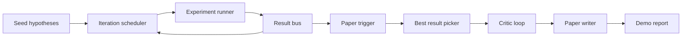
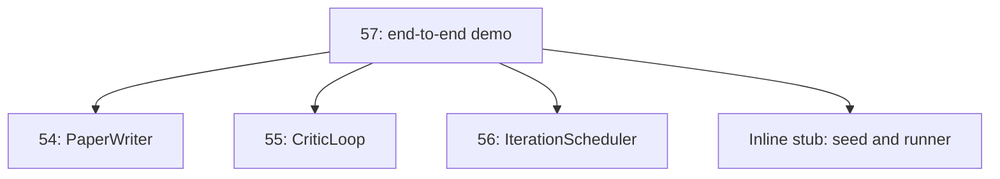
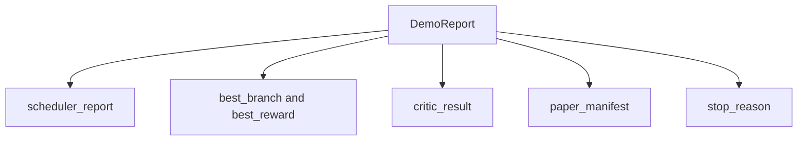

# End-to-End Research Demo

> Một demo là nơi mọi hợp đồng bạn đã viết trước đó phải kết hợp. Nếu bất kỳ hợp đồng nào rò rỉ, demo là bài học bắt nó.

**Type:** Build
**Languages:** Python
**Prerequisites:** Phase 19 lessons 50-53
**Time:** ~90 minutes

## Learning Objectives

- Nối vòng lặp tự nghiên cứu từ đầu đến cuối: seed giả thuyết, trình chạy thí nghiệm, bộ lập lịch, vòng lặp phê bình, bộ viết bài báo.
- Kết hợp các thành phần cơ sở từ bốn bài Track D trước qua các import Python thông thường, không phải một framework.
- Chạy vòng lặp đến một kết thúc tự dừng và phát ra một báo cáo demo duy nhất liệt kê đầu ra của mọi giai đoạn.
- Giữ demo tất định để bộ kiểm thử có thể khẳng định hình thức cuối.
- Đưa ra một chế độ lỗi rõ ràng khi hợp đồng của bất kỳ giai đoạn nào bị phá, để giai đoạn tiếp theo không chạy với một đầu vào hỏng.

```figure
ch-research-pipeline
```

## What composes here



Năm giai đoạn. Seed là một danh sách ba giả thuyết. Bộ lập lịch chạy sáu thí nghiệm trên chúng với ba vị trí song song. Bus báo cáo một hoặc nhiều kích hoạt bài báo. Bộ chọn chọn kết quả tốt nhất duy nhất. Vòng lặp phê bình lặp trên một bản nháp được xây dựng từ kết quả đó. Bộ viết bài báo phát ra LaTeX, BibTeX, và bản kê khai cuối.

## Why import, not copy

Mỗi bài trước cung cấp một `main.py` với các dataclass và hàm công khai. Demo import chúng bằng cách điều chỉnh `sys.path` tới thư mục cha của mỗi bài. Đây không phải nối framework; nó là cùng import mà các file kiểm thử trong các bài trước đã sử dụng.



Stub nội tuyến thay cho các bài năm mươi đến năm mươi ba: một bộ sinh nhỏ các giả thuyết seed và một hàm phần thưởng đồng bộ. Người dùng có thể đổi stub nội tuyến lấy các thành phần cơ sở thực từ những bài đó bằng cách điều chỉnh hai import.

## Determinism guarantees

Demo tất định do cách xây dựng. Trình chạy thí nghiệm là numpy được đặt seed. Bộ sửa đổi của vòng lặp phê bình duyệt các chiều cố định theo thứ tự cố định. Bộ sinh văn xuôi của bộ viết bài báo là bản giả lập từ bài năm mươi bốn. Bộ chọn UCB của bộ lập lịch phá hòa theo thứ tự lặp, không phải lựa chọn ngẫu nhiên.

Với cùng seed, demo phát ra cùng báo cáo. Kiểm thử khẳng định thuộc tính này bằng cách chạy demo hai lần và so sánh bản kê khai.

## The demo report shape



Mỗi trường đến nguyên văn từ giai đoạn thượng nguồn. Demo không biến đổi bất kỳ đầu ra nào; nó kết hợp chúng. Đó là bài kiểm thử mà demo chính là.

## Failure mode handling

Mỗi giai đoạn hoặc thành công hoặc phát sinh một lỗi có kiểu.

```text
Scheduler ........ returns SchedulerReport with stop_reason
                   in {queue_empty, max_experiments, deadline}
Best-result pick . raises NoTriggerError if no paper trigger fired
Critic loop ...... returns LoopResult with status converged or stopped
Paper writer ..... raises PaperValidationError on contract break
```

Một thất bại trong bất kỳ giai đoạn nào đoản mạch demo với một ngoại lệ có kiểu. Các kiểm thử ghim hợp đồng này: `test_no_triggers_raises_typed_error` và `test_best_picker_raises_when_no_triggers` khẳng định bộ chọn phát sinh `NoTriggerError` / `BestResultError` khi không nhánh nào phát một kích hoạt, và bộ viết không bao giờ được gọi.

## The best-result picker

Bộ lập lịch phát ra các kích hoạt bài báo theo nhánh. Bộ chọn chọn nhánh có phần thưởng trung bình cao nhất trên mọi kích hoạt. Hòa được phá theo thứ tự chữ cái của id nhánh để demo tất định. Bộ chọn là một hàm thuần túy nhỏ; kiểm thử ghim nó trên một báo cáo bộ lập lịch cố định.

## Wiring the critic loop

Vòng lặp phê bình trong bài năm mươi lăm hoạt động trên một `MiniPaper`. Demo xây dựng một `MiniPaper` từ nhánh được chọn bằng cách điền tóm tắt với id nhánh, khởi tạo hai mục (Giới thiệu và Kết quả), và đặt `originality_tag` từ phần thưởng trung bình của nhánh (cao nếu `>= 0.8`, trung bình nếu `>= 0.6`, thấp nếu không).

Bộ sửa đổi sau đó lặp bản nháp đến hội tụ. Đầu ra đi vào bộ viết bài báo.

## Wiring the paper writer

Bộ viết bài báo trong bài năm mươi bốn hoạt động trên hình thức `Paper` đầy đủ với các hình và thư mục tài liệu. Demo nâng cấp `MiniPaper` đã hội tụ qua `mini_to_full_paper`, gắn một hình cho nhánh được chọn và một thư mục tài liệu tổng hợp nhỏ được xây dựng từ hợp các khóa trích dẫn mà bộ phê bình gợi ý. Mọi trích dẫn demo thêm cũng được thêm vào danh sách thư mục tài liệu, nên xác thực đạt.

## How to read the code

`code/main.py` định nghĩa `BestResultError`, `NoTriggerError`, `DemoReport`, `pick_best_branch`, `build_mini_paper`, `mini_to_full_paper`, và `run_demo`. Các import ở đầu điều chỉnh `sys.path` một lần và lấy `PaperWriter`, `CriticLoop`, và `IterationScheduler` từ các bài của chúng.

`code/tests/test_e2e.py` bao phủ: demo chạy từ đầu đến cuối và phát ra một báo cáo với cả năm trường được điền, tính tất định giữa hai lần chạy, NoTriggerError khi không nhánh nào vượt ngưỡng, PaperValidationError khi hợp đồng của bộ viết bị phá, bản kê khai bài báo chứa hình của nhánh được chọn, và lý do dừng bộ lập lịch là một trong các giá trị dự kiến.

## Going further

Ba phần mở rộng đáng nối khi demo đã xanh. Thứ nhất, trạng thái bền vững: kết quả mỗi giai đoạn ghi vào một kho JSON nhỏ để một lần khởi động lại có thể tiếp tục mà không chạy lại các giai đoạn rẻ. Thứ hai, một bảng điều khiển: các sự kiện trace từ bộ lập lịch và vòng lặp phê bình hiển thị như một dòng thời gian duy nhất. Thứ ba, các lệnh gọi mô hình thực: đổi bộ sinh văn xuôi giả lập và bộ phê bình tất định thành các bản do mô hình điều khiển; hệ thống nối không đổi.

Công việc của demo là chứng minh rằng sự kết hợp là kiến trúc. Năm bài, bốn import, một báo cáo. Lần tiếp theo bạn thêm một giai đoạn, hệ thống nối tăng chính xác một dòng.
