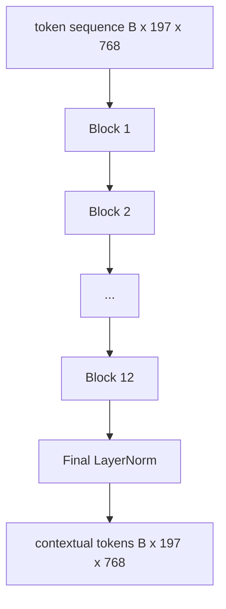
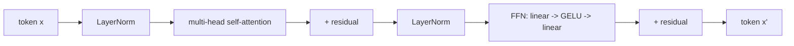

# Vision Transformer Encoder

> Các patch một mình không nhìn thấy. Một transformer pre-LN 12 lớp với 12 đầu attention biến chuỗi token patch thành một chuỗi token có ngữ cảnh, với token CLS gộp các đặc trưng toàn ảnh trong trạng thái ẩn cuối của nó. Bài này là phòng máy của mọi mô hình thị giác-ngôn ngữ hiện đại.

**Type:** Build
**Languages:** Python
**Prerequisites:** Phase 19 lessons 30-37 (Track B foundations)
**Time:** ~90 minutes

## Learning Objectives

- Triển khai một khối transformer pre-LN với self-attention đa đầu và một lớp con truyền thẳng.
- Xếp 12 khối với 12 đầu để tạo một bộ mã hóa ViT-Base.
- Nối phần đầu patch từ bài 58 vào bộ mã hóa và chạy một lượt tiến.
- Xác minh token CLS tổng hợp thông tin từ mọi patch.

## The Problem

Embedding patch tạo một chuỗi 197 token, mỗi token là một vector không biết về bất kỳ patch nào khác. Một bức ảnh mèo cần mọi patch biết những patch nào chứa râu, những patch nào chứa nền, và những patch nào chứa mắt. Transformer là cơ chế xây dựng nhận thức đó, từng lớp attention một. Không có nó, phần đầu patch là một tokenizer thông minh không có hiểu biết.

Công thức tiêu chuẩn sâu mười hai khối, rộng mười hai đầu, với vị trí pre-LayerNorm, kích hoạt GELU, và mở rộng truyền thẳng 4x. Công thức đó là xương sống của CLIP ViT-L, SigLIP, DINOv2, họ Qwen-VL, InternVL, và mọi bộ mã hóa thị giác trọng số mở khác của 2025-2026. Công thức đủ ổn định để bạn có thể đọc bất kỳ bài báo nào trong số đó và giả định hình thức khối này trừ khi họ nói rõ điều khác.

## The Concept





### Pre-LN vs post-LN

Transformer gốc đặt LayerNorm sau phần dư. Pre-LN (LayerNorm trước mỗi lớp con) là phiên bản mọi mô hình thị giác-ngôn ngữ hiện đại sử dụng, vì nó huấn luyện ổn định mà không có các thủ thuật khởi động tốc độ học. Khác biệt là một dòng trong lượt tiến, và dòng gradient ở độ sâu 12+ khác nhau một trời một vực.

### Multi-head self-attention

Mỗi đầu chiếu vector token sang bộ ba `(query, key, value)` riêng của nó với chiều `head_dim = hidden / num_heads`. Với `hidden = 768` và `heads = 12`, mỗi đầu có `dim = 64`. 12 đầu chú ý song song, rồi các đầu ra của chúng nối trở lại chiều 768 và đi qua một phép chiếu đầu ra. Điểm chính của đa đầu là một đầu có thể học "chú ý đến mắt mèo" trong khi đầu khác học "chú ý đến gradient nền" mà không can thiệp.

### Why the 4x feed-forward expansion

FFN đi `hidden -> 4 * hidden -> hidden` với GELU ở giữa. Hệ số 4 là thực nghiệm và đã được giữ trên các transformer ngôn ngữ và thị giác từ năm 2017. Nhỏ hơn (2x) thiếu khớp; lớn hơn (8x) quá khớp ở ngân sách dữ liệu cố định. MLP là nơi mô hình lưu phần lớn các sự kiện đã học, và phần giữa rộng hơn là nơi chúng nằm.

| Thành phần | Tham số ở quy mô ViT-Base |
|-----------|------------------------------|
| phép chiếu qkv mỗi khối | `3 * 768 * 768 = 1.77M` |
| phép chiếu đầu ra mỗi khối | `768 * 768 = 590K` |
| FFN mỗi khối (mở rộng 4x) | `2 * 768 * 4 * 768 = 4.72M` |
| LayerNorm mỗi khối | `4 * 768 = 3K` |
| Tổng mỗi khối | khoảng 7.1M |
| 12 khối | khoảng 85M |
| Cộng phần đầu | tổng khoảng 86M |

ViT-Base là một bộ mã hóa 86M tham số. Điều đó nhỏ theo chuẩn năm 2026 (SigLIP-So400M là 400M, ViT Qwen-VL là 675M), nhưng kiến trúc giống hệt sai khác ở độ rộng và độ sâu.

### Causal mask or not?

Vision Transformer chỉ encoder và hai chiều: token `i` có thể chú ý đến token `j` cho bất kỳ cặp nào. Không mặt nạ. Cross-attention phía decoder trong bài 61 sẽ dùng một mặt nạ nhân quả, nhưng bên trong bộ mã hóa thị giác, attention kết nối đầy đủ.

### What the CLS token learns

Token CLS bắt đầu như một tham số được học, không có nội dung patch riêng, và tích lũy thông tin qua attention trên mọi khối. Đến lớp cuối, hàng CLS là một bản tóm tắt vector của toàn ảnh; các đầu hạ nguồn chiếu vector duy nhất này thành các logit lớp, embedding tương phản, hoặc key cross-attention cho một decoder văn bản.

```figure
ch-cls-funnel
```

## Build It

`code/main.py` triển khai:

- `MultiHeadSelfAttention`, với `qkv` và các phép chiếu đầu ra, toán attention tích vô hướng có chia tỷ lệ, và các khẳng định hình dạng.
- `FeedForward`, MLP GELU mở rộng 4x.
- `Block`, một khối pre-LN kết hợp các lớp con attention và truyền thẳng với các phần dư.
- `ViT`, một ngăn xếp 12 khối với một LayerNorm cuối.
- `VisionEncoder`, nối `VisionFrontEnd` từ bài 58 với ngăn xếp `ViT` và cung cấp một `forward()` trả về chuỗi có ngữ cảnh và vector CLS được gộp.
- Một demo chạy một ảnh fixture 224x224 được tổng hợp qua bộ mã hóa đầy đủ và in hình dạng đầu vào, hình dạng đầu ra, số tham số, và chuẩn CLS cách mỗi một lớp.

Chạy nó:

```bash
python3 code/main.py
```

Đầu ra: fixture được mã hóa thành một tensor `(1, 197, 768)`. Chuẩn CLS trôi lên khi các lớp kết hợp, rồi ổn định tại LayerNorm cuối. Tổng tham số được báo khoảng 86M.

## Use It

Bộ mã hóa được định nghĩa ở đây, sai khác ở độ rộng và độ sâu, là cùng ngăn xếp khối được cung cấp bên trong mọi VLM trọng số mở năm 2025-2026. Các khác biệt nằm ở:

- **Độ rộng và độ sâu.** ViT-Large là `hidden=1024, depth=24, heads=16`; SigLIP So400M là `hidden=1152, depth=27, heads=16`. Cùng khối.
- **Đầu gộp.** Gộp CLS (bài này) so với gộp trung bình (SigLIP) so với gộp attention (các VLM sau này).
- **Xử lý vị trí.** Hình sin cố định (bài 58) so với 1D được học so với ALiBi so với RoPE 2D. Toán khối không đổi.
- **Token thanh ghi.** DINOv2 thêm 4 token được học bổ sung vào đầu. Một dòng mã.

Ngăn xếp khối này là nền tảng. Các bài tiếp theo (60-63) đứng trên nó.

## Tests

`code/test_main.py` bao phủ:

- một khối duy nhất bảo toàn hình dạng và bất biến với kích thước lô đầu vào
- các điểm attention cộng thành một dọc trục key (kiểm tra hợp lý softmax)
- các đường phần dư được nối (đầu vào không vẫn tạo đầu ra khác không qua token CLS)
- một lượt tiến xếp chồng 4 lớp tạo hình dạng đúng
- các gradient chảy tới phép chiếu patch từ đầu ra CLS

Chạy chúng:

```bash
python3 -m unittest code/test_main.py
```

## Exercises

1. Thêm các token thanh ghi (4 vector được học được thêm vào sau CLS) và chạy lại. So sánh độ mượt bản đồ attention qua entropy của phân phối softmax trên lớp cuối.

2. Đổi pre-LN thành post-LN và huấn luyện trong một epoch trên một bộ phân loại hình dạng tổng hợp. Quan sát biến thể nào huấn luyện ổn định mà không cần khởi động LR.

3. Triển khai che nhân quả như một đối số `attn_mask` để cùng khối có thể được tái sử dụng như một khối decoder. Hình dạng mặt nạ là `(seq, seq)`, tam giác dưới.

4. Đo hiệu năng một lượt tiến ở các kích thước lô 1, 8, 64 bằng `torch.profiler`. Lớp MLP chiếm ưu thế thời gian thực, không phải attention.

5. Thay các phép chiếu q-k-v của một đầu attention bằng một adapter LoRA hạng thấp, đóng băng phần còn lại, và xác minh gradient chỉ chảy nơi bạn kỳ vọng.

## Key Terms

| Thuật ngữ | Ý nghĩa |
|------|---------------|
| Pre-LN | LayerNorm được áp dụng trước mỗi lớp con thay vì sau |
| Self-attention (Tự chú ý) | Mỗi token chú ý đến mọi token khác trong cùng chuỗi |
| Multi-head (Đa đầu) | Chiều ẩn được chia trên `H` đầu attention độc lập |
| FFN expansion (Mở rộng FFN) | Lớp truyền thẳng mở rộng đến `4 * hidden` trước khi co lại |
| CLS pooling (Gộp CLS) | Dùng trạng thái ẩn cuối của token đầu làm tóm tắt ảnh |

## Further Reading

- An Image is Worth 16x16 Words (ViT, 2021) cho công thức bộ mã hóa.
- DINOv2 (2023) cho các token thanh ghi và mục tiêu tiền huấn luyện tự giám sát.
- SigLIP (2023) cho biến thể gộp trung bình và mất mát tương phản sigmoid được dùng trong bài 62.
