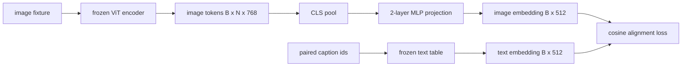

# Projection Layer for Modality Alignment

> Một bộ mã hóa thị giác tạo các token ảnh. Một decoder văn bản tiêu thụ các token văn bản. Hai thứ nằm trong các không gian vector khác nhau. Một MLP hai lớp nhỏ chiếu các token ảnh vào không gian embedding văn bản, và một mất mát căn chỉnh cosine với một chú thích ghép cặp kéo hai không gian vào sự đồng thuận. Phép chiếu đó là phần nhỏ nhất của một mô hình thị giác-ngôn ngữ và là phần quan trọng nhất cho chuyển giao.

**Type:** Build
**Languages:** Python
**Prerequisites:** Phase 19 lessons 30-37 (Track B foundations)
**Time:** ~90 minutes

## Learning Objectives

- Xây dựng một phép chiếu MLP hai lớp ánh xạ các đặc trưng ảnh vào không gian embedding văn bản.
- Tạo một bảng embedding văn bản giả lập (không tokenizer tiền huấn luyện, không corpus thực).
- Tính một mất mát căn chỉnh cosine giữa các token ảnh được chiếu và một embedding chú thích ghép cặp.
- Chỉ huấn luyện phép chiếu với một bộ mã hóa thị giác đóng băng và một bảng văn bản đóng băng.

## The Problem

Bạn có một bộ mã hóa thị giác (bài 58-59) tạo các token chiều `vision_hidden = 768`. Bạn có một decoder văn bản muốn gắn lên trên với chiều embedding `text_hidden = 512` (bất kỳ con số khác cũng hợp lý như vậy). Decoder kỳ vọng các token có hình thức văn bản. Các token ảnh không có hình thức văn bản: chúng nằm trong một cơ sở bộ mã hóa học trong tiền huấn luyện chỉ thị giác, không có quan hệ với các vector từ của decoder.

Phép chiếu MLP hai lớp (tuyến tính, GELU, tuyến tính) bắc cầu khoảng cách. Nó đủ nhỏ (khoảng `768 * 1024 + 1024 * 512 = 1.3M` tham số) để huấn luyện trong vài phút trên một GPU, và nó là phần duy nhất phải học trong giai đoạn căn chỉnh. Bộ mã hóa thị giác giữ đóng băng. Bảng embedding văn bản giữ đóng băng. Chỉ phép chiếu di chuyển. Đây là công thức LLaVA cung cấp năm 2023, BLIP-2 định hình lại thành một Q-Former, và mọi VLM trọng số mở từ đó đã áp dụng dưới một hình thức nào đó.

## The Concept



### Pooling before projection

Bộ mã hóa thị giác phát ra 197 token. Phía văn bản có một embedding ở mức chú thích duy nhất. Để căn chỉnh chúng bạn cần một vector ở mức ảnh mỗi mẫu. Gộp CLS đơn giản nhất: lấy token đầu từ bộ mã hóa và chiếu nó. Gộp trung bình trên cả 197 token là một lựa chọn khác và là điều SigLIP dùng. Cả hai gộp 197 vector xuống một.

### Why two layers and not one

Một phép chiếu tuyến tính duy nhất có thể xoay và đổi tỷ lệ nhưng không thể sửa cơ sở nếu hai không gian có sự không khớp độ cong. GELU giữa hai lớp tuyến tính cho phép chiếu một chỗ uốn phi tuyến, điều về thực nghiệm đủ để căn chỉnh các đặc trưng kiểu CLIP với các embedding mô hình ngôn ngữ. Các phép chiếu sâu hơn (LLaVA-NeXT dùng GLU; Qwen-VL dùng một ngăn xếp lớp attention) là các phần mở rộng; MLP hai lớp là đường cơ sở chuẩn và là thứ đầu chiếu Q-Former của BLIP-2 cung cấp bên dưới.

| Lớp | Hình dạng | Tham số |
|-------|-------|------------|
| fc1 | `(vision_hidden, projection_hidden)` | `768 * 1024 + 1024` |
| kích hoạt | GELU | 0 |
| fc2 | `(projection_hidden, text_hidden)` | `1024 * 512 + 512` |

Khoảng 1.3M tham số cho một đầu `768 -> 1024 -> 512`.

### Cosine alignment loss

Căn chỉnh không có nghĩa là `image_emb == text_emb`. Căn chỉnh nghĩa là `image_emb` trỏ cùng hướng với `text_emb` trong không gian chung. Mất mát cosine là `1 - cos_sim(image, text)`, nằm trong khoảng 0 (căn chỉnh hoàn hảo) đến 2 (đối diện). Huấn luyện đẩy nó về không theo cặp. Bài 62 khái quát sang một lô tương phản (InfoNCE) nơi mọi ảnh phải gần chú thích riêng của nó hơn bất kỳ chú thích nào khác trong lô; bài này dùng phiên bản theo cặp để động lực có thể thấy.

### Frozen encoder is the trick

Bộ mã hóa thị giác có 86M tham số. Bảng văn bản có thêm vài triệu. Huấn luyện tất cả từ một corpus giả lập là không thể bắt đầu. Đóng băng cả hai nghĩa là 1.3M tham số của phép chiếu là thứ duy nhất thay đổi, và vài trăm bước trên các cặp tổng hợp đủ để đẩy mất mát xuống. Đây chính xác là hình thức vận hành của mọi VLM dựa trên adapter: các phần nặng giữ đóng băng, cầu nối nhẹ được huấn luyện.

```figure
ch-projection-bridge
```

## Build It

`code/main.py` triển khai:

- `MLPProjector(in_dim, hidden_dim, out_dim)`, MLP tuyến tính hai lớp với kích hoạt GELU.
- `MockTextEmbedding(vocab_size, dim)`, một bảng embedding đóng băng với khởi tạo tất định từ một seed.
- `make_pair(seed, vocab_size)`, tổng hợp một mẫu (ảnh, chú thích) ghép cặp. Các chú thích là các chuỗi id ngắn; embedding chú thích được gộp trung bình trên các embedding token.
- `cosine_alignment_loss(image_emb, text_emb)`, mục tiêu `1 - cos_sim` theo cặp.
- Một vòng lặp huấn luyện chạy phép chiếu trong 200 bước trên 32 cặp tổng hợp (được quay vòng), với bộ mã hóa thị giác và bảng văn bản đóng băng, và in mất mát mỗi 25 bước.

Chạy nó:

```bash
python3 code/main.py
```

Đầu ra: huấn luyện báo cáo giảm từ mất mát ban đầu quanh 1.07 xuống khoảng 0.80 trong 200 bước, chứng minh chỉ riêng phép chiếu có thể kéo các token ảnh về phía không gian văn bản. Độ tương tự cosine cuối theo cặp cũng được in.

## Use It

Cùng mẫu xuất hiện trong mọi VLM trọng số mở:

- **LLaVA 1.5.** Phép chiếu MLP GELU hai lớp từ chiều ẩn CLIP-ViT-L sang chiều embedding LLaMA. Bộ mã hóa thị giác đóng băng, LLM đóng băng, chỉ huấn luyện phép chiếu (rồi mở đóng băng LLM ở giai đoạn hai).
- **BLIP-2.** Q-Former đưa 32 token query được học qua cross-attention với các token ảnh, rồi chiếu tới chiều embedding LLM. Đầu chiếu ở tận cuối Q-Former là phần tương tự MLP của bài này.
- **MiniGPT-4.** Một phép chiếu tuyến tính duy nhất từ đầu ra Q-Former BLIP-2 sang chiều embedding Vicuna.
- **Qwen-VL.** Adapter cross-attention với vài lớp, nhưng phần cuối lại là một phép chiếu tới chiều embedding LM.

Hình thức thay đổi nhưng vai trò giống hệt: gộp các token ảnh, chiếu tới chiều embedding văn bản, huấn luyện riêng.

## Tests

`code/test_main.py` bao phủ:

- hình dạng đầu ra bộ chiếu khớp `out_dim` được cấu hình
- bảng embedding văn bản đóng băng có không tham số `requires_grad`
- mất mát cosine bằng không trên các vector giống hệt và là 2 trên các vector đối song song
- gradient bộ chiếu chảy sau một lượt ngược
- vòng lặp huấn luyện giảm mất mát giữa bước 0 và bước 200

Chạy chúng:

```bash
python3 -m unittest code/test_main.py
```

## Exercises

1. Thay gộp CLS bằng gộp trung bình trên 196 token patch và so sánh mất mát cuối sau 200 bước. Gộp trung bình thường huấn luyện nhanh hơn trên dữ liệu tổng hợp; CLS hiệu quả mẫu hơn trên ảnh tự nhiên.

2. Thêm một nhiệt độ vô hướng được học vào mất mát cosine (`cos / tau`) và quan sát điều xảy ra khi `tau` quá nhỏ (nhiễu gradient) hoặc quá lớn (mất mát bình nguyên cao).

3. Đổi MLP hai lớp thành một lớp tuyến tính duy nhất và định lượng khoảng cách mất mát. Tính phi tuyến quan trọng hơn trên các đặc trưng ảnh tự nhiên và ít hơn trên các đặc trưng tổng hợp.

4. Thêm một hình phạt L2 nhỏ trên các trọng số bộ chiếu và xem nó tương tác thế nào với căn chỉnh cosine (cosine bất biến theo tỷ lệ, nên hình phạt chủ yếu co các hướng không dùng).

5. Lưu bền vững trọng số projector, rồi tải lại chúng cạnh vision encoder đã đóng băng và chạy suy luận không có backward pass. Xác minh rằng projector là sản phẩm mới duy nhất bạn phát hành; encoder vẫn chạy forward pass lúc triển khai.

## Key Terms

| Thuật ngữ | Ý nghĩa |
|------|---------------|
| Modality alignment (Căn chỉnh phương thức) | Hành động làm các embedding ảnh và văn bản có thể so sánh trong một không gian dùng chung |
| Projection head (Đầu chiếu) | Module nhỏ ánh xạ một không gian sang một không gian khác, thường là một MLP 2 lớp |
| Cosine similarity (Độ tương tự cosine) | Tích vô hướng chia cho tích các chuẩn L2 |
| Frozen encoder (Bộ mã hóa đóng băng) | Mô hình thị giác (hoặc văn bản) có mọi tham số với `requires_grad=False` |
| Mock corpus (Corpus giả lập) | Các cặp tổng hợp được dùng để huấn luyện không có phụ thuộc tải tập dữ liệu |

## Further Reading

- Bài báo LLaVA cho huấn luyện hai giai đoạn (chiếu, rồi mở đóng băng LM).
- Bài báo BLIP-2 cho Q-Former như một lựa chọn thay thế phép chiếu có thể học.
- Báo cáo kỹ thuật Qwen-VL cho các adapter cross-attention như các đầu chiếu sâu hơn.
