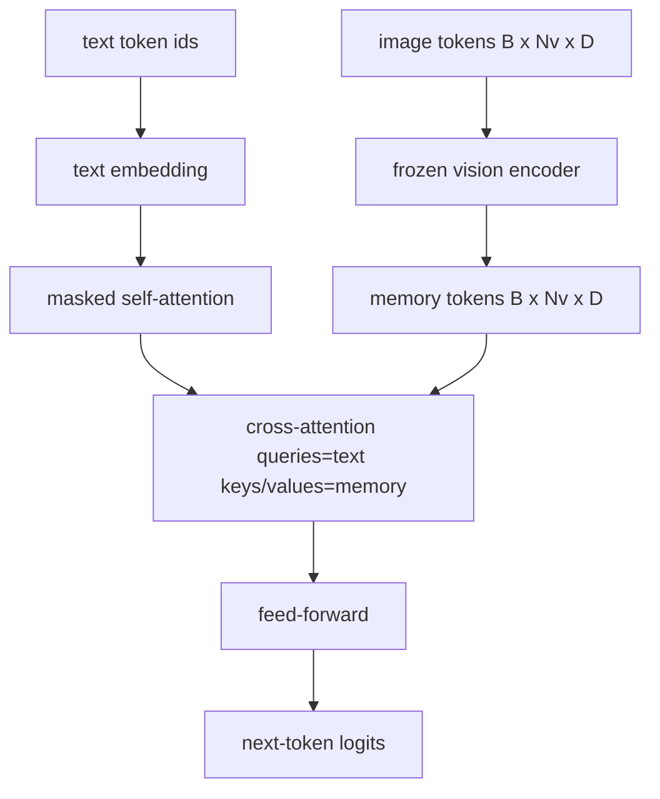
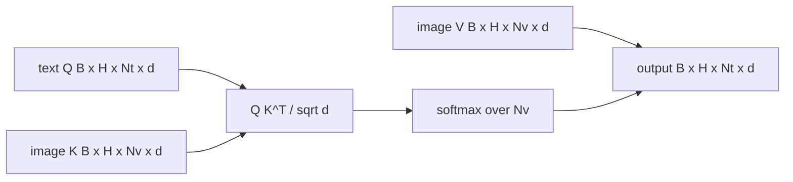

# Cross-Attention Fusion

> Lớp chiếu căn chỉnh một vector ảnh với một vector chú thích. Một decoder thị giác-ngôn ngữ thực cần mọi token văn bản chú ý đến mọi token patch, để mô hình có thể đặt mỗi từ trên căn cứ một vùng. Cross-attention là cách việc đặt căn cứ đó xảy ra. Văn bản truy vấn; các key và value thị giác trả lời. Bài này xây dựng khối cross-attention, self-attention văn bản nhân quả, và các hình dạng mặt nạ giữ cả hai hợp lệ.

**Type:** Build
**Languages:** Python
**Prerequisites:** Phase 19 lessons 30-37 (Track B foundations)
**Time:** ~90 minutes

## Learning Objectives

- Triển khai cross-attention đa đầu mà luồng query là văn bản và luồng key/value là thị giác.
- Kết hợp một khối decoder: self-attention nhân quả + cross-attention + truyền thẳng.
- Làm đúng các hình dạng mặt nạ: mặt nạ nhân quả cho self-attention, không mặt nạ cho cross-attention.
- Chạy một lượt tiến với các token văn bản theo lô và một tập token ảnh cố định.

## The Problem

Nối các token ảnh và token văn bản thành một chuỗi là một lựa chọn hợp nhất (hợp nhất sớm, con đường Chameleon và Emu3 đi). Cross-attention là lựa chọn còn lại (hợp nhất muộn, con đường Flamingo giới thiệu và mọi decoder có hình thức Flamingo từ đó đã sao chép). Trong hợp nhất muộn, decoder văn bản chạy trên các token chỉ văn bản và vươn sang luồng ảnh qua cross-attention ở mọi lớp.

Hợp nhất muộn có hai ưu điểm. Thứ nhất, luồng văn bản giữ sạch và mô hình bảo toàn các khả năng chỉ văn bản. Thứ hai, luồng ảnh được tính một lần mỗi ảnh và tái sử dụng cho mọi bước giải mã, nên sinh rẻ ngay cả với các chú thích dài. Chi phí là một lớp con attention bổ sung mỗi khối.

## The Concept





### Mask shapes

Hai attention bên trong một khối decoder cần các mặt nạ khác nhau:

| Attention | Độ dài query | Độ dài key | Mặt nạ | Tại sao |
|-----------|--------------|------------|------|-----|
| Self-attention | `Nt` (văn bản) | `Nt` (văn bản) | Nhân quả: tam giác dưới `(Nt, Nt)` | Các token văn bản không được nhìn trước trong tự hồi quy |
| Cross-attention | `Nt` (văn bản) | `Nv` (thị giác) | Không mặt nạ | Toàn ảnh hiển thị với mọi vị trí văn bản |

Bài học bao gồm một hàm xác thực hình dạng để lỗi nhầm lẫn chúng xuất hiện như một `ValueError` thay vì một đường cong mất mát hỏng âm thầm.

### Why no mask on cross-attention

Ảnh được quan sát đầy đủ trước khi bất kỳ văn bản nào được sinh. Token `t` của chú thích có thể chú ý đến bất kỳ patch nào của ảnh; không có thứ tự thời gian trên các patch ảnh. Một số biến thể Flamingo thêm một mẫu che theo mẫu khi xen kẽ nhiều ảnh và các đoạn văn bản, nhưng với một ảnh cùng một chú thích, cross-attention thấy mọi thứ.

### Key/value caching

Các key và value ảnh được tính một lần lúc bắt đầu giải mã và giữ trong một bộ nhớ đệm. Mỗi token văn bản mới dùng bộ nhớ đệm mà không tính lại. Đây là thứ khiến tạo chú thích nhanh lúc suy luận: ViT nặng chạy một lần; cross-attention tái sử dụng các key và value của nó cho mọi bước. Bài học cung cấp bộ nhớ đệm và kiểm thử đường trúng bộ nhớ đệm.

### Block composition

Một khối decoder chạy: pre-LN -> self-attention -> residual -> pre-LN -> cross-attention -> residual -> pre-LN -> feed-forward -> residual. Ba tầng con, mỗi tầng có LayerNorm riêng. Bài báo Flamingo thêm một cổng tanh được học trên cross-attention, khởi tạo bằng không, để mô hình ngôn ngữ đã đóng băng bắt đầu không thay đổi và việc huấn luyện giữ ổn định; baseline chuẩn (được dùng ở đây) không có cổng.

```python
class DecoderBlock:
  def forward(self, text_tokens, image_tokens, text_mask, cross_mask):
      text_tokens = text_tokens + self.self_attn(self.ln1(text_tokens),
                                                 mask=text_mask)
      text_tokens = text_tokens + self.cross_attn(self.ln2(text_tokens),
                                                  image_tokens,
                                                  mask=cross_mask)
      text_tokens = text_tokens + self.ffn(self.ln3(text_tokens))
      return text_tokens
```

```figure
ch-crossattn-fan
```

## Build It

`code/main.py` triển khai:

- `CrossAttention(hidden, heads)`, cross-attention đa đầu với các phép chiếu `q` và `kv` riêng.
- `CausalSelfAttention(hidden, heads)`, self-attention được che từ một decoder tiêu chuẩn.
- `DecoderBlock`, kết hợp ba lớp con với các phần dư pre-LN.
- `VisionLanguageDecoder`, decoder bốn lớp được cấp bởi một đầu ra bộ mã hóa thị giác giả lập và một bảng embedding văn bản nhỏ.
- `causal_mask(length)` trả về một tensor boolean tam giác dưới `(length, length)`.
- Một demo đưa một lô hai chuỗi văn bản dài 10 với bộ nhớ ảnh dài 197 và in hình dạng đầu ra, hình dạng mặt nạ self-attention, và chuẩn đầu ra cross-attention theo vị trí.

Chạy nó:

```bash
python3 code/main.py
```

Đầu ra: decoder tạo một tensor logit `(2, 10, text_vocab)`. Hình dạng mặt nạ là `(10, 10)`. Kiểm tra tái sử dụng bộ nhớ đệm KV xác nhận các logit giống hệt giữa các đường có đệm và không đệm.

## Use It

Cross-attention xuất hiện trong hai họ sản xuất:

- **Flamingo và IDEFICS.** Chèn một lớp con cross-attention mỗi K khối mô hình ngôn ngữ, với một LM đóng băng. Adapter thị giác-ngôn ngữ là khối cross-attention cùng cổng của nó.
- **BLIP-2.** Q-Former dùng cross-attention từ một tập cố định 32 token query vào các đặc trưng ảnh, rồi chiếu các query vào không gian embedding LM.

Hình thức khối trong bài này ánh xạ trực tiếp lên cả hai. Kỷ luật mặt nạ (nhân quả trên self, không trên cross) giống nhau.

## Tests

`code/test_main.py` bao phủ:

- mặt nạ nhân quả là tam giác dưới và khớp hình dạng boolean dự kiến
- hình dạng đầu ra cross-attention là `(B, Nt, hidden)` bất kể độ dài key
- đường bộ nhớ đệm KV khớp đường không đệm trong dung sai float
- sự không khớp hình dạng giữa các luồng văn bản và ảnh phát sinh một `ValueError` rõ ràng
- một lượt tiến decoder đầy đủ tạo hình dạng lô và chuỗi đúng

Chạy chúng:

```bash
python3 -m unittest code/test_main.py
```

## Exercises

1. Thêm một cổng tanh được học vào phần dư cross-attention (mẹo Flamingo) và xác minh huấn luyện hội tụ từ một cổng ban đầu gần không. Cổng bắt đầu ở 0; mô hình phục hồi hành vi chỉ văn bản trước khi trộn luồng ảnh vào.

2. Triển khai attention xen kẽ nơi cùng decoder tiêu thụ nhiều ảnh cùng nhiều đoạn văn bản. Xây dựng mặt nạ cross-attention theo mẫu ngăn đoạn văn bản 2 chú ý đến ảnh 1.

3. Đo hiệu năng lớp cross-attention so với self-attention tại `Nt=64, Nv=576` (một lưới 24x24 ở độ phân giải cao hơn). Chi phí cross-attention là `Nt * Nv` và chiếm ưu thế ở độ phân giải ảnh cao.

4. Thêm một dropout phía query trên bản đồ cross-attention và đo độ đa dạng chú thích trên demo (phương sai mẫu chú thích tăng với dropout trong bản đồ cross).

5. Đổi lớp cross-attention thành một khối attention kiểu Q-Former nơi một tập query 32 token cố định chú ý đến các đặc trưng ảnh một lần mỗi lớp.

## Key Terms

| Thuật ngữ | Ý nghĩa |
|------|---------------|
| Late fusion (Hợp nhất muộn) | Văn bản và thị giác giữ trong các luồng riêng; cross-attention nối chúng ở mọi khối |
| Cross-attention (Chú ý chéo) | Q đến từ một luồng, K và V từ luồng khác |
| Causal mask (Mặt nạ nhân quả) | Mặt nạ boolean tam giác dưới ngăn nhìn trước trong tự hồi quy |
| KV cache (Bộ nhớ đệm KV) | Các key và value ảnh được lưu một lần và tái sử dụng cho mọi bước giải mã |
| Memory tokens (Các token bộ nhớ) | Các token ảnh đóng băng mà decoder vươn vào |

## Further Reading

- Flamingo (2022) cho thiết kế hợp nhất muộn chuẩn với cross-attention có cổng.
- BLIP-2 (2023) cho Q-Former, là một khối cross-attention được khoác dạng một tập query được học.
- IDEFICS (2023) cho một bản tái tạo trọng số mở của công thức Flamingo.
