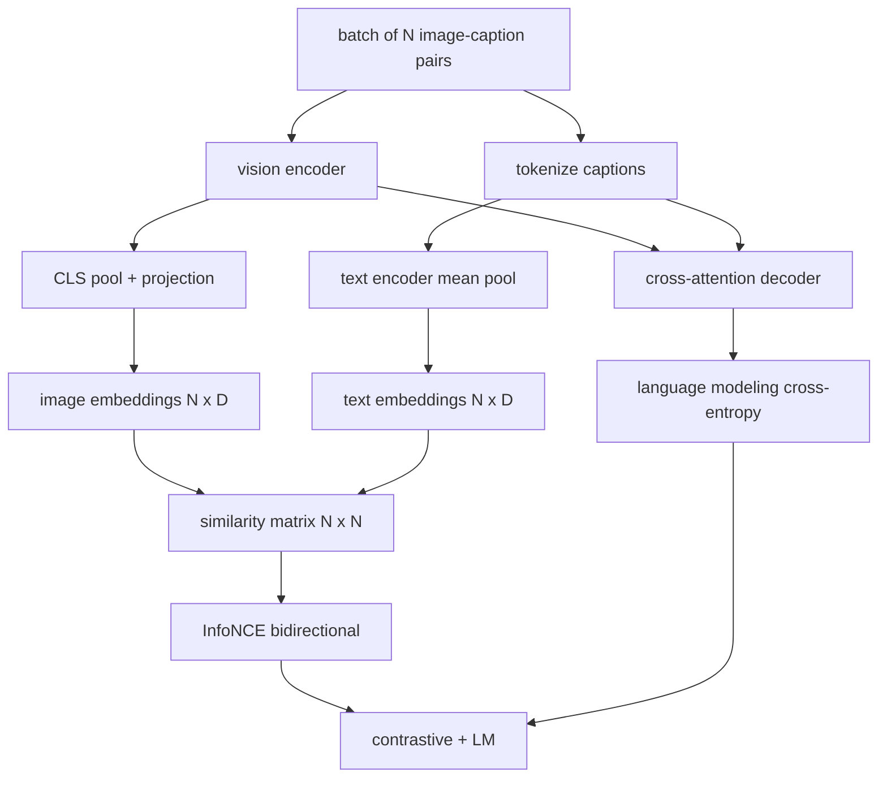

# Vision-Language Pretraining

> Bộ mã hóa, phép chiếu, và decoder đã được nối. Giờ huấn luyện chúng cùng nhau. Hai mục tiêu điều khiển học: một mất mát ảnh-văn bản tương phản (InfoNCE) kéo các cặp khớp lại gần trong không gian embedding chung, và một mất mát mô hình hóa ngôn ngữ yêu cầu decoder chú thích mỗi ảnh. Kết hợp, chúng dạy mạng cả tìm ảnh đúng cho một chú thích và viết một chú thích cho ảnh.

**Type:** Build
**Languages:** Python
**Prerequisites:** Phase 19 lessons 30-37 (Track B foundations)
**Time:** ~90 minutes

## Learning Objectives

- Triển khai mất mát tương phản InfoNCE trên một lô các cặp ảnh-chú thích.
- Kết hợp mất mát tương phản với mất mát mô hình hóa ngôn ngữ tự hồi quy.
- Tổng hợp một corpus ảnh-chú thích giả lập 200 cặp mà không tải tập dữ liệu thực.
- Chạy một vòng lặp huấn luyện demo 50 bước và quan sát cả hai mất mát giảm.

## The Problem

Một mô hình thị giác-ngôn ngữ cần hai kỹ năng. Nó phải xếp hạng: với một chú thích được cung cấp, tìm ảnh đúng giữa nhiều ảnh. Nó phải sinh: với một ảnh được cung cấp, viết một chú thích. Tiền huấn luyện mô hình chỉ trên một kỹ năng cho bạn nửa hệ thống. CLIP làm tốt xếp hạng nhưng không thể chú thích. GPT-4V có thể chú thích nhưng dùng một đầu truy xuất riêng cho xếp hạng. Tiền huấn luyện đa mục tiêu nhận cả hai trong một lượt.

InfoNCE xử lý nửa xếp hạng. Với một lô N cặp, mô hình coi N cặp khớp là dương tính và `N^2 - N` cặp không khớp là âm tính, rồi chạy một mất mát entropy chéo trên ma trận tương tự `(N, N)` kết quả. Mất mát LM xử lý nửa sinh: dự đoán token tiếp theo tiêu chuẩn điều kiện hóa trên ảnh. Cả hai mất mát khả vi và có thể dùng chung các trọng số bộ mã hóa, bộ chiếu, và decoder.

## The Concept



### InfoNCE in one paragraph

Xếp N embedding ảnh thành các hàng và N embedding văn bản thành các hàng. Chuẩn hóa L2 cả hai. Tính ma trận `N x N` `S = I T^T / tau` trong đó `tau` là một nhiệt độ được học. Các phần tử đường chéo là các cặp khớp; các phần tử ngoài đường chéo là âm tính. Áp dụng entropy chéo với đích `argmax` chạy dọc đường chéo: hàng `i` nên có phần tử cao nhất ở cột `i`. Làm tương tự đối xứng dọc các cột. Tổng là trung bình của hai thứ. Đây là mất mát CLIP trong tám dòng.

### Temperature matters

Nhiệt độ `tau` kiểm soát softmax nhọn thế nào. Quá nhỏ (ví dụ `tau = 0.01`) và gradient chỉ đến từ mẫu âm khó nhất, huấn luyện nhiễu. Quá lớn và softmax phẳng ra và gradient biến mất. CLIP học `tau` như một tham số; demo ở đây làm tương tự.

### Language modeling loss

Decoder tiêu thụ các token bộ nhớ ảnh qua cross-attention và dự đoán token văn bản tiếp theo tại mọi vị trí. Mất mát là entropy chéo tiêu chuẩn với đích vị trí tiếp theo. Các vị trí đệm được che khỏi mất mát.

### Combining the losses

`total = contrastive + lm_weight * lm` trong đó `lm_weight` là một đại lượng vô hướng (thường 1.0). Hai mất mát dùng chung các gradient vào bộ mã hóa và phép chiếu; chỉ decoder nhận gradient mất mát LM. Đây là công thức đa tác vụ mà CoCa, BLIP, và các mô hình kiểu SigLIP đều dùng, với các trọng số khác nhau.

| Thành phần | Bề mặt mất mát | Ảnh hưởng |
|-----------|--------------|---------|
| InfoNCE | Xếp hạng cặp trong không gian chung | Bộ mã hóa + phép chiếu + đầu văn bản |
| LM | Dự đoán token điều kiện hóa trên ảnh | Bộ mã hóa + phép chiếu + decoder |
| Kết hợp | Đa tác vụ | Toàn ngăn xếp |

### Why 50 steps is enough for a demo

Corpus giả lập là một tập tổng hợp 200 cặp với các ảnh ngẫu nhiên và các id chú thích ngẫu nhiên. Sau 50 bước SGD với kích thước lô 16, cả hai mất mát giảm rõ ràng ngay cả khi các giá trị tuyệt đối vẫn cao hơn mức một mô hình dữ liệu thực sẽ đạt. Điểm chính của demo là xác nhận hệ thống nối gradient hoạt động từ đầu đến cuối và việc thêm mất mát LM không làm mất ổn định mục tiêu tương phản.

```figure
ch-infonce-diagonal
```

## Build It

`code/main.py` triển khai:

- `MultimodalModel`, kết hợp một bộ mã hóa ViT nhỏ, bộ chiếu MLP, một bộ mã hóa phía văn bản tí hon (gộp trung bình trên các id được nhúng), và decoder cross-attention từ bài 61.
- `info_nce_loss(image_emb, text_emb, temperature)`, mất mát tương phản kiểu CLIP hai chiều.
- `lm_loss(logits, target_ids, padding_id)`, entropy chéo token tiếp theo được che.
- `make_mock_corpus(seed, n_pairs)`, trả về 200 cặp (image, caption_ids) tất định.
- Một vòng lặp huấn luyện chạy 50 bước với kích thước lô 16, bộ tối ưu Adam, và một tham số log-nhiệt độ được học. Cả hai mất mát được in mỗi 5 bước.

Chạy nó:

```bash
python3 code/main.py
```

Đầu ra: mất mát tương phản giảm từ khoảng `ln(16) = 2.77` về 2.4; mất mát LM giảm từ một đường cơ sở ngẫu nhiên đều `ln(512) ≈ 6.24` về khoảng 4.7. Cả hai mức giảm chứng minh gradient được nối chính xác. Các mô hình thực huấn luyện trong hàng triệu bước; động lực giống nhau.

## Use It

Đây là cùng công thức mất mát được cung cấp trong:

- **CLIP (2021).** Chỉ tương phản ảnh-văn bản, với một phép thăm dò chú thích bộ mã hóa đóng băng riêng.
- **CoCa (2022).** Tương phản ảnh-văn bản cộng mất mát LM chú thích ảnh trong một mô hình. Chính xác mẫu bài này xây dựng.
- **BLIP (2022) và BLIP-2.** Tương phản cộng LM cộng đầu khớp ảnh-văn bản. Ba mất mát kết hợp.
- **SigLIP (2023).** Đổi InfoNCE thành một mất mát cặp sigmoid; cùng vai trò tương phản, dạng hàm khác.
- **Họ LLaVA.** Huấn luyện hai giai đoạn mà giai đoạn một là căn chỉnh (cosine trên một LM đóng băng) và giai đoạn hai thêm mất mát LM với một LM không đóng băng. Bài 60 ánh xạ sang giai đoạn một; bài này ánh xạ sang giai đoạn hai.

## Tests

`code/test_main.py` bao phủ:

- mất mát InfoNCE đối xứng qua các hàng ảnh/văn bản
- mất mát InfoNCE trả về 0 khi ma trận tương tự là một đường chéo hoàn hảo các số dương lớn
- mất mát LM che chính xác các vị trí đệm
- lượt tiến mô hình tạo cả hai mất mát không có lỗi
- vòng lặp huấn luyện 5 bước giảm mất mát kết hợp

Chạy chúng:

```bash
python3 -m unittest code/test_main.py
```

## Exercises

1. Thay InfoNCE bằng mất mát cặp sigmoid kiểu SigLIP và so sánh hội tụ trên corpus giả lập.

2. Thêm một bước khai thác mẫu âm khó: mỗi lô cách một, chọn cặp ngoài đường chéo khó nhất từ lô trước và thêm nó. Huấn luyện và kiểm tra liệu mất mát tương phản giảm nhanh hơn không.

3. Thêm một đầu nhị phân khớp ảnh-văn bản trên embedding chung (đúng/sai: những thứ này có khớp không?) cho một mất mát thứ ba, tái tạo thiết lập ba đầu của BLIP.

4. Thay corpus giả lập bằng các chuỗi id chú thích được lấy từ một chuỗi Markov có ma trận chuyển tiếp điều kiện hóa trên băm ảnh. Mất mát chú thích nên giảm thêm vì có tín hiệu thực có thể học.

5. Huấn luyện cùng mô hình với `lm_weight = 0` và lần nữa với `lm_weight = 1`. So sánh mất mát tương phản; mất mát LM không nên làm thoái lui mục tiêu xếp hạng.

## Key Terms

| Thuật ngữ | Ý nghĩa |
|------|---------------|
| InfoNCE | Ước lượng tương phản nhiễu: entropy chéo trên một ma trận tương tự |
| Temperature (Nhiệt độ) | Đại lượng vô hướng kiểm soát softmax tương phản nhọn thế nào |
| Hard negative (Mẫu âm khó) | Một cặp ngoài đường chéo mô hình thấy khó phân biệt, hữu ích cho lấy mẫu |
| LM loss (Mất mát LM) | Entropy chéo token tiếp theo tiêu chuẩn ở phía chú thích |
| Joint embedding space (Không gian embedding chung) | Không gian dùng chung nơi các vector ảnh và văn bản nằm sau phép chiếu |

## Further Reading

- Bài báo CLIP cho công thức tương phản gốc.
- Bài báo CoCa cho tương phản cộng chú thích trong một mô hình.
- Bài báo SigLIP cho biến thể mất mát cặp sigmoid và tại sao nó mở rộng tốt hơn.
