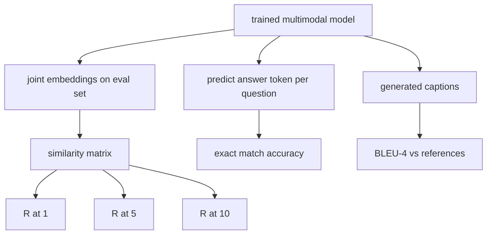

# Multimodal Evaluation

> Huấn luyện là nửa vòng lặp. Nửa kia là đo lường. Bài này xây dựng ba bề mặt đánh giá từ các thành phần cơ sở: truy xuất ảnh-chú thích được báo cáo như R@1, R@5, R@10; hỏi đáp thị giác được báo cáo như độ chính xác khớp chính xác; và chú thích ảnh được báo cáo như BLEU-4. Mỗi chỉ số là một hàm trên các đầu ra mô hình và một bộ đánh giá tổng hợp chạy trong vài giây.

**Type:** Build
**Languages:** Python
**Prerequisites:** Phase 19 lessons 58-62 (Track E foundations: encoder, transformer, projection, cross-attention fusion, pretraining)
**Time:** ~90 minutes

## Learning Objectives

- Tính Recall@K từ một ma trận tương tự giữa các embedding ảnh và chú thích.
- Tính độ chính xác VQA khớp chính xác từ một mô hình ánh xạ các cặp (ảnh, câu hỏi) sang một từ vựng đáp án cố định.
- Tính BLEU-4 từ các chuỗi token được sinh và tham chiếu mà không có bất kỳ thư viện bên ngoài nào.
- Chạy cả ba đánh giá trên một bộ tổng hợp được xây dựng trên mô hình đã huấn luyện từ bài 62.

## The Problem

Cám dỗ là tuyên bố một mô hình đa phương thức hoàn tất khi mất mát huấn luyện bình nguyên. Mất mát huấn luyện đo độ khớp trên phân phối huấn luyện; nó không đo liệu mô hình có thể xếp hạng các cặp trong một lô được giữ riêng, trả lời một câu hỏi, hoặc viết một chú thích mà một người sẽ chấp nhận. Ba bề mặt đánh giá là tiêu chuẩn:

- **Truy xuất (R@1, R@5, R@10).** Xây dựng embedding chung cho một chú thích truy vấn; xếp hạng mọi ảnh trong tập đánh giá theo cosine; báo cáo liệu ảnh khớp nằm trong top 1, top 5, top 10 không. Dạng đối xứng (ảnh-sang-văn-bản) chạy cùng cách.
- **Hỏi đáp thị giác (khớp chính xác).** Với (ảnh, câu hỏi) được cung cấp, mô hình xuất một token đáp án. Khớp chính xác là một bit mỗi mẫu: đáp án dự đoán có bằng đáp án tham chiếu không? Lấy trung bình trên tập đánh giá.
- **Chú thích (BLEU-4).** Sinh một chú thích. Tính trung bình nhân của các precision 1-gram đến 4-gram so với các chú thích tham chiếu, với một hình phạt ngắn. Đa tham chiếu là dạng tiêu chuẩn (một ảnh, nhiều chú thích tham chiếu).

Mỗi chỉ số là một hàm mỏng. Bài học xây dựng tất cả trong mã để toán cụ thể và bề mặt giữ dưới sự kiểm soát của bạn. Các bộ benchmark thực (MS-COCO, VQA v2, GQA, OK-VQA) cắm vào cùng các hình thức hàm.

## The Concept



### Recall@K from a similarity matrix

Xây dựng ma trận tương tự cosine `(N, N)` giữa các embedding ảnh và chú thích. Với mỗi hàng, sắp các cột theo độ tương tự giảm dần. Recall@K là tỷ lệ hàng mà chỉ số cột đường chéo nằm trong top K vị trí. Recall@K đối xứng (chú thích-sang-ảnh) được tính trên ma trận chuyển vị. Cả hai số được báo cáo. Với một đánh giá N=100, R@1 = 0.6 nghĩa là 60 trong 100 chú thích truy xuất được ảnh đúng của chúng như kết quả khớp cao nhất.

### VQA exact match

Với mỗi (ảnh, câu hỏi, đáp án), mã hóa ảnh, nhúng câu hỏi, hợp nhất qua decoder, và đọc token tiếp theo. Id token dự đoán được so sánh với id tham chiếu; đúng nếu bằng nhau. Lấy trung bình trên tập đánh giá. Các tập dữ liệu VQA thực cung cấp nhiều đáp án do con người chú giải mỗi câu hỏi và dùng một công thức độ chính xác mềm (1.0 nếu ít nhất 3 trong 10 người chú giải đồng ý, giảm tỷ lệ phía dưới); bài học dùng khớp chính xác một đáp án cho rõ ràng.

### BLEU-4

```math
\text{BLEU-4} = \text{BP} \cdot \exp\big(\text{mean}(\log p_1, \log p_2, \log p_3, \log p_4)\big)
```

Trong đó `p_n` là precision n-gram sửa đổi (số đếm bị cắt của các n-gram được sinh xuất hiện trong bất kỳ tham chiếu nào, chia cho tổng n-gram được sinh), và `BP` là hình phạt ngắn:

```math
\text{BP} = \begin{cases} 1 & \text{if generated length} > \text{reference length} \\ \exp(1 - r/g) & \text{otherwise, where } r \text{ is reference length and } g \text{ is generated} \end{cases}
```

Làm mượt cần thiết cho các mẫu nhỏ nơi một số `p_n` bằng không. Triển khai dùng "phương pháp 1" của Chen và Cherry (thêm 1 vào tử và mẫu cho bất kỳ số đếm không nào), là mặc định an toàn nhất cho các chế độ số đếm thấp.

### Synthetic eval suite

Một bộ đánh giá 50 mẫu được xây dựng trong bộ nhớ từ cùng mẫu corpus giả lập được dùng trong bài 62, với một seed được giữ riêng. Ba danh sách tạo thành bộ:

- `pairs`: 50 cặp (image, caption_ids) cho truy xuất.
- `vqa`: 50 bộ ba (image, question_ids, answer_id).
- `caps`: 50 mục (image, [reference_caption_ids, ...]) với tối đa 3 tham chiếu mỗi ảnh.

Bộ tất định từ seed và được giữ riêng khỏi corpus huấn luyện, nên các chỉ số được tính trên dữ liệu mô hình chưa từng thấy. Lưu bền vững bộ vào JSON được để lại như một bài tập (xem dưới).

| Chỉ số | Khoảng | Đường cơ sở ngẫu nhiên (N=50) |
|--------|-------|------------------------|
| R@1 | 0 đến 1 | 0.02 (1 / N) |
| R@5 | 0 đến 1 | 0.10 |
| R@10 | 0 đến 1 | 0.20 |
| VQA EM | 0 đến 1 | 1 / vocab |
| BLEU-4 | 0 đến 1 | nhỏ nhưng khác không |

Với một lần chạy huấn luyện 50 bước trên dữ liệu tổng hợp, các chỉ số không được kỳ vọng cao; chúng được kỳ vọng trên đường cơ sở ngẫu nhiên, là điều demo kiểm tra.

```figure
ch-recall-window
```

## Build It

`code/main.py` triển khai:

- `recall_at_k(sim_matrix, k)`, trả về một float trong `[0, 1]` cho cả hai hướng.
- `vqa_exact_match(predictions, references)`, trả về trung bình trên so bằng `int`.
- `bleu4(generated, references, smoothing=True)`, với hỗ trợ đa tham chiếu.
- `build_eval_suite(seed, n_samples, vocab_size, max_len)`, trả về ba danh sách đánh giá tất định.
- `evaluate(model, suite)`, chạy cả ba chỉ số và trả về một `dict` các số.
- Một demo nạp một mô hình đa phương thức vừa khởi tạo từ bài 62, đánh giá nó, rồi huấn luyện nó trong 50 bước và đánh giá lại, in các chỉ số trước/sau.

Chạy nó:

```bash
python3 code/main.py
```

Đầu ra: bảng chỉ số trước/sau cho thấy truy xuất cải thiện từ gần ngẫu nhiên về phía tín hiệu mô hình đã học, VQA cải thiện trên ngẫu nhiên, và BLEU-4 cải thiện (cấu trúc tổng hợp đủ cho một mức tăng precision 4-gram).

## Use It

Mỗi chỉ số ánh xạ trực tiếp lên một benchmark sản xuất:

- **Truy xuất.** MS-COCO 5K val và Flickr30K là các bài toán R@K trên cùng một ma trận độ tương đồng. ImageNet zero-shot cũng sử dụng ma trận đó, với một prompt embedding mỗi lớp, nhưng nó báo cáo độ chính xác phân loại top-1, tức R@1 trên các prompt lớp. Thay đánh giá tổng hợp bằng các tệp thật và chữ ký hàm không thay đổi.
- **VQA.** VQA v2, GQA, OK-VQA dùng cùng hình thức khớp chính xác (với độ chính xác mềm thay EM một đáp án cho VQA v2).
- **BLEU-4.** Chú thích MS-COCO, NoCaps, chú thích Flickr30K đều dùng BLEU-4 cùng CIDEr và METEOR. Thêm CIDEr là thêm một hàm.

Với các benchmark thực, đổi `build_eval_suite` thành một loader thực và giữ các thân hàm. Toán độc lập với benchmark.

## Tests

`code/test_main.py` bao phủ:

- recall@k trả về 1.0 trên một ma trận tương tự đơn vị hoàn hảo và 0.0 trên một ma trận bị lật với k < N
- recall@k tôn trọng cận trên `k <= N`
- bleu4 trả về 1.0 khi chuỗi được sinh bằng chính xác một trong các tham chiếu
- bleu4 trả về 0.0 trên các từ vựng rời nhau
- khớp chính xác vqa bằng tỷ lệ các cặp bằng nhau
- build_eval_suite trả về số cặp, mục vqa, và mục chú thích dự kiến

Chạy chúng:

```bash
python3 -m unittest code/test_main.py
```

## Exercises

1. Thêm CIDEr vào các chỉ số chú thích. CIDEr dùng trọng số TF-IDF trên n-gram, thưởng cho các token giàu thông tin.

2. Triển khai VQA độ chính xác mềm: nhiều đáp án con người mỗi câu hỏi, độ chính xác là `min(human_count / 3, 1)` nếu có bất kỳ đáp án nào khớp. Tái tạo VQA v2.

3. Thêm một biến thể an toàn NaN của `bleu4` xử lý các chuỗi được sinh rỗng mà không sập.

4. Tính thứ hạng nghịch đảo trung bình (MRR) cạnh R@K. MRR nhạy với vị trí mục đúng nằm ngoài top K; R@K nhạy với việc nó có nằm trong top K không.

5. Chạy đánh giá trên mô hình ở sáu checkpoint trong huấn luyện (bước 0, 10, 20, 30, 40, 50) và vẽ đường cong học. Xác nhận các quỹ đạo chỉ số theo sát quỹ đạo hàm mất mát.

## Key Terms

| Thuật ngữ | Ý nghĩa |
|------|---------------|
| R@K | Tỷ lệ truy vấn mà kết quả khớp đúng nằm trong top K kết quả |
| Exact match (Khớp chính xác) | Chấm VQA đơn giản nhất: đáp án dự đoán bằng tham chiếu |
| BLEU-4 | Trung bình nhân các precision 1- đến 4-gram, với hình phạt ngắn |
| Multi-reference (Đa tham chiếu) | Một chỉ số chú thích nhận nhiều chú thích tham chiếu mỗi ảnh |
| Held-out (Được giữ riêng) | Tập đánh giá được lấy mẫu từ một seed rời với corpus huấn luyện |

## Further Reading

- Bài báo VQA v2 cho công thức độ chính xác mềm và các thống kê tập dữ liệu.
- Bài báo CIDEr cho chú thích n-gram có trọng số TF-IDF.
- BLEU gốc (Papineni và cộng sự, 2002) cho các biến thể làm mượt.
- Các script đánh giá chú thích MS-COCO cho triển khai tham chiếu chuẩn.
