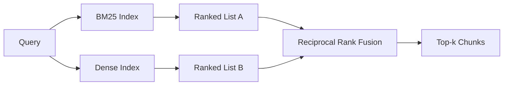

# Hybrid Retrieval with BM25 and Dense Embeddings

> Truy xuất từ vựng và ngữ nghĩa thất bại trên các phân phối truy vấn đối lập. Truy xuất lai với hợp nhất thứ hạng nghịch đảo không nội suy, nó bỏ phiếu - và phiếu bầu thắng trên mọi lớp truy vấn.

**Type:** Build
**Languages:** Python
**Prerequisites:** Phase 11 lessons 04 (embeddings), 06 (RAG); Phase 19 Track B foundations (lessons 20-29); Phase 19 lesson 64 (chunking strategies)
**Time:** ~90 minutes

## Learning Objectives
- Triển khai BM25 từ đầu từ công thức Robertson và Sparck Jones, với trọng số trường, chuẩn hóa độ dài tài liệu, và k1 và b có thể điều chỉnh.
- Xây dựng một bộ truy xuất dense trên một embedding giả lập tất định để vòng lặp chạy ngoại tuyến.
- Triển khai hợp nhất thứ hạng nghịch đảo chính xác như Cormack, Clarke, và Buettcher công bố năm 2009, và giải thích tại sao nó vượt nội suy theo trọng số điểm.
- Điều chỉnh hằng số k RRF và các trọng số theo phương thức và đọc các đánh đổi trên một corpus fixture nhỏ.

## The Problem

Tìm kiếm từ vựng thắng khi truy vấn mang một định danh nguyên văn mà corpus chứa nguyên văn. Một truy vấn cho `AbortMultipartOnFail` trả về hàm Go đúng qua BM25 trong vài micro giây. Cùng truy vấn, được nhúng, nằm ở ranh giới của ba cụm tương tự và một bộ truy xuất dense xếp sai file lên đầu.

Tìm kiếm dense thắng khi truy vấn được diễn đạt lại xa các token nguyên văn của corpus. Một người dùng hỏi "chúng ta xử lý các lần tải lên bị hủy thế nào" chưa bao giờ gõ từ abort hoặc multipart. BM25 trả về đoạn tài liệu về "tải lên các file lớn" vì trang đó chứa từ uploads. Truy xuất dense tìm hàm abort có tóm tắt nhắc đến việc hủy.

Lựa chọn giữa hai thứ không tĩnh. Phân phối truy vấn là biến số. Một hệ thống RAG sản xuất xử lý cả hai lớp từ cùng endpoint, nên truy xuất phải xử lý cả hai cùng lúc. Đó là truy xuất lai. Bước hợp nhất là phần phải đúng.

## The Concept



### BM25 in one paragraph

BM25 chấm một cặp truy vấn-tài liệu bằng cách cộng, trên các từ truy vấn, một hệ số nghịch đảo tần suất tài liệu nhân với một hệ số tần suất từ bão hòa bao gồm một hiệu chỉnh chuẩn hóa độ dài. Hai núm. `k1` kiểm soát bão hòa tần suất từ; mặc định 1.5 là khuyến nghị được công bố và bạn không nên đổi nó mà không có một benchmark. `b` kiểm soát độ dài tài liệu quan trọng bao nhiêu; mặc định 0.75 nói các tài liệu dài hơn bị phạt, nhưng không tuyến tính.

Công thức IDF dùng định nghĩa Robertson và Sparck Jones được làm mượt, là `log((N - df + 0.5) / (df + 0.5) + 1)`. Cộng một bên trong log giữ IDF dương khi một từ xuất hiện trong hơn nửa corpus. Điều này quan trọng trong các corpus nhỏ nơi các từ dừng về kỹ thuật là hiếm.

Trọng số trường cho phép bạn nói với BM25 rằng một kết quả khớp trên tên ký hiệu tính nhiều hơn một kết quả khớp trong thân. Triển khai là một hệ số nhân trên các số đếm từ khi lập chỉ mục, không phải lúc chấm. Điều đó giữ toán giống hệt và tránh một điểm riêng mỗi trường.

### Dense retrieval in one paragraph

Nhúng mỗi đoạn vào một vector chiều cố định bằng một mô hình embedding. Lúc truy vấn, nhúng truy vấn, xếp hạng cosine mọi đoạn theo độ tương tự, và trả về top-k. Mô hình là biến quyết định chất lượng. Chính thuật toán truy xuất là hai dòng: tích vô hướng và sắp xếp.

Bài này dùng một embedding dựa trên băm tất định để bạn có thể đọc toán hợp nhất mà không có một lệnh gọi mạng. Băm cộng các độ lệch được đặt khóa theo token vào một vector 96 chiều và chuẩn hóa. Các hạng cosine tất định giữa các lần chạy, là điều bộ kiểm thử yêu cầu.

### Reciprocal rank fusion, the published formula

Hai danh sách được xếp hạng. Với mỗi ứng viên xuất hiện trong một trong hai danh sách, cộng các đóng góp thứ hạng nghịch đảo của nó. Bài báo năm 2009 dùng `1 / (k + rank)` với k bằng 60 làm mặc định. Sắp theo tổng điểm. Đó là toàn bộ thuật toán.

Hằng số được công bố k = 60 không tùy ý. Với k = 60 đóng góp hạng 1 là 1 / 61 và đóng góp hạng 10 là 1 / 70. Đóng góp suy giảm chậm để các ứng viên sâu vẫn bỏ phiếu. k nhỏ hơn khiến các kết quả đầu chiếm ưu thế. k lớn hơn làm phẳng đường cong đóng góp.

Hai núm có thể điều chỉnh trong triển khai của chúng ta. Hằng số `k`. Một cặp trọng số theo phương thức để bạn có thể tăng BM25 hoặc dense khi có bằng chứng trước rằng một thứ tốt hơn trên corpus của bạn. Nhân đóng góp hạng với trọng số là triển khai có nguyên tắc đơn giản nhất; nó bảo toàn hình thức suy giảm hạng và giữ không phụ thuộc thang đo.

### Why fusion beats score-weighted interpolation

Các điểm BM25 không bị chặn và phụ thuộc corpus. Các độ tương tự cosine bị chặn trong -1 đến 1. Một tổ hợp tuyến tính `alpha * bm25 + (1 - alpha) * cosine` đòi hỏi điều chỉnh alpha theo corpus và hỏng mỗi khi bạn lập chỉ mục lại. Hợp nhất dựa trên hạng thì không. Hai hạng có thể so sánh giữa các phương thức. Đường cơ sở RRF được công bố vượt nội suy điểm trong mọi track TREC công khai từ năm 2010.

Đây là cùng lập luận bạn nghe về RankFusion so với RRF trong tài liệu Vespa và Weaviate. Họ đi đến cùng kết luận: giữ dựa trên hạng trừ khi bạn có bằng chứng rất mạnh để nội suy các điểm.

```figure
rrf-fusion
```

## Build It

`code/main.py` triển khai:

- `tokenize(text)` - một tokenizer regex nhanh.
- `BM25Index` - có trọng số trường, với `add` và `search` và k1, b có thể điều chỉnh.
- `mock_embed`, `DenseIndex` - cùng embedding tất định như bài 64 để các đoạn có thể so sánh.
- `rrf(rankings, k, weights)` - phép hợp nhất được công bố với các trọng số đa phương thức.
- `HybridRetriever` - kết hợp BM25 và dense.
- Một demo `main()` nạp một corpus fixture nhỏ, chạy ba truy vấn nhắm vào điểm mạnh và điểm yếu của mỗi bộ truy xuất, và in các thứ hạng mỗi phương thức tạo cùng danh sách hợp nhất.

Chạy nó:

```bash
python3 code/main.py
```

Đọc đầu ra demo cạnh nhau. Truy vấn định danh nguyên văn nằm ở hạng BM25 1, hạng dense 4, hạng RRF 1. Truy vấn diễn đạt lại nằm ở hạng BM25 6, hạng dense 1, hạng RRF 1. Truy vấn mơ hồ nằm ở hạng BM25 3, hạng dense 3, hạng RRF 1. Hợp nhất không phải một bộ phá hòa; nó là hệ thống thắng trên mọi lớp truy vấn.

## Tuning the knobs

| Núm | Mặc định | Tăng khi | Giảm khi |
|------|---------|----------------|------------------|
| BM25 k1 | 1.5 | Các từ lặp trong tài liệu và bạn muốn tần suất quan trọng hơn | Các tài liệu ngắn và lặp từ là nhiễu |
| BM25 b | 0.75 | Các tài liệu dài thực sự nói ít hơn mỗi từ | Độ dài tài liệu không tương quan với chủ đề |
| RRF k | 60 | Các ứng viên sâu nên tiếp tục bỏ phiếu | Top-1 nên chiếm ưu thế |
| Trọng số BM25 | 1.0 | Corpus của bạn chứa các định danh nguyên văn và các truy vấn khớp chúng | Các truy vấn của bạn được người dùng diễn đạt lại |
| Trọng số dense | 1.0 | Các truy vấn được diễn đạt lại | Các truy vấn nguyên văn |

Điều chỉnh bằng cách chạy lại harness đánh giá của bài 68 trên tập truy vấn được giữ riêng của bạn, không phải bằng trực giác.

## Failure modes the demo will hide

**Các token ngoài từ vựng.** IDF của BM25 được tính từ corpus, nên các từ chỉ trong truy vấn đóng góp không. Các embedding dense ảo giác một vector cho cùng từ. Trên các định danh ngoài corpus phương thức dense trả về các láng giềng trông hợp lý nhưng sai. Hợp nhất hấp thụ điều này vì BM25 không trả về gì và đóng góp hạng biến mất, nhưng chỉ nếu bạn loại trùng theo tài liệu, không phải theo đoạn.

**Token dừng chiếm ưu thế.** BM25 với từ "the" tạo một thứ hạng đều trên corpus. Lọc các token dừng trong bộ lập chỉ mục hoặc chấp nhận rằng các từ IDF cao chiếm ưu thế tự nhiên.

**Nội dung giống hệt giữa các phương thức.** Nếu corpus của bạn đủ nhỏ để top-1 BM25 cũng là top-1 dense, RRF cho bạn cùng top-1 với cùng các láng giềng. Đó là hành vi đúng, không phải một thất bại, nhưng nó khiến hợp nhất trông vô hình. Thêm một cặp truy vấn đối kháng trong đánh giá để xác minh hợp nhất thực sự hoạt động.

## Use It

Các mẫu sản xuất:

- Lập chỉ mục BM25 trong tiến trình; nút thắt là từ điển tần suất từ, không phải các vector.
- Lập chỉ mục các vector dense trong một kho riêng (trong bài này chúng ta dùng một danh sách phẳng; trong sản xuất bạn sẽ dùng HNSW).
- Chạy cả hai truy vấn song song; hợp nhất là một phép hợp nhất thời gian hằng trên hợp.
- Lưu bền vững phương thức của mỗi kết quả truy xuất để một bộ xếp hạng lại hạ nguồn có thể thấy phương thức nào đã bỏ phiếu cho nó.

## Ship It

Bài 66 lấy top-k hợp nhất từ bài này và xếp hạng lại bằng một cross-encoder. Bài 68 đánh giá toàn pipeline bằng precision, recall, MRR, và nDCG. Bộ truy xuất lai trong bài này là giai đoạn đầu của hệ thống đầu cuối trong bài 69.

## Exercises

1. Thay `mock_embed` bằng một mô hình thực từ nhà cung cấp của bạn. Chạy lại demo và báo cáo thứ hạng chỉ dense thay đổi thế nào trên truy vấn diễn đạt lại.
2. Thêm một phương thức thứ ba: các tóm tắt đoạn được lập chỉ mục riêng và hợp nhất như một danh sách được xếp hạng thứ ba. Đo mức tăng.
3. Quét k RRF qua 10, 30, 60, 100, 200. Vẽ đường cong recall@k từ bài 68. Báo cáo giá trị k nơi đường cong đạt đỉnh trên corpus của bạn.
4. Triển khai BM25F đúng cách (chuẩn hóa độ dài theo trường thay vì mẹo hệ số nhân) và so sánh trên một corpus nơi các kết quả khớp ký hiệu quan trọng nhất.

## Key Terms

| Thuật ngữ | Cách mọi người nói | Ý nghĩa thực sự |
|------|-----------------|------------------------|
| BM25 | "Tìm kiếm từ vựng" | Xếp hạng xác suất với idf x tf bão hòa x chuẩn hóa độ dài |
| RRF | "Hợp nhất hạng" | Tổng 1 / (k + rank) trên các danh sách được xếp hạng; mặc định k = 60 |
| k1 | "Bão hòa TF" | Kiểm soát một từ lặp ngừng thêm điểm nhanh thế nào |
| b | "Hình phạt độ dài" | 0 nghĩa là bỏ qua độ dài tài liệu, 1 nghĩa là chuẩn hóa đầy đủ |
| Field weighting (Trọng số trường) | "Tăng ký hiệu" | Lặp các token khi lập chỉ mục để tăng các kết quả khớp trong trường đó |
| Rank-based vs score-based fusion (Hợp nhất dựa trên hạng so với dựa trên điểm) | "Tại sao RRF vượt tuyến tính" | Các hạng có thể so sánh giữa các phương thức; các điểm thì không |

## Further Reading

- Cormack, Clarke, Buettcher, "Reciprocal Rank Fusion outperforms Condorcet and individual rank learning methods", SIGIR 2009
- Robertson, Walker, Beaulieu, Gatford, Payne, "Okapi at TREC-3" (bài báo BM25 gốc)
- [Vespa: Hybrid Retrieval with BM25 and Embeddings](https://docs.vespa.ai/en/tutorials/hybrid-search.html)
- [Weaviate: Hybrid Search](https://weaviate.io/developers/weaviate/search/hybrid)
- Phase 11 bài 06 - các nền tảng RAG
- Phase 19 bài 64 - các bộ chia đoạn có đầu ra được lập chỉ mục ở đây
- Phase 19 bài 66 - bộ xếp hạng lại cross-encoder tiêu thụ top-k hợp nhất
