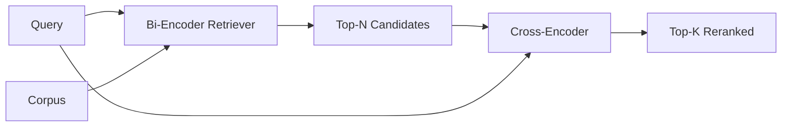

# Cross-Encoder Reranker

> Một bi-encoder nhúng truy vấn và tài liệu độc lập. Một cross-encoder nối chúng và đọc cả hai cùng lúc. Cross-encoder là bộ đọc thông minh nhất và chậm nhất. Được dùng như một giai đoạn thứ hai trên top-k của bi-encoder, nó tự bù chi phí.

**Type:** Build
**Languages:** Python
**Prerequisites:** Phase 11 lesson 06 (RAG), Phase 11 lesson 07 (advanced RAG); Phase 19 Track B foundations (lessons 20-29); Phase 19 lesson 65 (hybrid retrieval feeding this stage)
**Time:** ~90 minutes

## Learning Objectives
- Phân biệt một bộ truy xuất bi-encoder với một bộ xếp hạng lại cross-encoder theo hình thức đầu vào, số tham số, và chi phí mỗi truy vấn.
- Triển khai một cross-encoder nhỏ từ đầu như một khối transformer tiêu thụ một chuỗi (truy vấn, tài liệu) được đóng gói và phát ra một đại lượng liên quan vô hướng duy nhất.
- Nối một pipeline hai giai đoạn truy xuất-rồi-xếp-hạng-lại: truy xuất top-N bằng một bộ truy xuất rẻ, xếp hạng lại N thành top-K bằng cross-encoder, trả về K.
- Đo đánh đổi độ trễ-so-với-chất-lượng trên một corpus fixture nhỏ và chọn N đúng cho một ngân sách độ trễ cho trước.

## The Problem

Một bi-encoder ánh xạ truy vấn và tài liệu vào cùng không gian vector và xếp hạng theo cosine. Hai mã hóa không bao giờ thấy nhau. Mô hình phải nén mọi thứ hữu ích về một tài liệu vào một vector duy nhất, mù với truy vấn. Điều này nhanh - một embedding mỗi tài liệu lúc lập chỉ mục và một mỗi truy vấn lúc truy vấn - và là cách duy nhất để xếp hạng ở quy mô corpus.

Chi phí là precision. Hai tài liệu có cùng chủ đề tổng thể có thể có các embedding gần giống hệt ngay cả khi một tài liệu trả lời truy vấn và tài liệu kia không. Bi-encoder không thể phân biệt chúng.

Một cross-encoder giải quyết điều này bằng đọc truy vấn và tài liệu cùng nhau. Mô hình nhận `[query] [SEP] [document]` như một chuỗi duy nhất, chạy attention đầy đủ qua chỗ nối, và tạo một đại lượng liên quan vô hướng. Mọi token của tài liệu có thể chú ý đến mọi token của truy vấn. Mô hình quyết định điểm với ngữ cảnh đầy đủ.

Chi phí là thông lượng. Nơi bi-encoder nhúng một lần và truy vấn mãi, cross-encoder chạy một lần mỗi cặp (truy vấn, tài liệu). Với một corpus 10 triệu tài liệu đó là 10 triệu lượt tiến mỗi truy vấn. Không thể chạy trong một ngân sách yêu cầu.

Lời giải là chia giai đoạn. Dùng bi-encoder để truy xuất top-N. Dùng cross-encoder để xếp hạng lại N thành một top-K. N nhỏ (50 đến 200) và mức tăng chất lượng của cross-encoder tập trung nơi quan trọng. Tổng độ trễ giữ trong ngân sách yêu cầu. Tổng chất lượng là chất lượng của cross-encoder, bị giới hạn bởi recall của bi-encoder tại N.

## The Concept



### The cross-encoder's input shape

Đóng gói tiêu chuẩn là `[CLS] query_tokens [SEP] document_tokens [SEP]`. Đầu ra vị trí CLS được đưa vào một đầu tuyến tính duy nhất xuất đại lượng liên quan vô hướng. Một số triển khai dùng gộp trung bình thay CLS; khác biệt nhỏ. Điểm chính là mô hình tạo một con số mỗi cặp.

Một cross-encoder 22M tham số (lớp trọng số `ms-marco-MiniLM-L-6-v2` được công bố) là điểm sản xuất điển hình. Các mô hình nhỏ hơn mất chất lượng nhanh hơn mức chúng tiết kiệm độ trễ. Các mô hình lớn hơn (ví dụ `bge-reranker-v2-m3` ở 568M tham số) được dành cho xếp hạng lại ngoại tuyến hoặc xếp hạng lại trang đầu nơi K nhỏ.

### Why this lesson trains a tiny one

Một cross-encoder thực là một transformer encoder được tinh chỉnh. Trong sản xuất bạn nạp một checkpoint và chạy nó. Trong bài này mục tiêu là cho bạn thấy hình thức mô hình và hình thức đường cong độ trễ-chất lượng, không phải huấn luyện một bộ xếp hạng tiên tiến nhất. Vì vậy chúng ta xây dựng một `nn.Module` nhỏ với một khối transformer, attention đa đầu (mặc định 4 đầu), và một đầu hồi quy. Nó được khởi tạo tất định từ một seed để demo có thể tái lập mà không có các trọng số trên đĩa.

Mô hình đồ chơi học hình thức đúng từ corpus fixture: các cặp truy vấn-tài liệu liên quan có điểm dự đoán cao hơn các cặp không liên quan. Pipeline đầu cuối xếp hạng lại đầu ra bi-encoder và top-k được xếp hạng lại tương quan với các nhãn chuẩn.

### Latency vs quality

Pipeline hai giai đoạn có một núm điều chỉnh: N. Quét N từ 5 đến 100 trên một tập truy vấn được giữ riêng và bạn nhận đường cong.

| N | Recall@1 của giai đoạn 2 | Các lượt tiến cross-encoder mỗi truy vấn | Độ trễ |
|---|--------------------|---------------------------------------|---------|
| 5 | 0.62 | 5 | thấp |
| 20 | 0.81 | 20 | trung bình |
| 50 | 0.86 | 50 | cao |
| 100 | 0.86 | 100 | rất cao |

Các số ở trên minh họa hình thức, không phải các phép đo từ fixture này. Hình thức là thực. Luôn có một điểm gập quanh 20 đến 50 ứng viên nơi mức tăng xếp hạng lại bão hòa. Qua điểm gập bạn đang trả giá cho không gì cả.

Chọn N từ đường cong đánh giá cộng ngân sách độ trễ. Cross-encoder không thể nâng recall trên recall của bi-encoder tại N, nên một N thấp giới hạn chất lượng, không chỉ độ trễ.

```figure
rerank-funnel
```

## Build It

`code/main.py` triển khai:

- `CrossEncoder` - một `torch.nn.Module` nhỏ: embedding token, một khối transformer với attention đa đầu và truyền thẳng, đầu gộp trung bình tạo một đại lượng vô hướng.
- `tokenize_pair(query, document)` - đóng gói hai chuỗi thành một chuỗi id duy nhất với các type id đánh dấu ranh giới, tất định và stdlib.
- `train_tiny(pairs)` - một lượt huấn luyện có giám sát trên một danh sách bộ ba (truy vấn, tài liệu, độ liên quan) được gắn nhãn thủ công, để mô hình tạo các điểm hợp lý trên fixture.
- `rerank(query, candidates, top_k)` - giao diện sản xuất.
- `pipeline(query, retriever, top_n, top_k)` - luồng hai giai đoạn.
- Một demo `main()` nạp corpus từ mẫu bài 65, truy xuất top-N, xếp hạng lại thành top-K, in cả hai danh sách cạnh nhau, và báo cáo độ trễ của mỗi giai đoạn.

Chạy nó:

```bash
python3 code/main.py
```

Đầu ra cho thấy top-N của bi-encoder, top-K của cross-encoder, và một tóm tắt thời gian. Cross-encoder mất lâu hơn mỗi lệnh gọi nhưng không chạy trên toàn corpus. Tổng hai giai đoạn giữ trong ngân sách yêu cầu trong khi chọn đáp án mà bi-encoder xếp thứ hai hoặc thứ ba.

## Failure modes the demo will hide

**Cross-encoder không đối xứng.** `rerank(q, d)` và `rerank(d, q)` là các điểm khác nhau. Luôn đưa truy vấn trước. Nếu bạn vô tình đổi, recall sụp.

**N quá thấp để bộc lộ lỗi.** Nếu bạn đặt N = K, cross-encoder có thể sắp xếp lại K ứng viên nhưng không thể đưa một ứng viên mới vào top K. Recall tại K không thể thay đổi, nên mức tăng trông như bằng không. Chọn N ít nhất gấp ba K.

**Dữ liệu huấn luyện rò vào đánh giá.** Nếu các cặp huấn luyện được gắn nhãn thủ công bao gồm các truy vấn đánh giá, xếp hạng lại trông như phép màu. Tách nghiêm ngặt huấn luyện và đánh giá, ngay cả trên một fixture.

**Các trọng số sản xuất là dense.** Một cross-encoder 22M tham số là 88MB ở float32. Lên kế hoạch bộ nhớ máy chủ mô hình trước khi hứa p95 dưới 100ms.

**Chia lô quan trọng.** Một cross-encoder thực chạy N ứng viên trong một lô. Bài này làm điều đó trong `_batch_encode`, xây dựng các tensor id và type-id theo lô bằng `torch.tensor(...)` và chạy một lượt tiến. Bỏ chia lô và độ trễ nhân N.

## Use It

Các mẫu sản xuất:

- Ghim bi-encoder, cross-encoder, và N cùng nhau. Thay bất kỳ thứ nào làm mất hiệu lực đánh giá.
- Lưu đệm đầu ra bộ xếp hạng lại theo băm (query, document_id). Cùng truy vấn với một corpus ổn định xếp hạng lại thành cùng thứ tự; các lần trúng bộ nhớ đệm cho bạn một cắt giảm độ trễ miễn phí.
- Ghi nhật ký điểm cross-encoder hạng 1. Một truy vấn có điểm top-1 dưới một ngưỡng đặc thù corpus là một kết quả ngoài miền; đưa nó tới LLM như "Tôi không tự tin".

## Ship It

Bài 68 đánh giá pipeline hai giai đoạn này từ đầu đến cuối. Bài 69 nối bộ xếp hạng lại này sau bộ truy xuất lai từ bài 65 và trước bộ sinh đáp án. Bộ xếp hạng lại là giai đoạn thứ hai của hệ thống đầu cuối.

## Exercises

1. Quét N từ 5 đến 50 và vẽ recall@1 của đầu ra được xếp hạng lại. Tìm điểm gập trên fixture này.
2. Huấn luyện cross-encoder trong mười epoch thay vì một. Đo biên điểm giữa các cặp dương và âm tại mỗi epoch.
3. Thay gộp trung bình bằng một đầu token CLS. So sánh hội tụ trên fixture này.
4. Thêm một đầu cross-encoder thứ hai dự đoán một nhãn nhị phân "đáp án này có trong tài liệu không". Dùng cả hai đầu lúc suy luận; một để xếp hạng, một để đặt ngưỡng.
5. Thay bi-encoder giả lập tất định bằng bi-encoder từ bài 65 và nối chuỗi hai giai đoạn. Đo thay đổi top-K so với chỉ bi-encoder.

## Key Terms

| Thuật ngữ | Cách mọi người nói | Ý nghĩa thực sự |
|------|-----------------|------------------------|
| Bi-encoder (Bộ mã hóa đôi) | "Bộ truy xuất vector" | Mã hóa truy vấn và tài liệu độc lập; cosine xếp hạng chúng |
| Cross-encoder (Bộ mã hóa chéo) | "Bộ xếp hạng lại" | Mã hóa (truy vấn, tài liệu) chung; xuất một đại lượng liên quan vô hướng |
| Two-stage pipeline (Pipeline hai giai đoạn) | "Truy xuất và xếp hạng lại" | Bộ truy xuất rẻ trả về N, bộ xếp hạng lại đắt giữ K |
| N (candidate budget) (Ngân sách ứng viên) | "Tập xếp hạng lại" | Số ứng viên cross-encoder chấm mỗi truy vấn |
| Mean-pooling head (Đầu gộp trung bình) | "Trung bình trạng thái ẩn cuối" | Lấy trung bình các đầu ra lớp cuối của bộ mã hóa thành một vector |

## Further Reading

- Nogueira, Cho, "Passage Re-ranking with BERT", 2019 - bài báo bộ xếp hạng cross-encoder chuẩn
- Reimers, Gurevych, "Sentence-BERT: Sentence Embeddings using Siamese BERT-Networks", 2019 - về bi-encoder so với cross-encoder
- [SentenceTransformers Cross-Encoders documentation](https://www.sbert.net/examples/applications/cross-encoder/README.html)
- [BGE Reranker v2 model card](https://huggingface.co/BAAI/bge-reranker-v2-m3)
- Phase 19 bài 65 - bộ truy xuất lai cấp cho giai đoạn xếp hạng lại này
- Phase 19 bài 68 - đánh giá đo mức tăng mà việc xếp hạng lại này mang lại
