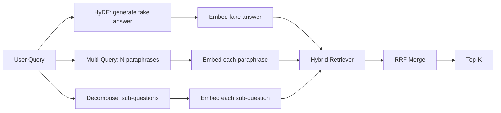

# Query Rewriting: HyDE, Multi-Query, and Decomposition

> Truy vấn người dùng gõ không phải truy vấn bộ truy xuất của bạn muốn. Viết lại bắc cầu khoảng cách trước truy xuất, để chỉ mục thấy thứ gần hơn với hình thức đáp án.

**Type:** Build
**Languages:** Python
**Prerequisites:** Phase 11 lessons 04 (embeddings), 06 (RAG); Phase 19 Track B foundations (lessons 20-29); Phase 19 lessons 64 and 65
**Time:** ~90 minutes

## Learning Objectives
- Triển khai Hypothetical Document Embeddings (HyDE): sinh một đáp án giả, nhúng nó, truy xuất theo vector đó thay vì vector truy vấn.
- Triển khai mở rộng đa truy vấn: viết lại một truy vấn thành N cách diễn đạt lại, truy xuất với mỗi cách, hợp nhất hợp bằng hợp nhất thứ hạng nghịch đảo.
- Triển khai phân rã truy vấn: chia một câu hỏi phức tạp thành các câu hỏi con, truy xuất theo câu hỏi con, hợp nhất.
- So sánh trực tiếp ba bộ viết lại trên một fixture và giải thích khi nào mỗi chiến lược thắng.
- Nối một LLM giả lập tạo các đầu ra tất định, theo fixture để vòng lặp viết lại chạy ngoại tuyến.

## The Problem

Một người dùng gõ "nhóm chúng ta làm gì khi tải lên thất bại và ngân sách đã hết?". Corpus chứa một tài liệu nói "AbortMultipartOnFail hủy một lần tải lên nhiều phần S3 đang xử lý và giảm ngân sách thử lại theo bucket khi tải lên thất bại". Truy vấn và tài liệu không chia sẻ một cụm danh từ. BM25 bỏ lỡ. Bi-encoder xếp tài liệu thứ ba hoặc thứ tư vì vector truy vấn nằm trong một vùng không gian embedding ưu tiên tài liệu về công việc bị hủy, không phải tài liệu về tải lên bị hủy. Xếp hạng lại hai giai đoạn từ bài 66 có thể cứu đáp án nếu nó nằm trong top-N, nhưng nếu nó thậm chí không đạt top-N, bộ xếp hạng lại không bao giờ thấy nó.

Cách sửa là viết lại truy vấn trước khi nó chạm bộ truy xuất. Bài báo năm 2023 "Precise Zero-Shot Dense Retrieval without Relevance Labels" (Gao và cộng sự) giới thiệu HyDE: yêu cầu một LLM viết tài liệu sẽ trả lời truy vấn, nhúng tài liệu giả định đó, và dùng embedding của nó làm vector truy xuất. Tài liệu giả định nằm trong vùng đúng của không gian embedding vì nó được viết bằng giọng của corpus. Vector truy vấn thì không.

Hai kỹ thuật họ hàng đi cặp với HyDE. Mở rộng đa truy vấn (thuật ngữ GraphRAG của Microsoft dùng) sinh N cách diễn đạt lại của truy vấn và truy xuất với mỗi cách, rồi hợp nhất. Phân rã (được phổ biến như "phân rã truy vấn con" trong nghiên cứu Stanford DSPy năm 2024) chia "nhóm chúng ta làm gì khi tải lên thất bại và ngân sách đã hết" thành hai câu hỏi: "điều gì xảy ra khi một lần tải lên thất bại" và "điều gì xảy ra khi ngân sách thử lại đã hết". Hai lần truy xuất, một kết quả hợp nhất, cả hai phần của đáp án có thể tiếp cận.

Bài này triển khai cả ba và chạy chúng với cùng corpus fixture.

## The Concept



### HyDE in detail

HyDE thay vector truy vấn của người dùng bằng một vector tài liệu giả định do LLM viết. Prompt ngắn:

```
You are a domain expert. Write a one-paragraph passage that answers the question
below. Use the same vocabulary and phrasing the documentation in this domain would
use. Do not refuse. Do not say you do not know.

Question: {user_query}

Passage:
```

Đáp án của LLM sai như một đáp án sự kiện vì LLM không biết corpus của bạn. Điều đó ổn. Bộ truy xuất không quan tâm tính đúng đắn sự kiện, chỉ phân phối token. Đoạn giả định chứa các từ "abort", "multipart", "bucket", "budget", vì đó là điều một đoạn tài liệu về chủ đề này sẽ nói. Nhúng đoạn đó. Vector nằm gần đoạn thực.

Trong sản xuất bạn giới hạn tài liệu giả định ở hai hoặc ba câu. Các giả định dài hơn thu thập nhiều nhiễu hơn. Các giả định ngắn hơn mất tín hiệu từ vựng mà HyDE cần.

### Multi-query expansion in detail

Sinh N cách diễn đạt lại truy vấn của người dùng. Prompt đơn giản nhất:

```
Rewrite the following question in {N} different ways. Each rewrite must preserve
the original intent. Number them 1 to {N}. Do not add explanations.
```

Truy xuất top-k cho mỗi cách diễn đạt lại. Hợp nhất N danh sách được xếp hạng bằng RRF (cùng thuật toán từ bài 65). Rẻ, song song, tất định.

Đa truy vấn thắng khi cách diễn đạt của người dùng là một trong nhiều cách hỏi hợp lệ như nhau, và bất kỳ bản viết lại nào cũng sẽ hỏi tốt hơn. Thua khi mọi bản viết lại đều tệ như nhau vì bản gốc tệ theo cùng cách.

### Decomposition in detail

Một lần truy xuất duy nhất không thể thỏa mãn một câu hỏi nhiều mặt. Phân rã yêu cầu LLM chia câu hỏi thành các câu hỏi con và hệ thống truy xuất theo câu hỏi con. Prompt:

```
The following question may require information from multiple distinct topics.
Decompose it into a list of sub-questions. Each sub-question must be answerable
independently. If the question is already atomic, return it unchanged.

Question: {user_query}
```

Truy xuất theo câu hỏi con. Hợp nhất. Phân rã là công cụ đúng cho các câu hỏi chứa liên từ, các so sánh nhiều mệnh đề, hoặc hai chủ đề không liên quan. Công cụ sai cho các câu hỏi nguyên tử; công việc của bộ phân rã ở đó là trả về câu hỏi duy nhất và không tự tạo các câu hỏi con giả.

### Why all three exist

Ba thứ bổ sung nhau. HyDE bắc cầu khoảng cách token truy vấn-corpus. Đa truy vấn bao phủ phương sai diễn đạt lại. Phân rã bao phủ các truy vấn đa chủ đề. Một hệ thống sản xuất chạy cả ba và chọn chiến lược theo truy vấn (hệ thống đầu cuối của bài 69 cho thấy bộ chọn).

## The Mock LLM

Bài học chạy ngoại tuyến. LLM giả lập là một bảng tra cứu nhỏ được đặt khóa theo truy vấn người dùng, cùng một phương án dự phòng cho các truy vấn nó chưa thấy. Bảng tra cứu chứa:

- Với mỗi truy vấn fixture: một đoạn giả định được viết, ba cách diễn đạt lại, và một phân rã.
- Với một truy vấn chưa biết: một phép biến đổi tất định: lấy các từ nội dung của truy vấn, mở rộng chúng qua một ánh xạ từ đồng nghĩa, và trả về kết quả.

Hình thức giả lập là điều quan trọng, không phải dữ liệu. Trong sản xuất bạn đổi giả lập thành một lệnh gọi mô hình thực. Bộ truy xuất không đổi.

```figure
cd-hyde-vector
```

## Build It

`code/main.py` triển khai:

- `MockLLM` - vật thay thế tất định được mô tả ở trên.
- `HyDERewriter` - gọi LLM để viết tài liệu giả định, trả về đầu ra bộ viết lại như `RewriteResult` với văn bản giả định và truy vấn bộ truy xuất nên dùng.
- `MultiQueryRewriter` - gọi LLM cho N cách diễn đạt lại, trả về một danh sách truy vấn.
- `DecomposeRewriter` - gọi LLM để phân rã, trả về các câu hỏi con.
- `retrieve_with_rewriter` - nhận một bộ viết lại và một bộ truy xuất, chạy các bản viết lại, hợp nhất các kết quả.
- Một demo chạy ba bộ viết lại trên một fixture và in chiến lược nào trả về tài liệu đáp án chuẩn đầu tiên.

Hình thức bộ truy xuất được tái sử dụng từ bài 65 (BM25 lai + dense). Hợp nhất là cùng RRF. Hình thức mới duy nhất là giao diện bộ viết lại, vốn nhỏ.

Chạy nó:

```bash
python3 code/main.py
```

Đầu ra là một thứ hạng theo chiến lược và một tóm tắt cuối. HyDE thắng trên truy vấn không khớp cách diễn đạt. Đa truy vấn thắng trên truy vấn phương sai diễn đạt lại. Phân rã thắng trên truy vấn đa chủ đề. Phương án dự phòng (không bộ viết lại) thua trên ít nhất một trong ba.

## Failure modes the demo will hide

**HyDE ảo giác sai các định danh đặc thù corpus.** Mô hình tự tạo một tên hàm. Điểm BM25 của giả định trên tài liệu đúng sụp vì tên tự tạo giờ là một token trọng số cao không xuất hiện trong chỉ mục. Giới hạn độ dài giả định và đặt trọng số BM25 thấp hơn trong hợp nhất.

**Các bản viết lại đa truy vấn đều hội tụ.** Một mô hình yếu tạo ba cách diễn đạt lại gần giống hệt. N lần truy xuất trả về cùng top-k. Hợp nhất RRF không tốt hơn một lần truy xuất duy nhất. Thêm một chỉ dẫn đa dạng rõ ràng vào prompt viết lại và phát hiện các bản trùng bằng Jaccard.

**Phân rã chia quá mức.** Bộ phân rã biến một câu hỏi nguyên tử thành một danh sách. Các lần truy xuất đều trả về cùng tài liệu nhưng với hạng giảm. Hợp nhất tệ hơn bản gốc. Phát hiện điều này bằng một lượt "các câu hỏi con này có đủ khác biệt không" trước khi phân nhánh.

**Độ trễ nhân lên.** HyDE tốn một lệnh gọi LLM. Đa truy vấn tốn một lệnh gọi LLM để sinh N bản viết lại, rồi N lần truy xuất. Phân rã tốn một lệnh gọi LLM để phân rã, rồi M lần truy xuất. Các lần truy xuất chạy song song; lệnh gọi LLM là sàn.

## Use It

Các mẫu sản xuất:

- Chọn chiến lược theo truy vấn bằng độ dài truy vấn: các truy vấn ngắn nguyên tử nhận đa truy vấn, các truy vấn phức tạp nhiều mệnh đề nhận phân rã, các truy vấn nhiều biệt ngữ nhận HyDE.
- Lưu đệm đầu ra bộ viết lại theo băm truy vấn. Nhiều truy vấn lặp lại.
- Chạy cả ba song song và hợp nhất ba tập kết quả thành một bằng RRF. Chi phí là ba lệnh gọi LLM và một hợp nhất; chất lượng là hợp độ bao phủ của cả ba chiến lược.

## Ship It

Bài 69 nối giai đoạn viết lại này trước bộ truy xuất từ bài 65 và bộ xếp hạng lại từ bài 66. Bài 68 đánh giá mức tăng mà bộ viết lại thêm vào recall truy xuất.

## Exercises

1. Triển khai RAG-Fusion (một biến thể đa truy vấn năm 2024) nơi các cách diễn đạt lại của bộ viết lại được cố ý làm đa dạng, rồi bước xếp hạng lại (bài 66) chọn danh sách cuối.
2. Thêm một chiến lược thứ tư: prompting lùi bước (hỏi LLM câu hỏi tổng quát hơn, truy xuất theo nó, rồi thu hẹp). So sánh trên fixture.
3. Huấn luyện bộ phân rã nhận ra các truy vấn nguyên tử bằng cách thêm một đầu "câu hỏi có nguyên tử không". Đo tỷ lệ chia quá mức trước và sau.
4. Thay LLM giả lập bằng một lệnh gọi mô hình thực. Đo độ trễ theo chiến lược trên ngăn xếp của bạn.
5. Thêm một điểm tin cậy theo bản viết lại. Bỏ các bản viết lại dưới ngưỡng. Đo tác động lên recall.

## Key Terms

| Thuật ngữ | Cách mọi người nói | Ý nghĩa thực sự |
|------|-----------------|------------------------|
| HyDE | "Truy xuất tài liệu giả" | LLM viết đáp án; nhúng và truy xuất theo nó thay vì truy vấn |
| Multi-query (Đa truy vấn) | "Mở rộng diễn đạt lại" | N bản viết lại truy vấn; truy xuất N lần, hợp nhất bằng RRF |
| Decomposition (Phân rã) | "Chia truy vấn con" | Các truy vấn đa chủ đề được chia thành các câu hỏi con, được truy xuất riêng |
| Atomic query (Truy vấn nguyên tử) | "Một chủ đề" | Không thể phân rã mà không tự tạo các câu hỏi con giả |
| Step-back (Lùi bước) | "Trừu tượng hóa truy vấn" | Hỏi câu hỏi tổng quát hơn, truy xuất, rồi thu hẹp |

## Further Reading

- Gao, Ma, Lin, Callan, "Precise Zero-Shot Dense Retrieval without Relevance Labels" (HyDE), 2023
- Microsoft Research, "Multi-Query Expansion for Retrieval"
- Stanford DSPy, "Subquery Decomposition for Multi-Hop QA"
- [LlamaIndex query transformations documentation](https://docs.llamaindex.ai/en/stable/optimizing/advanced_retrieval/query_transformations/)
- Phase 11 bài 07 - các mẫu RAG nâng cao
- Phase 19 bài 65 - bộ truy xuất mà bộ viết lại này cấp cho
- Phase 19 bài 68 - đánh giá đo mức tăng của bộ viết lại
