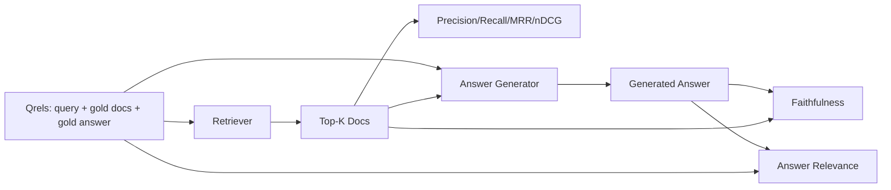

# RAG Evaluation: Precision, Recall, MRR, nDCG, Faithfulness, Answer Relevance

> Nếu bạn không thể chấm truy xuất và đáp án cùng lúc, bạn không thể cung cấp hệ thống. Hai thứ không phải cùng chỉ số và cùng prompt thất bại trên các trục khác nhau.

**Type:** Build
**Languages:** Python
**Prerequisites:** Phase 11 lessons 06 (RAG), 10 (evaluation); Phase 19 Track B foundations (lessons 20-29); Phase 19 lessons 64, 65, 66, 67
**Time:** ~90 minutes

## Learning Objectives
- Tính bốn chỉ số truy xuất từ qrels chuẩn: precision@k, recall@k, MRR (thứ hạng nghịch đảo trung bình), và nDCG@k.
- Tính hai chỉ số chấm đáp án: tính trung thực (mọi khẳng định có căn cứ trong ngữ cảnh truy xuất) và mức liên quan đáp án (đáp án giải quyết câu hỏi).
- Xây dựng một file qrels fixture (truy vấn, id tài liệu chuẩn, văn bản đáp án chuẩn) mà đánh giá đọc từ đầu đến cuối.
- Đọc các giá trị chỉ số để chẩn đoán nơi một pipeline thất bại: truy xuất, xếp hạng, sinh, hoặc đặt căn cứ.

## The Problem

Một hệ thống RAG có ít nhất bốn phần chuyển động: bộ chia đoạn, bộ truy xuất, bộ xếp hạng lại, bộ sinh. Bất kỳ phần nào cũng có thể là nguyên nhân một đáp án sai. Không có các chỉ số theo giai đoạn bạn đang bay mù.

Một người dùng báo cáo một đáp án sai. Có phải vì bộ chia đoạn cắt khoảng đáp án? Có phải vì bộ truy xuất không đưa đoạn vào top-k? Có phải vì bộ xếp hạng lại đẩy đoạn đúng qua vị trí một? Có phải vì bộ sinh bỏ qua đoạn và bịa thứ gì đó? Bạn không thể biết chỉ từ đáp án. Bạn cần:

- Các chỉ số truy xuất để chấm thứ ra khỏi bộ truy xuất.
- Các chỉ số xếp hạng để chấm đoạn đúng nằm ở đâu trong thứ tự.
- Tính trung thực để chấm liệu bộ sinh giữ bên trong ngữ cảnh truy xuất không.
- Mức liên quan đáp án để chấm liệu đáp án có giải quyết câu hỏi chút nào không.

Bài này xây dựng cả sáu trên một file qrels fixture. Đánh giá ngoại tuyến và tất định; trong sản xuất bạn đổi LLM-làm-bộ-chấm giả lập thành một bản thực.

## The Concept



### Precision@k

Trong top-k tài liệu bộ truy xuất trả về, tỷ lệ nào nằm trong tập chuẩn? Nếu chuẩn có ba tài liệu và top-3 trả về hai trong số đó cùng một sai, precision@3 là 2 / 3. Dùng precision khi chi phí của một đoạn truy xuất không liên quan cao (bộ sinh lãng phí token trên nó, hoặc đoạn đầu độc đáp án).

### Recall@k

Trong các tài liệu chuẩn, tỷ lệ nào nằm trong top-k? Nếu chuẩn có ba tài liệu và top-5 chứa cả ba, recall@5 là 1.0. Dùng recall khi chi phí của một đáp án bị bỏ lỡ cao (bạn thà thấy thêm một đoạn sai hơn bỏ lỡ hoàn toàn đoạn đáp án).

Trong RAG sản xuất chỉ số mọi người thường trích là recall@k. Sinh có thể bỏ các đoạn không liên quan dễ dàng; nó không thể tự tạo một đáp án từ một đoạn nó chưa từng thấy.

### MRR (Mean Reciprocal Rank)

Với mỗi truy vấn, tìm vị trí tài liệu liên quan đầu tiên trong danh sách được xếp hạng. Thứ hạng nghịch đảo là 1 / position. Lấy trung bình trên tập truy vấn. MRR là một tóm tắt một con số về việc bộ truy xuất đặt đáp án tốt nhất ở đầu tốt thế nào.

MRR đặt trọng số nặng cho vị trí 1. Một truy vấn mà tài liệu chuẩn ở hạng 1 đóng góp 1.0. Hạng 2 đóng góp 0.5. Hạng 10 đóng góp 0.1. Chỉ số bị chi phối bởi đầu danh sách.

### nDCG@k

Độ lợi tích lũy chiết khấu được chuẩn hóa. Công thức đầy đủ gán một độ lợi cho mỗi tài liệu truy xuất (thường 1 cho liên quan, 0 cho không), chiết khấu theo log vị trí, cộng, và chia cho DCG lý tưởng (DCG bạn sẽ có nếu xếp hạng hoàn hảo). Khoảng 0 đến 1.

nDCG đáp ứng mức liên quan phân bậc: chuẩn có thể nói "tài liệu A là 3, tài liệu B là 2, tài liệu C là 1". MRR và recall@k làm phẳng mọi thứ thành nhị phân. Dùng nDCG khi corpus có nhiều tài liệu liên quan một phần theo truy vấn.

### Faithfulness

Với mỗi khẳng định trong đáp án được sinh, kiểm tra liệu khẳng định có được hỗ trợ bởi ngữ cảnh truy xuất không. Triển khai tiêu chuẩn dùng một prompt LLM-làm-bộ-chấm nhận (khẳng định, ngữ cảnh) và trả về có hoặc không. Chỉ số là tỷ lệ khẳng định đạt.

Tính trung thực bắt chế độ lỗi bộ sinh nơi mô hình tự tạo nội dung. Ngay cả nếu bộ truy xuất trả về các đoạn đúng, một bộ sinh ảo giác thì bị hỏng. Tính trung thực cũng được gọi là tính có căn cứ, hỗ trợ, quy nguồn.

Bài này triển khai tính trung thực bằng một bộ chấm giả lập tất định kiểm tra liệu các token của mỗi khẳng định chồng lấn ngữ cảnh truy xuất theo một ngưỡng không. Trong sản xuất bạn đổi sang một lệnh gọi mô hình thực. Hình thức chỉ số giống nhau.

### Answer relevance

Đáp án có thực sự giải quyết câu hỏi không? Tính trung thực hỏi "đáp án có căn cứ trong ngữ cảnh không?". Mức liên quan đáp án hỏi "đáp án có căn cứ trong câu hỏi không?". Một đáp án trung thực nhưng lạc đề đạt điểm cao về tính trung thực và thấp về mức liên quan. Một đáp án ngắn, đúng chủ đề nhưng bỏ qua ngữ cảnh đạt điểm cao về mức liên quan và thấp về tính trung thực.

Triển khai tiêu chuẩn cũng dùng LLM-làm-bộ-chấm: lấy (câu hỏi, đáp án) và hỏi liệu đáp án giải quyết câu hỏi không. Bài này triển khai một vật thay thế chồng lấn token cộng bộ chấm.

## The fixture qrels

```python
{
  "qid": "q1",
  "query": "what is the abort threshold for multipart uploads",
  "gold_doc_ids": ["d1", "d3"],
  "gold_answer_substring": "three failed parts",
  "graded_relevance": {"d1": 3, "d3": 2},
}
```

Mỗi truy vấn mang:
- chuỗi truy vấn,
- một tập id tài liệu chuẩn (cho precision / recall / MRR),
- một dict mức liên quan phân bậc (cho nDCG),
- chuỗi con đáp án chuẩn (được giữ như siêu dữ liệu tham chiếu trên mỗi qrel; tính trung thực trong bài này được tính bằng chấm các khẳng định được trích xuất với ngữ cảnh truy xuất, không phải với chuỗi con này).

Trong sản xuất bạn gắn nhãn chúng. Bài này cung cấp một fixture dựng tay để đánh giá chạy ngay.

```figure
ci-rag-metric-ladder
```

## Build It

`code/main.py` triển khai:

- `precision_at_k(retrieved, gold, k)` - định nghĩa nguyên văn.
- `recall_at_k(retrieved, gold, k)` - định nghĩa nguyên văn.
- `mean_reciprocal_rank(retrieved_list_of_lists, gold_list)` - trung bình trên các truy vấn.
- `ndcg_at_k(retrieved, graded_relevance, k)` - DCG / IDCG với các độ lợi nhị phân hoặc phân bậc.
- `extract_claims(answer)` - chia một đáp án thành các khẳng định dạng câu.
- `faithfulness(claims, context_texts, judge)` - tỷ lệ khẳng định được chấm là được hỗ trợ.
- `answer_relevance(question, answer, judge)` - chấm liệu đáp án giải quyết câu hỏi không.
- `MockJudge` - bộ chấm chồng lấn token tất định để đánh giá chạy ngoại tuyến.
- `evaluate_pipeline(pipeline_fn, qrels, ks)` - bộ điều phối chạy mọi chỉ số.
- Một demo chạy ba biến thể pipeline (đường cơ sở bộ chia đoạn, truy xuất lai, lai + xếp hạng lại) với qrels và in một bảng chỉ số.

Chạy nó:

```bash
python3 code/main.py
```

Đầu ra cho thấy precision@k, recall@k, MRR, nDCG@k, tính trung thực, và mức liên quan đáp án cho mỗi biến thể trong một bảng chỉ số duy nhất. Hàng truy xuất lai vượt đường cơ sở bộ chia đoạn về recall; hàng xếp hạng lại vượt lai về MRR.

## Reading the metrics to diagnose failures

| Triệu chứng | Nguyên nhân có thể | Cần sửa gì |
|---------|-------------|-------------|
| recall@k thấp, precision@k thấp | Bộ chia đoạn cắt đáp án hoặc bộ truy xuất không thể tìm nó | Các ranh giới bộ chia đoạn (bài 64) hoặc phương thức bộ truy xuất (bài 65) |
| recall@k khá, MRR thấp | Đoạn đúng trong top-k nhưng không ở vị trí 1 | Bộ xếp hạng lại (bài 66) |
| MRR cao, tính trung thực thấp | Bộ sinh tự tạo nội dung dù ngữ cảnh đúng | Prompt sinh; buộc-trích-dẫn-hoặc-từ-chối |
| Tính trung thực cao, mức liên quan thấp | Đáp án có căn cứ nhưng lạc đề | Bộ viết lại truy vấn (bài 67) hoặc prompt sinh |
| Cả bốn cao, người dùng vẫn phàn nàn | Tập đánh giá không đại diện | Mở rộng qrels với các truy vấn người dùng thực |

## Failure modes the demo will hide

**Thiên lệch LLM-làm-bộ-chấm.** Một mô hình chấm các đầu ra của chính nó trung thực hơn thực tế. Dùng một họ mô hình khác cho bộ chấm so với bộ sinh, hoặc chấm tay một mẫu.

**Qrels mục nát.** Các đáp án chuẩn trôi khi corpus thay đổi. Một tài liệu từng là chuẩn cho q1 vào tháng Một năm 2024 không còn là đáp án đúng vào tháng Mười năm 2024 vì nhóm đổi tên hàm. Lên lịch rà soát qrels hàng quý.

**Các kiểm tra vi mô tính trung thực bỏ lỡ các khẳng định vĩ mô.** Tính trung thực theo câu có thể đạt trong khi cấu trúc đáp án tổng thể gây hiểu lầm. Thêm một rà soát định tính ở mức mẫu trên chỉ số tự động.

**Recall@k che các thất bại theo truy vấn.** Một recall trung bình 90% có thể che rằng một lớp truy vấn luôn bị bỏ lỡ. Chia qrels theo lớp truy vấn (nguyên văn, diễn đạt lại, đa chủ đề) và báo cáo theo phần.

## Use It

Các mẫu sản xuất:

- Chạy đánh giá trên mọi thay đổi bộ truy xuất hoặc bộ sinh. Coi một thoái lui recall@k như một kiểm thử thất bại.
- Lưu bền vững trace chỉ số theo truy vấn. Khi một người dùng phàn nàn, tra mục qrels khớp và xem liệu nó có được bắt không.
- Phân tầng qrels: một tập smoke 20 truy vấn chạy trong CI; một tập hồi quy 200 chạy hàng đêm; một tập sâu 2000 chạy hàng tuần.

## Ship It

Bài 69 nối toàn pipeline (bộ chia đoạn, bộ truy xuất, bộ xếp hạng lại, bộ sinh) và chạy đánh giá này với hệ thống đầu cuối.

## Exercises

1. Thêm một chỉ số truy xuất thứ năm: hit-rate@k. So sánh nó với recall@k. Giải thích khi nào chúng khác nhau.
2. Triển khai một tính trung thực phân bậc: 0 (không được hỗ trợ), 1 (được hỗ trợ một phần), 2 (được hỗ trợ đầy đủ). Cập nhật chỉ số tương ứng.
3. Thay bộ chấm giả lập bằng một lệnh gọi mô hình thực. Đo bất đồng giữa giả lập và bộ chấm thực trên fixture.
4. Thêm một phần chia lớp truy vấn ("nguyên văn", "diễn đạt lại", "đa chủ đề"). Báo cáo các chỉ số theo phần.
5. Thêm một chỉ số "độ dài đáp án" và tương quan nó với tính trung thực. Vẽ đường cong.

## Key Terms

| Thuật ngữ | Cách mọi người nói | Ý nghĩa thực sự |
|------|-----------------|------------------------|
| Precision@k | "Tỷ lệ trúng trên truy xuất" | Tỷ lệ top-k là chuẩn |
| Recall@k | "Tỷ lệ trúng trên chuẩn" | Tỷ lệ chuẩn trong top-k |
| MRR | "Vị trí trúng đầu tiên" | Trung bình 1 / hạng của tài liệu liên quan đầu tiên |
| nDCG@k | "Chất lượng xếp hạng phân bậc" | DCG trên top-k chia cho DCG lý tưởng |
| Faithfulness (Tính trung thực) | "Tính có căn cứ" | Tỷ lệ các khẳng định đáp án được ngữ cảnh truy xuất hỗ trợ |
| Answer relevance (Mức liên quan đáp án) | "Nó có giải quyết câu hỏi không?" | Liệu đáp án có khớp ý định câu hỏi không |
| Qrels | "Các nhãn chuẩn" | Tập truy vấn được gắn nhãn cùng các tài liệu và đáp án chuẩn của chúng |

## Further Reading

- Buckley, Voorhees, "Evaluating Evaluation Measure Stability", SIGIR 2000 - bài báo chuẩn về các chỉ số xếp hạng
- Jarvelin, Kekalainen, "Cumulated Gain-based Evaluation of IR Techniques" - bài báo nDCG
- [Ragas: Automated Evaluation of RAG Pipelines](https://docs.ragas.io)
- [Anthropic, Introducing Contextual Retrieval](https://www.anthropic.com/engineering/contextual-retrieval) - chấm truy xuất bằng 1 trừ recall@20
- Phase 11 bài 10 - các nền tảng framework đánh giá
- Phase 19 các bài 64-67 - các thành phần được đánh giá ở đây
- Phase 19 bài 69 - pipeline đầu cuối mà đánh giá này chấm
