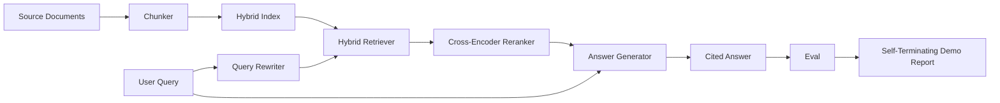

# End-to-End RAG System

> Sáu bài về các thành phần. Một pipeline. Một vòng lặp đánh giá. Một demo tự kết thúc. Đây là hệ thống bạn cung cấp.

**Type:** Build
**Languages:** Python
**Prerequisites:** Phase 11 lessons 06 (RAG), 10 (evaluation); Phase 19 Track B foundations (lessons 20-29); Phase 19 lessons 64, 65, 66, 67, 68
**Time:** ~90 minutes

## Learning Objectives
- Kết hợp bộ chia đoạn, bộ truy xuất lai, bộ viết lại truy vấn, bộ xếp hạng lại cross-encoder, và bộ sinh đáp án thành một pipeline đầu cuối duy nhất.
- Triển khai một bộ sinh đáp án trích dẫn các khẳng định theo neo đoạn, với phương án dự phòng từ chối khi độ tin cậy thấp.
- Chạy đánh giá bài 68 với pipeline được lắp ráp và chứng minh bản dựng chia giai đoạn thắng trên mọi chỉ số so với cùng các thành phần riêng lẻ.
- Xây dựng một demo CLI tự kết thúc tiếp nhận một corpus fixture, chạy một tập truy vấn cố định, và thoát với mã không cùng một báo cáo tóm tắt.

## The Problem

Sáu thành phần riêng lẻ không chứng minh gì. Bộ chia đoạn có thể thắng về recall@5 với corpus và thua về recall@5 của hệ thống vì bộ truy xuất không thể xếp hạng thứ bộ chia đoạn phát ra. Bộ xếp hạng lại có thể tăng MRR trên một tập ứng viên tổng hợp và thất bại trên các ứng viên bi-encoder thực vì recall của bi-encoder ở ngân sách xếp hạng lại quá thấp. Bộ viết lại truy vấn có thể nâng tài liệu chuẩn trên một truy vấn và hỏng trên truy vấn tiếp theo vì LLM giả lập trả về một giả định suy biến.

Kiểm thử tích hợp là toàn pipeline chạy từ đầu đến cuối với cùng qrels fixture, với cùng chỉ số, với một file điều phối nối mọi thứ với nhau. Đó là điều bài này xây dựng. Nếu các chỉ số trên pipeline tích hợp vượt các chỉ số trên demo riêng lẻ của mỗi giai đoạn, bạn đã chứng minh hệ thống.

## The Concept



### Wiring choices

Pipeline là một đồ thị nhỏ. Mỗi giai đoạn là một hàm với một chữ ký rõ ràng.

| Giai đoạn | Đầu vào | Đầu ra |
|-------|-------|--------|
| Bộ chia đoạn | Văn bản tài liệu | Danh sách bản ghi Chunk |
| Bộ truy xuất | Chuỗi truy vấn | Các bản ghi Chunk top-N |
| Bộ viết lại (tùy chọn) | Chuỗi truy vấn | Danh sách bản viết lại + giả định |
| Bộ xếp hạng lại | Truy vấn, ứng viên | Các bản ghi Chunk top-K với điểm chéo |
| Bộ sinh | Truy vấn, các bản ghi Chunk top-K | Chuỗi đáp án với trích dẫn |

Kết hợp thẳng thắn khi mỗi chữ ký ổn định. Lớp `Pipeline` của bài học giữ năm giai đoạn và một phương thức `query` chạy chúng theo thứ tự. Mọi giai đoạn có thể thay thế: truyền một bộ chia đoạn, bộ truy xuất, bộ viết lại, bộ xếp hạng lại, hoặc bộ sinh khác và pipeline vẫn chạy.

### Answer generator with citations

Bộ sinh là giai đoạn cuối và dễ phá nhất. Bài học cung cấp một bộ sinh giả lập tất định:

1. Lấy các đoạn top-K đã xếp hạng lại.
2. Chọn tối đa hai đoạn có văn bản chứa mức chồng lấn token nội dung cao nhất với truy vấn.
3. Phát ra một đáp án là phần nối của một-câu-từ-mỗi-đoạn-được-chọn, với mỗi câu theo sau bởi một neo `[doc_id:chunk_index]`.
4. Nếu không đoạn nào có mức chồng lấn trên một ngưỡng từ chối, phát ra "Tôi không biết" không có trích dẫn.

Trong sản xuất bạn đổi giả lập thành một lệnh gọi LLM thực với mẫu prompt:

```
You are answering a question using only the snippets below.
Cite every claim with the anchor in parentheses.
If the snippets do not answer the question, say "I do not know".

Question: {query}

Snippets:
{enumerated chunks with anchors}

Answer:
```

Đường từ chối khi độ tin cậy thấp là toàn bộ lý do điểm hạng 1 cross-encoder được ghi nhật ký. Nếu nó nằm dưới ngưỡng corpus, bộ sinh từ chối. Đây là van an toàn chống các đáp án ảo giác.

### The self-terminating demo

Demo chạy mọi thứ từ đầu đến cuối. Nó in một phân tích theo giai đoạn của một truy vấn, chạy đánh giá trên bốn qrels fixture, in một bảng chỉ số, và thoát với trạng thái không nếu mọi chỉ số bài 68 đạt các ngưỡng đặt trong demo. Nếu bất kỳ chỉ số nào dưới ngưỡng, demo thoát với một trạng thái khác không và một thông điệp nêu tên chỉ số thất bại.

Đây là hình thức một kiểm thử smoke CI có. Pipeline chạy ngoại tuyến, nhanh, tất định. Các ngưỡng cố ý chặt trên fixture để một thoái lui trong bất kỳ bài nào trong sáu bài làm demo thất bại.

```figure
rag-pipeline-flow
```

## Build It

`code/main.py` triển khai:

- `Chunk` - bản ghi được mang qua mọi giai đoạn (mở rộng hình thức bài 64 với một chunk_index và doc_id nguồn).
- `Chunker` - chọn một chiến lược từ bài 64 (mặc định chia đệ quy).
- `HybridIndex` - gói BM25 + dense + RRF từ bài 65.
- `Rewriter` (tùy chọn) - chọn một trong HyDE, đa truy vấn, phân rã từ bài 67 theo độ dài truy vấn và sự có mặt của liên từ.
- `Reranker` - cross-encoder đã huấn luyện từ bài 66, với một tập huấn luyện fixture nhỏ hơn để nó hội tụ trong vài giây.
- `Generator` - bộ sinh giả lập tất định với các trích dẫn và từ chối khi độ tin cậy thấp.
- `Pipeline` - kết hợp năm giai đoạn với một phương thức `query(question)` trả về `Result(answer, top_k, latency_ms_per_stage)`.
- `run_demo()` - tiếp nhận corpus, chạy ba truy vấn fixture, chạy đánh giá, in các kết quả, đặt mã thoát theo ngưỡng.

Chạy nó:

```bash
python3 code/main.py
```

Đầu ra là một trace truy vấn được in, bảng đánh giá đầy đủ, và một trạng thái đạt/trượt cuối. Trả về mã thoát 0 trên fixture.

## Failure modes the demo will hide

**Độ trôi ranh giới bộ chia đoạn.** Nếu bạn đổi chiến lược bộ chia đoạn giữa lượt gắn nhãn qrels đánh giá và demo, các id tài liệu chuẩn không còn khớp. Khóa chiến lược bộ chia đoạn trong file qrels. Demo bao gồm một header đặt tên bộ chia đoạn.

**Tập huấn luyện bộ xếp hạng lại rò vào đánh giá.** 14 bộ ba huấn luyện trong bài 66 bao gồm các truy vấn giống các truy vấn đánh giá. Trong sản xuất, giữ riêng các truy vấn đánh giá nghiêm ngặt. Các truy vấn đánh giá của demo cố ý rời với tập huấn luyện xếp hạng lại.

**Bộ sinh giả lập che rủi ro ảo giác.** Giả lập không thể ảo giác vì nó chỉ phát văn bản từ các đoạn truy xuất. Bài học ghi nhận điều này và trỏ đường thay thế sản xuất tới một mô hình thực.

**Không truyền luồng.** Pipeline trả về đáp án đầy đủ ở cuối mọi giai đoạn. Một hệ thống sản xuất sẽ truyền luồng đầu ra bộ sinh. Truyền luồng nằm ngoài phạm vi; các chỉ số chấm đáp án hoạt động trên chuỗi cuối trong cả hai trường hợp.

**Độ trễ ngoại tuyến.** Các lệnh gọi LLM giả lập có thời gian hằng. Các lệnh gọi LLM thực chiếm ưu thế. Lên kế hoạch một ngân sách độ trễ trong phạm vi yêu cầu; thời gian theo giai đoạn của bài học chỉ đo công việc CPU.

## Use It

Các mẫu sản xuất:

- Cung cấp file pipeline dưới một bộ điều phối với các giao diện giai đoạn rõ ràng. Tránh trải hệ thống nối khắp repo.
- Chạy đánh giá trước mọi lần hợp nhất chạm một giai đoạn. Nếu đánh giá giảm, hợp nhất không được đưa vào.
- Lưu bền vững trace chỉ số theo lần chạy CI để bạn có thể quy các lỗi thoái lui về một lần đổi giai đoạn.
- Thêm một tập smoke 20 truy vấn (tập con của tập hồi quy) chạy trong dưới 30 giây; tập hồi quy đầy đủ chạy hàng đêm.

## Ship It

File pipeline trong bài này là hình thức mà phần còn lại của các bài Track F Phase 19 giả định. Các bài tiếp theo sẽ thêm tự động hóa tiếp nhận, lập chỉ mục lại tăng dần, dữ liệu đo từ xa, và một lớp phục vụ lên trên. Các nửa truy xuất, xếp hạng lại, viết lại, và đánh giá hoàn chỉnh ở đây.

## Exercises

1. Thêm một bộ chọn chiến lược theo truy vấn bên trong bộ viết lại: các heuristic từ bài 67 (độ dài, liên từ, tỷ lệ biệt ngữ) chọn HyDE, đa truy vấn, hoặc phân rã.
2. Thêm một lệnh gọi LLM thực cho bộ sinh sau một cờ môi trường. Mặc định giả lập. Đo chênh lệch độ trễ.
3. Mở rộng demo để nhận một cờ `--corpus path` nạp một corpus thực. Chạy lại đánh giá và kiểm tra ngưỡng.
4. Thêm một cờ `--strategy` vào bộ chia đoạn. Đo đóng góp của mỗi chiến lược vào recall đầu cuối.
5. Thêm một giao diện bộ sinh truyền luồng và cấp nó vào đánh giá. Xác nhận tính trung thực được tính trên chuỗi cuối và không trên tiền tố được truyền luồng.

## Key Terms

| Thuật ngữ | Cách mọi người nói | Ý nghĩa thực sự |
|------|-----------------|------------------------|
| Pipeline | "Pipeline RAG" | Các giai đoạn được kết hợp từ tiếp nhận đến đáp án có trích dẫn |
| Citation anchor (Neo trích dẫn) | "Liên kết nguồn" | Tham chiếu (doc_id, chunk_index) được gắn vào mỗi khẳng định |
| Refuse-on-low-confidence (Từ chối khi độ tin cậy thấp) | "Tôi không biết" | Bộ sinh không trả về đáp án khi điểm top-1 bộ xếp hạng lại nằm dưới ngưỡng |
| Smoke set (Tập smoke) | "Đánh giá CI" | Tập con qrels tối thiểu chạy trong mọi kiểm tra PR |
| Stage interface (Giao diện giai đoạn) | "Chữ ký hàm" | Kiểu đầu vào và đầu ra ổn định của mỗi giai đoạn pipeline |

## Further Reading

- [Anthropic, Building search and retrieval](https://www.anthropic.com/news/contextual-retrieval)
- [Pinterest, MCP internal search](https://medium.com/pinterest-engineering) - kiến trúc sản xuất tham chiếu
- [Ragas: Automated Evaluation of RAG Pipelines](https://docs.ragas.io)
- Phase 11 bài 06 - các nền tảng RAG
- Phase 19 các bài 64-68 - các thành phần được kết hợp ở đây
