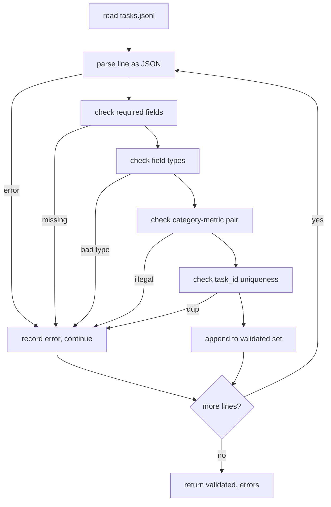

# Task Spec Format

> Một harness đánh giá chỉ tốt như hợp đồng mà các tác vụ của nó tuân thủ. Đóng băng hình thức JSONL và từ vựng chỉ số trước khi bạn viết một hàm chấm điểm duy nhất.

**Type:** Build
**Languages:** Python
**Prerequisites:** Phase 19 Track B foundations
**Time:** ~90 min

## Learning objectives

- Định nghĩa một lược đồ bản ghi tác vụ JSONL bao phủ số học, trắc nghiệm, thực thi mã, phân loại, và tóm tắt văn bản tự do trong một hình thức.
- Ghim một từ vựng đóng các tên chỉ số để các bài hạ nguồn (71-73) có thể điều phối theo một trường duy nhất.
- Đặc tả các ví dụ few-shot và quy tắc hậu xử lý như một phần của tác vụ, không phải trình chạy, để cùng prompt tạo cùng đích trên các mô hình.
- Triển khai một bộ xác thực nghiêm ngặt từ chối các bản ghi sai định dạng trước khi chúng đến trình chạy.
- Cung cấp một tập fixture 10 tác vụ thực thi mọi nhánh của đặc tả để bộ xác thực có thứ thực để nhai.

```figure
ci-task-spec-gate
```

## Why a frozen spec

Một cơ sở mã nghiên cứu sẽ tích lũy các script đánh giá nhanh hơn các kiểm thử. Sau sáu tháng, mọi notebook có hình thức JSON riêng, mọi chỉ số được triển khai lại hai lần, và không gì có thể so sánh giữa các lần chạy. Cách sửa nhàm chán. Chọn một lược đồ. Viết một bộ xác thực. Từ chối mọi thứ khác. Đó là điều bài này làm.

Hình thức mượn các ý tưởng từ BIG-bench, HELM, và các harness kiểu lm-eval, nhưng các tên trường là của chúng ta. Mọi trường có một chủ sở hữu duy nhất. Trình chạy đọc tác vụ. Chỉ số đọc các đích. Bước hậu xử lý chuẩn hóa phần sinh. Không trường nào có thể thay đổi giữa pipeline.

## The record shape

Một tác vụ là một đối tượng JSON trên một dòng duy nhất. Harness đọc `tasks.jsonl` và xác thực từng dòng độc lập. Một dòng sai hủy bản ghi đó, không phải lần chạy.

```json
{
  "task_id": "arith_001",
  "category": "arithmetic",
  "prompt": "Compute the result. Question: 17 + 24\nAnswer:",
  "targets": ["41"],
  "metric_name": "exact_match",
  "few_shot_examples": [
    {"prompt": "Question: 2 + 2\nAnswer:", "completion": "4"}
  ],
  "post_process": "strip_whitespace",
  "metadata": {"difficulty": "easy"}
}
```

Các trường bắt buộc là `task_id`, `category`, `prompt`, `targets`, `metric_name`, `post_process`. `few_shot_examples` và `metadata` tùy chọn. Các trường cấp cao nhất không xác định làm xác thực thất bại.

## Field rules

`task_id` là một chuỗi không có khoảng trắng. Bộ xác thực thực thi tính duy nhất trên toàn file.

`category` là một trong `arithmetic`, `mcq`, `code_exec`, `classification`, `summary`. Hạng mục ràng buộc cặp chỉ số và hậu xử lý nào hợp lệ. Một tác vụ `code_exec` phải dùng `metric_name = code_exec` và một tác vụ `mcq` phải dùng `metric_name = exact_match` với một đích một chữ cái.

`prompt` là một chuỗi không rỗng. Bộ xác thực cấm khoảng trắng cuối và từ chối các bản ghi đã chứa một khối few-shot trong thân prompt. Kết xuất few-shot xảy ra trong trình chạy, không phải tác giả.

`targets` là một danh sách chuỗi không rỗng. Với `exact_match`, bất kỳ phần tử nào khớp đều được tính. Với `f1` và `rouge_l`, đích có điểm cao nhất thắng. Với `mcq`, danh sách giữ chính xác một phần tử.

`metric_name` là một trong `exact_match`, `f1`, `bleu_4`, `rouge_l`, `accuracy`, `code_exec`. Từ vựng đóng. Một chỉ số mới đòi hỏi một bài mới và một mục mới ở đây.

`few_shot_examples` là một danh sách các cặp `{prompt, completion}`. Bộ xác thực giới hạn danh sách ở tám mục để giữ các prompt có giới hạn.

`post_process` là một trong `none`, `strip_whitespace`, `lower`, `extract_letter`, `extract_code_block`, `extract_first_line`. Mỗi quy tắc có một hành vi tất định duy nhất. Bộ xác thực cấm kết hợp các quy tắc.

## Validator behaviour



Bộ xác thực trả về hai danh sách: các bản ghi đã xác thực và các bản ghi lỗi với dòng vi phạm, quy tắc bị vi phạm, và trường có lỗi. Trình chạy từ chối bắt đầu nếu danh sách lỗi không rỗng trừ khi một cờ `--allow-bad-tasks` rõ ràng được đặt.

## Few-shot rendering

Trình chạy nối các ví dụ few-shot phía trước prompt với một dấu phân cách dòng trống. Cùng đường mã chạy cho mọi mô hình, nên nguồn phương sai duy nhất là chính mô hình. Các tác giả viết ví dụ một lần, không phải một lần mỗi nhà cung cấp.

```python
def render(task):
    parts = []
    for ex in task.get("few_shot_examples", []):
        parts.append(ex["prompt"] + " " + ex["completion"])
    parts.append(task["prompt"])
    return "\n\n".join(parts)
```

## Post-process rules

Bước hậu xử lý chạy sau sinh, trước chỉ số. Nó tất định và phi trạng thái.

- `none` trả về chuỗi không đổi.
- `strip_whitespace` bỏ khoảng trắng đầu và cuối.
- `lower` chuyển chuỗi thành chữ thường.
- `extract_letter` trả về ký tự đầu khớp `[A-E]`, được dùng cho MCQ.
- `extract_code_block` trả về thân của khối rào ba dấu backtick đầu tiên, được dùng cho thực thi mã.
- `extract_first_line` trả về dòng không rỗng đầu tiên, được dùng cho phân loại tóm tắt.

Một tác vụ cần một quy tắc ngoài danh sách này thuộc về một bài mới.

## What this lesson does not do

Nó không chấm điểm. Nó không gọi một mô hình. Nó không chạy mã. Những thứ đó đến trong các bài 71, 72, và 75. Bài này đóng băng hợp đồng mà tất cả tuân thủ.

Fixture 10 tác vụ bao phủ hai mục số học, hai mục MCQ, hai mục thực thi mã, hai mục phân loại, và hai mục tóm tắt. Bộ xác thực đạt trên cả 10. Một fixture riêng (`tasks_bad.jsonl`) kích hoạt mọi quy tắc và bộ xác thực trả về chính xác từng ấy lỗi.

## How to read the code

`main.py` định nghĩa `TaskSpec`, `validate_task`, `validate_file`, và một điểm vào CLI. Bộ nạp fixture là `load_fixtures`. Các hàm hỗ trợ kết xuất và hậu xử lý nằm cạnh xác thực để trình chạy trong bài 75 import một module duy nhất.

Đọc `main.py` từ trên xuống dưới. Rồi đọc `code/tests/test_spec.py`. Các kiểm thử ghim mọi quy tắc xác thực và mọi hành vi hậu xử lý. Demo ở cuối `main.py` xác thực fixture được đóng gói và in một tóm tắt.

## Going further

Các bộ đánh giá thực phát triển các hạng mục theo cách các lược đồ phát triển các cột. Bước đi tỉnh táo là từ chối thêm một hạng mục mà không đồng thời thêm một chỉ số, một quy tắc hậu xử lý, và ít nhất một tác vụ fixture. Coi đặc tả như một lần di chuyển cơ sở dữ liệu. Mọi thay đổi được rà soát, có phiên bản, và đi kèm các kiểm thử. Bộ xác thực trong bài này là cổng.
