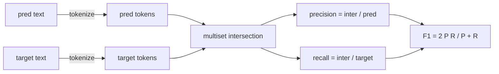
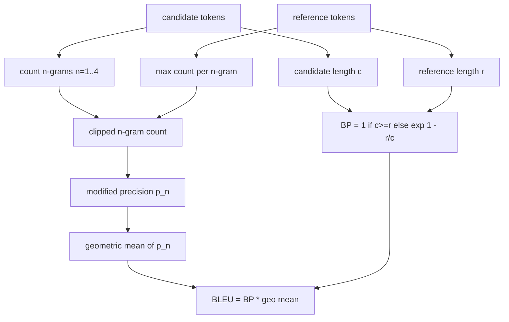

# Classical Metrics

> BLEU, ROUGE-L, F1, khớp chính xác, độ chính xác. Năm chỉ số vẫn chiếm phần lớn các số đánh giá LLM được công bố. Triển khai mỗi chỉ số từ các nguyên lý đầu tiên để bạn biết con số có ý nghĩa gì.

**Type:** Build
**Languages:** Python
**Prerequisites:** Phase 19 Track B foundations, lesson 70
**Time:** ~90 min

## Learning objectives

- Triển khai khớp chính xác, F1, và độ chính xác ở mức token với các quy tắc phân tách token rõ ràng.
- Triển khai BLEU-4 từ nền tảng: precision n-gram sửa đổi, trung bình nhân trên n bằng 1 đến 4, hình phạt ngắn.
- Triển khai ROUGE-L bằng dãy con chung dài nhất, với tổ hợp F-beta của precision và recall.
- Điều phối theo trường metric_name từ bài 70 để trình chạy giữ độc lập với chỉ số.
- Ghim hành vi bằng các vector tham chiếu lấy từ các ví dụ được giải, không phải từ một thư viện bên thứ ba.

```figure
cd-bleu-overlap
```

## Why reimplement

Bạn sẽ đọc các bài báo báo cáo BLEU 28.3 và một bài khác báo cáo BLEU 0.283. Bạn sẽ tìm thấy các điểm ROUGE-L khác nhau mười điểm giữa hai thư viện vì một thư viện cắt về chữ thường và thư viện kia không. Cách nhanh nhất để ngừng bối rối là tự viết các chỉ số, rồi chỉ vào dòng nơi tokenizer được quyết định và dòng nơi làm mượt được áp dụng. Sau đó, so sánh các số giữa các bài báo trở thành việc đọc thiết lập chỉ số, không phải tranh luận về thư viện.

Stdlib cộng numpy là đủ. BLEU là đếm và một phép chặn. ROUGE-L là quy hoạch động. F1 là một giao tập trên token. Phần khó nhất là chọn một tokenizer và cam kết với nó.

## Tokenisation

Tokenizer là `re.findall(r"\w+", text.lower())`. Chuyển chữ thường, các chuỗi ký tự từ (chữ cái, chữ số và dấu gạch dưới), bỏ mọi thứ khác. Mọi chỉ số trong bài học này sử dụng chính xác tokenizer này. Runner không được chọn. Nếu bạn thay tokenizer, bạn đang chạy một benchmark khác.

```python
TOKEN_RE = re.compile(r"\w+", re.UNICODE)
def tokenize(text):
    return TOKEN_RE.findall(text.lower())
```

Đây là một đơn giản hóa có chủ ý. Các thiết lập sản xuất sẽ quan tâm CJK, các dạng rút gọn, và các định danh mã. Điểm chính của bài học là tokenizer là một hợp đồng, không phải một núm điều chỉnh.

## Exact match

```python
def exact_match(pred, targets):
    return float(any(pred.strip() == t.strip() for t in targets))
```

Nó trả về 1.0 hoặc 0.0 mỗi tác vụ. Tổng hợp trên một tập dữ liệu là trung bình. Đây là công cụ chủ lực cho số học, MCQ, và các tác vụ phân loại ngắn.

## Token-level F1

Thiết lập đa tập token cho dự đoán và đích. Precision là giao đa tập chia cho đa tập của dự đoán. Recall là cùng giao chia cho đa tập của đích. F1 là trung bình điều hòa. Triển khai xử lý các trường hợp biên dự đoán rỗng và đích rỗng.



Với các tác vụ đa đích, chúng ta lấy F1 tốt nhất trên danh sách đích. Điều đó khớp hành vi kiểu SQuAD được báo cáo rộng rãi trong tài liệu.

## BLEU-4

BLEU là chỉ số dịch máy chuẩn và nó vẫn xuất hiện trong công việc tóm tắt. Công thức chúng ta sử dụng là BLEU-4 cấp câu, chấm điểm theo từng cặp dự đoán và tham chiếu, với brevity penalty tiêu chuẩn và làm trơn cộng một trên số đếm n-gram đã sửa đổi để một 4-gram thiếu duy nhất không đẩy điểm về không.

Với mỗi cặp ứng viên-tham chiếu, chúng ta đếm precision n-gram sửa đổi với n bằng 1, 2, 3, 4. Precision sửa đổi cắt số đếm n-gram ứng viên theo số đếm tối đa của n-gram đó trong bất kỳ tham chiếu nào, để một ứng viên không thể thổi phồng bằng cách lặp một cụm. Trung bình nhân trên bốn precision được bọc bằng hình phạt ngắn.



Quy tắc làm mượt là thứ Lin và Och gọi là phương pháp 1: thêm một vào cả tử và mẫu của mọi precision n-gram trước khi lấy log. Điều này tránh `log 0` khi một tham chiếu không có 4-gram khớp và giữ gần giá trị không làm mượt trên các ứng viên dài.

## ROUGE-L

ROUGE-L so sánh dãy con chung dài nhất của các chuỗi token ứng viên và tham chiếu. LCS nắm bắt thứ tự từ mà không buộc tính liên tục, đó là lý do nó là chỉ số tóm tắt mặc định. Chúng ta tính độ dài LCS bằng một bảng quy hoạch động tiêu chuẩn, rồi suy ra recall là `lcs / reference length`, precision là `lcs / candidate length`, và kết hợp bằng F-beta với beta bằng một cho dạng F1 đối xứng.

```python
def lcs_length(a, b):
    n, m = len(a), len(b)
    dp = numpy.zeros((n + 1, m + 1), dtype=int)
    for i in range(n):
        for j in range(m):
            if a[i] == b[j]:
                dp[i+1, j+1] = dp[i, j] + 1
            else:
                dp[i+1, j+1] = max(dp[i+1, j], dp[i, j+1])
    return int(dp[n, m])
```

Bảng numpy khiến triển khai dễ đọc; các danh sách Python thuần cũng sẽ hoạt động. Các tác vụ chọn ROUGE-L trả chi phí $O(n m)$ mỗi tác vụ. Với các độ dài tóm tắt điển hình điều đó giữ dưới một mili giây.

## Accuracy

Với các tác vụ phân loại, accuracy quy về exact-match: dự đoán được điểm 1 nếu nó khớp bất kỳ mục tiêu đã chuẩn hóa nào trong danh sách. Chúng ta cung cấp nó như một hàm riêng để dispatcher có thể phân phối theo `metric_name` mà không đi qua các so sánh chuỗi bên trong runner.

## Dispatch contract

Điểm vào duy nhất là `score(metric_name, prediction, targets)`. Nó trả về một float trong `[0, 1]`. Trình chạy không phân nhánh theo tên chỉ số. Nó bàn giao lệnh gọi và ghi kết quả. Đây là bề mặt mà bài 75 sẽ gắn với đặc tả tác vụ từ bài 70.

```python
def score(metric_name, pred, targets):
    if metric_name == "exact_match":
        return exact_match(pred, targets)
    if metric_name == "f1":
        return max(f1_score(pred, t) for t in targets)
    if metric_name == "bleu_4":
        return max(bleu4(pred, t) for t in targets)
    if metric_name == "rouge_l":
        return max(rouge_l(pred, t) for t in targets)
    if metric_name == "accuracy":
        return accuracy(pred, targets)
    raise ValueError(f"unknown metric_name: {metric_name}")
```

`code_exec` được xử lý trong bài 72 và cắm vào dispatcher ở đó.

## What this lesson does not do

Nó không gọi một mô hình. Nó không chuẩn hóa các phần sinh vượt ngoài điều các quy tắc hậu xử lý từ bài 70 đã làm. Nó không tính các khoảng tin cậy. Nó không làm BLEURT hoặc BERTScore (những thứ đó cần một mô hình và nằm trong một bài khác). Điểm chính là mức sàn: năm chỉ số, một tokenizer, một bảng điều phối.

## How to read the code

`main.py` định nghĩa mỗi chỉ số như một hàm tự do cùng dispatcher. Các vector tham chiếu nằm trong khối `_reference_examples` ở cuối file. Demo chạy dispatcher với tám ví dụ và in các điểm theo chỉ số. Các kiểm thử trong `code/tests/test_metrics.py` ghim các vector tham chiếu và thử thách mọi trường hợp biên (dự đoán rỗng, tham chiếu rỗng, không token chung, khớp chính xác, cắt cụm lặp).

Đọc `main.py` từ trên xuống dưới. Các hàm được sắp theo độ phức tạp. exact_match và accuracy mỗi hàm một dòng. F1 là sáu dòng. BLEU và ROUGE-L là các phần nặng và chúng bao gồm các bình luận chi tiết về quy tắc làm mượt và truy hồi LCS.

## Going further

Các chỉ số cổ điển cần thiết, không đủ. Chúng thưởng chồng lấn bề mặt và bỏ lỡ ý nghĩa. Cách sửa là xếp các chỉ số dựa trên mô hình lên trên (BLEURT, BERTScore, GEval) khi bạn tin mức sàn cổ điển. Đó là một bài sau. Lúc này: làm năm chỉ số này hoạt động, ghim chúng bằng các kiểm thử, và bạn có một ngăn xếp chỉ số có thể kiểm toán, nhanh, và có thể tái lập.
