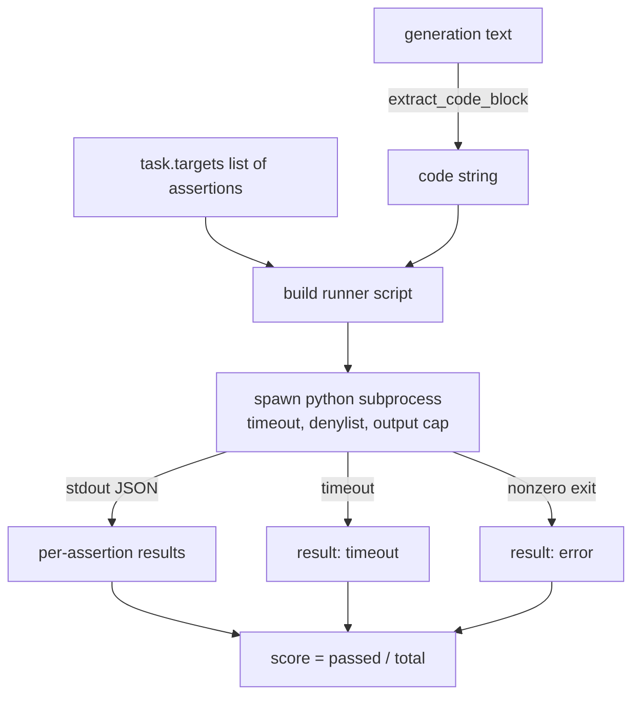
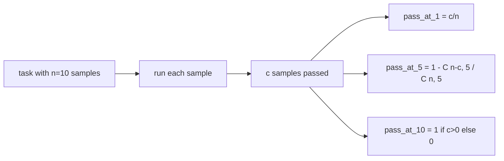

# Code Exec Metric

> Mã được sinh đúng khi nó đạt các kiểm thử. Harness đánh giá phải trích xuất mã, chạy nó mà không làm sập máy chủ, và kiểm đếm các tỷ lệ đạt trung thực. Bài này xây dựng bề mặt đó.

**Type:** Build
**Languages:** Python
**Prerequisites:** Phase 19 Track B foundations, lessons 70 and 71
**Time:** ~90 min

## Learning objectives

- Trích xuất một khối mã từ một phần sinh dạng tự do theo cách khớp quy tắc hậu xử lý từ bài 70.
- Thực thi mã ứng viên trong một tiến trình con cô lập với một timeout thời gian thực, trần đầu ra, và một danh sách cấm import.
- Chấm một tác vụ như tỷ lệ các chuỗi khẳng định được cung cấp đạt với ứng viên.
- Tính pass-at-k cho các tác vụ lấy mẫu nhiều phần sinh từ một mô hình.
- Coi các sự cố sandbox, lỗi cú pháp, và timeout như các chế độ thất bại hạng nhất với các mã thoát riêng mà trình chạy có thể ghi nhật ký.

```figure
sandbox-runner
```

## Why an isolated subprocess

`exec` nội tuyến là một nguy cơ bảo mật và ổn định. Một `while True: pass` được sinh chặn đánh giá mãi mãi. Một `import shutil; shutil.rmtree('/')` được sinh thảm khốc đúng như nghe thấy. Cách sửa là tạo một trình thông dịch Python mới mỗi ứng viên, truyền mã trên stdin, ghi các kết quả khẳng định vào stdout, và diệt tiến trình nếu nó chạy quá. Tiến trình đánh giá chủ tiếp tục chạy.

Các đánh giá thực như HumanEval, MBPP, BigCodeBench, và LiveCodeBench đều dùng một sandbox tiến trình con. Một số xếp Docker lên trên. Chúng ta dừng ở tiến trình con vì một lý do: nó di động, nó là stdlib, và nó bắt các chế độ lỗi quan trọng cho đánh giá giáo dục. Các triển khai sản xuất thêm seccomp, cô lập mạng, và một hệ thống file chỉ đọc. Bài tiếp theo về gia cố nằm ngoài track này.

## The shape of a code-exec task

Một tác vụ `code_exec` mang các chuỗi khẳng định trong `targets`. Trình chạy trích xuất một khối mã có rào từ phần sinh, xây dựng một bộ kiểm thử quanh nó, và chạy kết quả.



Điểm là một tỷ lệ trong `[0, 1]`. Một tác vụ có ba khẳng định mà hai đạt có điểm 0.667. Trình chạy trả về cùng hình thức bất kể thứ gì thất bại: các sự cố tiến trình con được ánh xạ tới một mã lỗi được chuẩn hóa, không phải một traceback Python trồi lên harness.

## The denylist

Danh sách cấm dựa trên import. Trước khi chạy mã ứng viên, script trình chạy viết lại các import module nguy hiểm thành một stub phát sinh `ImportError("denied")`. Danh sách cố ý bảo thủ: `os.system`, `subprocess`, `socket`, `requests`, `urllib`, `urllib.request`, `urllib.error`, `urllib.parse`, `ctypes`, `shutil`, `http.client`, `asyncio.subprocess`.

Chúng ta không giả vờ điều này bất khả xâm phạm. Mã đối kháng quyết tâm có thể thoát bất kỳ sandbox trong tiến trình nào trong Python. Danh sách cấm là một chốt chặn dự phòng. Timeout thời gian thực và trần đầu ra là các kiểm soát chịu tải.

```python
DENIED = {
    "os.system": True,
    "subprocess": True,
    "socket": True,
    "shutil": True,
    "requests": True,
    "urllib": True,
    "ctypes": True,
}
```

Chúng ta bọc ứng viên bằng cách thêm `import sys` vào đầu và một chốt bảo vệ monkey-patch `os.system` để phát sinh lỗi. Mẫu đầy đủ nằm trong `main.py`.

## Wall-clock timeout

Mọi tiến trình con nhận một ngân sách mặc định ba giây thời gian thực. Trình chạy dùng `subprocess.run(..., timeout=t)`. Nếu timeout kích hoạt, trình chạy bắt `TimeoutExpired`, diệt tiến trình, và ghi một lý do thoát `timeout` cho tác vụ. Điểm cho tác vụ đó bằng không. Trình chạy tiếp tục.

Timeout là đối số `timeout_s` của `run_candidate`; runner bài 75 đặt nó một lần mỗi lần chạy qua `code_exec_timeout_s`. Các unit test chạy lâu có thể yêu cầu nhiều hơn, nhưng `run_candidate` kẹp giá trị trong khoảng 0.1 đến ba mươi giây để giữ bộ kiểm tra có giới hạn.

## Output cap

Tiến trình con có thể làm ngập stdout, làm cạn bộ nhớ máy chủ. Trình chạy truyền luồng stdout vào một bộ đệm và diệt tiến trình con ngay khi tổng đang chạy vượt 256 KB. Kết quả được ghi như `exit_code = error` với chuỗi chi tiết `"output overflow"`. Điều này xuất hiện trong thực tế khi một phần sinh vô tình viết một vòng lặp vô hạn in ra.

## Pass-at-k

Pass-at-k là ước lượng không chệch được HumanEval và các công cụ tương tự dùng. Với `n` mẫu độc lập mỗi tác vụ và `c` mẫu đạt, xác suất một mẫu kích thước `k` từ `n` chứa ít nhất một lời giải đạt là:

```
pass_at_k(n, c, k) = 1 - C(n - c, k) / C(n, k)
```

Khi `n - c < k`, tử số `C(n - c, k)` bằng không theo quy ước thông thường (bạn không thể chọn `k` lần thất bại từ ít hơn `k`), nên giá trị là `1`. Phần triển khai xử lý trực tiếp trường hợp biên. Chúng ta cung cấp `pass_at_k(n, c, k)` để tầng bảng xếp hạng trong bài 74 sử dụng.



## Exit codes

Trình chạy trả về một trong năm kết quả mỗi tác vụ:

- `pass` khi mọi khẳng định đạt.
- `assertion_fail` khi mã chạy nhưng ít nhất một khẳng định thất bại.
- `syntax_error` khi mã không import được hoặc có một SyntaxError.
- `timeout` khi thời gian thực hết.
- `error` cho bất kỳ sự cố khác nào, bao gồm các lần trúng danh sách cấm và tràn đầu ra (tràn xuất hiện với chi tiết `"output overflow"`).

Điểm vẫn là một tỷ lệ. Mã thoát là siêu dữ liệu. Các bài hạ nguồn có thể quyết định tính một timeout là không hay dữ liệu thiếu.

## What this lesson does not do

Nó không cho bạn một sandbox thực. Nó không chạy mã không đáng tin từ web mở. Nó không xử lý các tác vụ có trạng thái như I/O file hoặc các lệnh gọi mạng. Những thứ đó cần một container hoặc một microVM. Điểm chính của bài này là hợp đồng: một tiến trình con cô lập, một danh sách cấm, một timeout, một trần đầu ra, một từ vựng mã thoát sạch, và toán pass-at-k.

## How to read the code

`main.py` định nghĩa `extract_code`, `run_candidate`, `score_code_exec`, và `pass_at_k`. Script trình chạy tiến trình con được xây dựng như một chuỗi và truyền dưới dạng `-c` cho một trình thông dịch Python mới. Các kiểm thử trong `code/tests/test_exec.py` thực thi bốn mã thoát cùng pass-at-k với các ví dụ được giải lấy từ phong cách HumanEval.

Đọc `main.py` từ trên xuống dưới. Mẫu trình chạy là phần chịu tải. Nhìn kỹ vòng lặp khẳng định cho đến khi bạn có thể dự đoán phong bì JSON nó ghi lại cho tiến trình cha.

## Going further

Một khi hình thức tiến trình con hoạt động, mối quan tâm tiếp theo là tính di động. Các phiên bản Python khác nhau xử lý SIGKILL khác nhau trên Windows. Cách sửa gọn nhất là đặt trình chạy trong một image Docker. Điều tiếp theo sau đó là thay các chuỗi khẳng định bằng các file kiểm thử đơn vị thực để đánh giá khớp điều CI sản xuất làm. Ngừng gọi các chuỗi khẳng định là kiểm thử ở thời điểm đó; chúng là các kiểm thử đồ chơi và chúng có các chế độ lỗi đồ chơi.
