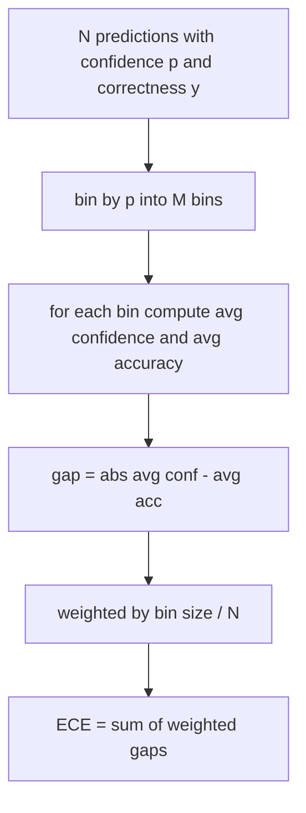
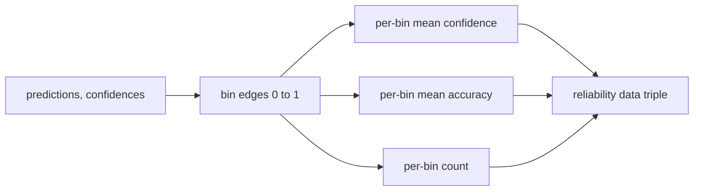

# Perplexity and Calibration

> Nếu mô hình của bạn nói tự tin 90 phần trăm trên một nghìn đáp án và làm đúng sáu trăm, nó không được hiệu chuẩn tốt. Hiệu chuẩn là nửa đánh giá đáng tin. Nửa còn lại là perplexity, cho bạn biết liệu mô hình có nghĩ văn bản được giữ riêng có vẻ hợp lý chút nào không.

**Type:** Build
**Languages:** Python
**Prerequisites:** Phase 19 Track B foundations, lessons 70 and 71
**Time:** ~90 min

## Learning objectives

- Tính perplexity ở mức token trên một corpus được giữ riêng từ các log-xác suất âm token do adapter mô hình cung cấp.
- Tính sai số hiệu chuẩn kỳ vọng (ECE) của một bộ phân loại hoặc đánh giá trắc nghiệm từ các xác suất dự đoán được chia nhóm.
- Tính điểm Brier (sai số bình phương trung bình so với chỉ báo tính đúng đắn) và giải thích khi nào nó làm điều ECE không làm.
- Xây dựng dữ liệu biểu đồ độ tin cậy cần để vẽ một đường cong độ tự tin-so-với-độ-chính-xác.
- Nối cả ba vào harness đánh giá để trình chạy có thể gắn các số `perplexity`, `ece`, và `brier` vào một báo cáo mô hình.

```figure
cd-reliability-diagram
```

## What perplexity tells you

Perplexity là trung bình log hợp lý âm theo token được lũy thừa hóa. Thấp hơn tốt hơn. Một perplexity bằng một nghĩa là mô hình gán xác suất một cho mọi token thực. Một perplexity bằng kích thước từ vựng nghĩa là mô hình đều và không học gì. Các số thực nằm giữa: một mô hình cơ sở mạnh năm 2026 trên WikiText-103 nằm quanh tám đến mười hai. Một mô hình kém trên cùng văn bản nằm ở năm mươi trở lên.

Harness không tự tính các log-xác suất. Chúng đến từ adapter mô hình. Harness tổng hợp: nó nhận một danh sách log-xác suất theo token, một danh sách số token theo chuỗi, và trả về perplexity corpus.

```python
def perplexity(neg_log_probs, token_counts):
    total_nll = sum(neg_log_probs)
    total_tokens = sum(token_counts)
    return math.exp(total_nll / total_tokens)
```

Triển khai xử lý các trường hợp biên không token và khẳng định các log-xác suất âm không âm. Một sai lầm phổ biến là quên phép đổi dấu: một adapter trả về `log p` thay vì `-log p` tạo một perplexity dưới một, điều không thể. Hàm bắt điều đó như một vi phạm hợp đồng.

## What ECE measures

Sai số hiệu chuẩn kỳ vọng nhóm các dự đoán theo độ tự tin của chúng vào một số nhóm cố định, rồi đo khoảng cách trung bình giữa độ tự tin và độ chính xác trên các nhóm, được đặt trọng số theo kích thước nhóm.



Công thức tiêu chuẩn dùng mười nhóm độ rộng bằng nhau trên `[0, 1]`. Triển khai hỗ trợ bất kỳ số nguyên dương nào. Chúng ta cung cấp một tham số `bins` để trình chạy có thể chọn giữa quy ước công bố (10) và quy ước so sánh (15).

ECE bị thiên lệch bởi số nhóm và kích thước mẫu. Với mười nhóm và một trăm dự đoán, bạn không thể phân biệt ECE 0.02 với nhiễu ngẫu nhiên. Triển khai trả về số nhóm có dữ liệu cùng ECE để trình chạy có thể từ chối báo cáo một con số duy nhất trên quá ít mẫu.

## What Brier score does that ECE does not

ECE chỉ quan tâm đến khoảng cách trung bình trong mỗi bin. Nó lấy khoảng cách tuyệt đối theo bin, nên các khoảng cách ở các bin khác nhau không triệt tiêu. Bên trong một bin thì có thể: nếu một số dự đoán trong bin quá tự tin và các dự đoán khác thiếu tự tin, các trung bình của bin có thể khớp và bin gần như không thêm gì vào ECE, trong khi mỗi dự đoán đều được hiệu chuẩn kém. Brier score đo sai số bình phương với kết quả thật theo từng dự đoán, nên nó phạt độ phân tán trực tiếp.

Với các kết quả nhị phân, Brier là `mean((p_i - y_i)^2)`. Nó phân rã thành độ tin cậy, độ phân giải, và độ bất định. Chúng ta tính điểm và phân rã. Trình chạy báo cáo đại lượng vô hướng nhưng ghi nhật ký phân rã cho bảng điều khiển.

```python
def brier(p, y):
    return float(np.mean((p - y) ** 2))
```

## Reliability diagram data

Một biểu đồ độ tin cậy vẽ độ tự tin dự đoán so với độ chính xác thực nghiệm trong mỗi nhóm. Đường chéo là hiệu chuẩn hoàn hảo. Hàm trả về ba mảng: độ tự tin trung bình theo nhóm, độ chính xác trung bình theo nhóm, và số đếm theo nhóm. Mã vẽ nằm ở hạ nguồn; bài này dừng ở hình thức dữ liệu.



Tuple được trả về là thứ một lớp gọi cần để vẽ biểu đồ hoặc tính một biến thể ECE tùy chỉnh (ECE thích ứng, ECE quét, v.v.). Chúng ta trả về các mảng numpy để mã hạ nguồn không phải chuyển đổi.

## Confidence sources

Harness không giả định độ tự tin đến từ softmax. Nó nhận bất kỳ số nào trong `[0, 1]` theo dự đoán. Với các tác vụ trắc nghiệm độ tự tin tự nhiên là `softmax over option log-likelihoods`. Với văn bản tự do độ tự tin tự nhiên là xác suất mô hình tự báo cáo hoặc hàm mũ của log hợp lý trung bình. Đánh giá chỉ tiêu thụ con số. Nó đến từ đâu là công việc của adapter.

## Edge cases

- Mọi dự đoán sai: ECE là độ tự tin trung bình, Brier cao, perplexity là bất cứ thứ gì mô hình nghĩ về văn bản.
- Mọi dự đoán đúng với độ tự tin cao: ECE gần không, Brier gần không.
- Bộ dự đoán hoàn toàn không chắc chắn ở p=0.5: mỗi dự đoán rơi vào một bin, nên ECE là `|0.5 - accuracy|`. Brier chính xác là 0.25, vì `(0.5 - y)^2 = 0.25` dù `y` là 0 hay 1.
- Đầu vào rỗng: ECE, Brier, và độ tin cậy trả về `0.0` (hoặc các mảng điền không). Perplexity trả về `NaN` cho trường hợp không token. Không đường nào trong số này phát ra một cảnh báo; trình chạy kiểm tra các giá trị và quyết định báo cáo hay bỏ qua.

Các trường hợp này được đưa vào các kiểm thử. Một mô hình thực trên một benchmark thực sẽ không gặp chúng, nhưng một adapter có lỗi hoặc một mẫu tí hon sẽ gặp, và trình chạy không nên sập.

## Dispatch

Hiệu chuẩn không phải một chỉ số theo tác vụ như F1. Nó là một báo cáo theo mô hình. Trình chạy tích lũy các cặp `(confidence, correct)` trên toàn đánh giá và tính ECE, Brier, và dữ liệu độ tin cậy một lần. Perplexity được tính trên một corpus văn bản được giữ riêng, tách khỏi chấm điểm từng tác vụ.

Giao diện là:

```python
report = CalibrationReport.from_predictions(confidences, correct)
report.ece          # float
report.brier        # float
report.reliability  # tuple of three numpy arrays
report.populated_bins  # int
```

`PerplexityResult.from_token_nll(neg_log_probs, token_counts)` trả về perplexity và log hợp lý âm trung bình theo token.

## What this lesson does not do

Nó không gọi một mô hình. Nó không triển khai softmax. Nó không ước lượng độ tự tin từ các token đầu ra; đó là công việc của adapter. Nó không làm chia tỷ lệ nhiệt độ hoặc chia tỷ lệ Platt; đó là các sửa chữa hậu nghiệm nằm trong một bài khác. Điểm chính của bài này là làm ba con số (perplexity, ECE, Brier) đáng tin và có thể tái lập.

## How to read the code

`main.py` định nghĩa `perplexity`, `expected_calibration_error`, `brier_score`, `reliability_diagram`, và các dataclass `CalibrationReport` / `PerplexityResult`. Demo chạy trên các dự đoán tổng hợp nơi đáp án chuẩn đã biết: một mô hình được hiệu chuẩn tốt, một mô hình quá tự tin, và một mô hình thiếu tự tin. Các kiểm thử trong `code/tests/test_calibration.py` ghim mọi trường hợp biên cùng các giá trị tham chiếu cho các bộ dự đoán tổng hợp.

Đọc `main.py` từ trên xuống dưới. Thứ tự hàm đi từ vô hướng sang vector sang báo cáo. Mỗi hàm có một docstring ngắn với toán và hợp đồng.

## Going further

Hiệu chuẩn là trục bị bỏ qua nhiều nhất trong đánh giá được công bố. Hầu hết bảng xếp hạng báo cáo một con số độ chính xác duy nhất và coi như xong. Một mô hình thắng về độ chính xác và thua về Brier là một triển khai sản xuất tệ hơn một mô hình có điểm độ chính xác thấp hơn vài điểm nhưng báo cáo độ bất định của nó đáng tin cậy. Một khi bạn có hệ thống nối hiệu chuẩn, thêm chia tỷ lệ nhiệt độ trên một phần xác thực được giữ riêng, tính lại ECE, và xem khoảng cách co lại. Đó là một bài riêng, nhưng mức sàn nằm ở đây.
