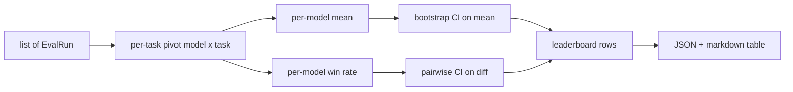
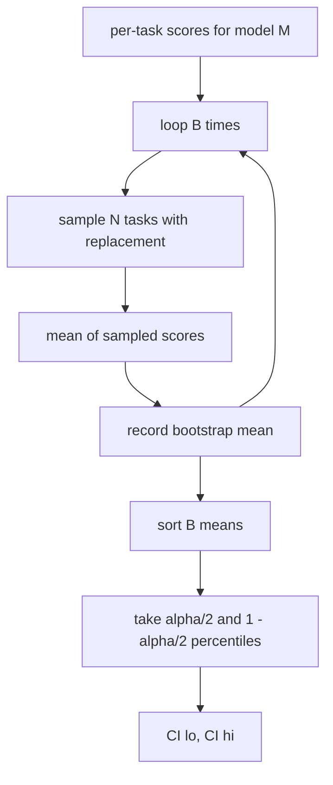

# Leaderboard Aggregation

> Các điểm theo tác vụ dễ. Xếp hạng theo mô hình trên các tác vụ không đồng nhất khó hơn. Ý nghĩa thống kê trên một bảng xếp hạng nghìn dự đoán là phần mọi người bỏ qua. Bài này không bỏ qua nó.

**Type:** Build
**Languages:** Python
**Prerequisites:** Phase 19 Track B foundations, lessons 70, 71, 73
**Time:** ~90 min

## Learning objectives

- Tổng hợp các điểm theo tác vụ trên nhiều mô hình và nhiều tác vụ thành một hàng gọn gàng theo mô hình.
- Chuẩn hóa các điểm không đồng nhất để các tỷ lệ đạt và giá trị BLEU không ảnh hưởng quá mức đến tổng hợp.
- Xếp hạng các mô hình theo trung bình và theo tỷ lệ thắng, và giải thích khi nào mỗi cách là tóm tắt đúng.
- Tính các khoảng tin cậy bootstrap trên điểm trung bình theo mô hình và trên các chênh lệch từng cặp.
- Xuất bảng xếp hạng như một báo cáo JSON và như một bảng markdown mà trình chạy trong bài 75 có thể dán vào một bình luận CI.

```figure
ci-leaderboard-ci
```

## The shape of input

Bộ tổng hợp tiêu thụ một danh sách bản ghi `EvalRun`:

```python
@dataclass
class EvalRun:
    model_id: str
    task_id: str
    metric_name: str
    score: float          # in [0, 1]
    category: str
```

Trình chạy trong bài 75 phát ra một bản ghi mỗi cặp `(model, task)`. Bộ tổng hợp không quan tâm điểm được tạo ra thế nào. Nó kỳ vọng chuẩn hóa đã xảy ra: mọi điểm nằm trong `[0, 1]`.

## The output

Ba bảng đi ra:



Hàng bảng xếp hạng chứa: `model_id`, `mean_score`, `mean_ci_lo`, `mean_ci_hi`, `win_rate`, `tasks_completed`, và một ánh xạ `categories` tùy chọn cho trung bình theo hạng mục.

## Normalisation

Nếu một tác vụ chấm trong `[0, 1]` và tác vụ khác trong `[0, 100]`, cái thứ hai âm thầm chi phối trung bình. Bộ tổng hợp xác thực mọi điểm đầu vào nằm trong `[0, 1]` và từ chối lần chạy nếu không. Cách sửa nằm ở thượng nguồn: chỉ số nên đã trả về một tỷ lệ. Các bài 71 đến 73 thực thi hợp đồng đó.

## Mean and win-rate

Hai sơ đồ xếp hạng phục vụ các mục tiêu khác nhau.

Điểm trung bình là trung bình các điểm theo tác vụ cho một mô hình. Nó là con số chính các bảng xếp hạng báo cáo. Nó nhạy với các giá trị ngoại lai và sự mất cân bằng tác vụ.

Tỷ lệ thắng đếm tần suất một mô hình vượt mọi mô hình khác trên cùng tác vụ. Với mỗi tác vụ, mô hình có điểm cao nhất thắng (hòa chia đều). Tỷ lệ thắng bằng số thắng chia cho số tác vụ mà mô hình có điểm. Nó ít nhạy với các giá trị ngoại lai và khác biệt thang đo hơn nhưng mất thông tin.

```python
def win_rate(model_id, runs_by_task, all_models):
    wins, total = 0, 0
    for task_id, runs in runs_by_task.items():
        scores = {r.model_id: r.score for r in runs if r.model_id in all_models}
        if model_id not in scores:
            continue
        total += 1
        best = max(scores.values())
        if scores[model_id] >= best:
            wins += 1
    return wins / total if total else 0.0
```

Harness báo cáo cả hai. Trình chạy trong bài 75 mặc định xếp theo trung bình; cột markdown cho tỷ lệ thắng ở ngay đó nếu người dùng thích nó.

## Bootstrap confidence intervals

Các trung bình theo mô hình đi kèm một khoảng tin cậy được ước lượng bằng lấy mẫu lại bootstrap trên các tác vụ. Chúng ta lấy mẫu lại các id tác vụ có hoàn lại, tính trung bình trên tập được lấy mẫu lại, lặp `B` lần, và lấy khoảng phân vị ở mức `alpha`.



Với các so sánh từng cặp chúng ta bootstrap chênh lệch theo tác vụ `score_A - score_B`, lấy khoảng phân vị, và báo cáo nó. Người dùng đọc xem khoảng có loại trừ không không. Nếu có, chênh lệch có ý nghĩa ở mức alpha. Nếu không, bảng xếp hạng coi các mô hình hòa.

Các hàm hỗ trợ cấp thấp (`bootstrap_mean_ci`, `bootstrap_pairwise_diff`) mặc định `B=1000`; các bộ tổng hợp công khai (`aggregate`, `pairwise_diffs`) mặc định `b=500` để demo và kiểm thử giữ nhanh. Alpha mặc định là 0.05. Bài học giữ bootstrap numpy thuần, không scipy.

## Categories

Nếu `EvalRun.category` được đặt, bộ tổng hợp cũng báo cáo trung bình theo hạng mục. Đây là cột trên mọi bảng xếp hạng nói `math`, `reasoning`, `code`, `safety`. Nó để trình chạy phát hiện liệu một mô hình tốt tổng thể nhưng yếu về mã không, là thông tin trung bình chính che giấu.

## Markdown rendering

Bảng xếp hạng được kết xuất như một bảng markdown:

```text
| Rank | Model | Mean | 95% CI | Win rate | Tasks |
|------|-------|------|--------|----------|-------|
| 1    | gpt   | 0.78 | 0.74-0.82 | 0.62 | 50 |
| 2    | claude| 0.75 | 0.71-0.79 | 0.34 | 50 |
| 3    | random| 0.10 | 0.07-0.13 | 0.04 | 50 |
```

Bảng được sắp theo điểm trung bình. CI được hiển thị đến hai chữ số thập phân. Các id mô hình dài bị cắt ở hai mươi ký tự.

## What this lesson does not do

Nó không chạy các mô hình. Nó không gọi lớp chỉ số. Nó không triển khai ECE thích ứng hoặc các biến thể hiệu chuẩn khác; đó là bài 73. Nó không triển khai trọng số tác vụ. Mọi tác vụ được tính như nhau ở đây. Các bảng xếp hạng sản xuất đặt trọng số tác vụ; chúng ta để hook đó mở qua trường `weight` nhưng bỏ qua nó trong bộ tổng hợp. Thêm trọng số trong một bài tiếp nối nếu bạn cần.

## How to read the code

`main.py` định nghĩa `EvalRun`, `LeaderboardRow`, `aggregate`, `bootstrap_mean_ci`, `bootstrap_pairwise_diff`, và `render_markdown`. Demo xây dựng một bộ tổng hợp gồm ba mô hình và mười hai tác vụ, tổng hợp, và in bảng xếp hạng cùng bảng diff từng cặp. Các kiểm thử trong `code/tests/test_leaderboard.py` ghim bootstrap, kết xuất markdown, các trường hợp biên tỷ lệ thắng, và hành vi đầu vào rỗng.

Đọc `main.py` từ trên xuống dưới. Hình thức dữ liệu (EvalRun, LeaderboardRow) đến trước, bộ tổng hợp tiếp theo, bootstrap thứ ba, kết xuất cuối. Mỗi hàm có một hợp đồng tập trung.

## Going further

Bước tiếp theo tự nhiên là ý nghĩa tác vụ ghép cặp thay vì bootstrap không ghép cặp. Nếu mô hình A và B đều chạy cùng một trăm tác vụ, kiểm định thích hợp là bootstrap ghép cặp trên các chênh lệch từng tác vụ, điều chúng ta triển khai. Xa hơn, bạn muốn một bootstrap phân cấp tôn trọng các họ tác vụ (các bài toán không độc lập với nhau; một mẫu lỗi số học ảnh hưởng mười bài). Đó là một phần tiếp nối. Điểm chính của bài này là làm đúng mức sàn để đánh giá báo cáo một con số bạn có thể bảo vệ.
