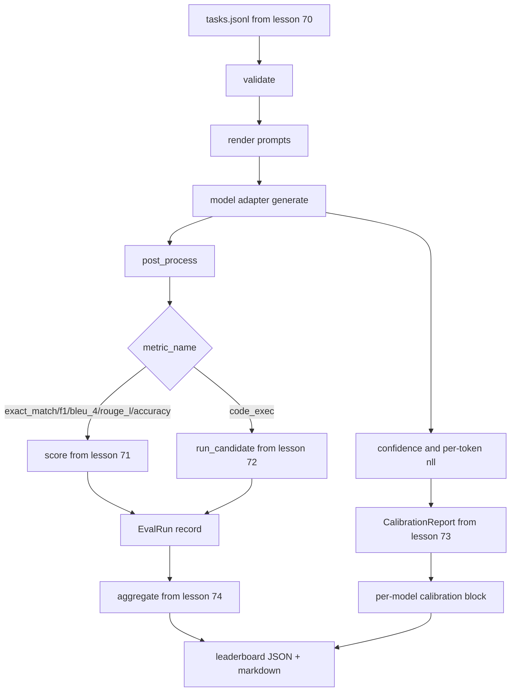

# End-to-End Eval Runner

> Năm bài về hệ thống nối, một bài để gắn chúng. Trình chạy đọc đặc tả tác vụ từ bài 70, gọi một mô hình qua một adapter, chấm bằng các bài 71 và 72, gắn báo cáo hiệu chuẩn từ bài 73, và phát ra bảng xếp hạng từ bài 74. Demo tự kết thúc.

**Type:** Build
**Languages:** Python
**Prerequisites:** Phase 19 Track B foundations, lessons 70 through 74
**Time:** ~90 min

## Learning objectives

- Định nghĩa một giao diện `ModelAdapter` mà bất kỳ mô hình nào (giả lập, cục bộ, API) có thể đáp ứng với một bề mặt phương thức nhỏ.
- Chạy đánh giá trên một file JSONL fixture với thực thi tác vụ song song trên một nhóm worker.
- Kết hợp lớp chỉ số (exact_match, F1, BLEU-4, ROUGE-L, code_exec) với lớp hiệu chuẩn trong một lượt.
- Phát ra các bản ghi `EvalRun` theo mô hình và cấp chúng thẳng vào bộ tổng hợp bảng xếp hạng.
- Xuất cả một báo cáo JSON và một bảng markdown; tự kết thúc với mã thoát không trên một lần chạy sạch, khác không khi xác thực hoặc runtime thất bại.

```figure
eval-grid
```

## The pipeline



Trình chạy là điểm tích hợp. Mỗi bài 70 đến 74 sở hữu một module mà trình chạy kết hợp. Trình chạy không sao chép bất kỳ logic nào từ những module đó: nó import chúng.

## The adapter interface

Adapter là chỗ nối giữa trình chạy và bất kỳ mô hình nào. Giao diện cố ý nhỏ.

```python
class ModelAdapter:
    model_id: str

    def generate(self, prompt: str, task: TaskSpec) -> Generation: ...
```

`Generation` là một dataclass với:

- `text`: đầu ra dạng tự do của mô hình
- `confidence`: một float trong `[0, 1]` đại diện xác suất mô hình tự báo cáo cho đáp án
- `token_nll`: tổng log hợp lý âm tùy chọn trên các token được sinh
- `token_count`: số token được sinh tùy chọn

Các adapter giả lập trong trình chạy cung cấp ba kiểu: `RuleBasedAdapter` (tất định, gần hoàn hảo), `NoisyAdapter` (quá tự tin, thường sai), và `BiasedAdapter` (giỏi một hạng mục, tệ ở một hạng mục khác). Demo chạy cả ba trên fixture bài 70.

## Parallel execution

Trình chạy dùng `concurrent.futures.ThreadPoolExecutor` để chạy các tác vụ song song theo mô hình. Số worker mặc định là giá trị nhỏ hơn giữa tám và số tác vụ. Các luồng đủ vì nút thắt cho các lệnh gọi mô hình thực là I/O mạng. Đường thực thi mã tạo tiến trình con riêng bên trong tác vụ và bộ thực thi chỉ lập lịch việc đợi.

Cho các kiểm thử tất định, trình chạy cung cấp `run_eval(adapters, tasks, parallel=False)` để kiểm thử có thể ghim thứ tự thực thi.

## The single-pass scoring loop

Với mỗi tác vụ:

1. Kết xuất prompt (tiền tố few-shot cộng thân prompt).
2. Gọi adapter và đo thời gian lệnh gọi.
3. Hậu xử lý phần sinh theo quy tắc tác vụ.
4. Điều phối đến lớp chỉ số.
5. Xây dựng một bản ghi `EvalRun` với điểm và siêu dữ liệu chỉ số.
6. Thêm cặp `(confidence, correct)` vào bộ đệm hiệu chuẩn.

Tín hiệu `correct` là `score >= 1.0` cho các chỉ số kiểu exact_match (`exact_match`, `accuracy`, `code_exec`) và `score >= 0.5` cho các chỉ số phân bậc. Ngưỡng nằm trong `_correct_from_score` và trình chạy không cung cấp một ghi đè công khai.

## Aggregation

Sau khi mọi tác vụ có kết quả, trình chạy gọi `aggregate` và `pairwise_diffs` từ bài 74 và `CalibrationReport.from_predictions` từ bài 73. Đầu ra là một phong bì JSON duy nhất:

```json
{
  "leaderboard": [...],
  "pairwise": [...],
  "calibration": {
    "model_id_a": {"ece": 0.04, "brier": 0.10, "populated_bins": 8, ...},
    ...
  },
  "summary": {
    "tasks": 10,
    "models": 3,
    "wall_seconds": 1.2
  }
}
```

Trình chạy cũng ghi một bảng markdown vào stdout để người dùng có thể dán kết quả vào một lần rà soát PR.

## Self-terminating demo

Demo chạy ba adapter giả lập trên mười tác vụ fixture từ bài 70. Thời gian thực nên nằm dưới mười giây. Mã thoát là không trên một lần chạy sạch.

Các tiêu chí lần chạy sạch là:

- Mọi tác vụ được xác thực theo bài 70.
- Mọi tác vụ được chấm theo các bài 71 và 72.
- Báo cáo hiệu chuẩn được tổng hợp theo bài 73 không có lỗi.
- Bảng xếp hạng xếp adapter dựa trên quy tắc cao hơn nghiêm ngặt so với adapter ngẫu nhiên.

Nếu bất kỳ điều nào trong số đó hỏng, trình chạy thoát khác không với một lỗi có cấu trúc trong phong bì JSON.

## What this lesson does not do

Nó không gọi một mô hình thực. Nó không triển khai một luồng khóa API hoặc xử lý giới hạn tốc độ. Nó không triển khai truyền luồng hoặc sinh một phần; adapter trả về một phần sinh mỗi lệnh gọi. Nó không làm thử lại hoặc lưu đệm. Những mối quan tâm đó nằm ở lớp adapter; trình chạy độc lập với chỉ số và nhà cung cấp.

## How to read the code

`main.py` là sự tích hợp. Nó import từ năm module bài khác qua một hàm hỗ trợ `_load_sibling` nhỏ phân giải chúng theo đường dẫn tương đối. Các dataclass `Generation`, `EvalReport`, và `ModelAdapter` được định nghĩa cục bộ. Các adapter giả lập ở cuối file.

Đọc `main.py` từ trên xuống dưới. Lướt các import, rồi xem `run_eval`, rồi `_score_one`, rồi các adapter. Demo ở cuối là điểm vào.

Các kiểm thử trong `code/tests/test_runner.py` ghim giao diện adapter, vòng lặp một lượt, tương đương song song-so-với-tuần-tự, bộ đệm hiệu chuẩn, và hình thức phong bì JSON.

## Going further

Trình chạy này là mức sàn. Một hệ thống đánh giá sản xuất thêm: một bộ nhớ đệm kết quả được đặt khóa theo `(task_id, model_id, model_version)`, một sổ cái chi phí theo dõi đô la và token mỗi lần chạy, một lớp thử lại lùi khi gặp giới hạn tốc độ, một chính sách lấy mẫu cho các tác vụ pass-at-k, và một định dạng đầu ra truyền luồng cho các bộ dài. Mỗi thứ là một mối quan tâm duy nhất bọc trình chạy mà không thay đổi các lớp chỉ số hoặc tổng hợp. Sự tách biệt đó là điểm chính của hợp đồng.

Thêm một adapter cho một nhà cung cấp thực sau khi bạn có các giả lập hoạt động. Chọn một nhà cung cấp có tầng miễn phí, viết ba mươi dòng kết nối, xem bảng xếp hạng sáng lên. Rồi thêm nhà cung cấp thứ hai và để harness làm việc.
