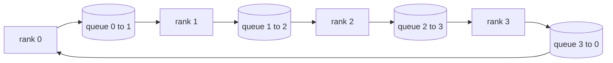

# Collective Ops From Scratch

> Bốn phép tập thể giữ huấn luyện phân tán với nhau là allreduce, broadcast, allgather, và reduce_scatter. Mọi thành phần cơ sở khác một framework huấn luyện cung cấp là một lớp bọc quanh chúng. Xây dựng chúng một lần trên một mạng lưới `multiprocessing.Queue`, xác minh chúng với một triển khai tham chiếu, và phần còn lại của track trở thành hệ thống nối.

**Type:** Build
**Languages:** Python
**Prerequisites:** Phase 19 Track C lessons 42-49
**Time:** ~90 min

## Learning Objectives

- Triển khai allreduce vòng trong hai lượt (reduce-scatter rồi allgather) và chứng minh lượng giao tiếp theo rank là 2(N-1)/N byte mỗi phần tử.
- Xây dựng broadcast, allgather, và reduce_scatter trên các lần gửi điểm-đến-điểm qua `multiprocessing.Queue`.
- Xác minh mọi thành phần cơ sở với một tham chiếu gloo `torch.distributed` cho cùng đầu vào.
- Bảo vệ lựa chọn vòng so với cây theo hình thức cụm, sàn độ trễ, và trần băng thông.

## The Problem

Một allreduce ngây thơ trên N rank gửi N lần tensor đến một gốc và broadcast N lần trở lại. Băng thông tăng theo $O(N)$ trên mỗi rank, gốc trở thành nút thắt và sàn thời gian thực là liên kết chậm nhất nhân N. Ring allreduce làm phẳng điều đó thành $2(N-1)$ chunk kích thước $T/N$, nên số byte theo rank giảm xuống $2T(N-1)/N$, tiến tới $2T$ khi N tăng và không bao giờ vượt nó, bất kể kích thước cụm. Tree allreduce thắng với N nhỏ và các liên kết độ trễ cao vì chiều sâu là $\log_2(N)$ hop thay vì $2(N-1)$. Chọn sai topology cho hình dạng cụm và GPU chậm nhất quyết định thời gian bước.

Mọi framework huấn luyện phân tán bạn sẽ đọc trong track này phụ thuộc vào bốn thành phần cơ sở này. PyTorch DDP đồng bộ các gradient bằng một allreduce mỗi nhóm tham số. ZeRO chia shard trạng thái bộ tối ưu bằng reduce_scatter và phát quảng bá các tham số được cập nhật bằng allgather. FSDP biến toàn lượt tiến thành allgather cộng reduce_scatter. Song song pipeline cần broadcast cho các kích hoạt giữa các nhóm giai đoạn. Nếu bạn không thể triển khai bốn phép tập thể, bạn không thể suy luận về tại sao huấn luyện đình trệ, tại sao sự không khớp gradient xuất hiện ở rank 3, hoặc tại sao bong bóng pipeline tăng gấp đôi khi bạn đổi cấu trúc liên kết.

## The Concept



### Ring allreduce in two passes

Chia tensor thành N đoạn bằng nhau được đánh chỉ mục 0..N-1. Mỗi rank sở hữu chỉ số đoạn bằng rank của nó. Lượt 1, reduce-scatter, chạy N-1 bước. Tại bước s, rank r gửi đoạn (r - s) mod N đến rank (r + 1) mod N và nhận đoạn (r - s - 1) mod N từ rank (r - 1) mod N, tích lũy đoạn nhận được vào bản sao cục bộ. Sau N-1 bước, rank r sở hữu tổng đầy đủ cho đoạn r. Lượt 2, allgather, chạy thêm N-1 bước và xoay các đoạn hoàn tất quanh vòng cho đến khi mọi rank giữ tổng đầy đủ cho mọi đoạn.

| Thành phần cơ sở | Byte theo rank | Bước | Khi nào dùng |
|-----------|---------------|-------|-------------|
| Allreduce vòng | 2T(N-1)/N | 2(N-1) | T lớn, cụm đồng nhất đường truyền rộng |
| Allreduce cây | T log2(N) | 2 log2(N) | T nhỏ hoặc các liên kết độ trễ cao |
| Broadcast | T | cây log2(N) | Khởi tạo tham số, cấu hình vô hướng |
| Allgather | T(N-1)/N | N-1 | Lượt tiến chia shard, bỏ chia shard ZeRO |
| Reduce_scatter | T(N-1)/N | N-1 | Chia shard gradient ZeRO |

### Queue mesh as a stand-in for NCCL

NCCL chạy trên PCIe và NVLink với các phép rút gọn được chuyển tải phần cứng. Trên CPU bạn không có điều đó. Một `multiprocessing.Queue` mỗi cạnh vòng cho bạn chuyển giao điểm-đến-điểm có thứ tự với một bên tạo và một bên tiêu thụ. Rút gọn xảy ra trong không gian người dùng, nên bạn trả chi phí phụ Python, nhưng mẫu truyền tin giống hệt allreduce vòng NCCL. Suy luận về tính đúng đắn trên phiên bản hàng đợi và hành vi cụm theo sau.

### Verify against gloo

Mọi thành phần cơ sở đi kèm một kiểm thử đơn vị so sánh đầu ra của nó với `torch.distributed` được khởi tạo bằng backend gloo trên cùng tensor qua cùng kích thước thế giới. Nếu allreduce vòng của bạn phân kỳ khỏi gloo nhiều hơn epsilon float32, kiểm thử thất bại. Xác minh với một triển khai tham chiếu là không thể thương lượng; không có nó thành phần cơ sở trông đúng đến bước 10000 của một lần chạy huấn luyện thực.

```figure
ci-ring-allreduce
```

## Build It

`code/main.py` triển khai:

- Lớp `Mesh` nối N thực thể `multiprocessing.Queue` thành một vòng và cung cấp `send(dst, tensor)` và `recv(src)` theo rank.
- `ring_allreduce(mesh, rank, world_size, tensor)` chạy thuật toán hai lượt.
- `broadcast(mesh, rank, world_size, tensor, src)` trên một cây logarit.
- `allgather(mesh, rank, world_size, tensor)` dùng N-1 lần xoay.
- `reduce_scatter(mesh, rank, world_size, tensor)` như nửa đầu allreduce.
- `_gloo_reference(op, world_size, tensor)` chạy cùng đầu vào qua `torch.distributed` với gloo để so sánh bằng nhau từng byte.

Chạy nó:

```bash
python3 code/main.py
```

Đầu ra: bảng xác minh theo thành phần cơ sở so sánh các đầu ra mạng lưới hàng đợi và gloo, theo sau bởi một bộ đếm byte theo rank chứng minh sự biến thiên 2T(N-1)/N.

## Production patterns in the wild

Ba mẫu gia cố các thành phần cơ sở đủ để cung cấp.

**Chia nhóm gradient trước allreduce.** Một mô hình 1B tham số có hàng chục nghìn tensor gradient. Một allreduce mỗi tensor trả sàn độ trễ N lần. DDP chia gradient thành các đoạn ~25 MB và phát một allreduce mỗi nhóm; các tensor nhỏ đi nhờ các tensor lớn. Không chia nhóm chi phí phụ độ trễ chi phối bước.

**Chồng lấn giao tiếp với tính toán.** Lượt ngược tính các gradient từng lớp theo thứ tự đảo. Ngay khi gradient của lớp cuối sẵn sàng, khởi động allreduce của nó trong khi lớp tiếp theo tiếp tục tính. PyTorch DDP nối điều này bằng các hook nhóm-sẵn-sàng. Chồng lấn giảm một nửa thời gian giao tiếp thấy được khi mạng còn dư.

**Chọn vòng hoặc cây theo kích thước thông điệp, không phải tôn giáo.** NCCL cung cấp một bộ phát hiện cấu trúc liên kết chọn vòng cho các thông điệp trên ~1 MB và cây phía dưới. Điểm giao là băng thông-so-với-độ-trễ: trên 1 MB, số hạng băng thông 2T(N-1)/N chi phối và vòng thắng; dưới 1 MB, số bước nhảy log2(N) thắng. Mã hóa cứng một cấu trúc liên kết tốn thông lượng ở kích thước thông điệp sai.

## Use It

Các mẫu sản xuất:

- **PyTorch DDP.** Gọi `dist.all_reduce` trên các gradient được chia nhóm sau lượt ngược. Kích thước nhóm có thể điều chỉnh; mặc định 25 MB hợp lý cho Ethernet 100Gbit.
- **DeepSpeed ZeRO.** Phát reduce_scatter để chia shard gradient và allgather để tái tạo các tham số đầy đủ trước lượt tiến. Các thành phần cơ sở của bài học chính xác là các lệnh gọi ZeRO thực hiện.
- **FSDP.** Lượt tiến bắt đầu bằng allgather để bỏ chia shard lớp, tính toán, rồi rút gọn bằng reduce_scatter và loại bỏ phần đã bỏ chia shard. Cùng các thành phần cơ sở, lịch khác.

## Ship It

Sử dụng các primitive queue-mesh trong bài 77-81. Bài 77 nối allreduce vào DDP. Bài 78 nối reduce_scatter vào ZeRO. Bài 79 di chuyển activation pipeline bằng send và recv điểm-điểm, không phải một collective. Bài 81 kết hợp cả bốn thành demo đầu cuối.

## Exercises

1. Thêm một biến thể allreduce cây và chuyển giữa vòng và cây theo kích thước thông điệp. Đo điểm giao.
2. Thêm một `recv_timeout_ms` để một rank đình trệ đưa ra một lỗi hạn chót thay vì treo mãi.
3. Thay `multiprocessing.Queue` bằng các socket TCP cho bốn thành phần cơ sở. Cùng các kiểm thử, đường truyền thực.
4. Thêm một hook đo lường băng thông để bộ đếm byte theo rank ghi nhật ký vào JSONL.
5. So sánh thời gian thực của vòng so với cây trên 4 rank cho các tensor kích thước 1KB, 1MB, 16MB. Bảo vệ điểm giao bằng thực nghiệm.

## Key Terms

| Thuật ngữ | Cách mọi người nói | Ý nghĩa thực sự |
|------|----------------|------------------------|
| Allreduce | "Cộng trên các rank" | Sau lệnh gọi mọi rank giữ cùng tensor được rút gọn |
| Ring (Vòng) | "Cấu trúc liên kết nhanh" | N-1 đoạn kích thước T/N chảy quanh chu trình hai lần |
| Tree (Cây) | "Cấu trúc liên kết log" | Rút gọn đi theo một cây nhị phân; độ sâu là log2(N) bước nhảy |
| Allgather | "Nối các shard" | Mọi rank kết thúc với shard của mọi rank khác |
| Reduce_scatter | "Chia tổng" | Mỗi rank kết thúc chỉ với tổng của một đoạn |
| Bucket (Nhóm) | "Hợp nhất các tensor nhỏ" | Gộp N allreduce nhỏ thành một lớn |

## Further Reading

- [PyTorch Distributed: NCCL collectives](https://pytorch.org/docs/stable/distributed.html#collective-functions)
- [Horovod ring allreduce paper](https://arxiv.org/abs/1802.05799)
- [NCCL topology and algorithm selection](https://docs.nvidia.com/deeplearning/nccl/user-guide/docs/index.html)
- [Patarasuk and Yuan, Bandwidth optimal allreduce algorithms](https://www.cs.fsu.edu/~xyuan/paper/09jpdc.pdf)
- Phase 10 Bài 05 - tổng quan huấn luyện phân tán
- Phase 19 Bài 77 - DDP được nối trên các thành phần cơ sở này
