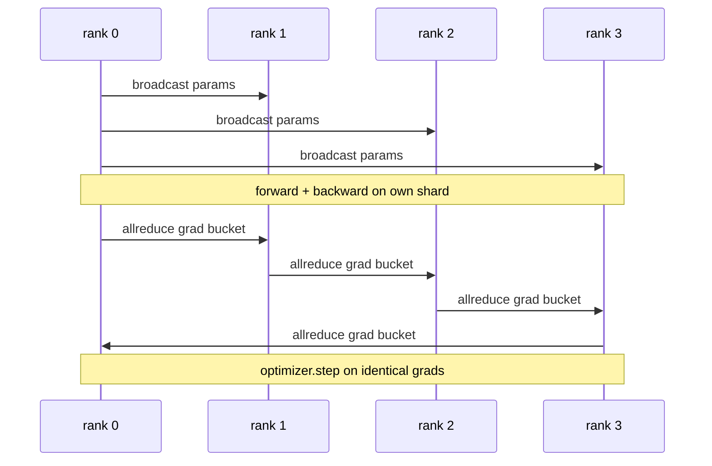

# Data Parallel DDP From Scratch

> DistributedDataParallel là một hook trên allreduce. Bọc một mô hình, phát quảng bá các tham số ban đầu từ rank 0 để mọi rank bắt đầu giống hệt, cài một hook lượt ngược trên mọi tham số phát một allreduce của gradient, và phần còn lại là hạ gradient. Toàn mẫu là 200 dòng.

**Type:** Build
**Languages:** Python
**Prerequisites:** Phase 19 Track C lessons 42-49
**Time:** ~90 min

## Learning Objectives

- Nối một lớp bọc có hình thức `DistributedDataParallel` phát quảng bá các tham số ban đầu và allreduce các gradient sau lượt ngược.
- Tạo N rank CPU bằng `torch.multiprocessing.spawn` trên backend gloo với điểm hẹn dựa trên file.
- Chứng minh tính đúng đắn đồng bộ gradient bằng huấn luyện cùng mô hình trên cùng dữ liệu tuần tự và cho thấy tương đương tham số theo bước.
- Bảo vệ việc dùng nhóm (hợp nhất gradient) và chồng lấn (giao tiếp trong lượt ngược) như hai thay đổi biến một DDP hoạt động thành một DDP sản xuất.

## The Problem

Một mô hình 1 tỷ tham số với 12 GB kích hoạt không vừa trên một GPU tiêu dùng. Ngay cả khi vừa, huấn luyện mất nhiều tuần. Song song dữ liệu chia lô trên N rank, mỗi rank tính lượt tiến và ngược trên shard của nó, và ở mọi bước các gradient của mọi rank được cộng để cả N bản sao giữ giống hệt. Gradient được cộng là thứ bộ tối ưu thực hiện bước trên.

Không đồng bộ gradient, N bản sao phân kỳ ở bước 2. Mô hình không còn là "một mô hình được huấn luyện trên nhiều dữ liệu hơn", nó là N mô hình riêng tình cờ dùng chung trọng số ban đầu. Với đồng bộ gradient làm tệ (một allreduce mỗi tham số, không chồng lấn, không chia nhóm) mạng là nút thắt và các GPU nhàn rỗi đợi đường truyền. Kỹ nghệ DDP là làm đồng bộ gradient gần như miễn phí tương đối với tính toán. PyTorch DDP chuẩn đạt điều đó bằng chia nhóm gradient, chồng lấn allreduce với lượt ngược lớp tiếp theo, và dùng NCCL trên NVLink. Chúng ta có thể làm cả ba trên CPU với gloo và học cùng bài học.

## The Concept



### The three operations DDP needs

| Giai đoạn | Phép tập thể | Tại sao |
|-------|-----------|-----|
| Khởi tạo | broadcast từ rank 0 | Mọi rank bắt đầu với cùng các tham số |
| Sau lượt ngược | allreduce của mỗi gradient | Gradient trung bình là thứ bộ tối ưu thực hiện bước trên |
| Đôi khi | broadcast các buffer | Các thống kê đang chạy Batchnorm giữ đồng bộ |

### Why mean and not sum

Allreduce-SUM chia cho world_size cho gradient trung bình. Trung bình bất biến với world_size: một tốc độ học được điều chỉnh ở một rank hoạt động ở bốn rank vì độ lớn gradient theo bước không đổi. Allreduce-SUM không có phép chia buộc bạn điều chỉnh lại tốc độ học mỗi khi đổi kích thước cụm. DDP bọc SUM và chia; làm tương tự trong bài học.

### Why bucket gradients

Một transformer có hàng nghìn tensor tham số. Một allreduce mỗi tensor trả sàn độ trễ gloo hàng nghìn lần. DDP nhóm gradient thành các nhóm ~25 MB và phát một allreduce mỗi nhóm. Cùng tổng byte di chuyển trên đường truyền nhưng độ trễ được phân bổ trên nhóm. Với mô hình tí hon của bài học chúng ta nhóm mọi thứ vào một nhóm; cấu trúc là thứ chuyển giao.

### Why pin the seed

Mỗi rank phải gọi `torch.manual_seed(seed + rank)` để xáo trộn nhưng `torch.manual_seed(seed)` để khởi tạo tham số. Một seed dùng chung duy nhất để xáo trộn nghĩa là mọi rank thấy cùng thứ tự batch (làm mất tác dụng data parallel). Với tham số, broadcast từ rank 0 lúc xây dựng là điều khiến các bản sao giống hệt và nó ghi đè bất cứ thứ gì mỗi rank đã khởi tạo. Seed khởi tạo dùng chung là dự phòng: nếu broadcast bị bỏ qua hoặc hỏng, khởi tạo đặc thù rank cho mỗi bản sao trọng số khởi đầu khác nhau, và chỉ đồng bộ gradient không bao giờ kéo chúng lại với nhau. Làm đúng mẫu seed hoặc bài kiểm tra tính tương đương tham số thất bại ở bước 1.

```figure
ci-ddp-grad-sync
```

## Build It

`code/main.py` triển khai:

- `MiniMLP`: một MLP 3 lớp đủ nhỏ để hội tụ trong vài giây, đủ lớn để lộ hệ thống nối.
- `DistributedDataParallel(model, world_size)`: phát quảng bá tham số khi khởi tạo, trả về một lớp bọc có `sync_grads` chia các gradient tích lũy được cộng bằng allreduce cho world_size.
- `worker(rank, world_size, ...)`: vòng lặp huấn luyện đầy đủ với khởi tạo `torch.distributed` trên gloo, lượt tiến, lượt ngược, đồng bộ, bước.
- `_reference_single_process_loop(...)`: huấn luyện cùng mô hình trên cùng dữ liệu tuần tự trên một rank, được kiểm thử dùng cho tương đương tham số bằng nhau từng byte sau mỗi bước.

Chạy nó:

```bash
python3 code/main.py
```

Đầu ra: một bảng huấn luyện theo bước so sánh mất mát và checksum tham số một tiến trình với lần chạy DDP trên 4 rank. Hai đường tạo các đường cong mất mát giống hệt trong epsilon float, chứng minh đồng bộ gradient chính xác.

## Production patterns in the wild

Ba mẫu gia cố DDP đủ để cung cấp.

**Tìm các tham số không dùng.** Một số đường lượt tiến bỏ qua các tham số theo điều kiện (thoát sớm, bộ định tuyến mixture-of-experts). Các tham số bị bỏ không có gradient, nhưng hook nhóm-sẵn-sàng của DDP vẫn đợi chúng và allreduce deadlock. `find_unused_parameters=True` nói DDP xem các tham số nào có gradient trước khi rút gọn. Chi phí là một phép duyệt đồ thị mỗi bước, nên để tắt trừ khi lượt tiến của bạn phân nhánh.

**Tối ưu đồ thị tĩnh.** Khi lượt tiến ổn định qua các bước, `static_graph=True` để DDP tính trước lịch nhóm. Tối ưu quan trọng ở quy mô lớn: tính trước tiết kiệm vài ms mỗi bước cộng dồn qua 10000 bước.

**Tích lũy gradient cần cẩn thận.** Tích lũy gradient trên K lô vi mô mà không đồng bộ mỗi lô là một lợi ích thông lượng 10x. DDP cung cấp `no_sync()` như một trình quản lý ngữ cảnh tạm dừng allreduce sau lượt ngược. Quên trình quản lý và bạn allreduce K lần không vì gì; thông lượng rơi xuống sàn.

## Use It

Các mẫu sản xuất:

- **PyTorch DDP.** Triển khai chuẩn. `torch.nn.parallel.DistributedDataParallel(model)` nối chia nhóm, chồng lấn, và ngữ cảnh no_sync.
- **HuggingFace Accelerate.** Thêm một trình khởi chạy xử lý các biến môi trường `torchrun` và bọc mô hình. Cùng DDP bên dưới.
- **Song song dữ liệu Megatron-LM.** Kết hợp DDP với song song tensor cho các mô hình lớn; phần song song dữ liệu là cùng mẫu allreduce-sau-lượt-ngược.

## Ship It

Bài 78 (chia shard ZeRO) thay allreduce theo tham số bằng reduce_scatter để mỗi rank chỉ lưu shard trạng thái bộ tối ưu của nó. Bài 81 kết hợp DDP với ZeRO vào demo đầu cuối.

## Exercises

1. Thêm các nhóm gradient kích thước có thể cấu hình và đo mức tăng tốc so với một-allreduce-mỗi-tham-số trên một mô hình sâu hơn.
2. Triển khai `no_sync()` như một trình quản lý ngữ cảnh và xác minh tích lũy gradient khớp một đường cơ sở một tiến trình trên K lô vi mô.
3. Thêm một chế độ `find_unused_parameters` mà lượt tiến đôi khi bỏ một trong các lớp MLP; không có cờ lần chạy nên deadlock.
4. Thay gloo bằng đồng bộ chỉ-`torch.distributed.barrier()` để cảm nhận khác biệt giữa đồng bộ dựa trên allreduce và dựa trên barrier.
5. Đo chi phí phụ đồng bộ gradient như một tỷ lệ thời gian bước cho các kích thước lô 1, 16, 256 và giải thích sự biến thiên.

## Key Terms

| Thuật ngữ | Cách mọi người nói | Ý nghĩa thực sự |
|------|----------------|------------------------|
| DDP | "Song song dữ liệu" | Lớp bọc phát quảng bá tham số và allreduce gradient mỗi bước |
| Bucket (Nhóm) | "Hợp nhất gradient" | Nhóm N allreduce nhỏ thành một lớn |
| Overlap (Chồng lấn) | "Ẩn giao tiếp" | Phát allreduce trong khi các lớp sau vẫn đang tính lượt ngược |
| no_sync | "Tích lũy" | Bỏ allreduce sau lượt ngược cho tích lũy gradient |
| find_unused | "Lượt tiến phân nhánh" | Phát hiện các tham số không có gradient trước khi rút gọn |

## Further Reading

- [PyTorch DistributedDataParallel docs](https://pytorch.org/docs/stable/generated/torch.nn.parallel.DistributedDataParallel.html)
- [PyTorch DDP internals tutorial](https://pytorch.org/tutorials/intermediate/ddp_tutorial.html)
- [Li et al, PyTorch Distributed: Experiences on Accelerating Data Parallel Training](https://arxiv.org/abs/2006.15704)
- Phase 19 Bài 76 - các phép tập thể mà DDP được xây trên
- Phase 19 Bài 78 - chia shard ZeRO thay allreduce theo tham số bằng reduce_scatter
