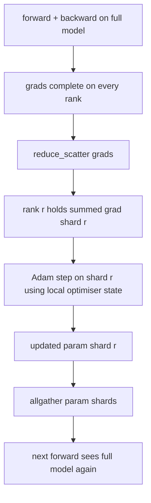

# ZeRO Optimizer State Sharding

> Adam lưu hai ước lượng mômen mỗi tham số, cả hai trong float32. Một mô hình 7B tham số mang 56 GB trạng thái bộ tối ưu. ZeRO giai đoạn 1 chia shard nó trên N rank; mỗi rank sở hữu 1/N bộ tối ưu. Sau bước cục bộ các shard tham số được cập nhật phát quảng bá trở lại, mọi rank tái tạo mô hình đầy đủ, và bước tiếp theo bắt đầu. Lợi ích là giảm bộ nhớ tuyến tính trên phần cấp phát đơn lẻ lớn nhất trong ngăn xếp huấn luyện.

**Type:** Build
**Languages:** Python
**Prerequisites:** Phase 19 Track C lessons 42-49
**Time:** ~90 min

## Learning Objectives

- Chia shard trạng thái bộ tối ưu (mômen thứ nhất, mômen thứ hai, bản sao chính fp32) trên N rank để mỗi rank sở hữu 1/N.
- Dùng reduce_scatter để chỉ đưa cho mỗi rank tổng gradient shard của nó, rồi allgather để phát quảng bá các shard tham số được cập nhật trở lại.
- Tính bảng tiết kiệm bộ nhớ cho giai đoạn 1, giai đoạn 2, giai đoạn 3 so với DDP thông thường.
- Bảo vệ lựa chọn giai đoạn 1 so với giai đoạn 2 so với giai đoạn 3 theo kích thước mô hình và ngân sách băng thông.

## The Problem

DDP nguyên bản sao chép mọi thứ: tham số, gradient và trạng thái optimizer hiện diện đầy đủ trên mọi rank. Với một mô hình 7B tham số ở fp16, điều đó nghĩa là 14 GB tham số, 14 GB gradient và 56 GB trạng thái optimizer (hai moment Adam float32) trên mỗi rank. Huấn luyện mixed-precision thêm một bản sao master float32 28 GB của trọng số ở trên. Trạng thái optimizer là số hạng lớn nhất và dễ phân shard nhất vì nó chỉ được chạm tới trong bước cập nhật, không trong forward hay backward.

ZeRO giai đoạn 1 chia shard trạng thái bộ tối ưu. Mỗi rank giữ 1/N các mômen Adam. Sau lượt ngược, thay vì allreduce gradient đầy đủ và thực hiện bước cục bộ, ZeRO reduce_scatter để mỗi rank chỉ nhận gradient được cộng của shard nó. Rank áp dụng bước bộ tối ưu lên shard tham số chính của nó. Các shard tham số được cập nhật sau đó allgather trở lại để mọi rank có mô hình đầy đủ cho lượt tiến tiếp theo. Bộ nhớ bộ tối ưu giảm theo N. Lưu lượng truyền tin mỗi bước giống DDP: một reduce_scatter cộng một allgather bằng một allreduce về băng thông. Bộ nhớ thắng, thông lượng giữ.

## The Concept



### Stages of ZeRO

| Giai đoạn | Thứ được chia shard | Bộ nhớ mỗi rank | Giao tiếp mỗi bước |
|-------|----------------|------------------|---------------|
| DDP | không gì | params + grads + optim | 1x allreduce |
| ZeRO-1 | trạng thái bộ tối ưu | params + grads + optim/N | 1x reduce_scatter + 1x allgather |
| ZeRO-2 | optim + grads | params + grads/N + optim/N | 1x reduce_scatter + 1x allgather |
| ZeRO-3 | optim + grads + params | params/N + grads/N + optim/N | 1x allgather mỗi lớp + 1x reduce_scatter mỗi lớp |

Giai đoạn 1 là lợi ích rẻ nhất vì trạng thái bộ tối ưu chi phối ngân sách. Giai đoạn 2 cần logic tích lũy shard gradient nhưng băng thông giống nhau. Giai đoạn 3 (FSDP) trả giao tiếp theo lớp cho mọi lượt tiến và ngược, nhận mức giảm bộ nhớ shard tham số. Bài học triển khai đầy đủ giai đoạn 1.

### The memory math, real numbers

Với một mô hình P tham số được huấn luyện bằng Adam ở độ chính xác hỗn hợp:

| Số hạng | Thông thường | ZeRO-1 | Tại sao |
|------|---------|--------|-----|
| tham số fp16 | 2P byte | 2P byte | cần cho lượt tiến |
| gradient fp16 | 2P byte | 2P byte | cần cho lượt ngược |
| bản sao chính fp32 | 4P byte | 4P/N byte | chỉ bộ tối ưu dùng nó |
| mômen thứ nhất fp32 | 4P byte | 4P/N byte | chỉ bộ tối ưu dùng nó |
| mômen thứ hai fp32 | 4P byte | 4P/N byte | chỉ bộ tối ưu dùng nó |
| Tổng | 16P byte | 4P + 12P/N byte |   |

Tại N=8: thông thường 16P, ZeRO-1 5.5P, giảm 65%. Tại N=64: thông thường 16P, ZeRO-1 4.19P, giảm 74%.

### Why reduce_scatter beats allreduce-then-shard

Allreduce cho mọi rank gradient được cộng đầy đủ. Nếu bạn chỉ cần shard r, (N-1)/N gradient đã được rút gọn bị lãng phí trên rank r. Reduce_scatter đưa chính xác shard mỗi rank sở hữu; các byte theo rank giống allreduce (vì allreduce là reduce_scatter + allgather) nhưng nửa thứ hai được thay bằng allgather shard tham số sau đó. Tổng truyền tin giống hệt DDP, bộ nhớ được chia.

```figure
cd-zero-shard
```

## Build It

`code/main.py` triển khai:

- `flatten_params(module)` và `unflatten_into(module, flat)` đóng gói các tham số của một mô hình vào một tensor liên tục và tháo gói lại. Bố cục phẳng là thứ khiến chia shard theo rank là một phần cắt đơn giản.
- `ZeroOptimizer(model, world_size, rank, lr)` sở hữu shard của rank cho bản sao chính và các mômen Adam.
- `step()` chạy reduce_scatter trên gradient phẳng, áp dụng Adam cho shard của rank, và allgather các tham số được cập nhật trở lại.
- Một demo huấn luyện một MLP 3 lớp trong 20 bước và in ngân sách bộ nhớ theo bước cạnh một đường cơ sở DDP thông thường.

Chạy nó:

```bash
python3 code/main.py
```

Đầu ra: mất mát theo bước và bảng bộ nhớ cho thấy ZeRO-1 giữ 1/N trạng thái bộ tối ưu trên mỗi rank so với bản sao đầy đủ của DDP.

## Production patterns in the wild

Ba mẫu gia cố ZeRO đủ để cung cấp.

**Checkpoint chia shard quan trọng.** Trạng thái bộ tối ưu của ZeRO-1 được chia giữa các rank; checkpoint phải ghi rank nào sở hữu gì. Bài 80 xây dựng bản kê khai checkpoint chia shard tiếp tục một lần chạy ZeRO trên cùng kích thước thế giới. Không có nó trạng thái được lưu không thể đọc khi khởi động lại.

**Độ chính xác hỗn hợp là điểm chính.** ZeRO là một kỹ thuật độ chính xác hỗn hợp; bản sao chính fp32 là thứ được chia shard. Chạy ZeRO không có độ chính xác hỗn hợp trả thuế bộ nhớ trên bản chính fp32 mà không có lợi ích lượt tiến fp16 tương ứng. Các lần chạy sản xuất luôn ghép ZeRO với autocast hoặc các trọng số bf16.

**Stage 1 là một lợi ích gần như miễn phí.** Giao tiếp giống hệt DDP về băng thông. Tiết kiệm bộ nhớ tuyến tính theo N. Chi phí duy nhất là việc ghi sổ cho shard optimizer. Các ngăn xếp production mặc định stage 1 trừ khi bộ nhớ gradient hoặc tham số cũng là vấn đề. Stage 2 phân shard gradient mà không thêm băng thông; chỉ stage 3 phân shard chính các tham số, và nó đánh đổi giao tiếp theo tầng lấy bộ nhớ đó.

## Use It

Các mẫu sản xuất:

- **DeepSpeed ZeRO.** Triển khai tham chiếu. `deepspeed_config.json` chọn giai đoạn 1/2/3 và các kích thước phân vùng.
- **PyTorch FSDP.** Tương đương bản địa PyTorch. `ShardingStrategy.SHARD_GRAD_OP` là ZeRO-2; `FULL_SHARD` là ZeRO-3.
- **HuggingFace Accelerate.** Bọc cả DeepSpeed và FSDP dưới một cấu hình thống nhất.

## Ship It

Bài 79 (song song pipeline) là trục chia shard trực giao: thay vì chia shard trạng thái bộ tối ưu trên cùng mô hình, pipeline chia shard các lớp trên các rank. Bài 81 kết hợp DDP + ZeRO trên demo đầu cuối.

## Exercises

1. Mở rộng sang ZeRO-2 bằng chia shard gradient: mỗi rank chỉ lưu gradient cho shard của nó, đạt được bằng đặt phần không thuộc shard về không sau lượt ngược.
2. Thêm một bộ đo bộ nhớ in mức sử dụng byte fp32 thực trên rank 0 so với dự đoán công thức.
3. Đo thời gian thực theo bước của DDP thông thường so với ZeRO-1 và phân rã thành lượt tiến, lượt ngược, giao tiếp.
4. Triển khai cắt gradient dưới ZeRO-1: chuẩn L2 phải được tính trên mọi shard qua allreduce bình phương chuẩn cục bộ.
5. Triển khai một "ZeRO ngây thơ" với allreduce thay vì reduce_scatter, đo khác biệt thời gian truyền tin. Bảo vệ lựa chọn reduce_scatter bằng các con số.

## Key Terms

| Thuật ngữ | Cách mọi người nói | Ý nghĩa thực sự |
|------|----------------|------------------------|
| ZeRO-1 | "Chia shard bộ tối ưu" | Mỗi rank giữ 1/N bản chính fp32 + các mômen Adam |
| ZeRO-2 | "Chia shard cả gradient" | Mỗi rank cũng bỏ các gradient không thuộc shard sau reduce_scatter |
| ZeRO-3 | "Chia shard tham số" | Mỗi rank giữ 1/N tham số fp16; allgather theo lớp trong lượt tiến |
| Master copy (Bản sao chính) | "Các trọng số fp32" | Bản sao tham số độ chính xác cao mà bộ tối ưu cập nhật |
| Reduce_scatter | "Chia tổng" | Chỉ đưa cho mỗi rank gradient được cộng của shard nó |

## Further Reading

- [Rajbhandari et al, ZeRO: Memory Optimizations Toward Training Trillion Parameter Models](https://arxiv.org/abs/1910.02054)
- [DeepSpeed ZeRO documentation](https://www.deepspeed.ai/tutorials/zero/)
- [PyTorch FSDP documentation](https://pytorch.org/docs/stable/fsdp.html)
- Phase 19 Bài 76 - reduce_scatter và allgather mà bài này đứng trên
- Phase 19 Bài 80 - checkpoint chia shard mà trạng thái ZeRO phải dùng
