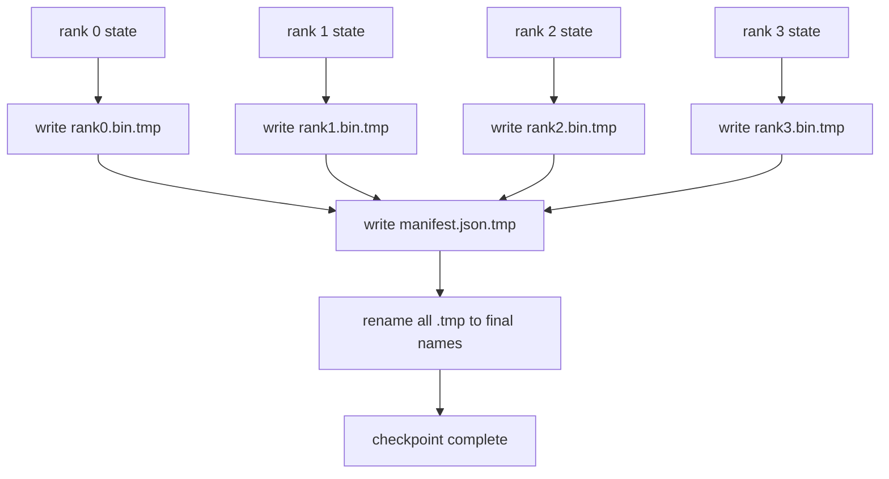

# Sharded Checkpoint and Atomic Resume

> Một công việc huấn luyện 70B tham số bị tạm dừng bởi một nút thất bại mỗi vài giờ. Định dạng checkpoint quyết định liệu bạn mất 30 phút hay 30 giờ. Một checkpoint chia shard ghi shard của mọi rank song song và ghi quyền sở hữu trong một bản kê khai. Tiếp tục nạp shard của mỗi rank từ file riêng, tái tạo trạng thái trên cùng kích thước thế giới, và bộ tối ưu thực hiện bước như thể không gì xảy ra. Ghi nguyên tử giữ một checkpoint hoàn tất nửa chừng khỏi đầu độc lần tiếp tục sau.

**Type:** Build
**Languages:** Python
**Prerequisites:** Phase 19 Track C lessons 42-49
**Time:** ~90 min

## Learning Objectives

- Lưu một checkpoint đa rank như một file shard theo rank cùng một bản kê khai ghi rank nào sở hữu gì.
- Dùng mẫu ghi nguyên tử (ghi vào một đường dẫn tạm rồi đổi tên) để một sự cố giữa lần ghi không bao giờ tạo một checkpoint hoàn tất nửa chừng.
- Tiếp tục từ bản kê khai, xác minh trạng thái bằng nhau từng byte cho cả các tham số fp16 và trạng thái bộ tối ưu ZeRO trên mọi rank.
- Bảo vệ lược đồ bản kê khai trước ba chế độ lỗi: thay đổi kích thước thế giới, số shard không khớp, và ghi một phần.

## The Problem

Một checkpoint thông thường đọc mọi tham số và trạng thái bộ tối ưu vào rank 0, gom, và ghi một file duy nhất. Với một mô hình 70B đó là 1.1 TB trạng thái qua cổng mạng của một rank. Việc ghi chặn mọi rank khác vì chúng nhàn rỗi đợi gom. Băng thông IO là liên kết mạng của một GPU chậm nhất, không phải tổng hợp. Trên một cụm thực bước gom-rồi-ghi có thể mất lâu hơn giờ huấn luyện trước, nghĩa là công việc cung cấp ít hơn một checkpoint mỗi ngày huấn luyện.

Các checkpoint chia shard đảo mẫu: mọi rank ghi shard riêng vào file riêng song song. Bản kê khai ghi rank nào đã sở hữu shard nào để tiếp tục có thể đặt mỗi shard trở lại nơi nó đến từ. Băng thông ghi tổng hợp tăng theo cụm. Một checkpoint 1 TB từng mất 4 giờ qua một rank mất 4 phút qua 64 rank. Cộng bản kê khai cho bạn một hợp đồng cho các lần tiếp tục không tương thích: thay đổi kích thước thế giới có thể phát hiện, ghi một phần có thể phát hiện, và đường nạp có thể thất bại rõ ràng thay vì âm thầm dùng dữ liệu cũ.

## The Concept



### Manifest schema

```json
{
  "world_size": 4,
  "step": 1234,
  "wall_clock_seconds": 4521,
  "shards": [
    {"rank": 0, "path": "rank0.bin", "sha256": "...", "param_shard_offset": 0, "param_shard_numel": 65536},
    {"rank": 1, "path": "rank1.bin", "sha256": "...", "param_shard_offset": 65536, "param_shard_numel": 65536}
  ],
  "schema_version": 1
}
```

Ba trường chịu tải. `world_size` khiến một lần tiếp tục trên một kích thước khác thất bại rõ ràng thay vì hỏng âm thầm. `sha256` theo shard bắt các lần ghi một phần hoặc hỏng. `param_shard_offset` và `param_shard_numel` theo shard để loader tái tạo tensor tham số phẳng tại vị trí đúng.

### Atomic write

Mẫu tiêu chuẩn: ghi mỗi shard vào `<name>.tmp`, ghi manifest vào `manifest.json.tmp`, fsync từng tệp, đổi tên các shard và đổi tên manifest cuối cùng. Một lần đổi tên POSIX trong cùng filesystem là nguyên tử: hoặc tệp mới hiện diện đầy đủ hoặc tệp cũ hiện diện. Một tập các lần đổi tên không phải một transaction, nên lần đổi tên manifest là điểm commit, và loader kiểm tra mỗi shard với các hash trong manifest. Ghi mỗi checkpoint vào thư mục bước riêng của nó; khi đó một sự cố trước lần đổi tên manifest để checkpoint trước là checkpoint đang hoạt động. Tái sử dụng một thư mục phá vỡ bảo đảm đó, vì các lần đổi tên shard thay thế các shard cũ trước khi manifest mới xuất hiện. Không có ghi nguyên tử, một sự cố có thể để lại một shard chưa đầy đủ với một manifest hiện diện trỏ đến nó, và việc tải làm hỏng trạng thái optimizer khi tiếp tục.

### Three failure modes the schema must defend against

| Thất bại | Triệu chứng | Phòng vệ |
|---------|---------|---------|
| Thay đổi kích thước thế giới | tiếp tục trên N=8 với bản kê khai từ N=4 | world_size không khớp trong bản kê khai, thất bại rõ ràng |
| Số shard không khớp | tiếp tục thấy ít file rank*.bin hơn shard trong bản kê khai | liệt kê các shard, xác minh từng shard tồn tại |
| Ghi một phần | file shard bị cắt ngắn giữa lần flush | xác minh sha256 khi nạp |

Mỗi phòng vệ từ chối lần nạp sai sớm; lựa chọn khác là hỏng âm thầm xuất hiện 100 bước sau khi mất mát thành NaN.

### Why per-rank files, not one big file

Ghi đồng thời vào một file qua `O_APPEND` hoạt động trên POSIX cho các lần ghi căn chỉnh byte, nhưng trong thực tế các độ lệch trong một shard trải các vùng cỡ MB và khóa chiếm ưu thế. Các file theo rank không có tranh chấp và hưởng lợi từ phân dải khi hệ thống file bên dưới song song (Lustre, GPFS). Các ngăn xếp sản xuất (DeepSpeed, FSDP, NeMo) đều dùng các file theo rank vì lý do đó.

```figure
ci-sharded-checkpoint
```

## Build It

`code/main.py` triển khai:

- Dataclass `ShardManifest` với lược đồ trên cùng `to_json`/`from_json`.
- `save_sharded(state_dict_per_rank, dir, step)` ghi trạng thái nhị phân của mọi rank vào file riêng bằng mẫu tạm-rồi-đổi-tên nguyên tử, rồi ghi bản kê khai.
- `load_sharded(dir, expected_world_size)` đọc bản kê khai, xác minh sha256 của mỗi shard, và trả về các state dict theo rank.
- Một kiểm thử khứ hồi: xây dựng trạng thái theo rank, lưu, nạp, khẳng định bằng nhau từng byte.

Chạy nó:

```bash
python3 code/main.py
```

Đầu ra: 4 file shard cùng bản kê khai được ghi, rồi được nạp lại với xác minh bằng nhau từng byte.

## Production patterns in the wild

Ba mẫu gia cố checkpoint đủ để cung cấp.

**Ghi bất đồng bộ.** Các ngăn xếp sản xuất phát lần ghi checkpoint trên một luồng hoặc tiến trình riêng để huấn luyện tiếp tục. Rào chắn ở checkpoint tiếp theo: không bắt đầu lần lưu tiếp theo cho đến khi lần trước hoàn tất. Cờ `async_io` của DeepSpeed làm chính xác điều này. Bài học giữ ghi đồng bộ để các bước hiển lộ.

**Đĩa nhanh cục bộ trước, rồi tải lên bất đồng bộ.** Ghi vào NVMe cục bộ (nhanh) rồi tải lên bất đồng bộ tới S3 hoặc GCS. Mẫu hai tầng giữ checkpoint trong cụm nhanh để tiếp tục trong khi gửi một bản sao bền vững ra ngoài cụm để lưu trữ. Bản kê khai mang đường dẫn cục bộ; một bản kê khai tải lên mang đường dẫn từ xa.

**Luân chuyển quan trọng.** Các lần chạy sản xuất giữ K checkpoint cuối (thường 3-5) và luân chuyển bản cũ nhất. Không luân chuyển đĩa đầy giữa lần chạy và checkpoint tiếp theo thất bại. Với luân chuyển lần lưu tiếp theo xóa bản cũ nhất trước, giải phóng ngân sách.

## Use It

Các mẫu sản xuất:

- **Checkpoint DeepSpeed.** `deepspeed.save_checkpoint(tag=step)` ghi các file theo rank và một file `latest` trỏ tới thẻ hoạt động.
- **Checkpoint PyTorch FSDP.** `torch.distributed.checkpoint` lưu trạng thái chia shard với một `Planner` quyết định bố cục theo rank.
- **NeMo.** Bọc DeepSpeed và FSDP bằng một API `save_to_checkpoint` thống nhất thêm siêu dữ liệu.

## Ship It

Bài 81 lưu một checkpoint chia shard của lần chạy DDP+ZeRO đầu cuối và nạp lại nó trên cùng kích thước thế giới để chứng minh hợp đồng tiếp tục đúng.

## Exercises

1. Thêm ghi bất đồng bộ: khởi động lần lưu trong một luồng và để huấn luyện tiếp tục. Chặn lần lưu tiếp theo cho đến khi lần trước hoàn tất.
2. Thêm một luân chuyển `last_5_steps`: giữ 5 checkpoint gần nhất, xóa bản cũ nhất trước khi lưu một bản mới.
3. Thêm một đường xác minh nhanh chỉ CRC cho nạp lại trong vòng lặp (luân chuyển đưa một checkpoint thành bản hoạt động mới mà không có sha256 đầy đủ).
4. Thêm một lần nạp chéo kích thước thế giới: cân bằng lại shard từ N=4 sang N=8 bằng đọc bản kê khai, nối, và chia shard lại.
5. Thêm một lần tải lên tới S3 giả (một thư mục thứ hai) và ghi bản kê khai tải lên. Bảo vệ chính sách lưu trữ hai tầng.

## Key Terms

| Thuật ngữ | Cách mọi người nói | Ý nghĩa thực sự |
|------|----------------|------------------------|
| Sharded checkpoint (Checkpoint chia shard) | "Lưu theo rank" | Mỗi rank ghi file shard riêng song song |
| Manifest (Bản kê khai) | "Chỉ mục" | File JSON ghi các đường dẫn shard, độ lệch, và sha256 |
| Atomic write (Ghi nguyên tử) | "tmp rồi đổi tên" | Ghi vào .tmp rồi đổi tên POSIX để một sự cố giữ file trước hoạt động |
| Partial write (Ghi một phần) | "Shard bị cắt ngắn" | Một sự cố trong khi ghi tạo một shard hỏng; sha256 bắt nó |
| Rotation (Luân chuyển) | "Giữ K cuối" | Xóa checkpoint cũ nhất trước khi ghi bản mới để giới hạn sử dụng đĩa |

## Further Reading

- [DeepSpeed checkpointing](https://deepspeed.readthedocs.io/en/latest/model-checkpointing.html)
- [PyTorch torch.distributed.checkpoint](https://pytorch.org/docs/stable/distributed.checkpoint.html)
- [POSIX rename atomicity](https://pubs.opengroup.org/onlinepubs/9699919799/functions/rename.html)
- Phase 19 Bài 78 - trạng thái ZeRO mà checkpoint này được định hình để lưu
- Phase 19 Bài 81 - demo đầu cuối khứ hồi trạng thái được lưu
