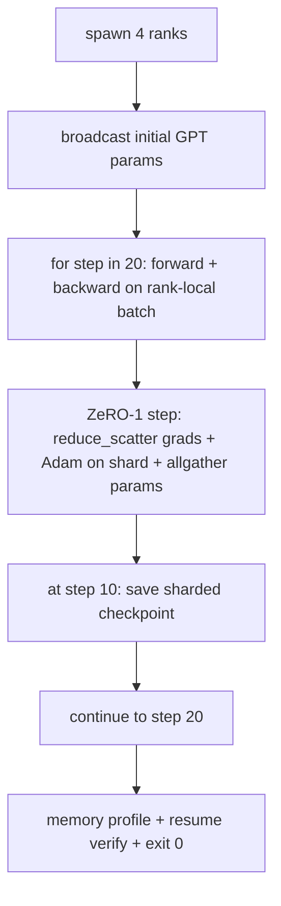

# End-to-End Distributed Training

> Các bài 76 đến 80 mỗi bài xây một phần. Đây là sự lắp ráp: một GPT tí hon được huấn luyện trên 4 rank mô phỏng với DDP cho đồng bộ gradient, ZeRO-1 cho chia shard trạng thái bộ tối ưu, và một checkpoint chia shard tại mốc giữa chừng. Demo chạy 20 bước, tự kết thúc, in một đường cong mất mát cùng một hồ sơ bộ nhớ, và ghi một checkpoint có thể tiếp tục.

**Type:** Build
**Languages:** Python
**Prerequisites:** Phase 19 Track C lessons 42-49
**Time:** ~90 min

## Learning Objectives

- Kết hợp DDP (bài 77) cộng ZeRO-1 (bài 78) cộng các checkpoint chia shard (bài 80) thành một vòng lặp huấn luyện.
- Huấn luyện một mô hình ngôn ngữ transformer 2 lớp trên một corpus tổng hợp nhỏ trong 20 bước trên 4 rank mô phỏng.
- In một bảng mất mát theo bước, một hồ sơ bộ nhớ theo rank, và một bản kê khai checkpoint tiếp tục bằng nhau từng byte trên cùng kích thước thế giới.
- Bảo vệ sự kết hợp: mỗi phần có thể kiểm thử độc lập trong các bài trước và bài này chứng minh chúng kết hợp.

## The Problem

Một bài tổng kết là chứng minh các phần vừa với nhau. Bài 76 triển khai các phép tập thể. Bài 77 bọc chúng thành DDP. Bài 78 chia shard trạng thái bộ tối ưu bằng reduce_scatter. Bài 79 phân tích pipeline. Bài 80 lưu một checkpoint chia shard. Mỗi bài đứng độc lập với kiểm thử riêng. Một lần chạy huấn luyện thực dùng mọi thành phần cơ sở cùng lúc; nếu sự kết hợp sai, mất mát phân kỳ, checkpoint từ chối tiếp tục, hoặc bộ nhớ theo rank tăng khi nó nên co.

Bài này chạy demo đầu cuối và xác minh bốn bất biến: (a) mất mát giảm đơn điệu qua 20 bước trong nhiễu float, (b) mọi rank giữ cùng chuẩn tham số ở mọi bước, (c) bộ nhớ bộ tối ưu theo rank bằng công thức ZeRO-1 12P/N byte, và (d) checkpoint tại bước 10 nạp lại bằng nhau từng byte khi khởi động lại. Demo tự kết thúc: 20 bước, một lệnh, thoát 0.

## The Concept



### The mini GPT

Mô hình nhỏ có chủ ý: 2 khối transformer, chiều embedding 32, 4 đầu attention, từ vựng 64, độ dài chuỗi 16, lô 4. Vài nghìn tham số. Đủ lớn để thực thi mọi quyết định nối (attention đa đầu chạy đường được che tiêu chuẩn; LayerNorm có các trọng số để đồng bộ; đầu LM là một phép chiếu tuyến tính riêng trở lại từ vựng). Đủ nhỏ để 20 bước trên 4 rank CPU hoàn tất trong vài giây.

### The composition rules

| Phần bài học | Nó sở hữu gì | Nó để lại gì cho vòng lặp |
|--------------|--------------|----------------------------|
| Broadcast DDP | Đồng bộ tham số ban đầu | Một lệnh gọi khi khởi tạo |
| Bước ZeRO-1 | Đồng bộ gradient, cập nhật bản sao chính, phát quảng bá tham số | Một lệnh gọi mỗi bước thay optimiser.step |
| Checkpoint chia shard | Lưu bền vững trạng thái theo rank, bản kê khai với sha256 | Được gọi trên rank 0 với trạng thái được thu qua allgather |
| Vòng lặp huấn luyện | Lượt tiến, lượt ngược, ghi nhật ký mất mát | Gọi ba thứ trên theo thứ tự |

Vòng lặp không biết về reduce_scatter hoặc các file điểm hẹn. Các module ZeRO và checkpoint cung cấp các giao diện hẹp mà vòng lặp kết hợp.

### Why a tiny GPT and not just an MLP

MLP từ bài 77 đủ để xác minh đồng bộ gradient. Một GPT tí hon thêm ba thứ: một đầu LM riêng trên từ vựng (trong bài này, không buộc để rõ ràng; GPT đầy đủ thường buộc đầu với embedding token), softmax+entropy chéo làm mất mát (nhiều trường hợp biên số học hơn MSE), và một lượt tiến bất đối xứng (embedding rồi attention rồi MLP mỗi lớp). Bám một MLP cho bài tổng kết sẽ che liệu sự kết hợp xử lý LayerNorm hoặc hình dạng gradient của lớp embedding chính xác không.

### Self-terminating means exit 0

Vòng lặp chạy cố định 20 bước và thoát. Không `while True`, không can thiệp con người, không tiếp tục từ trạng thái bên ngoài. Một bài tổng kết bạn có thể để chạy không giám sát và tìm một nhật ký đầy đủ khi nó hoàn tất là một bài tổng kết chứng minh hệ thống được nối đúng. Nếu bất kỳ phần nào deadlock demo không bao giờ trả về và bộ kiểm thử bắt nó.

```figure
ci-distributed-assembly
```

## Build It

`code/main.py` triển khai:

- `MiniGPT`: transformer 2 lớp với self-attention được che và một đầu LM riêng.
- `make_corpus(seed, total_tokens)`: dữ liệu dự đoán token tiếp theo tất định.
- `_train_worker`: được tạo theo rank; phát quảng bá tham số khởi tạo, chạy vòng lặp, gọi bước ZeRO, ghi checkpoint chia shard tại bước 10.
- `verify_resume`: sau lần chạy chính, nạp lại checkpoint bước 10 trong tiến trình và khẳng định các shard chính được lưu khớp bản chụp trong bộ nhớ từng byte.
- `main`: điều phối toàn demo, in bảng mất mát, hồ sơ bộ nhớ, và kết quả xác minh.

Chạy nó:

```bash
python3 code/main.py
```

Đầu ra: một bảng mất mát 20 hàng, một hồ sơ bộ nhớ theo rank 4 hàng, một bản kê khai checkpoint, và một dòng "ĐÃ XÁC MINH TIẾP TỤC" khi thành công.

## Production patterns in the wild

Ba mẫu hoàn tất sự kết hợp cho các lần chạy thực.

**Checkpoint mỗi K phút, không phải mỗi K bước.** Thời gian bước thay đổi theo độ dài chuỗi và số lô vi mô. Một nhịp checkpoint 10 phút bắt cùng lượng tính toán bất kể kích thước mô hình. Bài học dùng dựa trên bước cho đơn giản; sản xuất dùng dựa trên thời gian thực.

**Phát hiện phân kỳ sớm.** Các lần chạy sản xuất thêm một chốt bảo vệ NaN sau lượt ngược và một bộ phát hiện đỉnh mất mát; nếu mất mát nhảy hơn 2x trong một bước, quay lại checkpoint trước thay vì để bộ tối ưu tiến vào một trạng thái suy biến. Đường cong mất mát của bài học mượt nên chốt bảo vệ không được dùng nhưng hook giữ lại.

**Tổng hợp hồ sơ bộ nhớ trên các rank.** Bộ nhớ theo rank khác nhau theo rank trong các lần chạy thực (rank có giai đoạn pipeline lớn nhất giữ nhiều kích hoạt hơn). Sản xuất ghi nhật ký giá trị tối đa trên các rank cùng trung bình; bài học in theo rank để cho thấy công thức khớp.

## Use It

Các mẫu sản xuất:

- **DeepSpeed.** Kết hợp DDP + ZeRO + pipeline + checkpoint kích hoạt dưới một cấu hình. Sự kết hợp của bài học là hình thức DeepSpeed thu nhỏ.
- **PyTorch FSDP.** Tương đương bản địa. `FullyShardedDataParallel` với `ShardingStrategy.SHARD_GRAD_OP` là ZeRO-2.
- **NeMo và Megatron-LM.** Thêm song song tensor cho các mô hình lớn nhất; nếu không sự kết hợp có cùng hình thức.

## Ship It

Toàn track kết thúc ở đây. 6 bài cùng nhau là hệ thống con huấn luyện phân tán một nhóm thực sẽ xây trước khi áp dụng DeepSpeed; trừu tượng đã được chứng minh với gloo và các chế độ lỗi đã được thực thi. Phase 17 (hạ tầng và sản xuất) là nơi đưa điều này tới một cụm thực.

## Exercises

1. Thêm một phép chia song song tensor của đầu attention và xác minh mất mát khớp đường cơ sở một rank. Hai rank: nửa số đầu mỗi rank, allreduce đầu ra attention.
2. Thêm tích lũy gradient trên 4 lô vi mô và chứng minh gradient bằng gradient của một lô lớn.
3. Thêm một đường tiếp tục-từ-bước-10 thực sự tiếp tục huấn luyện đến bước 20 và tạo cùng mất mát cuối như lần chạy gốc.
4. Thêm một bộ xuất chỉ số (mất mát, chuẩn gradient, thời gian bước) vào JSONL để lần chạy có thể được trực quan hóa sau đó.
5. Thêm một chốt bảo vệ NaN quay lại checkpoint trước khi mất mát tăng vọt, và buộc một đỉnh bằng một hệ số nhân LR một bước để thực thi khôi phục.

## Key Terms

| Thuật ngữ | Cách mọi người nói | Ý nghĩa thực sự |
|------|----------------|------------------------|
| End-to-end (Đầu cuối) | "Nối tất cả" | Một lần chạy kết hợp mọi phần, không phải một kiểm thử đơn vị mỗi phần |
| Memory profile (Hồ sơ bộ nhớ) | "GB mỗi rank" | Các byte được giữ trên mỗi rank cho tham số, gradient, trạng thái bộ tối ưu |
| Resume contract (Hợp đồng tiếp tục) | "Lưu và nạp" | Trạng thái theo rank bằng nhau từng byte sau một lần khứ hồi checkpoint |
| Self-terminating (Tự kết thúc) | "Lần chạy có giới hạn" | Số bước cố định, thoát 0 khi hoàn tất, không con người trong vòng lặp |

## Further Reading

- [DeepSpeed end-to-end training tutorial](https://www.deepspeed.ai/getting-started/)
- [PyTorch FSDP advanced tutorial](https://pytorch.org/tutorials/intermediate/FSDP_advanced_tutorial.html)
- [Megatron-LM training script reference](https://github.com/NVIDIA/Megatron-LM)
- Phase 19 Các bài 76-80 - mỗi phần mà bài này kết hợp
- Phase 17 - đưa sự kết hợp tới một cụm thực
