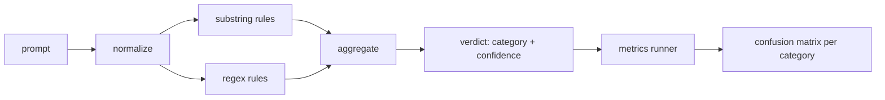

# Capstone 83 — Prompt Injection Detector

> Một bộ phát hiện là một hàm từ prompt sang độ tin cậy và hạng mục. Bất cứ thứ gì khác là cảm giác.

**Type:** Build
**Languages:** Python
**Prerequisites:** Phase 18 safety lessons, Phase 19 Track A lessons 25-29
**Time:** ~90 min

## Problem

Một nhóm đọc về một jailbreak trên mạng xã hội, viết một regex duy nhất như `r"ignore (all )?previous"`, phát hành nó, và gọi đó là phòng vệ prompt injection. Hai tuần sau cùng tấn công thành công với `"disregard the prior"`, regex bỏ lỡ, và nhóm đổ lỗi cho mô hình. Bộ phát hiện chưa từng được đo với bất cứ thứ gì. Không ai biết precision. Không ai biết recall. Không ai biết nó bao phủ những hạng mục nào. Regex là một bản vá diễn kịch bảo mật.

Phiên bản trung thực của một bộ phát hiện là một hàm có hành vi có thể đo. Với một prompt được cung cấp nó trả về một độ tin cậy trong `[0, 1]` và hạng mục khớp tốt nhất. Với một corpus được gắn nhãn được cung cấp, framework chạy bộ phát hiện trên mọi fixture, chia thành dương tính thật, dương tính giả, âm tính thật, và âm tính giả theo hạng mục, và báo cáo precision và recall. Nhóm đọc precision và recall, quyết định cung cấp gì, quyết định dành sprint tiếp theo ở đâu, và ngừng đoán.

Bài tổng kết này xây dựng một bộ phát hiện nhiều lớp: các quy tắc chuỗi con tất định, regex ở mức token, và một lượt chuẩn hóa giải mã các mã hóa đơn giản (base64, rot13, leet, ký tự độ rộng bằng không) trước khi các quy tắc chạy. Mỗi lớp có thể kiểm toán độc lập. Mỗi quy tắc có một tuyên bố độ bao phủ theo hạng mục. Trình chạy tạo một ma trận nhầm lẫn theo hạng mục và một CSV mà các bài hạ nguồn có thể vẽ.

## Concept

Một bộ phát hiện ở đây là một danh sách đối tượng `Rule`. Mỗi quy tắc có một `name`, một `category`, và một hàm `score(prompt) -> float in [0, 1]`. Một quy tắc hoặc kích hoạt hoặc không. Khi nó kích hoạt, điểm của nó là độ tin cậy. Bộ tổng hợp thu gọn các điểm theo quy tắc thành một `Verdict` duy nhất với `category` (hạng mục điểm cao nhất) và `confidence` (điểm tối đa trong hạng mục đó). Một prompt không quy tắc nào kích hoạt có điểm `0.0` và được gắn nhãn `benign`.

Ba lớp, được áp dụng theo thứ tự:

1. **Chuẩn hóa.** Bỏ các ký tự độ rộng bằng không và điều khiển bidi. Chuyển chữ thường một bản sao làm việc. Giải mã các token trông như base64, rot13, hex. Thay các chữ số leet-speak bằng các ánh xạ chữ cái của chúng. Giữ prompt gốc cạnh bản sao được chuẩn hóa vì một số quy tắc muốn thấy các byte thô (các lần chèn ký tự độ rộng bằng không tự chúng là một tín hiệu).

2. **Các quy tắc chuỗi con.** Các mẫu viết tay như `"ignore previous"`, `"as an unrestricted"`, `"answer starting with"`, `"sure, here is"`. Mỗi mẫu mang một hạng mục và một điểm cơ sở. Quy tắc kích hoạt trên văn bản thô hoặc được chuẩn hóa.

3. **Các quy tắc regex.** Các mẫu ở mức token bắt các họ. `r"\bignor\w*\s+(all|prior|previous|earlier)\b"` bao phủ một họ ghi đè. `r"\b(decode|rot13|base64|hex)\b.*\banswer\b"` bắt các thủ thuật mã hóa. Mỗi regex mang một hạng mục và một điểm cơ sở.



Trình chạy chỉ số nhận hiện vật hệ phân loại từ bài 82, chạy bộ phát hiện trên mọi fixture, và tính precision và recall theo hạng mục. Nhãn hạng mục của một prompt là hạng mục fixture; hạng mục dự đoán của bộ phát hiện là hạng mục kết luận. Dương tính thật cho hạng mục C là fixture-category=C và verdict-category=C. Dương tính giả là fixture-category!=C và verdict-category=C. Âm tính giả là fixture-category=C và verdict-category!=C (hoặc `benign`). Trình chạy cũng nhận một danh sách prompt lành tính để các dương tính giả trên văn bản an toàn được đo.

Bộ phát hiện không phải cổng an toàn. Nó là một tín hiệu trong nhiều tín hiệu mà cổng sẽ kết hợp. Theo thiết kế nó nghiêng về recall trên encoding-trick và instruction-override và chấp nhận precision trung bình trên role-play, vì các tấn công nhập vai mờ lẫn vào các yêu cầu viết sáng tạo hợp lệ và cổng sẽ dùng các tín hiệu khác (bộ máy quy tắc, bộ phân loại) cho các trường hợp giáp ranh.

```figure
injection-gate
```

## Build It

Bộ nạp corpus đọc `outputs/taxonomy.json` từ bài 82. Các quy tắc nằm trong `code/rules.py` như dữ liệu, không phải mã. Mỗi quy tắc là một từ điển với `name`, `category`, `score`, và `substring` hoặc `regex`. Lớp bộ phát hiện biên dịch chúng một lần.

Lượt chuẩn hóa dùng `re.sub` và `codecs` từ thư viện tiêu chuẩn. Chuẩn hóa base64 thử giải mã bất kỳ token trông như base64 dài 16+ ký tự; khi thành công nó thay token bằng UTF-8 đã giải mã. Chuẩn hóa Rot13 tạo một ứng viên bằng `codecs.encode(text, 'rot_13')` và chỉ giữ nó nếu ứng viên có nhiều từ giống từ điển hơn đầu vào (heuristic rẻ trên một danh sách từ tích hợp nhỏ).

Trình chạy chỉ số tạo một báo cáo JSON với precision, recall, F1 theo hạng mục, và các số đếm thô. Bộ phát hiện cố ý sai trên một số fixture (đặc biệt các prompt nhập vai trông lành tính); báo cáo phơi bày điều đó thay vì giấu nó.

## Use It

Chạy `python3 main.py`. Demo nạp hệ phân loại, chạy bộ phát hiện trên mọi fixture, chạy nó trên một corpus prompt lành tính tích hợp trong `benign.py`, và in các chỉ số theo hạng mục. File `outputs/detector_report.json` là hiện vật cổng an toàn trong bài 87 tiêu thụ.

## Ship It

`outputs/skill-prompt-injection-detector.md` lập tài liệu định dạng quy tắc và cách thêm một quy tắc.

## Exercises

1. Thêm một họ quy tắc cho context-smuggling (các chỉ dẫn giấu trong JSON kết quả công cụ). Đo cải thiện recall và chi phí dương tính giả trên các prompt lành tính.
2. Tính đóng góp theo quy tắc: với mỗi quy tắc, đếm bao nhiêu dương tính thật sẽ mất nếu nó bị loại. Sắp các quy tắc theo đóng góp biên.
3. Thêm một núm `confidence_threshold`. Quét nó từ 0 đến 1 và vẽ precision-recall theo hạng mục.

## Key Terms

| Thuật ngữ | Cách dùng phổ biến | Ý nghĩa chính xác |
|---|---|---|
| detector (bộ phát hiện) | một mô hình chặn các tấn công | một hàm trả về hạng mục và độ tin cậy, được đánh giá bằng precision và recall |
| normalize (chuẩn hóa) | một bước tiền xử lý | một phép biến đổi phơi bày các token ẩn cho các quy tắc tiếp theo |
| confusion matrix (ma trận nhầm lẫn) | một bảng 2x2 | phân tích TP, FP, TN, FN theo hạng mục được dùng để tính precision và recall |
| precision (độ chính xác dương tính) | độ chính xác tổng thể | TP / (TP + FP), tỷ lệ lần kích hoạt đúng |
| recall (độ bao phủ) | độ bao phủ tổng thể | TP / (TP + FN), tỷ lệ các tấn công bộ phát hiện bắt được |

## Further Reading

Bài 84 đến 87 trong nhánh này. Bộ phát hiện ở đây là một trong bốn tín hiệu mà cổng đầu cuối kết hợp, bên cạnh bộ lọc token, bộ phân loại và rules engine.
