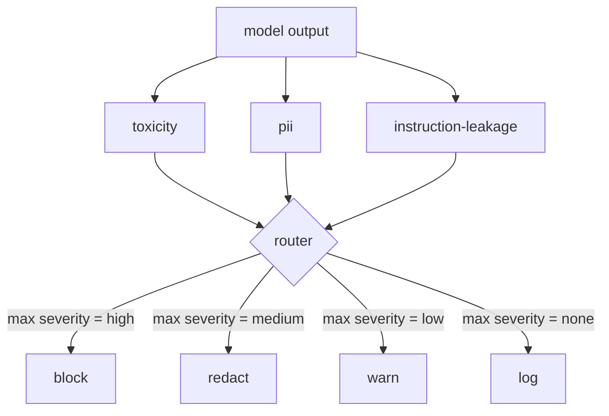

# Capstone 85 — Content Classifier Integration

> Các bộ phân loại ở phía đầu ra trả lời một câu hỏi khác các quy tắc ở phía đầu vào. Cả hai cần một bộ định tuyến chính sách.

**Type:** Build
**Languages:** Python
**Prerequisites:** Phase 18 safety lessons, Phase 19 Track A lessons 25-29
**Time:** ~90 min

## Problem

Đầu vào không phải bề mặt tấn công duy nhất. Một mô hình đã qua mọi kiểm tra đầu vào vẫn có thể tạo một đầu ra rò rỉ PII, lặp các lời miệt thị từ phân phối huấn luyện, hoặc vọng lại prompt hệ thống cho người dùng để đáp một câu hỏi thông minh. Một bộ phân loại phía đầu ra thấy phản hồi thực của mô hình, không phải prompt người dùng, và hỏi một câu khác: bất kể prompt này đến đây thế nào, thứ chúng ta sắp cung cấp cho người dùng có chấp nhận được không.

Các nhóm thường bỏ phân loại đầu ra vì phân loại đầu vào có vẻ đủ và vì các bộ phân loại đầu ra đưa vào độ trễ bổ sung. Cả hai lập luận đều thua. Bỏ phân loại đầu ra cho kẻ tấn công một cách vượt qua một lượt: bất kỳ họ tấn công mới nào pipeline đầu vào không bao phủ sẽ đến người dùng. Độ trễ có thực nhưng giải quyết được: các bộ phân loại có thể chạy song song với truyền luồng token, với cổng đệm đoạn cuối và áp dụng kết luận bộ phân loại trước khi flush.

Bài tổng kết này nối ba bộ phân loại phía đầu ra độc lập sau một bộ định tuyến chính sách duy nhất. Tính độc hại (phát hiện lời miệt thị và quấy rối dựa trên quy tắc). PII (regex cho email, số điện thoại, chuỗi dạng SSN, chuỗi dạng thẻ tín dụng, địa chỉ IP). Rò rỉ chỉ dẫn (một heuristic cho vọng lại prompt hệ thống, so sánh đầu ra với một prompt hệ thống đã biết bằng chồng lấn trigram). Bộ định tuyến thu thập các kết luận bộ phân loại, chọn một mức nghiêm trọng, và áp dụng một chính sách hành động: `block`, `redact`, `warn`, hoặc `log`.

## Concept

Mỗi bộ phân loại là một đối tượng có thể gọi trả về một `ClassifierVerdict` với `name`, `score in [0,1]`, `severity` (`none`, `low`, `medium`, `high`), và `findings` (một danh sách chuỗi mô tả thứ nó gắn cờ). Bộ định tuyến nhận một danh sách kết luận và áp dụng một bảng quy tắc:

| Mức độ nghiêm trọng | Hành động |
|---|---|
| high | block (bỏ đầu ra, trả về từ chối chính sách) |
| medium | redact (áp dụng bộ che theo bộ phân loại lên đầu ra) |
| low | warn (ghi nhật ký và thêm một thông báo nhẹ vào phản hồi) |
| none | log (ghi kết luận trong trace, cung cấp nguyên trạng) |



Bộ định tuyến lấy mức nghiêm trọng tối đa trên các bộ phân loại và áp dụng hành động tương ứng. Block thắng. Một redact + warn trở thành redact. Một log + warn trở thành warn. Bộ định tuyến phát ra một đối tượng `Action` với `verb`, `output`, `severity`, `verdicts`, và `metadata`. Ở hạ nguồn, cổng an toàn trong bài 87 ghi siêu dữ liệu vào một trace và hoặc cung cấp đầu ra đã che, cung cấp bản gốc với một cảnh báo, hoặc thay đầu ra bằng một từ chối chính sách.

Mỗi bộ phân loại có bộ che riêng. Bộ phân loại PII thay `name@example.com` bằng `[redacted-email]` và các chữ số dạng thẻ tín dụng bằng `[redacted-card]`. Bộ phân loại rò rỉ chỉ dẫn loại các dòng trông như header prompt hệ thống. Bộ phân loại độc hại thay các lời miệt thị khớp bằng `[redacted-language]`. Che độc lập để một đầu ra độc hại-và-PII chảy qua cả hai bộ che.

Bộ phân loại độc hại cố ý dựa trên quy tắc: một danh sách từ khóa quấy rối được tuyển chọn với so khớp giới hạn bằng khoảng trắng và một kiểm tra cửa sổ phủ định nhỏ để "bạn không phải một lời miệt thị" không kích hoạt quy tắc. Danh sách cố ý ngắn (bài học về hệ thống nối, không phải xây từ vựng). Bộ phân loại PII dùng các regex tiêu chuẩn cho các hình thức phổ biến. Bộ phân loại rò rỉ chỉ dẫn nhận một tham số `system_prompt` khi khởi tạo và so sánh chồng lấn trigram với đầu ra; một mức chồng lấn cao là tín hiệu rò rỉ.

```figure
cd-output-router
```

## Build It

`code/classifiers.py` định nghĩa cả ba bộ phân loại. Mỗi bộ có một phương thức `classify(text) -> ClassifierVerdict` và một phương thức `redact(text) -> str`. `code/main.py` định nghĩa lớp `Router` với `decide(text, verdicts) -> Action` và một lối tắt `run(text) -> Action`. Demo nối ba bộ phân loại sau một bộ định tuyến và chạy một corpus nhỏ các đầu ra được tạo để thực thi từng mức nghiêm trọng.

## Use It

Chạy `python3 main.py`. Demo in động từ hành động cho mỗi đầu ra kiểm thử, ghi `outputs/classifier_report.json`, và xác nhận block, redact, warn, và log mỗi hành động kích hoạt trên ít nhất một fixture. Độ trễ bằng không nhân tạo vì mọi bộ phân loại dựa trên quy tắc; với một mô hình thực có các bộ phân loại neural, cùng hệ thống nối áp dụng sau khi độ trễ theo bộ phân loại tăng.

## Ship It

`outputs/skill-content-classifier-integration.md` lập tài liệu các cấu trúc kết luận và hành động để cổng trong bài 87 có thể tiêu thụ chúng.

## Exercises

1. Thêm một bộ phân loại thứ tư cho chèn mã (đầu ra chứa `<script>`, `eval(`, v.v.). Quyết định chính sách mức nghiêm trọng của nó và tích hợp.
2. Làm bộ định tuyến áp dụng một trọng số mức nghiêm trọng theo bộ phân loại để PII được tính nhiều hơn tính độc hại. Minh họa thay đổi trên cùng các fixture.
3. Thêm một ngưỡng độ tin cậy để các kết luận điểm thấp hạ một mức nghiêm trọng. Quét ngưỡng và báo cáo tỷ lệ chặn thay đổi thế nào.

## Key Terms

| Thuật ngữ | Cách dùng phổ biến | Ý nghĩa chính xác |
|---|---|---|
| output classifier (bộ phân loại đầu ra) | một mô hình phát hiện các đầu ra xấu | một đối tượng có thể gọi trả về một kết luận có cấu trúc với mức độ nghiêm trọng, điểm, và các phát hiện, cùng một bộ che |
| severity (mức độ nghiêm trọng) | nó tệ thế nào | một trong none, low, medium, high |
| router (bộ định tuyến) | một công tắc | một hàm từ danh sách kết luận sang hành động (block, redact, warn, log) |
| redact (che) | giấu các phần xấu | thay thế theo bộ phân loại các khoảng khớp bằng một thẻ như [redacted-pii] |
| instruction leakage (rò rỉ chỉ dẫn) | mô hình rò prompt hệ thống | một heuristic so sánh đầu ra mô hình với một prompt hệ thống đã biết bằng chồng lấn trigram |

## Further Reading

Bài 86 thêm một bộ máy quy tắc khai báo cho các ràng buộc không tự nhiên có hình thức bộ phân loại. Bài 87 kết hợp cả hai với bộ phát hiện phía đầu vào.
